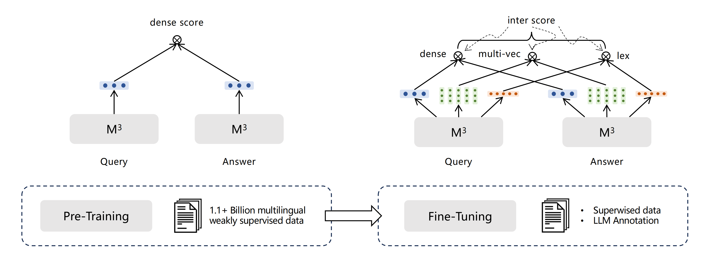
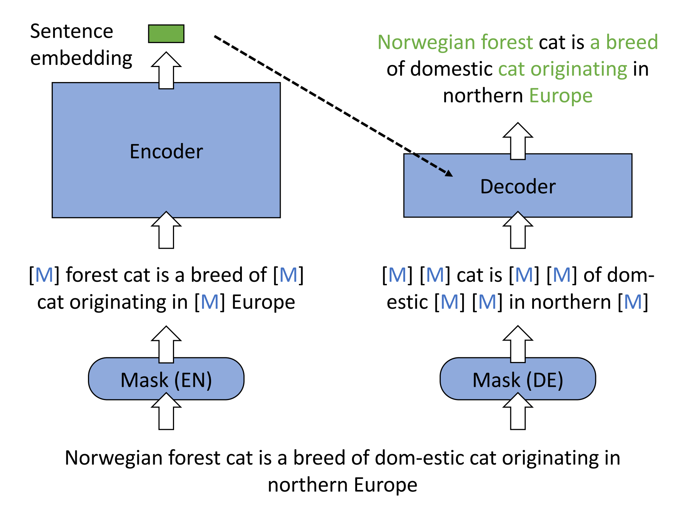
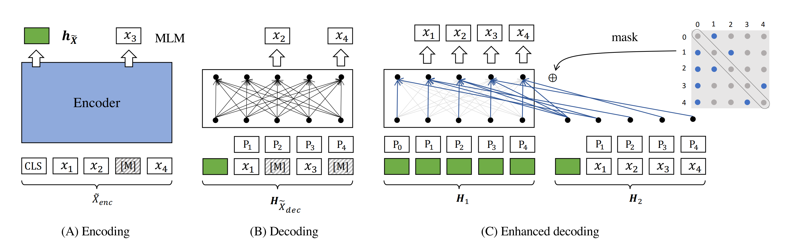

# BGE-M3

## BGE-M3 原理：统一多种检索模式的强大架构

BGE-M3 的核心设计思想在于通过一个统一的模型，同时支持三种主流的检索范式：**密集检索（Dense Retrieval）**、**稀疏检索（Sparse Retrieval）**和**多向量检索（Multi-Vector Retrieval）**。这使其在实际应用中，能够通过混合检索（Hybrid Retrieval）策略，博采众长，实现更优的检索效果。

BGE-M3 的基础架构是 XLM-RoBERTa，这是一个跨语言的 RoBERTa 模型。选择 XLM-R 作为基础，为 BGE-M3 带来了强大的多语言理解能力，使其能够处理超过 100 种语言的文本。

- **密集检索 (Dense Retrieval):** 与大多数嵌入模型类似，BGE-M3 使用模型输出中 `[CLS]` 特殊标记（token）的隐藏状态（hidden state），经过归一化处理后，作为整个文本的单一、密集的向量表示。该向量蕴含了文本的整体语义信息。
  
$$
e_{dense} = normalize(H_{[CLS]})
$$

其中，$H_{[CLS]}$ 是 `[CLS]` 标记对应的输出向量。两个文本的相似度可以通过计算其密集嵌入的余弦相似度或点积来得到。

- **稀疏检索 (Sparse Retrieval):** 为了捕捉词汇级别的匹配信息（类似于传统的 BM25 算法），BGE-M3 为每个词元（token）生成一个权重，形成一个高维但大部分值为零的稀疏向量。这是通过在 XLM-R 的每个词元输出后接一个**线性层（Linear Layer）**和** ReLU 激活函数**来实现的。

$$
w_t = ReLU(W_{lex} \cdot H_t)
$$

其中，$H_t$ 是第 $t$ 个词元的输出向量，$W_{lex}$ 是可学习的线性层权重。$w_t$ 代表了该词元的重要性。两个文本的稀疏检索得分，通常通过计算共同词元的权重乘积之和来得到。

- **多向量检索 (Multi-Vector Retrieval):** 该模式借鉴了 ColBERT 模型的思想，不将整个文本压缩为单一向量，而是保留所有词元的输出向量序列。在进行相似度计算时，它采用“后期交互（Late Interaction）”的方式，逐个计算一个文本中所有词元向量与另一个文本中所有词元向量的最大相似度，然后将这些最大相似度值求和或求平均。这种方式能捕捉到更细粒度的词汇交互信息。

$$
s_{mul} = \frac{1}{N} \sum_{i=1}^{N} \max_{j=1}^{M} (E_{q_i} \cdot E_{p_j}^\top)
$$

其中，$E_q$ 和 $E_p$ 分别是查询和文档的所有词元嵌入序列。

BGE-M3 支持最长达 8192 个词元的输入，远超许多早期模型（如 512 个词元）的限制。这使得它能够有效处理从短句、段落到长篇文档等不同粒度的文本输入，在处理长文档的问答和摘要等任务时具有显著优势。

### BGE-M3  训练方法



1. 首先，使用弱监督数据对文本编码器进行预训练，其中只有密集检索是以对比学习的基本形式进行训练的
2. 其次，第二阶段进行自我知识蒸馏，在此阶段对嵌入模型进行微调，以建立三种检索功能。在这一阶段中，将使用标注数据和合成数据，并根据 ANCE 方法为每个查询引入硬负样本

多阶段训练策略和创新的自知识蒸馏方法。

#### 三阶段训练过程

1.  **RetroMAE 预训练：** 第一阶段采用 RetroMAE（Masked Auto-Encoder for Pre-training）方法对模型进行预训练。这一阶段在大规模的多语言语料库（如 Wikipedia、S2ORC 等）上进行，旨在让模型学习到通用的、与表示任务相关的文本理解能力，并为支持 8192 的长文本输入打下基础。
2.  **无监督对比学习：** 第二阶段利用海量的文本对数据（约 1.2 亿对，覆盖 194 种语言）进行大规模的对比学习。这些文本对来自于网页标题-正文、问题-答案、指令-输出等多种形式。此阶段的目标是让模型学习区分语义相似和不相似的文本。其核心损失函数是 InfoNCE（Noise Contrastive Estimation），通过拉近正样本对（如一个问题和其对应的答案）的嵌入距离，同时推远负样本对的距离来优化模型。
3.  **多检索方式统一优化：** 这是最关键的阶段。在高质量、多样化的有监督数据集（如 MS MARCO、DuReader 等）上，对模型的三种检索功能进行联合优化。

#### RetroMAE



- 一个类似于 BERT 的编码器，用于生成句向量：Mask(EN) 掉一小部分 token，然后通过 BERT 编码得到句子嵌入
- 一个一层 Transformer 的解码器，用于重建句子：Mask(DE) 很大一部分 token，然后结合句子嵌入 sentence embedding，让解码器重构原始句子



#### 增强解码Enhanced Decoding

前面提及的解码策略有一种缺陷，就是训练信号只来源于被 mask 掉的 token，而且每个 mask 掉的 token 都是基于同一个上下文重建的。

提出增强解码：

H1 中的每个 token embedding 去 H2 中查找比较重要的上下文：包括 **H2 被采样到的 token，以及初始 token embedding**都能看到（这里的初始 embedding 就是 sentence embedding），至于对角线上的因代表的各自自身，故看不到。

#### 自知识蒸馏（Self-Knowledge Distillation）

为了让三种异构的检索功能（密集、稀疏、多向量）能够协同工作、相互促进，BGE-M3 提出了一种新颖的**自知识蒸馏**机制。

其核心思想是，将三种检索模式计算出的相关性得分进行融合（例如加权求和），形成一个更强大、更鲁棒的“教师信号”。然后，用这个集成的教师信号来指导模型自身的学习过程。这类似于集成学习，利用不同模型的“视角”来纠正和增强单一模型的判断力，从而显著提升了每种检索模式的独立性能。

最终的损失函数不仅包含传统的对比学习损失（InfoNCE），还包含了基于教师信号的蒸馏损失。

### 微调方法：适配特定任务的优化路径

虽然预训练的 BGE-M3 已经非常强大，但在特定领域或任务上进行微调（Fine-tuning）可以进一步提升其性能。BGE-M3 的微调主要分为两种路径：

#### 密集检索微调（Dense Fine-tuning）

- **数据准备：** 准备成对的（query, positive_passage）或三元组（query, positive_passage, negative_passage）格式的数据。对于特定任务，例如 FAQ 问答，query 可以是用户问题，positive_passage 是标准答案。
- **训练过程：** 使用对比学习的目标，让模型学习将 query 和 positive_passage 的 `[CLS]` 嵌入拉近，将 query 和 negative_passage 的 `[CLS]` 嵌入推远。`FlagEmbedding` 库为这种微调提供了便捷的工具和脚本。
- **适用场景：** 适用于大多数语义搜索、文本聚类、RAG 中的文档召回等任务。

#### 统一微调（Unified Fine-tuning）

- **数据准备：** 数据格式与密集微调类似。
- **训练过程：** 在微调过程中，不仅优化 `[CLS]` 嵌入（用于密集检索），同时也会更新用于生成稀疏权重的线性层和所有词元的嵌入（用于多向量检索）。这意味着模型的**所有参数**（编码器和额外的线性层）都会被更新，以同时提升三种检索模式的性能。
- **适用场景：** 追求极致检索效果的场景，希望通过混合检索来最大化召回率和精确率。

## BEG-m3 混合检索

- **密集检索（Dense retrieval）**：输入查询 $q$ 被转换为基于文本编码器的隐藏状态 $H_q$，使用特殊标记 `[CLS]` 的归一化隐藏状态来表示查询：$e_q = \text{norm}(H_q[0])$。类似地，我们可以获取段落 $p$ 的嵌入表示为 $e_p = \text{norm}(H_p[0])$。查询和段落之间的相关性得分通过两个嵌入向量 $e_p$ 和 $e_q$ 的内积来度量：$s_{\text{dense}} \leftarrow \langle e_p, e_q \rangle$
- **词汇检索（Lexical Retrieval）**：输出 embedding 还被用来估计每个词项的重要性，以促进词汇检索。对于查询中的每个词项 $t$（词项对应于一个标记），词项权重被计算为 $w_{qt} \leftarrow \text{Relu}(W_{\text{lex}} H_q[i])$，其中 $W_{\text{lex}} \in \mathbb{R}^{d \times 1}$ 是将隐藏状态映射到一个实数的矩阵。如果词项 $t$ 在查询中出现多次，则只保留其最大权重。以相同的方式计算段落中每个词项的权重。基于估计的词项权重，查询和段落之间的相关性得分通过查询和段落中共同出现的词项（表示为 $q ∩ p$）的联合重要性来计算：$s_{\text{lex}} \leftarrow \sum_{t \in q \cap p}(w_{qt} \cdot w_{pt})$
- **多向量检索（Multi-Vector Retrieval）**：作为密集检索的扩展，多向量方法利用整个输出嵌入来表示查询和段落：$E_q = \text{norm}(W_{\text{mul}} H_q), E_p = \text{norm}(W_{\text{mul}} H_p)$，其中 $W_{\text{mul}} \in \mathbb{R}^{d \times d}$ 是可学习的投影矩阵。按照 ColBERT 的方法，使用后期交互来计算细粒度的相关性得分：$s_{\text{mul}} \leftarrow \frac{1}{N} \sum_{i=1}^{N} \max_{j=1}^{M} E_q[i] \cdot E_p[j]$；$N$ 和 $M$ 分别是查询和段落的长度。

由于嵌入模型的多功能性，检索过程可以在混合过程中进行。首先，可以通过每种方法单独检索候选结果（由于其高成本，可以免去多向量方法的这一步）。最终的检索结果是根据集成的相关性得分重新排序的：$s_{\text{rank}} \leftarrow s_{\text{dense}} + s_{\text{lex}} + s_{\text{mul}}$。

```python
def densen_embedding(self, hidden_state, mask=None):
  	# hidden_state 形状 [batch_size, seq_len, hidden_size]
    if self.sentence_pooling_method == "cls":
        return hidden_state[:, 0]
    elif self.sentence_pooling_method == "mean":
        s = torch.sum(hidden_state * mask.unsqueeze(-1).float(), dim=-1)
        d = mask.sum(axis=1, keepdim=True).float()
        return s / d
      
def sparse_embedding(self, hidden_state, input_ids, return_embedding: bool = True):
    # input_ids 形状 [batch_size, seq_len]
    # sparse_linear = torch.nn.Linear(in_features=self.model.config.hidden_size, out_features=1)
    # 通过 relu 计算 token weight
    token_weights = torch.relu(self.sparse_linear(hidden_state))
    if not return_embedding:
        return token_weights
    # [batch_size, seq_len, vocab_size]
    sparse_embedding = torch.zeros(input_ids.size(0), input_ids.size(1), self.vocab_size, 
                                   dtype=token_weights.dtype,
                                   device=token_weights.device)
    # 将 token_weights 中的值分散 scatter 到 sparse_embedding 的相应位置，索引位置根据 input_ids 提供
    sparse_embedding = torch.scatter(sparse_embedding, dim=-1, index=input_ids.unsqueeze(-1), src=token_weights)
    unused_tokens = [self.tokenizer.cls_token_id, self.tokenizer.eos_token_id, self.tokenizer.pad_token_id]
    sparse_embedding = torch.max(sparse_embedding, dim=-1).values
    # 将未使用的 token 的 embedding 设置为 0
    sparse_embedding[:, :, unused_tokens] *= 0
    return sparse_embedding
```

- Dense Embedding 向量的维度未必很高，但每个维度都有数字表征为某种权重
- Sparse Embedding 向量的大多数维度都是零，只有个别维度有值，整体向量的维度可以很高，由于大多数维度没有值，因此可以采用 （位置，值）的形式表达向量中每个存在权重的维度。

```python
[0.2, 0.3, 0.5, 0.7,......] # Dense Embedding
[{ 331 : 0.5 }, { 14136 : 0.7 }] # Sparse Embedding
```

#### 长文本优化

MCLS(Multiple CLS) 增强模型的能力，而无需对长文本进行微调。每个固定数量的 token 插入一个 cls token，每个 cls token 可以从相邻的 token 获取语义信息。最后，通过对所有 cls token 的最后隐藏状态求平均值来获得最终的文本嵌入

稀疏向量就是指向量的维度很高，比如有 3 万维，其中每个维度代表一个单词，采用一个专用的 Embedding 模型将文档投射到一个稀疏向量上，让这个稀疏向量与文档的语言词汇一致，随后在词这个维度上进行执行检索策略，就可以起到精确召回的效果。

产生稀疏向量的 Embedding 模型跟产生普通稠密向量的 Embedding 模型不同，后者把文档投射到一个稠密向量，向量只能表征文档的语义关系，而前者则只能用某个特定维度跟某个单词对应起来，无法表征语义。所谓语义，**本质上是不同单词在一个上下文窗口共现（Co-occurrence）的概率**，这种计算方式，正是最早用语义去表征单词和文档的手段。 

当下的 Embedding 模型，则是在共现的基础之上，解决了表征鲁棒性等等问题，但本质跟最早的语义定义并没有本质的区别。相反，产生稀疏向量的 Embedding 模型，则无需这种计算，它解决的是传统信息检索过程中如何在以倒排索引的基础之上，进一步对单词进行裁剪、扩展和定义权重的过程。

典型的 SPLADE 模型利用标准的预训练数据，将文档中的冗余词删除，并且增加相应扩展词，从而形成一个标准的稀疏向量输出。冗余词删除类似传统搜索引擎中分词过程中的“去停用词”，增加相应扩展，也类似传统搜索引擎的查询同义词等扩展技术。这样 SPLADE 可以将任何文档都表征为一个 3 万维的稀疏向量，向量每个维度表征这个单词的权重。

SPLADE 先用一个预训练语言模型比如 BERT 来做热启动，给网络增加 2 个损失函数，一个是用来排序的 Ranking Loss，一个是保证稀疏化的 Regularization Loss ，用来学习到在每个单词的权重，以及它可以用来被做扩展的单词（可以类比为同义词）。SPLADE 利用微软的 MSMARCO 数据集进行训练，该数据集先用 BM25 等传统搜索引擎召回方式，把通用领域问答数据整理成“提问：回答列表”的形式，再通过人工标注方式，让更相关的回答排在前边，大概一共有几十万这样的问答对列表。

1.  SPLADE 本质是一个预训练模型，它利用现有的语言模型基于人工标注的搜索/排序数据进行训练，得到最终的结果。因此，在这些数据上， SPLADE 一定比简单的 BM25 表现好。
2.  但我们并不能得出 SPLADE 在所有任务上都能表现好的结论，因为在绝大多数情况下，企业自身的数据，跟 SPLADE 训练的数据，并不是一个领域。尽管用来训练 SPLADE 的数据具备通用性，但它的通用程度，远远没有广泛到覆盖任何场景，毕竟这个数据，只是给学术研究用来评测的一个数据集。
3.  一个不错的实践是在每家企业，都用 SPLADE，结合企业自身的数据，训练出专有的稀疏化 Embedding 模型，但这带来两方面的问题： 其一，这导致将 RAG 应用到企业的复杂性和成本显著上升；其二，训练数据很难获得，这是比技术性问题更难解决的事情。

事实上，我们所说的多路召回中的全文搜索，并不是简单将 BM25 拿来用就结束了，这些工作，在具体的召回中都是必不可少的：  

1.  行业词典，以及基于行业的查询扩展。单词在不同场景下的权重都有所不同，针对金融和针对法律的词权重肯定不一样。正如有了 ElasticSearch，并不代表搜索的结果就足够好一个道理。
2.  召回和排序是个需要方便定制的任务，尤其对于企业场景。例如： 针对不同业务字段的权重肯定会不一样，这些权重需要能灵活定义； 有很多需要特殊处理的召回规则，比如常见的通配符检索，前缀查询，编辑距离查询，以及短语查询等等，它们都在不同时候需要用到。这些查询的语法非常复杂的，增加了用户使用成本，但是在一个 RAG 系统的实施中，这些工作是由 RAG 的中间件来负责的，用户只需要用自然语言提问即可，中间件会把这些提问转化成为符合意图的查询条件。 而数据库本身，需要提供尽可能多的可定制性，才能满足多样化的业务场景。

在信息检索和搜索引擎领域，基于 Embedding 来做召回的工作已经存在很多年，这些 Embedding 都是通过 Learning To Rank 排序学习机制得到的。因此，对于运营一个面向 C 端的搜索引擎来说，获取到足够的用户反馈，再辅之以足够的人工标注，产生出适合自身需要的数据集，是提升自身服务质量的不二选择。 

但即便如此，任何一个面向 C 端用户的搜索和对话场景，都是综合了各种方式，共同得到结果的，包括基于倒排索引和网页权重的、基于稀疏向量的、基于稠密向量的，等等，并且在最后的 Reranker 重排序阶段，也是采用同样类似的机制训练得到足够好的排序模型得到最终排序结果。而在面向企业的场景中，这些数据的获取会非常困难，Embedding 模型的通用性也远远没有达到足够覆盖的地步，因此，数据库本身的灵活性和可定制性将非常重要，而将数据库成功用于 RAG 实施，也并不是简单的像传统数据库部署完毕由 DBA 接管即可，在 RAG 中，没有 DBA 的存在，只有将数据应用到具体场景和企业的实施，这是件既复杂又有足够高价值的工作。

## 训练数据

1. 利用现有业务数据：
    - FAQ 对： 将常见问题（作为 query）和其标准答案（作为 pos）配对。这是最优质的数据来源之一。
    - 搜索日志： 分析用户的搜索点击行为。用户搜索的关键词可以作为 query，他们点击并停留时间较长的页面可以作为 pos。
    - 问答社区/工单系统： 从内部的问答系统或客服工单中，提取问题和被采纳的答案。
2. 人工构建与标注：
    - 让领域专家（Domain Experts）手动编写高质量的查询和答案对。例如，让医生为某个病症写出多种可能的问法，并链接到标准知识库文档。成本高，但质量也最高。
3. 利用大语言模型（LLM）合成数据：给 LLM 一段文档（作为潜在的 pos）。让 LLM 为这段文档生成 5-10 个不同风格的 query（例如，提问式、关键词式、场景描述式）。这样就为一篇文档生成了多个 (query, pos) 对。
4. 挖掘“难负样本”（Hard Negatives）
    - 简单的随机负样本（从数据集中随机选一个不相关的文档）很容易让模型区分。但要让模型学会分辨细微差别，就需要“难负样本”。
    - 难负样本是指那些与 query 在词汇上有些相似，但语义上不匹配的文档。
    - 使用 BM25： 用 query 通过 BM25 召回排名靠前但不是 pos 的文档。这些文档通常和 query 共享一些关键词，是很好的难负样本。
    - 使用未微调的模型： 用未微调的稀疏或密集模型进行召回，选择那些得分较高但不是正确答案的文档。