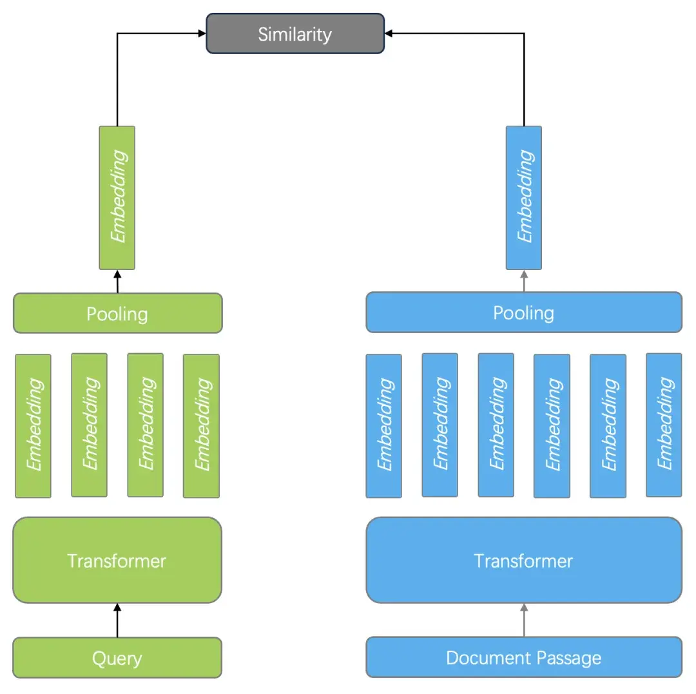
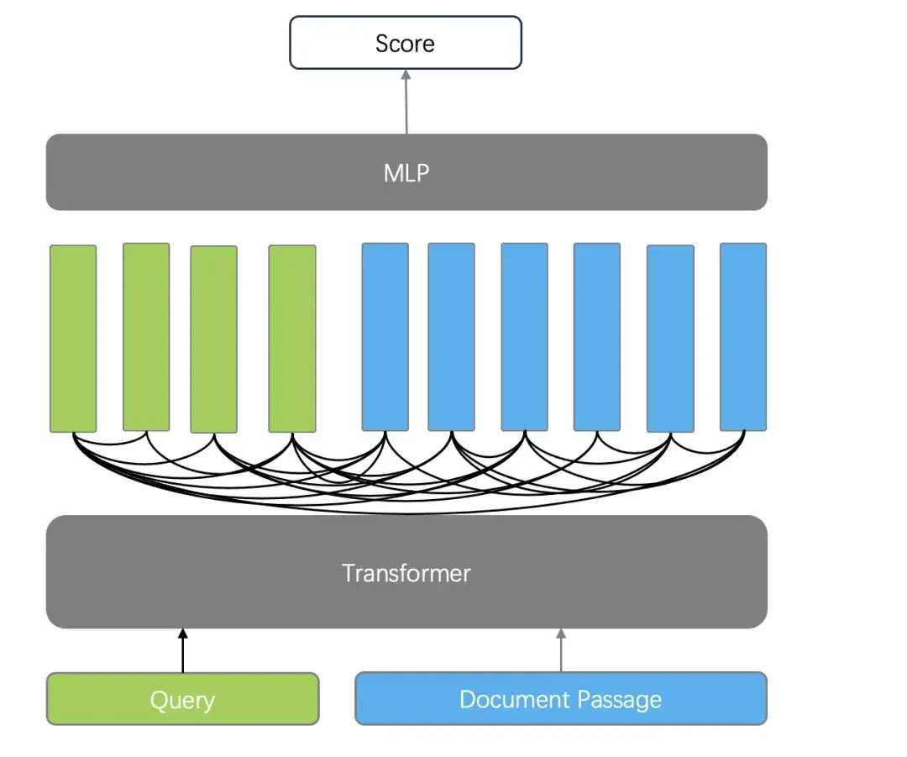
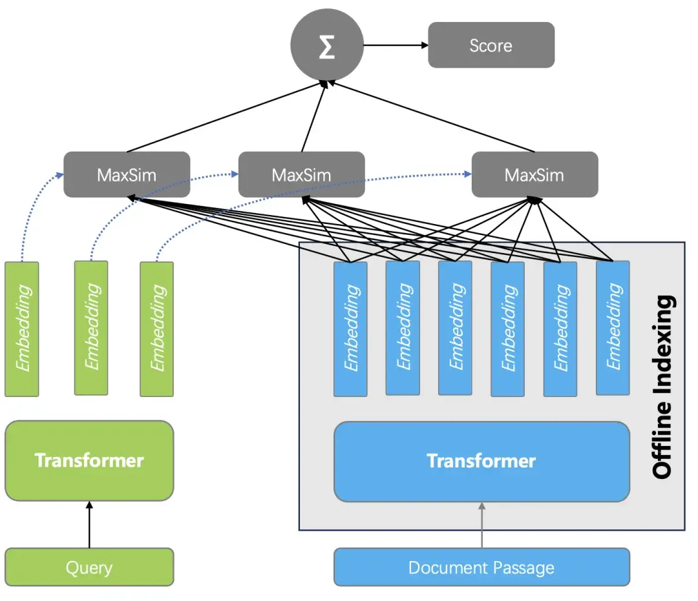
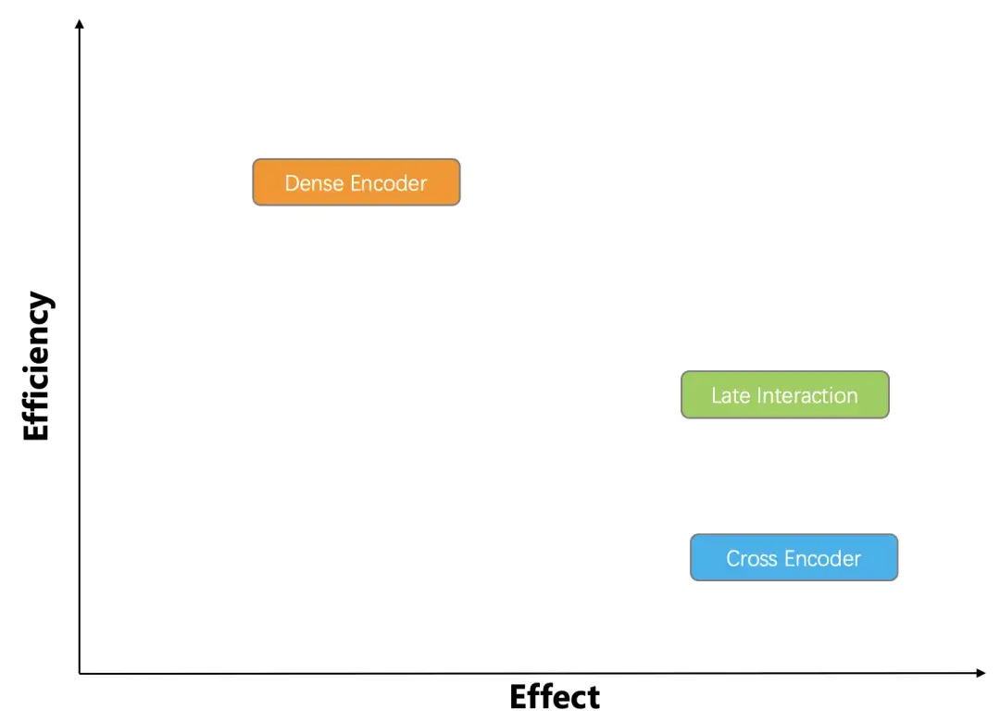
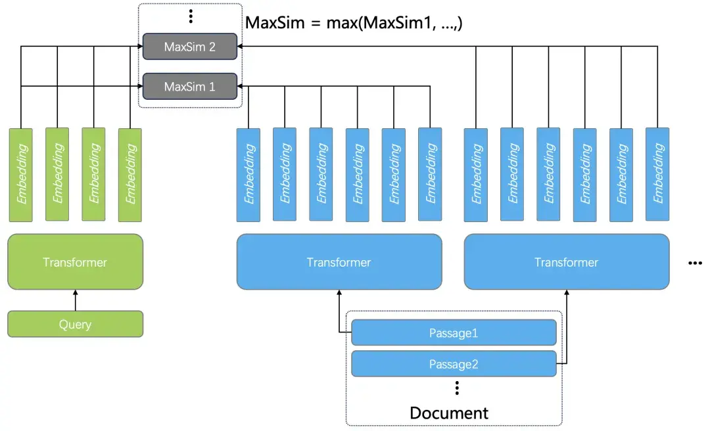
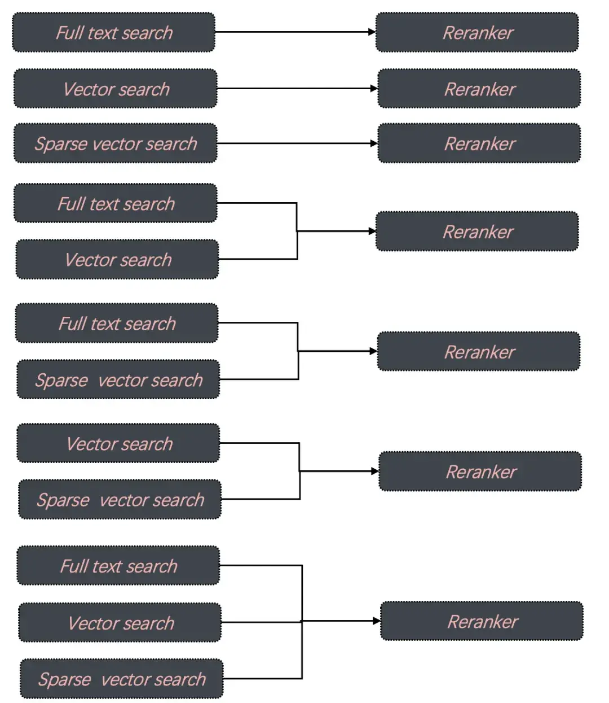
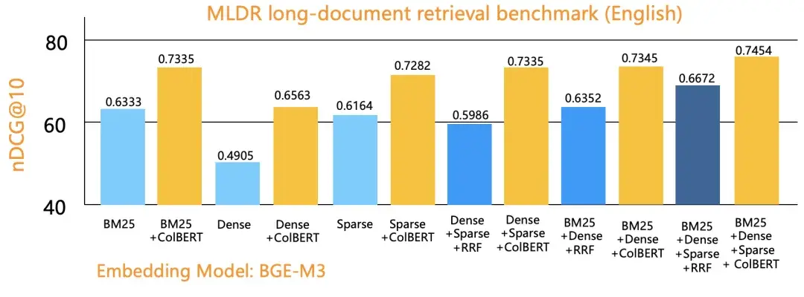
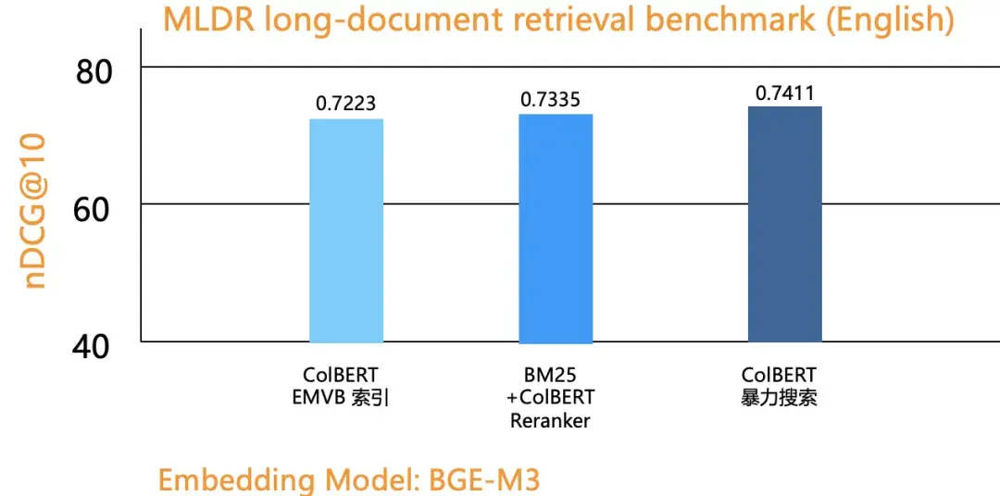
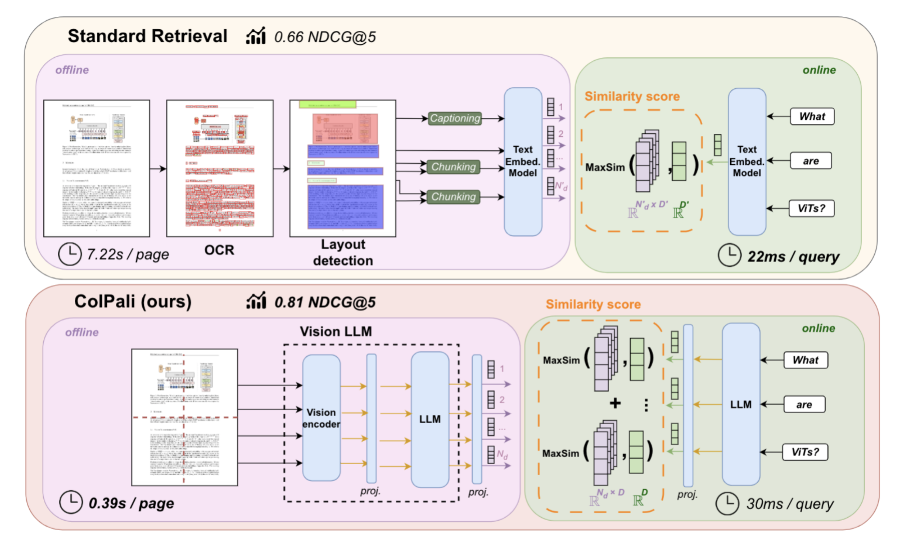

# ColBERT

Late Interaction 延迟交互模型

以向量搜索为代表的查询，面临命中率低的问题。因此需要高级的 rerank 模型来补救，这样就构成了以向量搜索为初筛，以 rerank 模型做精排的两阶段排序架构。

当前排序模型的架构主要有两类：

1. 双编码器：以 BERT 模型为例，它针对查询和文档分别编码，最后再经过一个 Pooling 层，使得输出仅包含一个向量。在查询时的 Ranking 阶段，只需要计算两个向量相似度即可，如下图所示。双编码器既可以用于 Ranking 也可以用于 Reranking 阶段，向量搜索实际上就是这种排序模型。由于双编码器针对查询和文档分别编码，因此无法捕获查询和文档的 Token 之间的复杂交互关系，在语义上会有很多损耗，但由于只需要向量搜索即可完成排序打分计算，因此执行效率非常高。

2. 交叉编码器（Cross Encoder）。Cross-Encoder 使用单编码器模型来同时编码查询和文档，它能够捕捉查询和文档之间的复杂交互关系，因此能够提供更精准的搜索排序结果。Cross-Encoder 并不输出查询和文档的 Token 所对应的向量，而是再添加一个分类器直接输出查询和文档的相似度得分。它的缺点在于，由于需要在查询时对每个文档和查询共同编码，这使得排序的速度非常慢，因此 Cross-Encoder 只能用于最终结果的重排序。例如针对初筛结果的 Top 10 做重排序，仍然需要耗时秒级才可以完成。

## ColBERT

1. 相比于 Cross Encoder，ColBERT 仍采用双编码器策略，将查询和文档分别采用独立的编码器编码，因此查询的 Token 和文档的 Token 在编码时互不影响，这种分离使得文档编码可以离线处理，查询时仅针对 Query 编码，因此处理的速度大大高于 Cross Encoder；
2. 相比于双编码器，ColBERT 输出的是多向量而非单向量，这是从 Transformer 的最后输出层直接获得的，而双编码器则通过一个 Pooling 层把多个向量转成一个向量输出，因此丢失了部分语义。

在排序计算时，ColBERT 引入了延迟交互计算相似度函数，并将其命名为最大相似性（MaxSim），计算方法如下：对于每个查询 Token 的向量都要与所有文档 Token 对应的向量进行相似度计算，并跟踪每个查询 Token 的最大得分。查询和文档的总分就是这些最大余弦分数的总和。例如对于一个有 32 个 Token 向量的查询（最大查询长度为 32）和一个有 128 个 Token 的文档，需要执行 32*128 次相似性操作，如下图所示。

因此相比之下， Cross Encoder 可以称作**早期交互模型 （Early Interaction Model）**，而以 ColBERT 为代表的工作可称为**延迟交互模型（Late Interaction Model）。**

由于延迟交互模型满足了对排序过程中查询和文档之间复杂交互的捕获，同时也避免了对文档 Token 编码的开销，因此既能保证良好的排序效果，也能实现较快的排序性能：相同数据规模下， ColBERT 的效率可达 Cross Encoder 的 100 倍以上。因此延迟交互模型是一种非常有前景的排序模型。

ColBERT 工程化的一些问题：

1. ColBERT 的 MaxSim 延迟交互相似度函数，计算效率大大高于 Cross Encoder，但相比普通向量搜索，计算开销仍然很大：因为查询和文档之间的相似度，是多向量计算，因此 MaxSim 的开销是普通向量相似度计算的 M * N 倍 （M 为查询的 Token 数， N 为文档的 Token 数）。针对这些，ColBERT 作者在 2021 年推出了 ColBERT v2，通过 Cross Encoder 和模型蒸馏，改进了生成的 Embedding 质量，并且采用压缩技术，对生成的文档向量进行量化，从而改善 MaxSim 的计算性能。基于 ColBERT v2 包装的项目 RAGatouille 成为高质量 RAG 排序的解决方案。然而，ColBERT v2 只是一个算法库，端到端的让它在企业级 RAG 系统使用，仍然是一件困难的事情。
2. 由于 ColBERT 是预训练模型，而训练数据来自于搜索引擎的查询和返回结果，这些文本数据并不大，例如查询 Token 数 32 ， 文档 Token 数 128 是典型的长度限制。因此将 ColBERT 用于真实数据时，超过限制的长度会被截断，这对于长文档检索并不友好。

解决方案：

1. 使用 Tensor 存放  ColBERT 编码输出的多个向量，从而使用 Tensor 之间的相似度直接得出 MaxSim 打分。针对 MaxSim 计算量大的问题，一是 binary 量化，让原始 Tensor 的空间只需原始尺寸的 1/32，但并不改变 MaxSim 计算的相对排序结果。这种方案主要用于 Reranker，因为需要根据前一阶段粗筛的结果取出对应的 Tensor。二是使用 Tensor Index。
2. 针对超过 Token 限制的长文本，引入了 Tensor Array 类型：一篇超过 ColBERT 限制的文档，会被切分成多个段落，分别编码生成 Tensor 后，都跟原始文档保存在一行。计算 MaxSim 的时候，查询跟这些段落分别计算，然后取最大值作为整个文档的打分。如下图所示：

其他混合搜索方式：召回手段可以有向量搜索，

## 测评

数据集：MLDR，Multi Long Document Retrieval，一共包含 20 万长文本数据。

采用 BGE-M3 作为 Embedding 模型采用 Jina-ColBERT 生成 Tensor。

### ColBERT 作为 Reranker 

将 20 万 MLDR 数据分别用 BGE-M3 生成稠密向量和稀疏向量，并插入到数据库中，数据库包含 4 列，分别保存原始文本，向量，稀疏向量，以及 Tensor，并分别构建相应全文索引、向量索引、稀疏向量索引。评测包含所有的召回组合，包含单路召回、双路召回，以及三路召回，如下所示：

评测指标采用 nDCG@10。其他参数：采用 RRF Reranker 时粗筛返回的 Top N = 1000 ，查询累计共有 800 条，平均每条查询长度在 10 个 token 左右。

从图中看到，所有的召回方案，在采用了 ColBERT Reranker 之后，都有明显的效果提升。ColBERT 作为一种延迟交互模型，它可以提供跟在 MTEB 的 Reranker 排行榜上位居前列相提并论的排序质量，但是性能却是它们的 100 倍，所以可以在更大的范围内进行重排序。图中给出的结果是针对 Top 100 进行 Reranker，而采用 Top 1000 进行 ColBERT 重排序，数值没有明显变化，性能还有明显下降，因此不推荐采用。传统上采用基于 Cross Encoder 的外部 Reranker ，Top 10 就会有秒级的延迟。

### ColBERT 作为 Ranker

这时需要针对 Tensor 这列数据构建 Tensor Index。同时，为了评估 Tensor Index 引入的精度损耗，还进行了暴力搜索。

可以看到，相比 Reranker ，即使是采用没有精度损失的暴力搜索，也没有显著的提升，而采用基于 Tensor Index 的排序质量甚至低于采用 Reranker。然而，作为 Ranker 的查询时间却要慢得多：MLDR 数据集包含 20 万文档数据，大约 2GB 左右，采用 Jina-ColBERT 转成 Tensor 数据后，高达 320G，这是因为 Tensor 数据类型是把一篇文档的每个 Token 对应的向量都要保存下来， ColBERT 模型的维度是 128 维，因此默认数据量会膨胀 2 个数量级，即使构建了 Tensor Index，在查询这么多数据的时候，也需要平均 7s 才能返回一个查询，但得到的结果却并没有更好。

显然，ColBERT 作为 Reranker 的收益比作为 Ranker 要高得多。当前最佳的 RAG 检索方案，是在 **3 路混合搜索（全文搜索 + 向量 + 稀疏向量）**的基础上加 ColBERT Reranker。

## ColPali 多模态

由此可以看到，ColBERT 及其延迟交互模型，在 RAG 场景具有很大的应用价值，以上是在文本对话内容生成的相关工作，近期，延迟交互模型在多模态场景，也得到了 SOTA 的结果。这就是 ColPali，它改变了 RAG 的工作流程，如下图所示：

RAG 在面临复杂格式文档时，当下的 SOTA ，是采用文档识别模型，对文档的布局做识别，并针对识别出的部分结构，例如图表，图片等，再分别调用相应的模型，将它们转化为对应的文字，再用各种格式保存到 RAG 配套的数据库中。而 ColPali 则省掉了这些步骤，它直接采用多模态模型生成 Embedding 内容。

ColPali 模型的训练跟 ColBERT 类似，也是采用查询 - 文档页面对的形式，从而捕获查询和文档多模态数据之间的语义关联，只是采用 PaliGemma 用来生成多模态 Embedding 。相比没有采用 Late Interaction 机制但同样采用 PaliGemma 生成 Embedding 的方案 BiPali，在 nDCG@5 的评测指标对比是 81.3 vs 58.8，这种差距是就是 “极好” 和 “压根不能工作” 的区别。