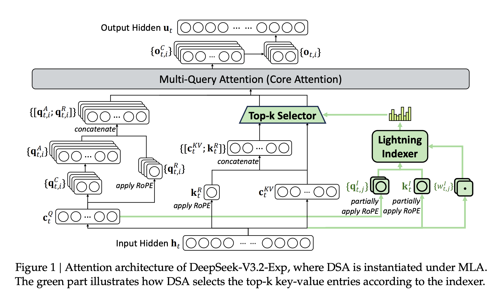
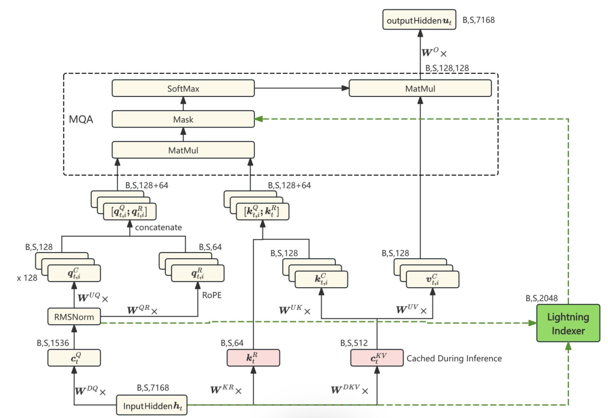
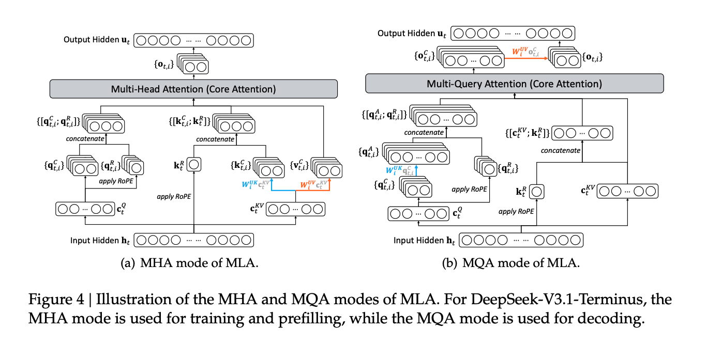

# DeepSeek-V3.2-Exp

DeepSeek-V3.2-Exp 模型以 DeepSeek-V3.1-Terminus 为基础，通过持续训练集成 DeepSeek 稀疏注意力（DSA）机制，核心目标是在长上下文场景中显著提升训练与推理效率，同时最大限度保留原有模型性能。

DSA 机制（含轻量级索引器与细粒度 token 选择），实现注意力计算复杂度从 $O(L^2)$ 到 $O(L \times k)(k \ll L)$ 的优化。

## DeepSeek 稀疏注意力（DSA）

DeepSeek-V3.2-Exp 与上一版本 DeepSeek-V3.1-Terminus 的唯一架构差异，是通过持续训练引入 DSA 机制。DSA 基于 MLA 框架的 MQA 模式实例化（为兼容 V3.1-Terminus 的训练流程），整体架构如下：



### 轻量级索引器（Lightning Indexer）

输入是 Q 的低秩矩阵 $c^Q_t$ 与 MLA 的输入矩阵 $h_t$，输出则是每个 Token 所对应的 **2048 个可参与 Attention 的历史 Token 索引**。

被选中的 2048 个 Token 会在 MQA 的 Mask 阶段发挥作用：通过将未选中的位置的 Mask 值设为 INF，在经过 softmax 之后，就能有效去除不需要参与 Attention 的 Token。这样实现了高效的稀疏化，显著降低了计算量。

索引器的核心作用是计算 query token 与前文 token 的索引分数 $I_{t,s}$，为后续 token 选择提供依据。

$$
I_{t, s}=\sum_{j=1}^{H^{I}} w_{t, j}^{I} \cdot \text{ReLU}\left(q_{t, j}^{I} \cdot k_{s}^{I}\right)
$$

- $H^I$：索引器头数（固定为 64）
- $q^I_{t,j}$ ：第 $t$ 个 Token 在第  $j$ 个索引头的 Query 向量
- $k^I_s$ ：前文 token $h_s$ 第 $s$ 个 Token 的 Key 向量，**Key 向量只有一个，被所有 64 个索引头共享**
- $q^I_{t,j}$ 和 $k^I_s$ 的维度均为 128
- $w^I_{t,j}$：由查询 token $h_t$ 衍生的权重，可学习的标量
- 使用 **ReLU** 激活而非 softmax，有利于**吞吐优化（FP8 实现）**

从结构上看，Indexer 的 Q/K 计算过程与模型中的 MLA（Multi-head Latent Attention）非常相似，可以看作是一个 **"微缩版" 的 MLA**（其头数为 64 vs MLA 的 128，头维度为 128 vs MLA 的 576）。其计算量大约仅为 MLA 对应部分的 **1/9**，实现了高效的 Key 选择。

### 细粒度 token 选择与注意力计算

Fine-Grained Token Selection

基于索引器输出的分数，token 选择机制仅保留 Top-k 索引分数对应的键值对（KV），再通过注意力机制计算最终输出

$$
u_{t}=\text{Attn}\left(h_{t},\left\{c_{s} \mid I_{t, s} \in \text{Top-k}\left(I_{t,:}\right)\right\}\right)
$$

- $u_t$：查询 token $h_t$ 的注意力输出
- $c_s$：Top-k 索引分数对应的键值对
- $\text{Top-k}(I_{t,:})$：查询 token $h_t$ 所有索引分数中的前 k 个高分集合。



修正：上图中的 k 应该是单头。

### DSA 实例化

为兼容 DeepSeek-V3.1-Terminus 的持续训练，DSA 采用 MLA 框架的 MQA 模式（而非 MHA 模式），因为在核函数层面，MQA 模式下每个 KV 条目可被多个查询共享，能显著降低计算冗余。

#### 对比 MLA 的 MHA 与 MQA 模式

其中，DeepSeek-V3.1-Terminus 在训练和预填充（Prefilling）阶段用 MHA 模式，解码阶段用 MQA 模式；而 DeepSeek-V3.2-Exp 的 DSA 统一基于 MQA 模式实现。



## 训练流程：从持续预训练到后训练

DeepSeek-V3.2-Exp 的训练以 DeepSeek-V3.1-Terminus（上下文长度 128K）为基础 checkpoint，分为“持续预训练”和“后训练”两大阶段，全程保持与 V3.1-Terminus 一致的数据分布，确保性能对比的公平性。**将模型从 dense attention 平稳迁移至 DSA 架构下的 sparse attention**，且保持性能稳定。

### 持续预训练

#### Dense Warm-up

目标：初始化轻量级索引器，使其输出与原有密集注意力分布对齐；

- 冻结模型所有参数，仅训练索引器；
- 聚合 dense 注意力的所有头部分数，沿序列维度做 L1 归一化，得到目标分布 $p_{t,:} = \text{L1-normalized}\left(\sum_{h=1}^{H} \text{AttentionScore}^{(h)}_{t,:}\right) \in \mathbb{R}^t$；
- 以 KL 散度损失为索引器训练目标：

$$
\mathcal{L}^{I}=\sum_{t} \mathbb{D}_{KL}\left(p_{t,:} \parallel \text{Softmax}\left(I_{t,:}\right)\right)
$$

训练配置：

- 学习率：$10^{-5}$；
- 训练步数：1000 步（每步 16 个序列，每个序列 128K token，总 token 量 2.1B）。

#### Sparse Training

目标：引入细粒度 token 选择机制，优化全模型参数以适应稀疏模式；

- 解锁所有模型参数，保留索引器与密集注意力的对齐目标，但仅考虑 Top-k 选中的 token 集合 $S_t = \{s \mid I_{t,s} \in \text{Top-k}(I_{t,:})\}$，损失公式调整为： 

$$
\mathcal{L}^{I}=\sum_{t} \mathbb{D}_{KL}\left(p_{t, S_{t}} \parallel \text{Softmax}\left(I_{t, S_{t}}\right)\right)
$$

- 索引器与主模型**分离优化**：索引器训练信号仅来自 KL 损失，主模型仅通过语言建模损失优化；

训练配置：

- 学习率：$7.3 \times 10^{-6}$；
- Top-k 选择：每个 query token 选中 2048 个 KV token；
- 训练步数：15000 步（每步 480 个序列，每个序列 128K token，总 token 量 943.7B）。

### 后训练：性能对齐与领域优化

后训练阶段完全复用 DeepSeek-V3.1-Terminus 的流程、算法和数据，确保仅 DSA 机制对性能产生影响，核心包含“专家蒸馏”和“混合 RL 训练”两大模块。

#### 专家蒸馏（Specialist Distillation）

- 为 6 个领域（数学、竞赛编程、通用逻辑推理、智能体编码、智能体搜索、写作/通用问答）训练**领域专家模型**（均从 V3.2 基础 checkpoint 微调，使用大规模 RL 训练）；
- 专家模型生成两类数据：长链推理数据（思考模式）、直接响应数据（非思考模式）；
- 用蒸馏数据训练主模型，使其性能接近领域专家（后续 RL 训练可消除性能差距）。

#### 混合 RL 训练（Mixed RL Training）

采用 GRPO

- 创新点：将“推理训练、智能体训练、人类对齐训练”合并为单个 RL 阶段，避免多阶段训练的“灾难性遗忘”问题；
- 奖励设计：平衡两大 trade-off：
- 长度 vs 准确率：通过长度惩罚控制输出冗余；
- 语言一致性 vs 准确率：对推理/智能体任务采用“语言一致性奖励”，通用任务采用“生成式奖励模型”（按 prompt 专属标准评估）。

## 评估结果 效率与性能的平衡

评估从**模型能力**和**推理成本**两方面展开，对比基准为 DeepSeek-V3.1-Terminus，核心结论是：DSA 在显著提升长上下文效率的同时，未造成实质性性能损失。 

- **性能保留**：在 MMLU-Pro（通用）、BrowseComp（搜索智能体）、SimpleQA（搜索智能体）、AIME 2025（数学）、Terminal-bench（代码智能体）等任务中，性能与 V3.1-Terminus 持平或略有提升； 
- **轻微下降任务**：GPQA-Diamond（80.7→79.9）、Humanity’s Last Exam（21.7→19.8）、HMMT 2025（86.1→83.6），原因是 V3.2-Exp 生成的推理 token 更少，使用“生成同等 token 量的中间 checkpoint”可消除差距； 
- **训练稳定性**：RL 训练曲线显示，两模型准确率曲线高度对齐，证明 DSA 不影响训练稳定性。

### 推理成本评估

核心结果基于 GPU 租金 2 美元/小时的实测： 

- 复杂度优化：DSA 将主模型核心注意力复杂度从 $O(L^2)$ 降至 $O(L \times k) (k \ll L)$； 
- 成本优势：预填充阶段：短序列场景下，通过“掩码 MHA 模式模拟 DSA”，成本低于 V3.1-Terminus；
- 解码阶段：随序列长度增加（0K→128K），V3.2-Exp“每百万 token 成本”优势逐渐扩大，长上下文场景效率提升更显著； 
- 索引器开销：尽管索引器复杂度仍为 $O(L^2)$，但其计算量远低于 V3.1-Terminus 的 MLA 机制，对整体成本影响可忽略。

## TileLang & CUDA 算子开源

在新模型的研究过程中，需要设计和实现很多新的 GPU 算子。官方使用高级语言 TileLang 进行快速原型开发，以支持更深入的探索。在最后阶段，以 TileLang 作为精度基线，逐步使用底层语言实现更高效的版本。因此，本次开源的主要算子包含 TileLang 与 CUDA 两种版本。

```python
class Indexer(torch.nn.Module):
    def __init__(self, args: ModelArgs):
        super().__init__()
        self.dim: int = args.dim # 7168
        self.n_heads: int = args.index_n_heads
        self.n_local_heads = args.index_n_heads // world_size   # 64 / TP
        self.head_dim: int = args.index_head_dim # 128
        self.rope_head_dim: int = args.qk_rope_head_dim # 64
        self.index_topk: int = args.index_topk  # 2048
        self.q_lora_rank: int = args.q_lora_rank # 1536
        self.wq_b = Linear(self.q_lora_rank, self.n_heads * self.head_dim) # [b, s, 1536] -> [b, s, 64*128]
        self.wk = Linear(self.dim, self.head_dim) # [b, s, 7168] -> [b, s, 128]
        self.k_norm = LayerNorm(self.head_dim) # [b, s, 128] -> [b, s, 128]
        self.weights_proj = Linear(self.dim, self.n_heads, dtype=torch.get_default_dtype()) # [b, s, 7168] -> [b, s, 64]
        self.softmax_scale = self.head_dim ** -0.5 # sqrt(128)
        self.scale_fmt = args.scale_fmt

        self.register_buffer("k_cache", torch.zeros(args.max_batch_size, args.max_seq_len, self.head_dim, dtype=torch.float8_e4m3fn), persistent=False) # [b, s, 128]
        self.register_buffer("k_scale_cache", torch.zeros(args.max_batch_size, args.max_seq_len, self.head_dim // block_size, dtype=torch.float32), persistent=False)


    def forward(self, x: torch.Tensor, qr: torch.Tensor, start_pos: int, freqs_cis: torch.Tensor, mask: Optional[torch.Tensor]):
        bsz, seqlen, _ = x.size()  # [b, s, 7168] 
        end_pos = start_pos + seqlen 
        q = self.wq_b(qr) # [b, s, 1536] * [1536, 64*128] -> [b, s, 64*128] 
        q = rearrange(q, 'b s (h d) -> b s h d', d=self.head_dim) # Hidden -> Head Num, Head Dim, [b, s, 64*128] -> [b, s, 64, 128]
        q_pe, q_nope = torch.split(q, [self.rope_head_dim, self.head_dim - self.rope_head_dim], dim=-1) # [b, s, 64, 128] -> [b, s, 64, 64] + [b, s, 64, 64]  
        q_pe = apply_rotary_emb(q_pe, freqs_cis) # [b, s, 64, 64]  
        q = torch.cat([q_pe, q_nope], dim=-1) # [b, s, 64, 64] + [b, s, 64, 64] -> [b, s, 64, 128]
        k = self.wk(x) # [b, s, 7168] * [7168, 128] -> [b, s, 128]
        k = self.k_norm(k) # [b, s, 128] 
        k_pe, k_nope = torch.split(k, [self.rope_head_dim, self.head_dim - self.rope_head_dim], dim=-1) # [b, s, 128] -> [b, s, 64] + [b, s, 64]
        k_pe = apply_rotary_emb(k_pe.unsqueeze(2), freqs_cis).squeeze(2) # [b, s, 64] -> [b, s, 64]
        k = torch.cat([k_pe, k_nope], dim=-1) # [b, s, 64] + [b, s, 64] -> [b, s, 128]
        q = rotate_activation(q) # 对每个 Token 的 128 维数据做 Hadamard 变换 -> [b, s, 64, 128]
        k = rotate_activation(k) # 对每个 Token 的 128 维数据做 Hadamard 变换 -> [b, s, 128]
        q_fp8, q_scale = act_quant(q, block_size, self.scale_fmt) # 以 perGroup=128 量化：第一个输出是被量化的 q:[b, s, 64, 128]， 第二个输出是 q 被量化的 Scale:[b, s, 64]
        k_fp8, k_scale = act_quant(k, block_size, self.scale_fmt) # 以 perGroup=128 量化：第一个输出是被量化的 k:[b, s, 128]， 第二个输出是 k 被量化的 Scale:[b, s]
        self.k_cache[:bsz, start_pos:end_pos] = k_fp8
        self.k_scale_cache[:bsz, start_pos:end_pos] = k_scale
        weights = self.weights_proj(x) * self.n_heads ** -0.5 # [b, s, 7168] -> [b, s, 64] / sqrt(128)
        weights = weights.unsqueeze(-1) * q_scale * self.softmax_scale # 上述 Weight 与 Q 的量化 Scale 乘在一起，省一次点乘，并做扩维操作，[b, s, 64] -> [b, s, 64, 1]
        # 总的逻辑就是：Relu(q_fp8 X weights) * weights 再延 Head 维度求和，再点 K 的 Scale。[b, s, 64, 128]， [b, s, 64，1], [b, s, 128], [b, s]
        index_score = fp8_index(q_fp8.contiguous(), weights, self.k_cache[:bsz, :end_pos].contiguous(), self.k_scale_cache[:bsz, :end_pos].contiguous())
        # Output Tensor Shape: [b, s, s] Token 之间的相关性的分数
        if mask is not None:
            index_score += mask
        topk_indices = index_score.topk(min(self.index_topk, end_pos), dim=-1)[1]
        topk_indices_ = topk_indices.clone() # [b, s, s] -> [b, s, 2048] 选出分数最高的 2048 个索引
        dist.broadcast(topk_indices_, src=0)
        assert torch.all(topk_indices == topk_indices_), f"{topk_indices=} {topk_indices_=}"
        return topk_indices
```

```python
class MLA(nn.Module):
    """
    Multi-Head Latent Attention (MLA) Layer.

    Attributes:
        dim (int): Dimensionality of the input features. # 7168
        n_heads (int): Number of attention heads. # 128
        n_local_heads (int): Number of local attention heads for distributed systems. # n_heads / TP
        q_lora_rank (int): Rank for low-rank query projection. # 1536
        kv_lora_rank (int): Rank for low-rank key/value projection. # 512
        qk_nope_head_dim (int): Dimensionality of non-positional query/key projections. # 128
        qk_rope_head_dim (int): Dimensionality of rotary-positional query/key projections. # 64
        qk_head_dim (int): Total dimensionality of query/key projections.  # 192
        v_head_dim (int): Dimensionality of value projections. # 128
        softmax_scale (float): Scaling factor for softmax in attention computation. # sqrt(192)
    """
    def __init__(self, args: ModelArgs):
        super().__init__()
        self.dim = args.dim
        self.n_heads = args.n_heads
        self.n_local_heads = args.n_heads // world_size  # MLA 做 TP 方案场景，world_size 是 TP Num
        self.q_lora_rank = args.q_lora_rank
        self.kv_lora_rank = args.kv_lora_rank
        self.qk_nope_head_dim = args.qk_nope_head_dim
        self.qk_rope_head_dim = args.qk_rope_head_dim
        self.qk_head_dim = args.qk_nope_head_dim + args.qk_rope_head_dim
        self.v_head_dim = args.v_head_dim

        self.wq_a = Linear(self.dim, self.q_lora_rank) # [b, s, 7168] -> [b, s，1536] 
        self.q_norm = RMSNorm(self.q_lora_rank) # [b, s，1536] -> [b, s，1536]
        self.wq_b = ColumnParallelLinear(self.q_lora_rank, self.n_heads * self.qk_head_dim) # [b, s，1536] -> [b, s，128*(128+64)]
        self.wkv_a = Linear(self.dim, self.kv_lora_rank + self.qk_rope_head_dim) # [b, s，7168] -> [b, s，　(512+64)]
        self.kv_norm = RMSNorm(self.kv_lora_rank) # [b, s，512] -> [b, s，512]
        self.wkv_b = ColumnParallelLinear(self.kv_lora_rank, self.n_heads * (self.qk_nope_head_dim + self.v_head_dim)) # [b, s，512] -> [b, s，128*(128+128)]
        self.wo = RowParallelLinear(self.n_heads * self.v_head_dim, self.dim) # [b, s，128*128] -> [b, s， 7168]
        self.softmax_scale = self.qk_head_dim ** -0.5
        if args.max_seq_len > args.original_seq_len:
            mscale = 0.1 * args.mscale * math.log(args.rope_factor) + 1.0
            self.softmax_scale = self.softmax_scale * mscale * mscale

        self.indexer = Indexer(args)

        self.register_buffer("kv_cache", torch.zeros(args.max_batch_size, args.max_seq_len, self.kv_lora_rank), persistent=False) # KVCache 512
        self.register_buffer("pe_cache", torch.zeros(args.max_batch_size, args.max_seq_len, self.qk_rope_head_dim), persistent=False) # KVCache 64
        self.dequant_wkv_b = None

    def forward(self, x: torch.Tensor, start_pos: int, freqs_cis: torch.Tensor, mask: Optional[torch.Tensor]):
        """
        Forward pass for the Multi-Head Latent Attention (MLA) Layer.

        Args:
            x (torch.Tensor): Input tensor of shape (batch_size, seq_len, dim).
            start_pos (int): Starting position in the sequence for caching.
            freqs_cis (torch.Tensor): Precomputed complex exponential values for rotary embeddings.
            mask (Optional[torch.Tensor]): Mask tensor to exclude certain positions from attention.

        Returns:
            torch.Tensor: Output tensor with the same shape as the input.
        """
        bsz, seqlen, _ = x.size()
        end_pos = start_pos + seqlen
        qr = self.q_norm(self.wq_a(x)) # [b, s, 7168] -> [b, s，1536] 
        q = self.wq_b(qr) # [b, s，1536] -> [b, s，128*(128+64)]
        q = q.view(bsz, seqlen, self.n_local_heads, self.qk_head_dim) # Hidden Dim 拆成 Head Num，Head Dim [b, s，128*(128+64)] -> [b, s，128, (128+64)]
        q_nope, q_pe = torch.split(q, [self.qk_nope_head_dim, self.qk_rope_head_dim], dim=-1) # [b, s，128*(128+64)] -> [b, s，128, 128] + [b, s，128, 64]
        q_pe = apply_rotary_emb(q_pe, freqs_cis) # [b, s，128, 64] -> [b, s，128, 64]
        kv = self.wkv_a(x) # [b, s，7168] -> [b, s，(512+64)]
        kv, k_pe = torch.split(kv, [self.kv_lora_rank, self.qk_rope_head_dim], dim=-1) # [b, s，(512+64)] -> [b, s，512], [b, s，64]
        kv = self.kv_norm(kv)
        k_pe = apply_rotary_emb(k_pe.unsqueeze(2), freqs_cis)
        self.kv_cache[:bsz, start_pos:end_pos] = kv
        self.pe_cache[:bsz, start_pos:end_pos] = k_pe.squeeze(2)
        if mask is not None:    # MHA prefill Prefill 阶段采取的是 Naive 方案推理，Attention 的计算逻辑是 MHA
            q = torch.cat([q_nope, q_pe], dim=-1) # [b, s，128, 128] + [b, s，128, 64] -> [b, s，128, 128+64]
            kv = self.wkv_b(kv) # [b, s，512] -> [b, s，128*(128+128)]
            kv = kv.view(bsz, seqlen, self.n_local_heads, self.qk_nope_head_dim + self.v_head_dim) # [b, s， 128*(128+128)] -> [b, s，128, (128+128)]
            k_nope, v = torch.split(kv, [self.qk_nope_head_dim, self.v_head_dim], dim=-1) # [b, s，128, (128+128)] -> [b, s，128, 128], [b, s，128, 128]
            k = torch.cat([k_nope, k_pe.expand(-1, -1, self.n_local_heads, -1)], dim=-1) # [b, s，128, 128] + [b, s，64] -> [b, s，128, (128+64)]
            scores = torch.einsum("bshd,bthd->bsht", q.float(), k.float()) * self.softmax_scale # Q*K/sqrt(192),  [b, s，128, 128+64] * [b, s，128, (128+64)] -> [b, s，128, s]

            # indexer
            topk_indices = self.indexer(x, qr, start_pos, freqs_cis, mask) # 调用 indexer 计算得到与当前 Token 相关性最高的 2048 个 Token
            index_mask = torch.full((bsz, seqlen, seqlen), float("-inf"), device=x.device).scatter_(-1, topk_indices, 0) # 根据选出的 2048 个 Token Index 生成 Mask，在 Attention SoftMax 计算时选中 2048 个 Token 参与计算
            index_mask += mask
            scores += index_mask.unsqueeze(2)

            scores = scores.softmax(dim=-1, dtype=torch.float32) #Attention中的SoftMax计算， Input Tensor Shape:[b, s，128, s] -> Output Tensor Shape:[b, s，128, s]
            x = torch.einsum("bsht,bthd->bshd", scores.type_as(x), v) #再乘以V Input Tensor Shape:[b, s，128, s] -> Output Tensor Shape:[b, s，128, 128]
        else:  # MHA decode Decode 阶段采用 Absorb 方案，将 wkv_b 矩阵乘拆成两份，分别串在了 wq_b 后面，与 wo前面。这样操作后，Attention 模块就是 MQA
            if self.dequant_wkv_b is None and self.wkv_b.scale is not None:
                self.dequant_wkv_b = weight_dequant(self.wkv_b.weight, self.wkv_b.scale)
            wkv_b = self.wkv_b.weight if self.dequant_wkv_b is None else self.dequant_wkv_b
            wkv_b = wkv_b.view(self.n_local_heads, -1, self.kv_lora_rank) # [128, 128+128, 512]
            q_nope = torch.einsum("bshd,hdc->bshc", q_nope, wkv_b[:, :self.qk_nope_head_dim]) #wkv_b矩阵乘拆分后第一个矩阵乘，Input Tensor Shape:[b, s，128, 128] * [128, 128+128, 512] -> Output Tensor Shape:[b, s，128, 512]
            scores = (torch.einsum("bshc,btc->bsht", q_nope.float(), self.kv_cache[:bsz, :end_pos].float()) +
                      torch.einsum("bshr,btr->bsht", q_pe.float(), self.pe_cache[:bsz, :end_pos].float())) * self.softmax_scale
            # torch.einsum("bshc,btc->bsht", q_nope.float(), self.kv_cache[:bsz, :end_pos].float()) : Input Tensor Shape:[b, s，128, 512] * [b，s, 512] -> Output Tensor Shape:[b, s，128, s]
            # torch.einsum("bshr,btr->bsht", q_pe.float(), self.pe_cache[:bsz, :end_pos].float()) : Input Tensor Shape:[b, s，128, 64] * [b，s, 64] -> Output Tensor Shape:[b, s，128, s]
            # Q*K/sqrt(192) 

            # indexer
            topk_indices = self.indexer(x, qr, start_pos, freqs_cis, mask) # 调用indexer计算得到与当前Token相关性最高的2048个Token
            index_mask = torch.full((bsz, 1, end_pos), float("-inf"), device=x.device).scatter_(-1, topk_indices, 0) # 根据选出的2048个Token Index生成Mask，在Attention SoftMax计算时选中2048个Token参与计算
            index_mask += mask
            scores += index_mask.unsqueeze(2)

            scores = scores.softmax(dim=-1, dtype=torch.float32)  # [b, s，128, s] -> [b, s，128, s]
            x = torch.einsum("bsht,btc->bshc", scores.type_as(x), self.kv_cache[:bsz, :end_pos])  #Attention的乘以V，Input Tensor Shape:[b, s，128, s] * [b，s, 512] -> Output Tensor Shape:[b, s，128, 512]
            x = torch.einsum("bshc,hdc->bshd", x, wkv_b[:, -self.v_head_dim:]) # [b, s，128, 512] * [128, 128, 512] -> [b, s，128, 128]
        x = self.wo(x.flatten(2)) #wkv_b矩阵乘拆分后第二个矩阵乘， Input Tensor Shape:[b, s，128*128] * [128*128, 7168] -> Output Tensor Shape:[b, s， 7168]
        return x
```

