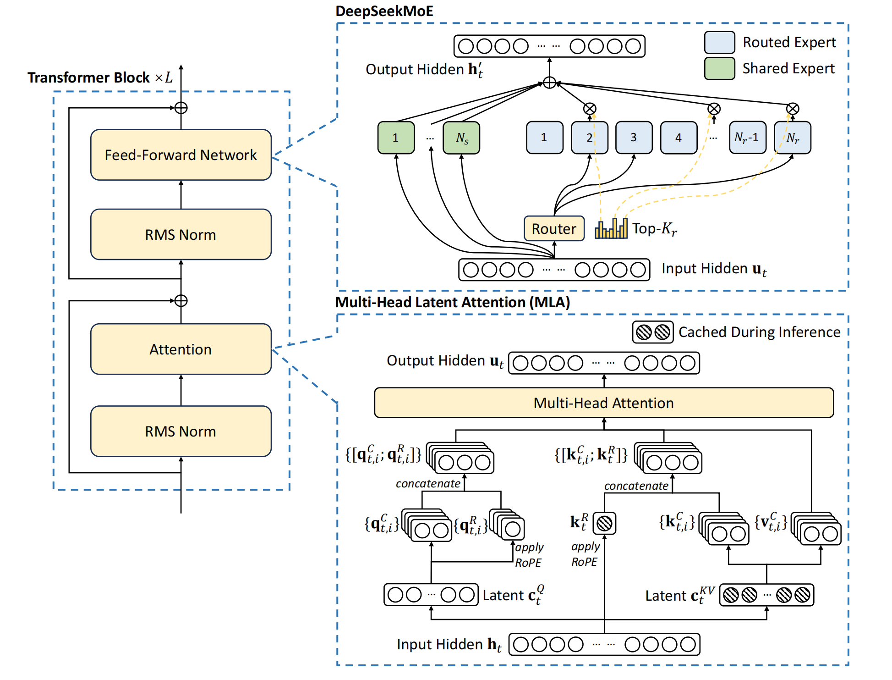
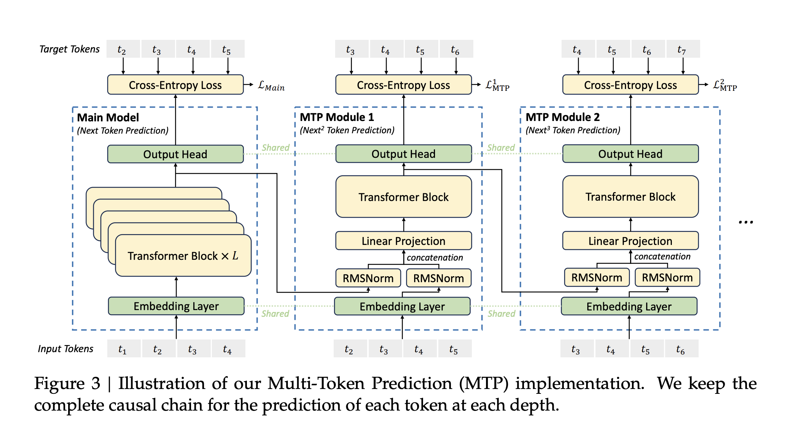
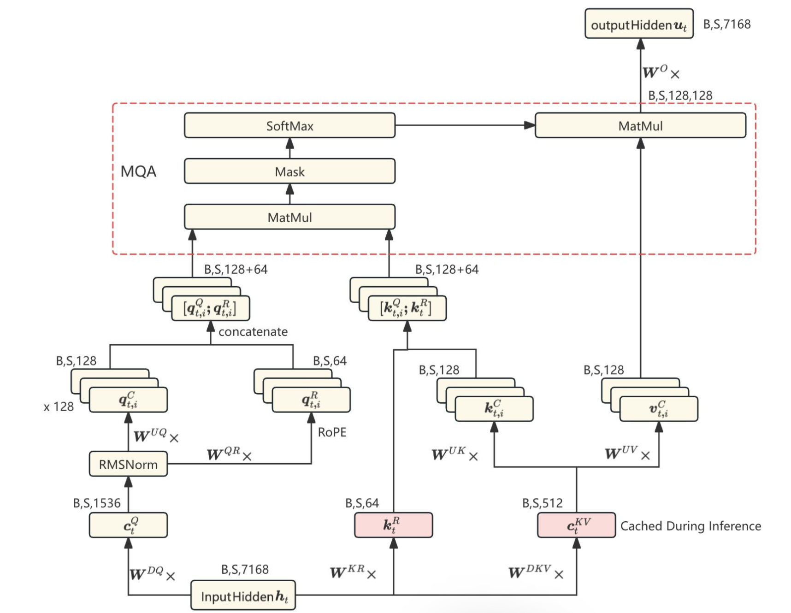

# DeepSeek



- 671B 总参数，其中每个 token 激活 37B 亿参数，是目前参数规模最大的开源 MoE（混合专家）模型之一。
  
- 实现高效且经济的训练
  - 14.8 万亿训练数据、无辅助损失的负载均衡策略、多词元预测训练（提效）
  - DualPipe 算法，多头潜在注意力，FP8 混合精度训练框架（提速）
  - 单次完整训练仅需 278.8 万个 H800 GPU 小时，总成本约为 557.6 万美元（不包括对架构、算法和数据进行的研究和消融实验的相关成本）

DeepSeekV2 是由多个 Transformer Block 构成。每个 Transformer Block 里由 RMS Norm, Attention, Feed-Forward Network 几个模块，以及残差连接构成。

DeepSeekV3 的 DeepSeekMOE 和 MLA 都没有变化。但在实现细节上有一些小的变化。在 DeepSeekV2 里，路由网络出来对各个专家的权重 logits 用 softmax 作为激活函数，这样让所有专家的权重加和为 1。但是因为最终只选择 TopK 个专家，选择 TopK 个专家后，对权重还要再做一次归一化，所以这里也不必一定用 softmax。在 DeepSeekV3 里，就改成对每个专家的权重的 logits 用 Sigmoid 激活函数，然后对选择的 topK 个专家，再进行归一化，做为最终的专家权重。

接下来是负载均衡的修改，在 DeepSeekV3 里去掉了针对 Batch 的辅助负载均衡损失函数，而是训练时，在每个 step，监控每个专家的负载，如果某个专家负载过高，就自动调整减小它对应的权重；如果专家负载过低，就自动调整增加它的权重。需要注意的是，这个修改只在专家路由时起作用，在和最终专家输出相乘时，还是采用原来的权重值。DeepSeek 也做了消融实验，发现去掉 Batch 的辅助负载均衡损失函数，通过动态调节每个专家的权重的方法可以获得更好的模型效果。并且同时在不同大小的模型下做了实验，效果都是一致的。

另外 DeepSeekV3 增加了针对序列的负载均衡损失函数，这个损失函数的形式和 MOE 时针对 batch 的负载均衡损失是一样的。都是用各个专家被选择的频率值乘以平均概率值再求和。之所以要增加序列负载均衡损失函数，是防止在序列内部专家的负载不均衡。如果专家仅仅是在 batch 内负载均衡，那么有可能是按照序列划分的专家的，有的专家可能擅长回答某一类问题。这样当模型部署后，如果用户在某一时间问多个同一方向的问题（比如数学问题），就会出现专家负载不均衡的现象。

## MOE

- 极度稀疏的专家设置
  - 1 share + 256 routed
  - 每个 token 只激活 8 个 routed experts
  - 每个 token 最多被发送到 4 个节点
- 使用无辅助损失的负载平衡策略
  - 用最简单的动态 expert bias 做负载均衡

## MLA

Multi-head latent attention

- 对 KV Cache 进行低秩投影
- 在更少的设备上推理更长的上下文，或者在相同的上下文长度下增大 Batch size
- 可以实现更快的推理速度或者更大的吞吐总量
- MLA 不适合张量并行，更适配于 DeepSeek MoE 没有张量并行，全开流水线并行的结构

## 多词元预测训练 (MTP, Multi-token prediction training)

- 在每个位置预测多个未来的词元
- 增加训练信号的密度，提高数据效率
- 提高模型表达的预先规划能力，优化对未来词元的预测效果
- 用 D 个顺序模块来预测 D 个额外的 token，第 k 个 MTP 模块由一个共享 embedding 层、一个共享输出头、一个独立的 transformer 块 TRM_K 以及一个独立 d x 2d 的投影矩阵 M_k 组成

## FP8 混合精度训练

- 对硬件有要求，H800 以上
- 能用 FP8 的地方都用，重写了相关算子和 FP8 的混合竞速策略
- 使用 E3M4 处理所有的张量，以达到更高精度
- 大幅降低训练过程中的 GPU 内存需求和存储带宽压力

## 双路流水线并行 (dual pipe)

- 编排计算和通信，最大限度的让计算和通信重叠。显著减少了管道气泡，并隐藏了大部分通信开销（和计算时间重叠）
- 其他工程优化：
  - 通信优化：每个 token 最多路由到 4 个物理节点，节点内最多选择 3.2 个专家（核心 IB 带宽是 50GB/s，NVLink 带宽是 160GB/s，相差的比值是 3.2。也就是说在一个节点内路由 3.2 个专家和在 IB 上路由 1 个专家的时间是相当，保证 IB 和 NVLink 传输时间是重叠的）
  - 内存优化：
    1. 重计算，前向计算不存，反向时再计算，用计算量换内存；
    2. 使用 CPU 内存，如模型参数的指数移动平均异步更新；
    3. 参数共享
  - 基于 PTX 进行优化，上面有很多的 GPU 优化度是在 CUDA 粒度之下的优化

## 经验

- 大规模强化学习可以极大提升推理能力，前提是基座模型足够强；
- 对小模型而言，蒸馏带来的提升远大于进行强化学习；小模型有望通过”能力分治”（DCA）的模式将语言、世界知识及逻辑推理三个能力解耦，即语言能力靠小模型自身、逻辑推理靠 RL+蒸馏， 世界知识靠外挂 RAG， 从而具备目前最强大模型的能力，对于中小型开发者而言，部署模型也将更加友好。
- 加大投入提升强基座模型的性能重要性提升，只有这样才能够突破能力的上限，便于蒸馏出各种能力强但成本很低的小模型。

- 组相对策略优化算法（GRPO）实质上仅依赖模型自身近些迭代，实现了“反思能力”，提供了一种具体可行的“RL Scaling law“方向，可以跟进并继续探索其他方向；
- R1-Zero 验证纯强化学习（RL）对推理能力的提升，R1 则强调冷启动和多阶段训练的平衡。R1-Zero 的特别之处在于，其无需任何监督微调数据即可获得强大的推理能力，反映了模型仅通过强化学习就能有效学习和泛化的能力。
- 在 OpenAI 推出 o1 模型时即发现了推理性能随着训练时间和测试时间计算而平稳提升的“RL Scaling law”
- 过程奖励模型（PRM）和蒙特卡洛树搜索（MCTS）等方法难以做出较好的效果，R1 的技术报告更是提到 PRM 和 MCTS 存在难以规模化拓展、奖励欺骗等问题。R1 模型的技术报告提供了一种多阶段训练的方式，其中在第一阶段 RL 过程中，研究人员可以通过扩大 RL 训练集的方式提升模型性能，或为一种可以验证的“RL Scaling law”方向：OpenAI 首席研究官 Mark Chen 也承认，“DeepSeek 的确独立发现了一些 o1 的核心思路”。

## 对 RAG 和 Agent 的影响

- 直接替换原有 LLM，利用 R1 thinking 过程，可以自行 reflection 去噪；
- 召回后接 R1，生成 thinking 过程，然后拼接 prompt，送原有 LLM；
- 做成类似 POT，让 R1 参与到 agentic RAG 中的步骤，利用自己的反思、规划能力；
- 在 1 或者 2 的基础上，去优先处理数值计算、深度分析等需要推理能力的领域，充分利用推理大模型的优势。 

Agentic RAG，使用以下所有可能的组合：

- 分块策略
- 嵌入策略
- 上下文生成策略
- LLM 选择

结果评估

## 四种改进/训练推理模型的方法

[Understanding Reasoning LLMs](https://magazine.sebastianraschka.com/p/understanding-reasoning-llms)

- 推理时间缩放
- 纯强化学习（RL）
- 监督微调和强化学习（SFT + RL）
- 纯监督微调（SFT）和蒸馏

## DeepSeek V3 参数量计算

| Component | Per－layer Parameter | Number        | Total Parameter | Total Parameter（B） |
| --------- | ------------------- | ------------- | --------------- | ------------------ |
| Embedding | Embedding           | 926679040     | 1               | 0.92667904         |
| MLA       | W_DKV               | 367016        | 61              | 0.223870976        |
|           | W_KR                | 458752        | 61              | 0.027983872        |
|           | W_UK                | 8388608       | 61              | 0.511705088        |
|           | W_UV                | 8388608       | 61              | 0.511705088        |
|           | W_DQ                | 11010048      | 61              | 0.671612928        |
|           | W_UQ                | 25165824      | 61              | 1.535115264        |
|           | W_UR                | 12582912      | 61              | 0.767557632        |
|           | W_o                 | 117440512     | 61              | 7.163871232        |
|           | Layernorm           | 7168×2＝ 14336 | 61              | 0.000874496        |
| MoE       | Shared Expert       | 44040192      | 61              | 2.686451712        |
|           | Routed Expert       | 44040192      | 256×58＋8×3      | 654.9565735        |
|           | Router              | 1835008       | 58              | 0.106430464        |
| Output    | RMSNorm             | 7168          | 1               | 0.000007168        |
|           | Linear              | 926679040     | 1               | 0.92667904         |
| Activated |                     |               |                 | 36.6256(~36.6 B)   |
| Total     |                     |               |                 | 671.0168（~671B）    |

每次计算激活 1 个共享专家（Shared Expert）， 8 个路由专家（Routed Expert），所以 DeepSeek V3 MoE 部分的激活参数量是：阿达u水淀按读法

(Shared Expert×1 + Routed Expert×8)×61 + Router×58 = 44040192×9×61+1835008×58 = 24.2845B

最后的激活参数 $=$ MOE＋MLA＋Output =24.2845B+11.4144B+926679040+7168=36.6256B（注意：此时 Embedding 层查表，没有参数）

### 嵌入层 Embedding

```text
"vocab_size": 129280, // Token 字典大小
"hidden_size": 7168,
```

DeepSeek V3 的嵌入层参数量是：129280 * 7168 = 926,679,040 (~0.9B)

### MLA

```python
"hidden_size": 7168,
"num_key_value_heads": 128,
"v_head_dim": 128,
"kv_lora_rank": 512,

"num_attention_heads": 128,
"q_lora_rank": 1536,

"qk_nope_head_dim": 128,
"qk_rope_head_dim": 64,

"num_hidden_layers": 61,
```

单层 MLA 中 Q 的 LoRA 参数量是：7168 * 1536 + 1536 + 1536 * 128 * (128 + 64) = 48,760,320

- $W_{DQ}$: 7168 * 1536 hidden_size * q_lora_rank
- 偏置项：1536
- $W_{UQ}$: 1536 * 128 * 128 （无 ROPE 部分的投影矩阵 q_lora_rank * qk_nope_head_dim * num_attention_heads）
- $W_{UR}$: 1536 * 64 * 128（有 ROPE 部分 q_lora_rank * qk_rope_head_dim * num_attention_heads）

单层 MLA 中 KV 的 LoRA 参数量是：7168 * (512 + 64) + 512 + 512 * 128 * (128 + 128) = 20,906,496

- $W_{DKV}$: 7168 * 512 (hidden_size * kv_lora_rank)
- $W_{KR}$: ROPE Projection 7168 * 64 (hidden_size * qk_rope_head_dim)
- 偏置项：512
- $W_{UK}$: 512 * 128 * 128 （无 RoPE 部分的投影矩阵 kv_lora_rank * qk_nope_head_dim * num_key_value_heads）
- $W_{UR}$: 512 * 64 * 128（有 RoPE 部分 kv_lora_rank * qk_rope_head_dim * num_key_value_heads）

单层 MLA 中 $W_O$ 的参数量是：128 * 128 * 7168 = 117,440,512 (num_attettion_heads * v_head_dim * hidden_size)

pre 和 post attention layernorm 的参数量是：7168 * 2 = 14336 (scale/shift 两个参数)

所以 DeepSeek V3 的 MLA 部分共 61 层的总参数量是：

(48,760,320 + 20,906,496 + 117,440,512 + 14336) * 61 = 11,414,421,504 (~11B)

### MoE

```python
"num_hidden_layers": 61,
"hidden_size": 7168,
"moe_intermediate_size": 2048,  # 路由专家 MLP 的中间维度
"n_shared_experts": 1,          # 共享专家数量
"n_routed_experts": 256,        # 路由专家数量
"first_k_dense_replace": 3,     # 前几层使用 dense 替换 MoE
"intermediate_size": 18432,     # 前3层 (9*moe_intermediate_size)
```

每个专家的参数量是：7168 * 2048 * 3 = 44,040,192

路由 Gate 的参数量是：256 * 7168 + 256 = 1,835,264

前 3 层 dense（固定激活 8 路由专家），前 3 层参数量是：44,040,192 * 9 * 3 = 1,189,085,184

后 58 层稀疏（动态激活 8 路由专家），后 58 层参数量是：(44,040,192 * 257 + 1,835,264) * 58 = 656,569,547,264

所以 DeepSeek V3 的 MoE 部分的总参数量是：1,189,085,184 + 656,569,547,264 = 657,758,632,448 (~657B)

每次计算激活 1 个共享专家，8 个路由专家，所以 DeepSeek V3 MoE 部分的激活参数量是：

44,040,192 * 9 * 61 + 1,835,264 * 58 = 24,284,510,720 (~24B)

### Layer 维度

前 3 层是 dense，没有 gate，基于上面的计算，DeepSeek V3 前 3 层每层的参数量是：

(48,760,320 + 20,906,496 + 117,440,512 + 14336) + (44,040,192 * 9) = 583,483,392

后 58 层是 MoE 稀疏激活专家，基于上面的计算，DeepSeek V3 后 58 层每层的参数量是：

(48,760,320 + 20,906,496 + 117,440,512 + 14336) + (44,040,192 * 257 + 1,835,264) = 11,507,286,272

### 输出层

DeepSeek V3 输出层的 RMSNorm 参数量：7168

Linear 参数量 129280 * 7168 = 926,686,208 (~0.9B)

### 总参数量

DeepSeek V3 总参数量：

583,483,392 * 3 + 11,507,286,272 * 58 + 926,679,040 * 2 + 7168 = 671,026,419,200 (~671B)

DeepSeek V3 激活参数量：

11,414,421,504 + 24,284,510,720 + 926,679,040 * 2 + 7168 = 37,552,297,472 (~37B)

DeepSeek 更新了 README_WEIGHT.md，激活参数量修正成了 36.6B，考虑到 embedding 层只是查表，并不是矩阵乘，所以实际激活参数是：

11,414,421,504 + 24,284,510,720 + 926,679,040 + 7168 + 7168 = 36,625,625,600 (~36.6B)

### MTP



用 $D$ 个顺序的模块，预测 $D$ 个tokens。每个 MTP 模块的具体结构：

- 输入 token 首先接入一层共享的 embedding layer
- 对于第 $i$ 个 token **$t_i$** 和第 **$k$** 个预测深度：
  - 首先将第 $k-1$ 层的的隐层输出 $\mathbf{h}_i^{k-1} \in \mathbb R^d$ 做归一化处理 $\operatorname{RMSNorm}(\mathbf{h}_i^{k-1})$ 
  - 再对第 $i+k$ 位置的 token embedding：$\operatorname{Emb}(t_{i+k}) \in \mathbb R^d$ 做归一化处理 $\operatorname{RMSNorm}(\operatorname{Emb}(t_{i+k}))$ 
  - 将上述两个结果 concat 后，通过投影矩阵 $M_k \in \mathbb R^{d \times 2d}$ 做一层线性变换得到 $\mathbf{h}_i^{'k} \in \mathbb R^d$ 


上述过程如下所示（当 $k=1$ 时， $h_i^{k-1}$ 对 main model 的隐层表征）

$$
\mathbf{h}_i^{'k} = M_k \left[\operatorname{RMSNorm}(h_i^{k-1}); \operatorname{RMSNorm}(\operatorname{Emb}(t_{i+k})) \right]
$$

再将 $\mathbf{h}_i^{'k} $ 输入到 Transformer 层，获得第 $k$ 个预测深度的输出： $\mathbf{h}_i^{k}$ 

$$
\mathbf{h}^k_{1:T-k} = \operatorname{TRM}_k(\mathbf{h}^{'k}_{1:T-k})
$$

最后将 $\mathbf{h}_i^{k}$ 通过一个各 Module 共享的映射矩阵 $\operatorname{OutHead} \in \mathbb R^{V \times d}$ 变换，再过 $softmax$ 处理，计算出词表 $V$ 维度的输出概率，这里注意： $\mathbf{h}_k^i$ 的 label 是对应 $i+1+k$ 位置的 token
$$
P^k_{i+k+1} = \operatorname{OutHead}(\mathbf{h}^k_i)
$$


- $T$ 是序列长度， $k$ 是预测头的深度，$\mathbf{h}_i^{k}$ 是第 **$i$** 个 token 在第 **$k$** 预测深度上输出的表征，是要预测序列中第 **$i+k$** 位置的 token 
- 由于序列总长度为 $T$ ，所以第 $k$ 预测深度最长处理的输入 token 位置 $i$ 应该满足 $i + k \le T $。 所以第 $k$ 预测头能接受的 $i$ 的范围为： $i \le T -k$ ，也就是 $i \in [1, T-k]$

举个简单的例子： $T = 10$ ，对于 $k$ 预测深度，模型训练期间样本构建方式如下图。Main Model 是预测 next token，所以 input 和 label 序列错 1 位。MTP Module 1 是预测 next next token，input 和 label 序列错 2 位，在 T+1 总长度下，输入的后续 token 和输出的前序 token 都要按错位做裁剪。


通过 CrossEntropyLoss 计算每个 MTP Module Head 的损失：

$$
\mathcal{L}^k_{MTP} = \operatorname{CrossEntropy}(P^k_{2+k:T+1}, t_{2+k:T+1}) = -\frac{1}{T}\sum^{T+1}_{i=2+k}\log P^k_i \left[t_i \right]
$$
其中 $2+k : T+1$ 表示 label 范围的下标

- 起始下标 $2+k$ ：MTP Model 1 是预测 next next token，也就是输入第一个 token 是 $t_1$ ，预测第一个 label token 是 $t_{(2+1)} = t_3$ ，以此类推， MTP Model k，输入第一个 token 是 $t_1$， 预测第一个 token 是 $t_{2+k}$ 
- 结束下标 $T+1$ ：所有 sequence 样本默认在原序列上额外增加的一个 eos token，所以 token 下标为序列长度 $T+1$ 


DeepSeek V3 MTP 的 embedding 和输出 head 与主模型共享，enorm 和 hnorm 的权重是：7168 + 7168 = 14336

eh_proj 线性变换的权重规模是：7168 * 14336 = 102,760,448

增加了一层 hidden layer，即第 61 层：

(48,760,320 + 20,906,496 + 117,440,512 + 14336) + (44,040,192 * 257 + 1,835,264) = 11,507,286,272

加起来 DeepSeek V3 MTP 的总参数量是：

11,507,286,272 + 102,760,448 + 14336 = 11,610,061,056 (~11.6B)

DeepSeek V3 MTP 的激活参数量是：

11,610,061,056 - 44,040,192 * (256 - 8) + 926,686,208 * 2 = 2,541,465,856

减去了 embedding 层：

11,610,061,056 - 44,040,192 * (256 - 8) + 926,686,208 = 1,614,779,648 (~1.6B)



