# DeepSpeed ZeRO

GPU + PyTorch + Megatron-LM + DeepSpeed

Zero Redundancy Optimizer

## 分布式并行策略

1. 数据并行（data parallelism, DP）：假设有 N 张卡，每张卡都保存一个模型，每一次迭代（iteration/step）都将 batch 数据分割成 N 个等大小的 micro-batch，每张卡根据拿到的 micro-batch 数据独立计算梯度，然后调用 AllReduce 计算梯度均值，每张卡再独立进行参数更新；
2. 模型并行（model parallelism/tensor parallelism, MP/TP）：有的 tensor/layer 很大，一张卡放不下，将 tensor 分割成多块，一张卡存一块；
3. 流水并行（pipeline parallelism, PP）：将网络按层切分，划分成多组，一张卡存一组。

```
# 假设模型有三层：L0, L1, L2
# 每层有两个神经元
# 两张卡

# 数据并行：
GPU0: 
L0 | L1 | L2
---|----|---
a0 | b0 | c0
a1 | b1 | c1

GPU1:
L0 | L1 | L2
---|----|---
a0 | b0 | c0
a1 | b1 | c1

# 模型并行：
GPU0:
L0 | L1 | L2
---|----|---
a0 | b0 | c0

GPU1:
L0 | L1 | L2
---|----|---
a1 | b1 | c1

# 流水并行
# 假设模型有8层，两张卡
======================  =====================
|  L0 | L1 | L2 | L3 |  | L4 | L5 | L6 | L7 |
======================  =====================
        GPU0                 GPU1
```

为了防止”一卡工作，众卡围观“，实践中流水线并行也会把 batch 数据分割成多个 micro-batch，流水线执行。对于 LLMs 动辄几百上千亿参数，实践中往往是 3 种并行策略混用，也就是论文中经常提到的 3D parallelism。

数据并行简单易实现，应用最广泛。但是也有缺点，如果每张卡都存储一个模型，那么显存就成了模型规模的天花板。如果有 2 张卡，那么系统中就存在 2 份模型参数，如果有 N 张卡，系统中就存在 N 份模型参数，其中 N-1 份都是冗余的。因此希望系统中只有一个完整模型，每张卡都存 1/N 参数，卡数越多，每张卡的显存占用越少，这样就能训练更大规模的模型。

## 显存占用

混合精度训练，同时存在 fp16 和 fp32 两种格式的数值，其中模型参数、模型梯度都是 fp16，此外还有 fp32 的模型参数，如果优化器是 Adam，则还有 fp32 的 momentum 和 variance（二阶动量）。

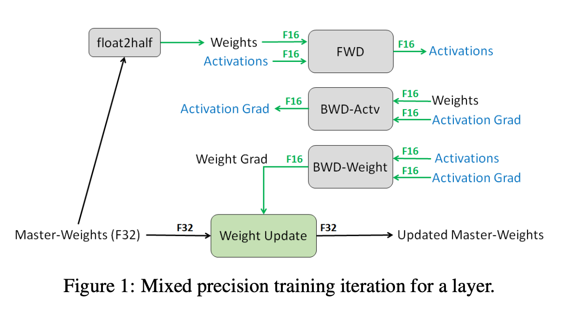

ZeRO 将模型训练阶段每张卡中显存内容分为两类：

1. **模型状态**（model states）: 模型参数（fp16）、模型梯度（fp16）和 Adam 状态（fp32 的模型参数备份，fp32 的 momentum 和 fp32 的 variance）。假设模型参数量 $\Psi$ ，则共需要 $2\Psi+2\Psi+(4\Psi+4\Psi+4\Psi)=4\Psi+12\Psi=16\Psi$ 字节存储，其中 Adam 状态占比 75% 。
2. **剩余状态**（residual states）: 除了模型状态之外的显存占用，包括激活值（activation）、各种临时缓冲区（buffer）以及无法使用的显存碎片（fragmentation）。

例如 GPT-2 含有 1.5B 个参数，如果用 fp16 格式，只需要 3GB 显存，但是模型状态实际上需要耗费 24GB。相比之下，激活值可以用 activation checkpointing 来大大减少，所以模型状态就成了头号显存杀手，也是 ZeRO 的重点优化对象，而其中 Adam 状态是最需要被优化的。

针对模型状态的存储优化（去除冗余），ZeRO 使用的方法是分片（partition），即每张卡只存 1/N 的模型状态量，这样系统内只维护一份模型状态。

- 首先进行分片操作的是模型状态中的 Adam，也就是下图中的 $P_{os}$，os 指 Optimizer States。模型参数（parameters）和梯度（gradients）仍旧是每张卡保持一份，此时，每张卡的模型状态所需显存是 $4\Psi+\frac{12\Psi}{N}$ 字节，当 N 比较大时，趋向于 $4\Psi$ ，也就是原来 $16\Psi$ 的 1/4 。
- 继续对模型梯度进行分片，也就是下图中的 $P_{os+g}$，模型参数仍旧是每张卡保持一份，此时，每张卡的模型状态所需显存是 $2\Psi+\frac{2\Psi+12\Psi}{N}$ 字节，当 N 比较大时，趋向于 $2\Psi$ ，也即是原来的 1/8 。
- 如果继续对模型参数进行分片，也就是下图中的 $P_{os+g+p}$，此时每张卡的模型状态所需显存是 $16\Psi/N$ 字节，当 N 比较大时，趋向于 0。

在 DeepSpeed 中，$P_{os}$ 对应 ZeRO-1，$P_{os+g}$ 对应 ZeRO-2，$P_{os+g+p}$ 对应 ZeRO-3，一般使用 ZeRO-2 就足够了。

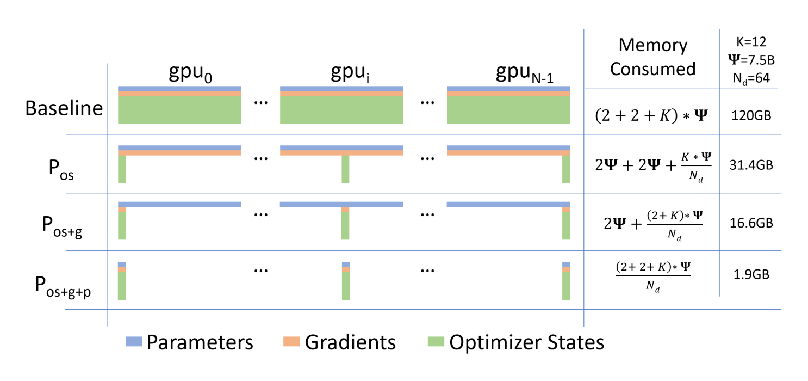

解决了模型状态，再来看剩余状态，也就是激活值（activation）、临时缓冲区（buffer）以及显存碎片（fragmentation）。

- 激活值同样使用分片方法，并且配合 checkpointing；
- 模型训练过程中经常会创建一些大小不等的临时缓冲区，比如对梯度进行 AllReduce 等，解决办法就是预先创建一个固定的缓冲区，训练过程中不再动态创建，如果要传输的数据较小，则多组数据 bucket 后再一次性传输，提高效率；
- 显存出现碎片的一大原因是时候 gradient checkpointing 后，不断地创建和销毁那些不保存的激活值，解决方法是预先分配一块连续的显存，将常驻显存的模型状态和 checkpointed activation 存在里面，剩余显存用于动态创建和销毁 discarded activation。

## 通信数据量分析

常用的集合通信（collective communication）函数 Collective Operations。

- Reduce: One rank receives the reductions of input values across ranks.

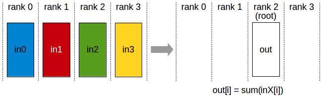

- Broadcast: all ranks receive data from “root” rank.

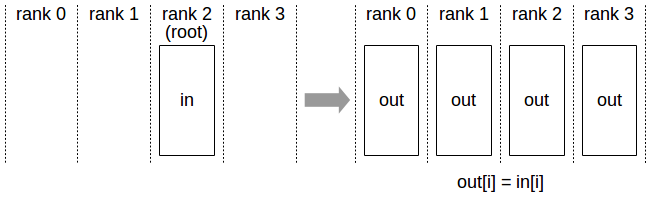

- All-Reduce: each rank receives the reduction of input values across ranks.

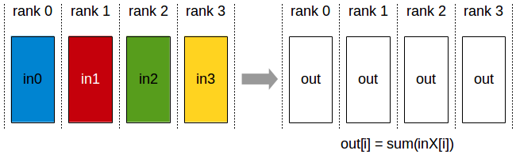

- All-Gather: each rank receives the aggregation of data from all ranks in the order of the ranks.

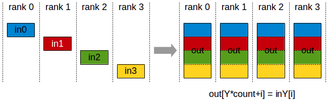

- Reduce-Scatter: input values are reduced across ranks, with each rank receiving a subpart of the result.

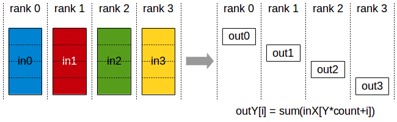

All-Reduce 可以通过 Reduce-Scatter 和 All-Gather 这两个更基本的集群通信操作来实现。基于 Ring 状通信可以高效的实现 Reduce-Scatter 和 All-Gather。

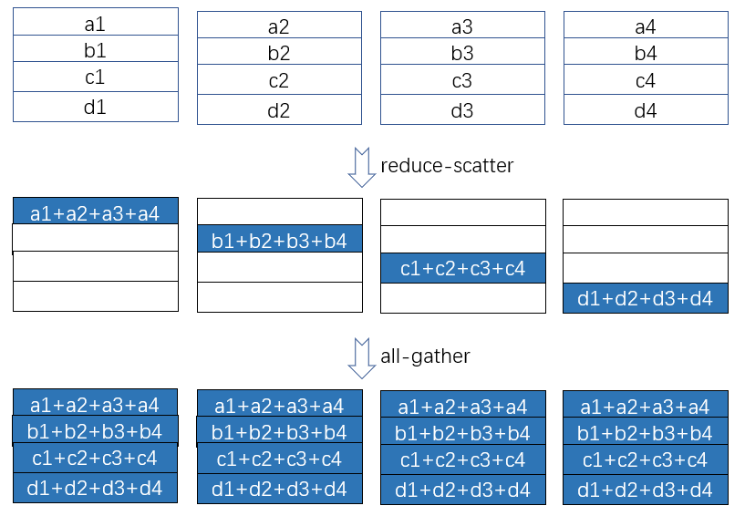

传统数据数据并行在每一步（step/iteration）计算梯度后，需要进行一次 All-Reduce 操作来计算梯度均值，目前常用的是 Ring All-Reduce，分为 Reduce-Scatter 和 All-Gather 两步，每张卡的通信数据量（发送+接受）近似为 $2\Psi$。

直接分析 $P_{os+g}$，每张卡只存储 $\frac{1}{N}$ 的优化器状态和梯度，对于 GPU0 来说，为了计算它这 $\frac{1}{N}$ 梯度的均值，需要进行一次 Reduce 操作，通信数据量是 $\frac{1}{N}\Psi \times N = \Psi$，然后其余显卡则不需要保存这部分梯度值了。实现中使用了 bucket 策略，保证 $\frac{1}{N}$ 的梯度每张卡只发送一次。

注意，假如模型最后两层的梯度落在 GPU0，为了节省显存，其他卡将这两层梯度删除，怎么计算倒数第三层的梯度呢？还是因为用了 bucket，其他卡可以将梯度发送和计算倒数第三层梯度同时进行，当二者都结束，就可以放心将后两层梯度删除了。

GPU0 计算好梯度均值后，就可以更新局部的优化器状态（包括 $\frac{1}{N}\Psi$ 的参数），当反向传播过程结束，进行一次 Gather 操作，更新 $(1-\frac{1}{N})\Psi$ 的模型参数，通信数据量是 $\Psi$。从全局来看，相当于用 Reduce-Scatter 和 AllGather 两步，和数据并行一致。

也就是说，$P_{os}$ 和 $P_{os+g}$ 的通信量和传统数据并行相同，而 $P_{os+g+p}$ 使得每张卡只存了 $\frac{1}{N}$ 的参数，不管是在前向计算还是反向传播，都涉及一次 Broadcast 操作，其通信量是 1.5 倍。

## ZeRO-Offload

显存不足，内存来补。相比于昂贵的显存，内存廉价多了，因此希望在模型训练过程中结合内存。之前的很多工作几乎只聚焦在内存上面，没有用到 CPU 计算，更没有考虑多卡的场景。ZeRO-Offload 则将训练阶段的某些模型状态下放（offload）到内存以及 CPU 计算。

直接看下效果，在单张 V100 的情况下，用 PyTorch 能训练 1.4B 的模型，吞吐量是 30TFLOPS，有了 ZeRO-Offload 加持，可以训练 10B 的模型，并且吞吐量 40TFLOPS。这么好的效果还能扩展到多卡上面，比如只用一台 DGX-2 服务器，可以训练 70B 的模型，是原来只用模型并行的 4.5 倍，在 128 张显卡的实验上基本也是线性加速，此外还可以与模型并行配合，快乐加倍！

ZeRO-Offload 没有涉及剩余状态（比如激活值）的下放，因为在 Transformer LM 场景中，其占用的显存比模型状态小。

ZeRO-Offload 并不希望为了最小化显存占用而让系统的计算效率下降，否则的话，只用 CPU 和内存不就得了。但是将部分 GPU 的计算和存储下放到 CPU 和内存，必然涉及 CPU 和 GPU 之间的通信增加，**不能让通信成为瓶颈**，此外 GPU 的计算效率相比于 CPU 也是数量级上的优势，也**不能让 CPU 参与过多计算**，避免成为系统瓶颈，只有前两条满足的前提下，再考虑最小化显存的占用。

下图是某一层的一次迭代过程（iteration/step），使用了混合精读训练，前向计算（FWD）需要用到上一次的激活值（activation）和本层的参数（parameter），反向传播（BWD）也需要用到激活值和参数计算梯度

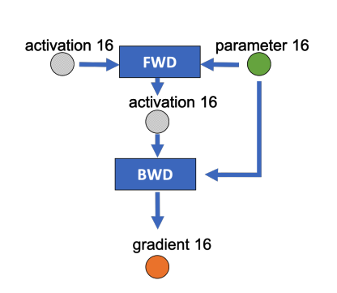

- 圆形节点表示模型状态，比如参数、梯度和优化器状态；
- 矩形节点表示计算操作，比如前向计算、后向计算和参数更新；
- 边表示数据流向；

如果用 Adam 优化器进行参数更新（Param update），流程如下：

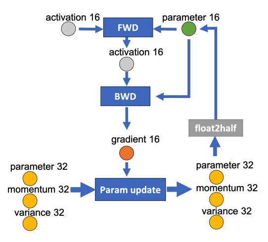

下面为边添加权重，物理含义是数据量大小（单位是字节），假设模型参数量是 M，在混合精度训练的前提下，边的权重要么是 2M（fp16），要么是 4M（fp32）。

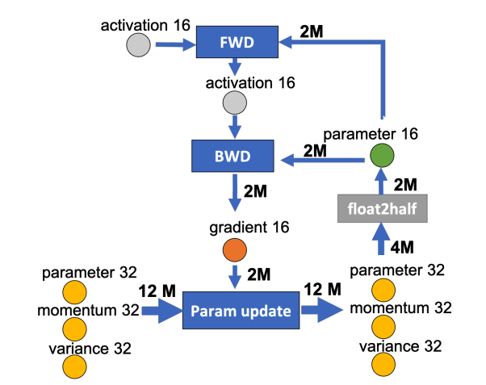

接下来沿着边把数据流图切分为两部分，分布对应 GPU 和 CPU，计算节点（矩形节点）落在哪个设备，哪个设备就执行计算，数据节点（圆形）落在哪个设备，哪个设备就负责存储，将被切分的边权重加起来，就是 CPU 和 GPU 的通信数据量。

ZeRO-Offload 的切分思路是：

图中有四个计算类节点：FWD、BWD、Param update 和 float2half，前两个计算复杂度大致是 O(MB) ，B 是 batch size，后两个计算复杂度是 O(M)。为了不降低计算效率，将前两个节点放在 GPU，后两个节点不但计算量小还需要和 Adam 状态打交道，所以放在 CPU 上，Adam 状态自然也放在内存中，为了简化数据图，将前两个节点融合成一个节点 FWD-BWD Super Node，将后两个节点融合成一个节点 Update Super Node。如下图所示，沿着 gradient 16 和 parameter 16 两条边切分。

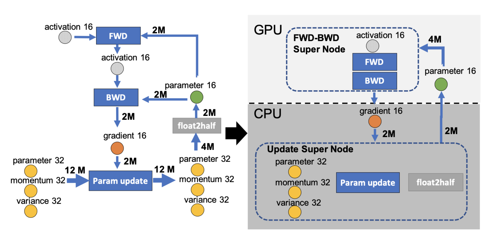

现在的计算流程是，在 GPU 上面进行前向和后向计算，将梯度传给 CPU，进行参数更新，再将更新后的参数传给 GPU。为了提高效率，可以将计算和通信并行起来，GPU 在反向传播阶段，可以待梯度值填满 bucket 后，一遍计算新的梯度一遍将 bucket 传输给 CPU，当反向传播结束，CPU 基本上已经有最新的梯度值了，同样的，CPU 在参数更新时也同步将已经计算好的参数传给 GPU，如下图所示。

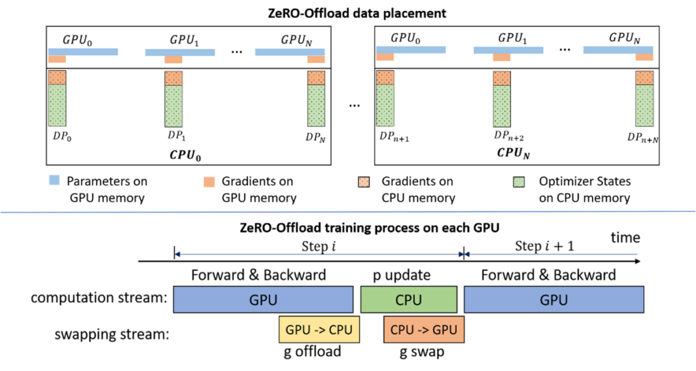

## 扩展性

在多卡场景，ZeRO-Offload 利用了 ZeRO-2，ZeRO-2 是将 Adam 状态和梯度进行了分区，每张卡只保存 $\frac{1}{N}$，而 ZeRO-Offload 做的同样是将这 $\frac{1}{N}$ 的 Adam 状态和梯度都 offload 到内存，在 CPU 上进行参数更新。

注意：在多卡场景，利用 CPU 多核并行计算，每张卡至少对应一个 CPU 进程，由这个进程负责进行局部参数更新。

并且 CPU 和 GPU 的通信量和 $N$ 无关，因为传输的是 fp16 gradient 和 fp16 parameter，总的传输量是固定的，由于利用多核并行计算，每个 CPU 进程只负责 $\frac{1}{N}$ 的计算，反而随着卡数增加节省了 CPU 计算时间。

但是有一个问题，当 batch size 很小时，GPU 上每个 micro-batch 计算很快，此时 CPU 计算时长会成为训练瓶颈，一种方法是让 CPU 在某个节点更新参数时延迟一步，后面就可以让 GPU 和 CPU 并行起来。

前 N-1 步，不进行延迟，避免早期训练不稳定，模型无法收敛，在第 N 步，CPU 拿到 GPU 计算的梯度后，不更新参数，相当于 GPU 空算了一步，到 N+1 步，CPU 开始根据刚才拿到的第 N 步的梯度计算，此时 GPU 开始算 N+1 步的梯度。

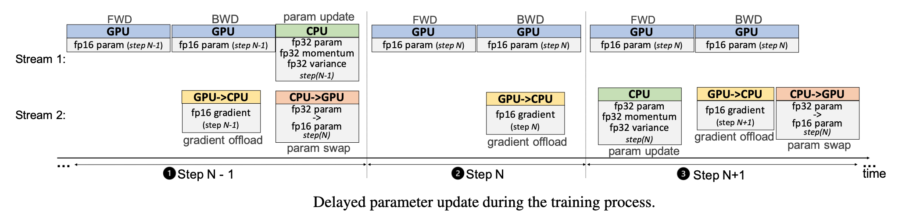

当然这样会有一个问题，用来更新参数的梯度并不是根据当前模型状态计算得到的，论文的实验结果表明暂未发现对收敛和效果产生影响。
