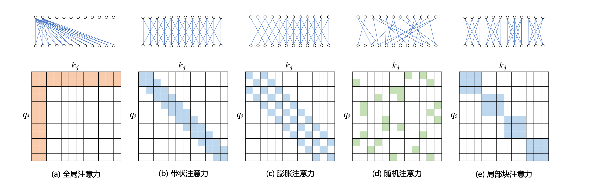
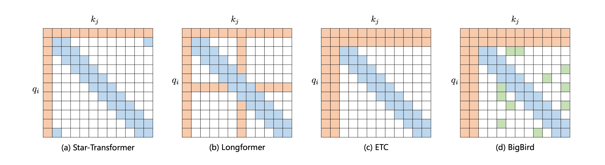

## IO-aware attention / memory-efficient attention

精确，同时 IO / 内存更省

- 数学上仍然是原始 Softmax attention，没有任何近似：
  $$
    O = \mathrm{softmax} \frac{QK^\top}{\sqrt{d}}V
  $$
- 靠算法 + 内存层次结构优化：
	- 分块读取 Q、K、V；
	- 在 on-chip SRAM 中分块计算；
	- 流式计算 softmax（保持数值稳定）；
	- 避免显式构造 $N \times N$ matrix。
- 复杂度仍是 $O(N^2 d)$，但实际 wall-clock 和内存压得很低，可支持长很多的上下文（比如 16K–64K+）。([OpenReview](https://openreview.net/pdf?id=H4DqfPSibmx&utm_source=chatgpt.com "Fast and Memory-Efficient Exact Attention with IO-Awareness"))

## Approximate 但算法上更快

### Linear / Kernel-based attention

如 Performer、TransNormerLLM、[[Lighting Attention]] 系列、Flash-Linear-Attention 等

优点：复杂度近似 $O(N)$，适合极长序列（数十万、上百万 token）。

缺点：需要精心设计 $\phi(\cdot)$、位置编码（比如 LRPE + decay 之类）来保证表达力，不然在某些任务上落后 softmax ([arXiv](https://arxiv.org/abs/2307.14995?utm_source=chatgpt.com "TransNormerLLM: A Faster and Better Large Language Model with Improved TransNormer"))。实现不当会被 cumsum 卡死。

### Sparse / Local / Block attention

Longformer、BigBird、Transformer-LS、Nyströmformer 等，把 attention pattern 限制在局部窗口 / 稀疏模式 / 低秩近似。

- 每个 token 只和附近 W 个 token 或某些“global tokens”交互；
- 或用 block-sparse 的模式，如滑动窗口 + 全局 token；
- 或把 $QK^\top$ 用低秩近似（Nyström 等）。
- 复杂度通常是 $O(NW)$ 或 $O(N \log N)$。

SparseAttention：基于位置信息和基于内容

基于位置信息，主要包含五种类型：

1. 全局注意力（Global Attention）：为了增强模型建模长距离依赖关系，可以加入一些全局节点；
2. 带状注意力（Band Attention）：大部分数据都带有局部性，限制 Query 只与相邻的几个节点进行交互；
3. 膨胀注意力（Dilated Attention）；与 CNN 中的 Dilated Convolution 类似，通过增加空隙以获取更大的感受野；
4. 随机注意力（Random Attention）：通过随机采样，提升非局部的交互；
5. 局部块注意力（Block Local Attention）：使用多个不重叠的块（Block）来限制信息交互。

经典的稀疏注意力模型：

1. Star-Transformer：使用带状注意力和全局注意力的组合。具体来说，Star-Transformer 只包括一个全局注意力节点和宽度为 3 的带状注意力，其中任意两个非相邻节点通过一个共享的全局注意力连接，而相邻节点则直接相连。
2. Longformer：使用带状注意力和内部全局节点注意力（Internal Global-node Attention）的组合。此外，Longformer 还将上层中的一些带状注意力头部替换为具有扩张窗口的注意力，在增加感受野同时并不增加计算量。
3. Extended Transformer Construction（ETC）：利用带状注意力和外部全局节点注意力（External Global-node Attention）的组合。ETC 稀疏注意力还包括一种掩码机制来处理结构化输入，并采用对比预测编码（Contrastive Predictive Coding，CPC）进行预训练。
4. BigBird：使用带状和全局注意力，还使用额外的随机注意力来近似全连接注意力，此外还揭示了稀疏编码器和稀疏解码器的使用可以模拟任何图灵机，这也在一定程度上解释了，为什么稀疏注意力模型可以取得较好的结果原因。

基于内容的稀疏注意力是根据输入数据来创建稀疏注意力，其中一种很简单的方法是使用选择和给定 query 有很高相似度的 key。

Routing Transformer

采用 K-means 聚类方法，针对 $\text{Query}\{q_i\}^T_{i=1}$ 和 $\text{Key}\{k_i\}^T_{i=1}$ 一起进行聚类，类中心向量集合为 $\{\mu_i\}^k_{i=1}$，其中 $k$ 是类中心个数。每个 Query 只与其处在相同簇（Cluster）下的 Key 进行交互。中心向量采用滑动平均的方法进行更新:

$$
\begin{aligned}
\widetilde{\boldsymbol{\mu}} &\leftarrow \lambda \widetilde{\boldsymbol{\mu}}+(1-\lambda)\left(\sum_{i: \mu\left(\boldsymbol{q}_i\right)=\mu} \boldsymbol{q}_i+\sum_{j: \mu\left(\boldsymbol{k}_j\right)=\mu} \boldsymbol{k}_j\right) \\
c_\mu &\leftarrow \lambda c_\mu+(1-\lambda)|\mu| \\
\mu &\leftarrow \frac{\widetilde{\boldsymbol{\mu}}}{c_\mu}
\end{aligned}
$$

其中 $|\mu|$ 表示在簇 $\mu$ 中向量的数量。

### KV 压缩 / 缓存裁剪

 - 对 KV 做 pooling / clustering；
 - 用 “长短记忆”(Long-Short Transformer) 只保留长程 summary + 短程精细信息；([arXiv](https://arxiv.org/abs/2107.02192?utm_source=chatgpt.com "Long-Short Transformer: Efficient Transformers for Language and Vision"))
 - 动态丢弃不重要的 KV（relevance-based pruning）。

### 混合 / 分层 / MoE attention

   - 部分 head 用 full-softmax + FlashAttention，部分 head 用 linear / local，形成 Hybrid Attention；
   - 或 MoE + efficient attention，只在部分 experts 上做重计算，其他部分采用轻量 attention。