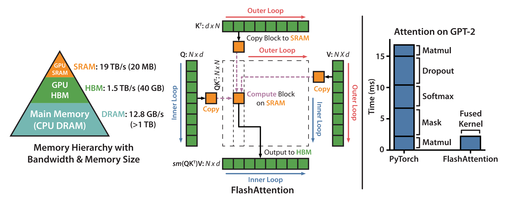
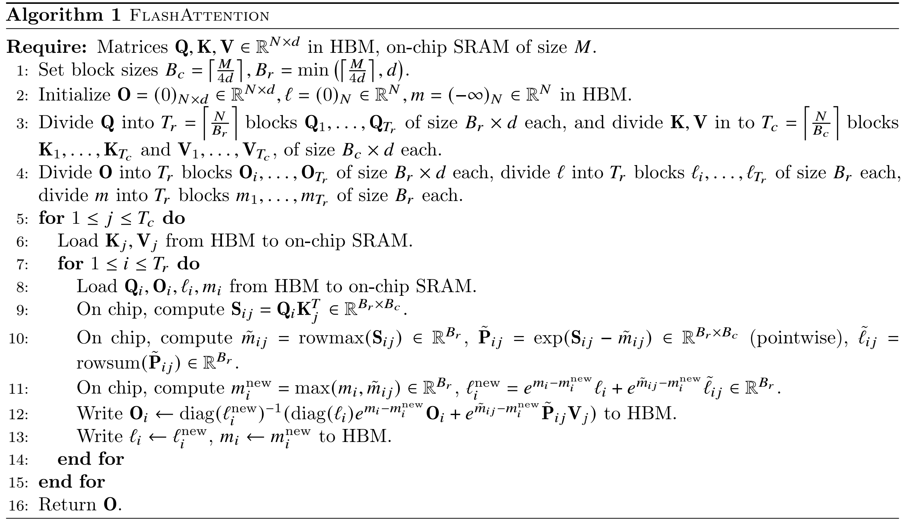
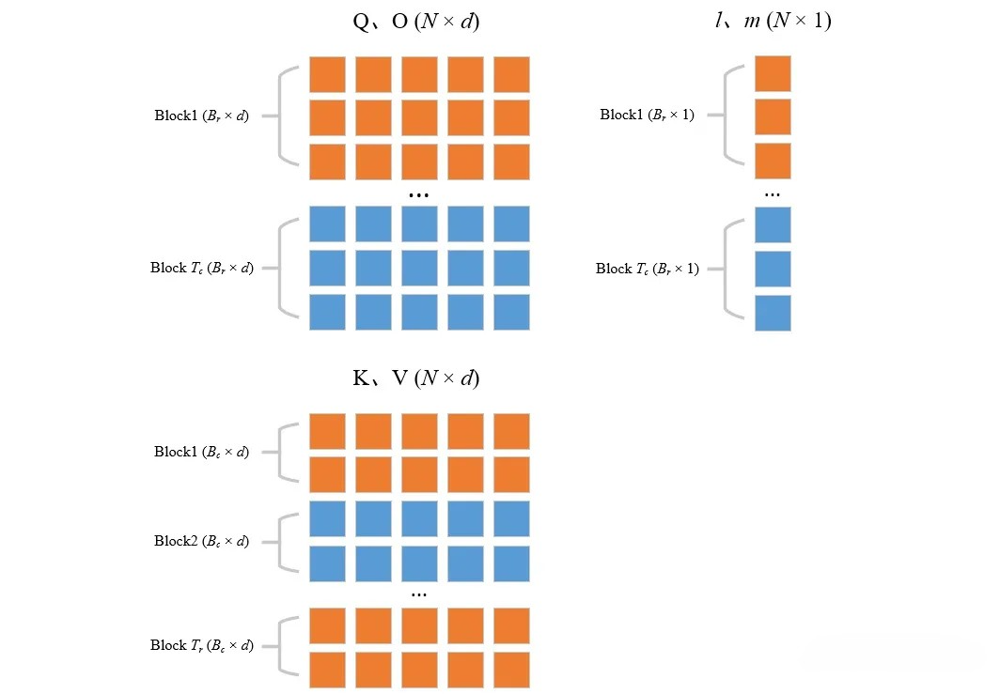
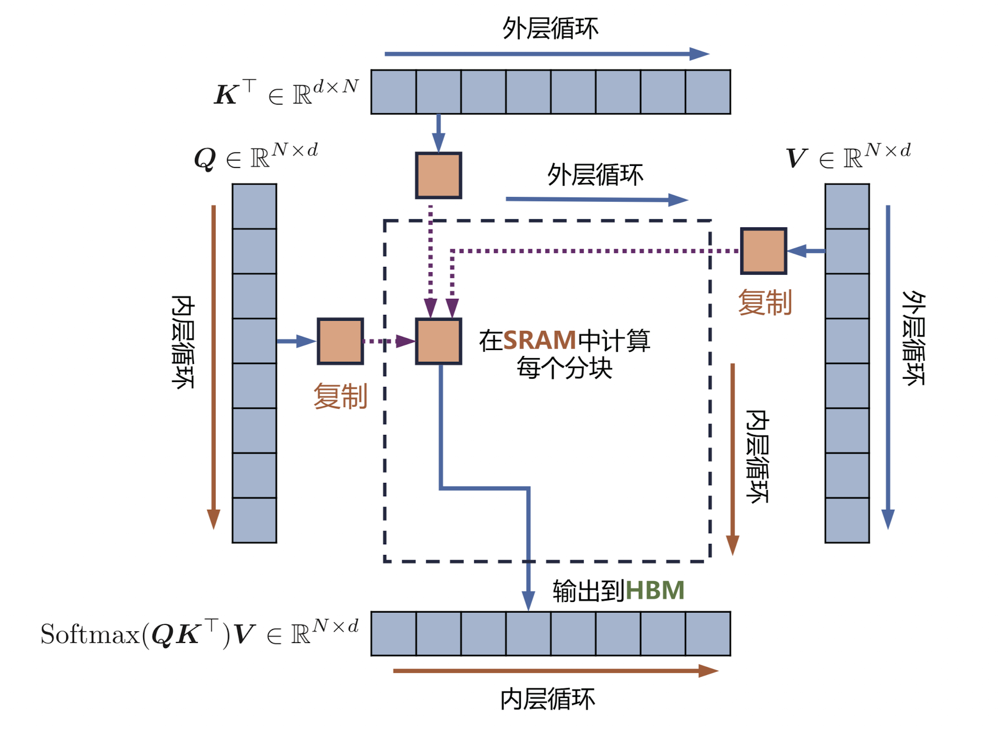
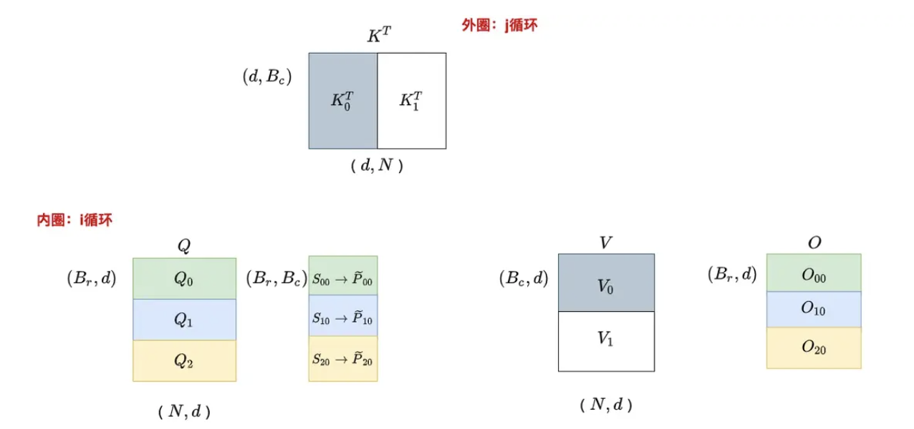
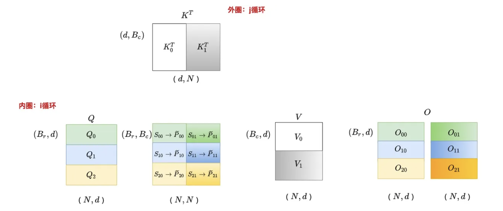
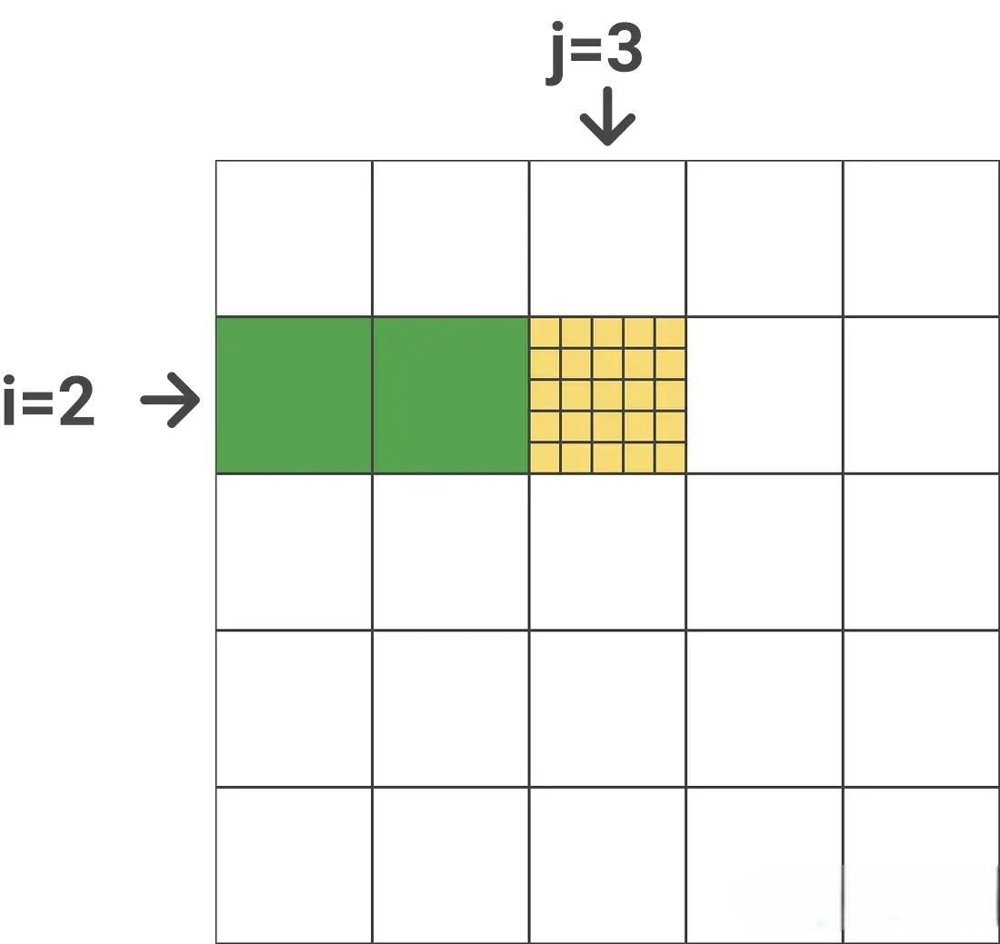
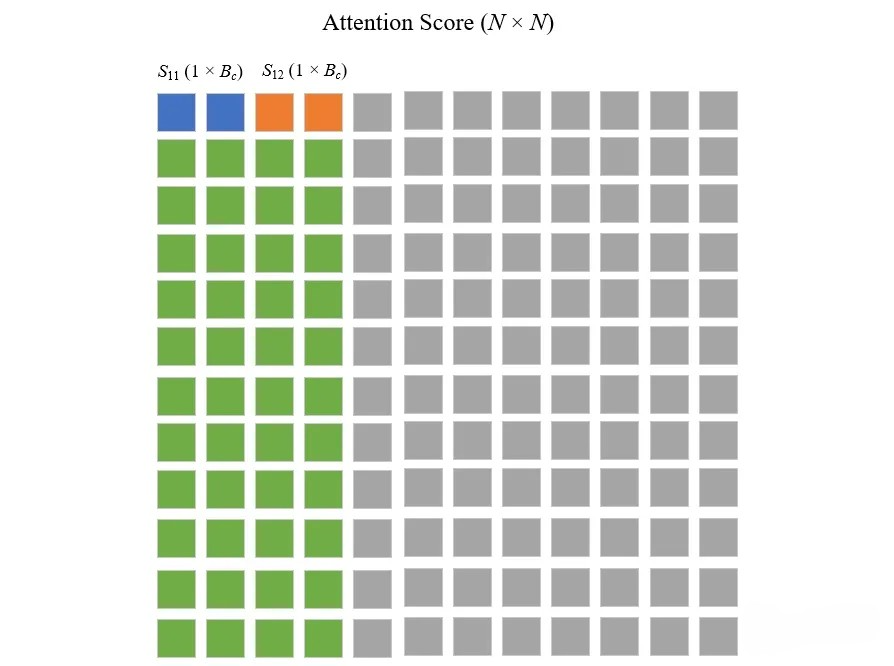

# FlashAttention

传统的 Attention 的瓶颈：

- 计算 $QK^\top$ 需要 $O(N^2)$ 中间存储（$N$ 是序列长度）
- 显存频繁读写导致带宽受限（Memory-Bound）

Flash-Attention 的解决方式：

- 分块计算（Tiling）：将 $Q,K,V$ 分成小块，在 SRAM/寄存器中计算局部 Attention，避免全局矩阵存储
- 增量 softmax：通过数学变换，在分块计算时维护全局归一化因子

算子融合（Kernel Fusion）

将以下操作合并为单个 CUDA Kernel：

- $QK^\top$ 矩阵乘法
- Softmax 归一化
- 与 $V$ 加权求和

避免显存中间结果：所有计算在芯片内完成，减少 HBM 访问次数

| 模型                                       | 上下文长度          |
| ------------------------------------------ | ------------------- |
| GPT3.5                                     | 4-16K               |
| GPT4                                       | 8K-32K（最新 128K） |
| LLaMA                                      | 2048                |
| LLaMA2                                     | 4096                |
| LLaMA2-long                                | 32K                 |
| 基于 LongLoRA 技术的 LongAlpaca-7B/13B/70B | 32K以上             |
| Baichuan 7B/13B、Baichuan2 7B/13B          | 4096（最长 192K）   |
| ChatGLM 6B                                 | 2000                |
| ChatGLM2 6B/ChatGLM3 6B                    | 8-32K               |

# FlashAttention

NVIDIA GPU 显存分为：

1. 全局内存 Global memory
2. 本地内存 Local memory
3. 共享内存 Shared memory，SRAM
4. 寄存器内存 Register memory
5. 常量内存 Constant memory
6. 纹理内存 Texture memory

其中全局内存、本地内存、共享内存和寄存器内存具有读写能力。全局内存和本地内存使用的高带宽显存（High Bandwidth Memory，HBM）位于板卡 RAM 存储芯片上，该部分内存容量很大。全局内存是所有线程都可以访问，而本地内存则只能当前线程访问。NVIDIA H100 中全局内存有 80GB 空间，其访问速度虽然可以达到 3.35TB/s，但是如果全部线程同时访问全局内存时，其平均带宽仍然很低。共享内存和寄存器位于 GPU 芯片上，因此容量很小，并且共享内存只有在同一个 GPU 线程块（Thread Block）内的线程才可以共享访问，而寄存器仅限于同一个线程内部才能访问。NVIDIA H100 中每个 GPU 线程块在流式多处理器（Stream Multi-processor，SM）可以使用的共享存储容量仅有 228KB，但是其速度非常快，远高于全局内存的访问速度。

## Transformer 计算复杂度：Self-Attention 层与 MLP 层

简单来说，计算复杂度和序列长度的平方 $N^2$ 成正比；精确来说，当输入 batch size 为 $b$，序列长度为 $N$ 时，$l$ 层 Transformer 模型的计算量为 $l\times (24bNd^2+4bN^2d)$，$d$ 代表词向量的维度或者隐藏层的维度（词向量的维度通常等于隐藏层维度）。

### self-attention 层的计算复杂度

$8bNd^2+4bN^2d$

- 第一步计算 QKV，即 $Q=xW_Q$，形状为 $[b,N,d]\times[d,d]\to[b,N,d]$，$[b,N,d] × [d,d]$ 看做 b 个 (N,d) × (d,d)，(N,d) × (d,d) 的计算次数是 2Ndd（乘法 Ndd、加法再 Ndd）。除了 Q 之外，还得再计算 K、V，再乘以个 3，得到 $6bNd^2$
- 第二步计算 $QK^\top$，该部分的输入和输出的形状为 $[b,head\_num,N,per\_head\_hidden\_size]\times[b,head\_num,per\_head\_hidden\_size,N]\to[b,head\_num,N,N]$，计算量为 $2bN^2d$
- 第三步计算在 $V$ 上的加权 $score \cdot V$，该部分矩阵乘法的输入和输出形状为 $[b,head\_num,N,N] \times[b,head\_num,N,per\_head\_hidden\_size]\rightarrow[b, head\_num,N,per\_head\_hidden\_size ]$，
    计算量为： $2bN^2d$
- 第四步为 attention 后的线性映射，矩阵乘法的输入和输出形状为 $[b, N, d] \times[d, d] \rightarrow[b, N, d]$ 计算量为 $2 b N d^2$

最终自注意力层的输出结果为

$$
x_{o u t}=\text{softmax}\left(\frac{Q K^\top}{\sqrt{d}}\right) \cdot V \cdot W_o+x
$$

### MLP 层的计算复杂度

$16bNd^2$

- MLP 块由 2 个线形层组成
- 第一个线形层将维度从 $d$ 映射到 $4d$，第二个线形层再将维度从 $4d$ 映射到 $d$：$x=f_{gelu}(x_{out}W_1)W_2+x_{out}$

$$
x=f_{\mathrm{gelu}}\left(x_{\mathrm{out}} W_1\right) W_2+x_{\mathrm{out}}
$$

- 第一个线性层的权重矩阵 $W_1$ 的形状为 $[d, 4 d]$ ，相当于先将维度从 $d$ 映射到 $4 d$ ，矩阵乘法的输入 $[b, N, d] \times[d, 4 d] \rightarrow[b, N, 4 d]$ ，计算量为 $8 b N d^2$
- 第二个线性层的权重矩阵 $W_2$ 的形状为 $[4 d, d]$ ，相当于再将维度从 $4 d$ 映射到 $d$ ，矩阵乘法的输入 $[b, N, 4 d] \times[4 d, d] \rightarrow[b, N, d]$ ，计算量为 $8 b N d^2$

将上述所有表粗所示的计算量相加，得到每个 Transformer 层的计算量大约为 $24bNd^2+4bN^2d$

### Logits 计算量

$2bNdV$

词向量维度通常等于隐藏层维度 $h$，词嵌入矩阵的参数量为 $Vh$，最后的输出层的权重矩阵通常与词嵌入矩阵的参数共享的。

参数共享可以减小参数量，词嵌入矩阵是 [vocab_size, hidden_size]，输出层矩阵是 [hidden_size, vocab_size]，是可以共享的。

Logits 矩阵乘法的输入和输出形状为 $[b,N,d]\times [d,V]\to[b,N,V]$，计算量为 $2bNdV$。

因此对于一个 $l$ 层的 Transformer 模型，输入数据形状为 $[b,N]$ 的情况下，一次训练迭代的计算量为上述 self-attention，MLP，Logits 三部分的总和：$l\times(24bNd^2+4bN^2d)+2bNdV$。

## Transformer 空间复杂度：Self-Attention 层与 MLP 层

中间激活的显存大小为 $l\times (34bNd+5bN^2a)$，其中 $a$ 为注意力头数，$a\times per\_head\_hidden\_size = d$

大模型在训练过程中通常采用混合精度训练，中间激活值一般是 float16 或者 bfloat16 数据类型的。在分析中间激活的显存占用时，假设中间激活值是以 float16 或 bfloat16 数据格式来保存的，每个元素占了 2 个 bytes。唯一例外的是，dropout 操作的 mask 矩阵，每个元素只占 1 个 bytes。

### Self-Attention 的中间激活

$11bNd+5bN^2a$

- 对于 QKV，需要保存它们共同的输入 x，这就是中间激活，x 的形状为 [b, N, d]，占用显存大小为 2bNd
- 对于 $QK^\top$ 矩阵乘法，需要保存中间激活 QK，占用显存 4bNd
- 对于 softmax 函数，需要保存函数的输入 $QK^\top$，Q 的形状为 [b,head_num,N,per_head_hidden_size]，$QK^\top$ 的形状为 [b,head_num,N,N]，元素个数为 $bN^2a$，占用显存 $2bN^2a$
- 每一个 token 相对于其他 token 的注意力权重，所以每个 token 都有 N 个权重，那么所有 token 就是 N²。 再，每个注意力头，都有这样一套注意力矩阵，所以是 $N^2a$，再乘以 batch 和 fp16
- 计算完 softmax 函数后，进行 dropout 操作，需要保存一个 mask 矩阵，形状与 $QK^\top$  相同，占用显存 $2bN^2a$
- 计算在 V 上的 attention，即 score·V，需要保存 score($2bN^2a$) 和 V(2bNd)
- 计算输出映射以及一个 dropout 操作，映射保存其输入 2bNd，dropout 保存 mask 矩阵 bNd

### MLP 的中间激活

- 第一个线性层需要保存其输入，占用显存大小为 2bNd
- 激活函数需要保存其输入，占用显存大小为 8bNd
- 第二个线性层需要保存其输入，占用显存大小为 8bNd
- 最后有一个 dropout 操作，需要保存 mask 矩阵，占用显存大小为 bNd

### 两个 Layer Norm 需要保存的中间激活

另外，self-attention 块和 MLP 块分别对应了一个 layer normalization。每个 layer norm 需要保存其输入，大小为 2bNd，两个共需要 4bNd

综上，每个 Transformer 层需要保存的中间激活占用显存大小为 $34bNd+5bN^2a$，对于 $l$ 层 Transformer 模型，还有 embedding 层、最后的输出层。embedding 层不需要中间激活。总的而言，当隐藏维度 $h$ 比较大，层数 $l$ 较深时，这部分的中间激活是很少的，可以忽略。因此，对于 $l$ 层的模型，中间激活占用的显存大小可以近似为 $l\times (34bNd+5bN^2a)$。

可以看到，**Transformer 模型的计算量和储存复杂度随着序列长度 $N$ 呈二次方增长**，这限制了大语言模型的最大序列长度 N 的大小。需要方法优化复杂度，注意到上述结果中 N 的二次方项，计算量中的 $4bN^2d$ 项和中间激活中的 $5bN^2a$ 项都是 self-attention 产生的，与 MLP 无关。

## 标准注意力 Standard Attention 问题

显存占用多、HBM 读写次数多

$$
\text{Attention}(Q, K, V)=\text{softmax}\left(\frac{Q K^{\top}}{\sqrt{d}}\right) V
$$

其中，$Q, K, V \in R^{N \times d}$ ，其中 $N$ 是序列长度，$d$ 是每个注意力头的维度，输出可以记为 $O \in R^{N \times d}$。可以拆解为以下三步：

$$
\begin{aligned}
S&=Q K^{\top} \in R^{N \times N} \\
P&=\text{softmax}(S) \in R^{N \times N} \\
O&=P V \in R^{N \times d}
\end{aligned}
$$

$S$ 被称为 Attention Scores，$P$ 可理解为 Normalized Attention Scores 或 Attention Weights。

在标准注意力实现中，$S,P \in R^{N\times N}$ 都要写回到 HBM 中，占用了 $O(N^2)$ 的内存，通常 $N \gg d$，例如对于 GPT2，N=1024，d=64，对于 GPT3，N=1028，d=128。

尽管已经有许多近似注意力的方法尝试减少 attention 的计算和内存要求。例如，稀疏近似和低秩近似的方法，将计算复杂度降低到了序列长度的线性或亚线性，但这些近似注意力方法方法并没有得到广泛应用。因为这些方法过于关注 FLOPS 的减少，而忽略了 IO 读写的内存访问开销，导致这并没有效减少运行时间（wall-clock time）。总之，在现代 GPU 中，计算速度已经远超过了显存访问速度，

Transformer中的大部分计算操作的瓶颈是显存访问。对于显存受限的操作，IO 感知是非常重要的，因为显存读写占用了大部分的运行时间。GPU 的内存由多个不同大小和不同读写速度的内存组成。内存越小，读写速度越快。对于 A100-40GB 来说，内存分级图如下所示。

- 静态随机存取存储器（Static Random Access Memory）SRAM 内存分布在 108 个流式多处理器上，每个处理器的大小为 192K，合计为 $192\times 108KB =20736KB=20MB$。SRAM 相当于计算块，但内存小
- 高带宽内存 HBM（High Bandwidth Memory），也就是常说的显存，大小为 40GB。SRAM 的读写速度为 19TB/s，而 HBM 的读写速度只有 1.5TB/s，不到 SRAM的1/10。计算慢，但内存大

Transformer 的核心组件 self-attention 块的计算复杂度和空间复杂度是序列长度 $N$ 的二次方，且对于 self-attention 块，除了两个大矩阵乘法（$QK^\top, PV$）是计算受限的，其他都是内存受限的逐点运算（例如对 $S$ 的 mask 操作、$S$ 的 softmax 操作、对 $P$ 的 dropout 操作，这些逐点操作的性能是受限于内存带宽的，会减慢运行时间。

总结：标准注意力实现存在两个问题：

1. 显存占用多，过程中由于实例化了完整的注意力矩阵 $P,S\in R^{N\times N}$，导致了 $O(N^2)$ 的内存要求
2. HBM 读写次数多，减慢了运行时间

## Memory-efficient Attention

把显存复杂度从平方降低到线性，但 HBM 访问次数仍是平方。

在注意力计算过程中，节省显存的主要挑战是 softmax 与 K,V 的列是耦合的，其方法是单独计算 softmax 的归一化因子，来实现解耦。

为了简化分析，忽略计算 softmax 时“减去最大值”的步骤，记 $Q$ 的第 $i$ 列为 $q_i \in R^d, ~ K$ 的第 $j$ 列为 $K_j \in R^d$ ，有 $S_{i j}=q_i^{T} k_j \in R$，定义 softmax 的归一化因子为：

$$
L_i=\sum_j e^{q_i^{\top} k_j} \in R
$$

记 $v_j \in R^d$ 为 $V$ 的第 $j$ 个列向量，则输出 $O$ 的第 $i$ 个列向量 $o_i$ 为：

$$
o_i=P_{i:} V=\sum_j P_{i j} v_j=\sum_j \frac{e^{q_i^{\top} k_j}}{L_i} v_j
$$

在计算得到归一化因子 $L_i$ 后，就可以通过反复累加 $\frac{e^{q_i^{\top} k_j}}{L_i} v_{j}$ 来得到 $o_i$，如此，通过节省显存（memory-efficient）的注意力机制 $Q$ ，改变了计算顺序，相比于 Standard Attention，节省显存的注意力机制将显存复杂度从 $O\left(N^2\right)$ 降低到了 $O(N)$。

这种方法在 Online normalizer calculation for softmax 和 Self-attention Does Not Need $O\left(N^2\right)$ Memory 中已经使用过，称为 lazy softmax，这种方法避免了实例化完整的注意力矩阵 $S, P$ ，从而达到了节省显存的目的。然而 HBM 访问次数仍然是 $O(N^2)$ 的，因此运行时间并没有减少。

## Flash Attention

通过 kernel 融合降低 HBM 读写次数，避免频繁地从 HBM 中读写数据。

1. 在标准注意力中，注意力的性能主要受限于内存带宽，是内存受限的，频繁地从 HBM 中读写 $N\times N$ 的矩阵是影响性能的主要瓶颈
2. 稀疏近似和低秩近似等近似注意力方法虽然减少了计算量 FLOPS，但对于内存受限的操作，运行时间的瓶颈是从 HBM 中读写数据的耗时，减少计算量并不能有效地减少运行时间 well-clock time
3. 针对内存受限的标准注意力，Flash Attention 是 IO 感知的，目标是避免频繁地从 HBM 中读写数据

所以，减少对 HBM 的读写次数，有效利用 SRAM 来进行计算是非常重要的，而对于性能受限于内存带宽的操作，进行加速的常用方式就是 kernel 融合，该操作的典型方式分为三步：

1. 每个 kernel 将输入数据从低速的HBM中加载到高速的 SRAM 中
2. 在 SRAM 中进行计算
3. 计算完毕后，将计算结果从 SRAM 中写入到 HBM 中

如果把 SRAM 协会 HBM 只是为了重新加载数据来计算 softmax，那么是可以将其保存在 SRAM 中，执行所有中间步骤，然后将最终结果写会 HBM，如此，便可避免反复执行从 HBM 中读取数据，SRAM 执行计算，最后将计算结果写入到 HBM 中，将多个操作融合成一个操作，减少读写 HBM 的次数。

### 分块计算注意力 Tiling

kernel 融合需满足 SRAM 的内存大小，但是 SRAM 的内存大小有限，不可能一次性计算完整的注意力，因此必须进行分块计算，使得分块计算需要的内存不超过 SRAM 的大小。因此需要分块计算，因此分块大小 block_size 不能太大，否则会导致 OOM。

Tiling 分块计算使得可以用一个 CUDA kernel 来执行注意力的所有操作。从 HBM 中加载输入数据，在 SRAM 中执行所有的计算操作（矩阵乘法、mask、softmax、dropout、矩阵乘法），再将计算结果写回到 HBM 中。

但是注意力机制的计算过程是“矩阵乘法 --> scale --> mask --> softmax --> dropout --> 矩阵乘法”，矩阵乘法和逐点操作（scale，mask，dropout）的分块计算是容易实现的，难点在于 softmax 的分块计算。由于计算 softmax 的归一化因子（分母）时，需要获取到完整的输入数据，进行分块计算的难度比较大。

1. 考虑到向量 $\left[x_1, x_2, \cdots, x_d\right]$ ，原生 softmax 的计算过程如下：

$$
\text{softmax}\left(x_i\right)=\frac{e^{x_i}}{\sum_{j=1}^{d^{x_j}} e^{x_j}}
$$

2. 在实际硬件中，浮点数表示的范围是有限的。对于 float32 和 bfloat16 来说，当 $x \geq 89$ 时，$e^x$ 就会变得很大甚至变成 inf，发生数据上溢的问题故为了避免发生数值溢出的问题，保证数值稳定性，计算时通常会“减去最大值”，称为 safe softmax。

​定义 $m(x)$ 为 $\left[x_1, x_2, \cdots, x_d\right]$ 中的最大值：

$$
m(x)=\max \left(\left[x_1, x_2, \ldots, x_d\right]\right)
$$

safe softmax：

$$
\text{softmax}\left(x_i\right)=\frac{e^{x_i-m(x)}}{\sum_{j=1}^d e^{x_j-m(x)}}
$$

3. 在训练语言模型时，通常会采用交叉摘损失函数。交叉摘损失函数等价于先执行 log_softmax 函数，在计算负对数似然函数且在计算 log_softmax 时，同样会执行减去最大值，这不仅可以避免数值溢出，提高数值稳定性，还可以加快计算速度

$$
\log \left(\text{softmax}\left(x_i\right)\right)=\log \left(\frac{e^{x_i-m}}{\sum_{j=1}^d e^{x_j-m}}\right)=x_i-m-\log \left(\sum_{j=1}^d e^{x_j-m}\right)
$$

总之，要计算输入序列中的特定第 $i$ 个标记对序列中其他标记的关注程度，需要在 SRAM 中随时可用所有这些分数（这里用 $x_j$ 表示），但是 SRAM 的容量是有限的，$N$（序列长度）可以是 1000 甚至 100000 个 token，$N^2$ 会爆炸得很快。

为了解决 softmax 分块计算的问题，考虑到 softmax 与 K 是耦合的，可以通过引入两个额外的统计量 m(x), l(x) 来进行解耦，其中 m(x) 类似于最大分数，l(x) 类似 exp 分数总和，实现了分块计算。

1. 首先，模型训练会影响 kernel 融合的效果，原因在于在标准注意力实现中，为了后向传递计算 Q, K, V 的梯度，前向计算时通常需要将某些中间结果（比如需要用到 N×N 的中间矩阵 S, P）写回到 HBM 中，这会产生额外的 HBM 读写次数，减慢运行时间，因此 Flash Attention 要想办法避免为后向传递保存很大的中间矩阵。
2. 进一步，Flash Attention 的办法是重新计算，即不保存 S, P 这两个矩阵，而只保存两个统计量 m(x), l(x)，后向传递时在高速的 SRAM 上快速地重新计算 Attention，通过分块的方式重新计算注意力矩阵 S, P。相比标准注意力中从 HBM 中读取很大的中间注意力矩阵的方法，重新计算的方法要快很多

总的来说，Flash Attention通过调整注意力的计算顺序，引入两个额外的统计量进行分块计算，避免了实例化完整的 N×N 的注意力矩阵 S,P，将显存复杂度从 $O(N^2)$ 降低到了 $O(N)$，此外，对于内存受限的标准注意力，Flash Attention 还通过 kernel 融合和分块计算，大量减少了 HBM 的访问次数，尽管由于后向传递中的重新计算增加了额外的计算量 FLOPs，但总的来说，最终还是减少了不少的运行时间，计算速度更快。

### 公式推导

1．$S=Q K^{\top} \in R^{N \times N}$
2．$P=\text{softmax}(S) \in R^{N \times N}$
3．$O=P V \in R^{N \times d}$
4．考虑到向量 $\left[x_1, x_2, \cdots, x_d\right]$ ，原生 softmax 的计算为：$\text{softmax}\left(x_i\right)=\frac{e^{x_i}}{\sum_{j=1}^d e^{x_j}}$。其中分子 $e^{x_i}$ 为对向量 $x$ 中的第 $i$ 个元素取指数，分母 $\sum_{j=1}^d e^{x_j}$ 则是对向量 $x$ 中的所有元素取指数后的和，这确保了 softmax 函数的输出是一个概率分布，即所有元素的和为 1。
5．$m(x)=\max \left(\left[x_1, x_2, \ldots, x_d\right]\right)$，$m(x)$ 被定义为 $\left[x_1, x_2, \cdots, x_d\right]$ 中的最大值
6．$f(x)=\left[\begin{array}{lll}e^{x_1-m(x)} & \ldots & e^{x_d-m(x)}\end{array}\right]$

$f(x)$ 是一个新的向量，其中每一项相当于在公式 4 的标准 softmax 的分子即 $e^{x_i}$ 的每一项的基础上，在其指数项 $x_i$ 中减去了一个 $\left[x_1, x_2, \cdots, x_d\right]$ 中的最大值 $m(x)$

7．$l(x)=\sum_i f(x)_i$

$l(x)$ 是变体 softmax 分母中的求和项，为了方便后续的描述，下文将本公式 7 中的求和项称为“EXP求和项”

8．$\text{softmax}(x):=\frac{f(x)}{l(x)}=\frac{\left[e^{x_1-m(x)} \ldots e^{x_d-m(x)}\right]}{\sum_i f(x)_i}$

考虑一个大小为 2d 的向量 $x \in \mathbb{R}^{2 d}$ ，将其＂一切为二＂进行分块：$x=\left[x^{(1)}, x^{(2)}\right]$，其中 $x^{(1)}, x^{(2)} \in \mathbb{R}^d$。

换言之，子向量 $x^{(1)}$ 是原向量 $x$ 的前半部分，子向量 $x^{(2)}$ 是原向量 $x$ 的后半部分。假设在分块计算中先处理 $x^{(1)}$ ，再处理 $x^{(2)}$。

那就先使用公式 5 至公式 8 对子向量 $x^{(1)}$ 计算的其“局部 softmax”，计算过程如下公式 9-12 所示。

9．$m\left(x^{(1)}\right)=\max \left(\left[x_1^{(1)}, x_2^{(1)}, \ldots, x_d^{(1)}\right]\right)$
10．$f\left(x^{(1)}\right)=\left[e^{x_1^{(1)}-m\left(x^{(1)}\right)}, \ldots, e^{x_d^{(1)}-m\left(x^{(1)}\right)}\right]$
11．$l\left(x^{(1)}\right)=\sum_i f\left(x^{(1)}\right)_i$
12．${\text {softmax }\left(x^{(1)}\right)}=\frac{f\left(x^{(1)}\right)}{l\left(x^{(1)}\right)}$

很明显，至此得到的 $\mathrm{softmax}\left(x^{(1)}\right)$ 并不能算是子向量 $x^{(1)}$ 的最终结果，原因很简单

- 公式 10 中的指数项减去的最大值应该是整个向量 $x$ 的最大值 $m(x)$ ，而不应该是子向量 $x^{(1)}$ 的最大值 $m\left(x^{(1)}\right)$
- 公式 12 中分母的 EXP 求和项应该是关于整个向量 $x$ 的求和项，而非仅仅只是子向量 $x^{(1)}$ 中所有元素的求和项

正因上述计算得到的 $\text{softmax}\left(x^{(1)}\right)$ 不是最终结果，所以将其称为“局部的”

接下来通过保存额外的一些变量值，在处理完 $x^{(2)}$ 后更新 $x^{(1)}$ 的 softmax 值。

首先，在处理完子向量 $x^{(1)}$ 后，保存 $m\left(x^{(1)}\right)$ 和 $l\left(x^{(1)}\right)$ ，相比于保存整个子向量 $x^{(1)}$ ，仅保存这两个标量的开销要小的多其次，还需要保存两个全局标量：$m_{\text {max }}$ 和 $l_{\text {all }}$

- $m_{m a x}$ 表示当前最大值，因为目前只处理完了 $x^{(1)}$ ，所以暂：$m_{\text {max }}=m\left(x^{(1)}\right)$
- $l_{\text {all }}$ 表示全局 EXP 求和项。因为目前只处理完了 $x^{(1)}$ ，所以暂：$l_{\text {all }}=l\left(x^{(1)}\right)$

接着采用类似处理 $x^{(1)}$ 的方法来处理 $x^{(2)}$ ，可得如下结果：

13．$m\left(x^{(2)}\right)=\max \left(\left[x_1^{(2)}, x_2^{(2)}, \ldots, x_d^{(2)}\right]\right)$
14．$f\left(x^{(2)}\right)=\left[e^{x_1^{(2)}-m\left(x^{(2)}\right)}, \ldots, e^{x_d^{(2)}-m\left(x^{(2)}\right)}\right]$
15．$l\left(x^{(2)}\right)=\sum_i f\left(x^{(2)}\right)_i$
16．$\text{softmax}\left(x^{(2)}\right)=\frac{f\left(x^{(2)}\right)}{l\left(x^{(2)}\right)}$

同样，此时公式 16 得到的 softmax 也是局部而非全局的。但在处理完 $x^{(2)}$ 之后，可以利用 $x^{(2)}$ 的信息来更新之前保存的两个全局标量。

17．$m_{\text {max }}^{\text {new }}=\max \left(\left[m_{\max }, m\left(x^{(2)}\right)\right]\right)$
18．$l_{\text{all}}^{\text {new}}=e^{m_{\max }-m_{\max }^{\text {new}}} l_{\text {all }}+e^{m_{x^{(2)}}-m_{\max }^{\text {new }}} l\left(x^{(2)}\right)$

公式 18 是更新的全局 EXP 求和项的方法，以 $l\left(x^{(2)}\right)$ 为例，我们说 $l\left(x^{(2)}\right)$ 是“局部的”是因为 $l\left(x^{(2)}\right)$ 到目前为止只用到了 $x^{(2)}$ 的信息，将 $l\left(x^{(2)}\right)$ 更新至“全局”需要用到 $m_{m a x}^{n e w}$。

把 $l\left(x^{(2)}\right)$ 的计算公式 15 $l\left(x^{(2)}\right)=\sum_i f\left(x^{(2)}\right)_{i}$ 稍微展开可得：

19．$l\left(x^{(2)}\right)=\sum_i e^{x_i^{(2)}-m\left(x^{(2)}\right)}$

为此可以将 $l\left(x^{(2)}\right)$ 做下变换，以变成全局

20．即

$$
\begin{aligned}
l^{\text {new }}\left(x^{(2)}\right) & =l\left(x^{(2)}\right) \cdot e^{m\left(x^{(2)}\right)-m_{\max }^{\mathrm{new}}} \\
& =\sum_i e^{x_i^{(2)}-m\left(x^{(2)}\right)} \cdot e^{m\left(x^{(2)}\right)-m_{m a x}^{\mathrm{new}}} \\
& =\sum_i e^{x_i^{(2)}-m_{\max }^{\mathrm{new}}}
\end{aligned}
$$

此时的 $l\left(x^{(2)}\right)$ 更新为全局的。

这个公式说明，当需要把某个 $l$ 更新为全局时，只要将其乘以一个项：$e^{m-m_{m a x}^{n e w}}$ ，其中 $m$ 表示当前 $l$ 对应的最大值，$m_{m a x}^{n e w}$ 表示当前最大值。

回到公式18，可知其首先用了这种全局更新方法分别将 $l_{\text {all }}$ 与 $l\left(x^{(2)}\right)$ 更新至全局，然后将它们求和得到当前的 EXP 求和项。

基于上述更新 $l$ 的方法，也能直接更新 softmax 值。根据公式 16 即 $\text{softmax}\left(x^{(2)}\right)=\frac{f\left(x^{(2)}\right)}{l\left(x^{(2)}\right)}$ ，可知 $f\left(x^{(2)}\right)=\text{softmax}\left(x^{(2)}\right) \times l\left(x^{(2)}\right)$

由于当前的分子和分母都是局部的，所以都需要更新至全局。先看分子部分 $f\left(x^{(2)}\right)$ 由公式 14 定义即$f\left(x^{(2)}\right)=\left[e^{x_1^{(2)}-m\left(x^{(2)}\right)}, \ldots, e^{x_d^{(2)}-m\left(x^{(2)}\right)}\right]$ ，可将其做下更新
21．即：

$$
\begin{aligned}
f^{n e w}\left(x^{(2)}\right) & =f\left(x^{(2)}\right) \cdot e^{m\left(x^{(2)}\right)-m_{m a x}^{n e w}} \\
& =\left[e^{x_1^{(2)}-m\left(x^{(2)}\right)}, \ldots, e^{x_d^{(2)}-m\left(x^{(2)}\right)}\right] \cdot e^{m\left(x^{(2)}\right)-m_{m a x}^{\mathrm{new}}} \\
& =\left[e^{x_1^{(2)}-m_{m a x}^{n e w}}, \ldots, e^{x_d^{(2)}-m_{m a x}^{n e w}}\right]
\end{aligned}
$$

当对比 $f\left(x^{(2)}\right)$ 变换前后，再次印证上面针对公式 20 所得的结论，即：如想把 $f\left(x^{(2)}\right)$ 从局部值变成全局值，只要将其乘以一个项： $e^{m-m_{m a x}^{n e w}}$ ，其中 $m$ 表示当前 $l$ 对应的最大值，$m_{m a x}^{n e w}$ 表示当前最大值。

再来看分母部分 $l\left(x^{(2)}\right)$ ，其实只需要将分母由 $l\left(x^{(2)}\right)$ 替换为 $l_{a l l}^{n e w}$ 即可：
22．即：

$$
\frac{\text{softmax}\left(x^{(2)}\right) \cdot l\left(x^{(2)}\right)}{l_{\text {all }}^{\text {naw }}}
$$

其中的 $l_{\text {all }}^{\text {new }}$ 由公式 18 计算得到。

最后，结合公式21和公式22， $\text{softmax}\left(x^{(2)}\right)$ 的更新可由如下实现：
23． 即：

$$
\text{softmax}^{(\text {new })}\left(x^{(2)}\right)=\frac{\text { softmax }\left(x^{(2)}\right) \cdot l\left(x^{(2)}\right) \cdot e^{m\left(x^{(2)}\right)-m_{\max }^{\text {now }}}}{l_{\text {all }}^{\text {naw }}}
$$

仔细看公式 23 ，我们在更新 $x^{(2)}$ 的 softmax 值时，用到了前面提到的额外保存的几个量：

- $x^{(2)}$ 的局部 softmax 值 $\text{softmax}\left(x^{(2)}\right)$ ，来自公式 16
- $x^{(2)}$ 的局部 EXP 求和项 $l\left(x^{(2)}\right)$ ，来自公式 15
- $x^{(2)}$ 的局部最大值 $m\left(x^{(2)}\right)$ ，来自公式 13
- 全局最大值 $m_{\max }^{n e w}$ ，来自公式 17
- 全局 EXP 求和项 $l_{a l l}^{n e w}$ ，来自公式 18

同理，可以将上面前三项中的 $x^{(2)}$ 替换成 $x^{(1)}$ 来对 $x^{(1)}$ 的 softmax 值进行更新，所有更新过程都不需要用到 $x^{(1)}$ 或 $x^{(2)}$ 的向量值。这就是 Flash Attention 中对 softmax 值进行动态更新的本质。

上述其实是一个增量计算的过程：我们首先计算一个分块的局部 softmax 值，然后存储起来。当处理完下一个分块时，可以根据此时的新的全局最大值和全局EXP求和项来更新旧的 softmax 值，接着再处理下一个分块，然后再更新。当处理完所有分块后，此时的所有分块的 softmax 值都是“全局的”

### 对分块计算注意力 tiling 的简单总结

对于两个向量 $x^{(1)}, x^{(2)} \in R^d$ ，解耦拼接向量 $x=\left[x^{(1)}, x^{(2)}\right] \in R^{2 d}$ 的 softmax 计算：

$$
\begin{gathered}
m(x)=m\left(\left[x^{(1)} x^{(2)}\right]\right)=\max \left(m\left(x^{(1)}\right), m\left(x^{(2)}\right)\right) \\
f(x)=\left[e^{m\left(x^{(1)}\right)-m(x)} f\left(x^{(1)}\right) \quad e^{m\left(x^{(2)}\right)-m(x)} f\left(x^{(2)}\right)\right] \\
l(x)=\ell\left(\left[x^{(1)} x^{(2)}\right]\right)=e^{m\left(x^{(1)}\right)-m(x)} l\left(x^{(1)}\right)+e^{m\left(x^{(2)}\right)-m(x)} l\left(x^{(2)}\right) \\
\text{softmax}(x)=\frac{f(x)}{l(x)}
\end{gathered}
$$

通过保持两个额外的统计量 $m(x), l(x)$ ，可以实现 softmax 的分块计算。需要注意的是，可以利用 GPU 多线程同时并行计算多个 block 的 softmax。为了充分利用硬件性能，多个 block 的计算不是串行（sequential）的，而是并行的。

举例：对向量［1, 2, 3, 4］计算 softmax，分成两块［1, 2］和［3, 4］进行计算

计算 block 1：

$$
\begin{gathered}
m_1=\max ([1,2])=2 \\
f_1=\left[e^{1-2}, e^{2-2}\right]=\left[e^{-1}, e^0\right] \\
l_1=\sum f_1=e^{-1}+e^0 \\
o_1=\frac{f_1}{l_1}=\frac{\left[e^{-1}, e^0\right]}{e^{-1}+e^0}
\end{gathered}
$$

计算 block 2：

$$
\begin{gathered}
m_2=\max ([3,4])=4 \\
f_2=\left[e^{3-4}, e^{4-4}\right]=\left[e^{-1}, e^0\right] \\
l_2=\sum f_2=e^{-1}+e^0 \\
o_2=\frac{f_2}{l_2}=\frac{\left[e^{-1}, e^0\right]}{e^{-1}+e^0}
\end{gathered}
$$

合并得到完整的 softmax 结果：

$$
\begin{aligned}
& m=\max \left(m_1, m_2\right)=4 \\
& f=\left[e^{m_1-m} f_1, e^{m_2-m} f_2\right]=\left[e^{-3}, e^{-2}, e^{-1}, e^0\right] \\
& l=e^{m_1-m} l_1+e^{m_2-m} l_2=e^{-3}+e^{-2}+e^{-1}+e^0 \\
& o=\frac{f}{l}=\frac{\left[e^{-3}, e^{-2}, e^{-1}, e^0\right]}{e^{-3}+e^{-2}+e^{-1}+e^0}
\end{aligned}
$$

## Flash Attention 算法的前向计算算法

在忽略 mask 和 dropout 的情况下，简化分析，Flash Attention 算法的前向计算过程如下所示：

从中可以看出，Flash Attention 在 K, V 的维度上做外循环，在 Q 的维度上做内循环（在 triton 的实现中，在 Q 的维度上做外循环，在 K, V 的维度上做内循环）

首先，有基本条件：

Matrices $\mathbf{Q}, \mathbf{K}, \mathbf{V} \in \mathbb{R}^{N \times d}$ in HBM，on-chip SRAM of size $M$。其中，$N$ 是序列长度，$d$ 是每个注意力头的维度，$S R A M$ 的大小为 $M$。

算法流程：

1．设置块大小 $B_c=\left\lceil\frac{M}{4 d}\right\rceil, B_r=\min \left(\left\lceil\frac{M}{4 d}\right\rceil, d\right)$

计算行/列块大小：由于查询键和值向量是 $d$ 维的，所以还需要将它们组合成输出的 $d$ 维向量，所以需要 $ceil(M / 4 d)$ 。所
以这个大小基本上允许我们用 $qkv$ 和 0 向量最大化 SRAM 的容量

以 GPT2 和 A100 为例：

A100 的 SRAM 大小为 $M=192 K B=196608 B$，GPT2 中 $N=1024, d=64$ ，对应的 $Q, K, V$ 的维度为 $N \times d=1024 \times 64$ ，中间结果 $S, P$ 的维度为：$N \times N=1024 \times 1024$。故 $B_c=\lceil 196608 / 4 / 64\rceil=768 ; \quad B_r=\min (768,64)=64$

2. Initialize $\mathbf{O}=(0)_{N \times d} \in \mathbb{R}^{N \times d}, \ell=(0)_N \in \mathbb{R}^N, m=(-\infty)_N \in \mathbb{R}^N$ in HBM．

用全 0 初始化输出矩阵 $O$ ，它将作为一个累加器

$l$ 类似上文的 $l(x)$ ，其目的是保存 softmax 的累积分母：exp 分数的总和

$m$ 类似上文的 $m(x)$ ，其逐行保存最大分数，且初始化为 -inf，将对其进行 Max 运算符。

3. Divide $\mathbf{Q}$ into $T_r=\left\lceil\frac{N}{B_r}\right\rceil$ blocks $\mathbf{Q}_1, \ldots, \mathbf{Q}_{T_r}$ of size $B_r \times d$ each, and divide $\mathbf{K}, \mathbf{V}$ in to $T_c=\left\lceil\frac{N}{B_c}\right\rceil$ blocks $\mathbf{K}_1, \ldots, \mathbf{K}_{T_c}$ and $\mathbf{V}_1, \ldots, \mathbf{V}_{T_c}$  of size $B_c \times d$ each．

按照步骤 1 中的块大小，将 $Q, K$ 和 $V$ 分成块。具体来说，则是

$Q$ 沿着行方向分为 $T_r$ 块，每一分块的大小为 $B_r \times d$，$K, V$ 沿着行方向分为 $T_c$ 块，每一分块的大小为 $B_c \times d$，而 $T_c=\lceil 1024 / 768\rceil=2 ; T_r=\lceil 1024 / 64\rceil=16$

4. Divide $\mathbf{O}$ into $T_r$ blocks $\mathbf{O}_i, \ldots, \mathbf{O}_{T_r}$ of size $B_r \times d$ each, divide $\ell$ into $T_r$ blocks $\ell_i, \ldots, \ell_{T_r}$ of size $B_r$ each, divide $m$ into $T_r$ blocks $m_1, \ldots, m_{T_r}$ of size $B_r$ each．

将 $O, l, m$ 分割成块。至于向量 1 和向量 $m$ 则分为 $T_r$ 块，每一块子向量大小为 $B_r$

综合上述 3、4 两个步骤，先后切分 $Q, K, V, O, 1, m$（别看上面这么多内容，其实就干这点事），可以得到各个分块之间的关系如下：

切分完之后，接下来开启两大循环，先外（列）循环，再内（行）循环

5. for 1 ≤ j ≤ Tc do

开始跨列循环（即外部循环，由 $T_c$ 控制，从上一列到下一列），即跨键/值向量，即遍历 K, V，一共循环 $T_c=2$ 次：

6. Load Kj , Vj from 慢速 HBM to on-chip 快速 SRAM
7.  for 1 ≤ i ≤ Tr  do

开始跨行内部循环（从上一行到下一行），即跨查询向量，一共循环 $T_r=16$ 次，可只在遍历 $Q, O, l, m$

8. Load $Q_i, O_i, \ell \mathrm{l}, m_i$ from HBM to on-chip SRAM

将 $Q_i\left(B_r \times d=64 \times d\right)$ 和 $O_i\left(B_r \times d=64 \times d\right)$ 块以及 $l_i\left(B_r\right)$ 和 $m_i\left(B_r\right)$ 加载到 SRAM 中。

这里需要保证 $l_i$ 和 $m_i$ 能够载入 SRAM（包括所有中间变量）

9. On chip，compute $\mathbf{S}_{i j}=\mathbf{Q}_i \mathbf{K}_i^\top \in \mathbb{R}^{B_r \times B_c}$ ，即为 $C_{64 \times 768}=A_{64 \times d} \times B_{d \times 768}$

这一步计算 $Q_i\left(B_r \times d\right)$ 和 $K_{j}$ 转置 $\left(d \times B_c\right)$ 之间的点积，得到分块的 Attention Score $\mathbf{S}_{i j}=\mathbf{Q}_i \mathbf{K}_i^\top \in \mathbb{R}^{B_r \times B_c}$ ，在标准的 Transformer 计算中得到的 Attention Score 是一个 $N \times N$ 的矩阵，如下图所示（图中 $N=12, B_r=3, B_c=2$ ）

当 $j=0$ ，遍历 $i$

当 $j=1$ ，遍历 $i$

10. On chip, compute $\tilde{m}_{i j}=\text{rowmax}\left(\mathbf{S}_{i j}\right) \in \mathbb{R}^{B_r}, \tilde{\mathbf{P}}_{i j}=\exp \left(\mathbf{S}_{i j}-\tilde{m}_{i j}\right) \in \mathbb{R}^{B_r \times B_c} \text { (pointwise) },\tilde{\ell}_{i j}=\text{rowsum}\left(\tilde{\mathbf{P}}_{i j}\right) \in \mathbb{R}^{B_r}$

使用上一步计算的分数计算 $\tilde{m}_{i j}, ~ \tilde{\ell}_{i j}$ 和 $\tilde{\mathbf{P}}_{i j}$，对分块的 Attention Score $S_{i j}$ ，计算它每一行中的最大值 $m_{i j}=\text{rowmax}\left(\mathrm{S}_{i j}\right) \in \mathbb{R}^{B_r}$

基于 $\hat{m}_{i j}$ ，计算指数项（归一化，取行最大值并从行分数中减去它，然后 EXP）：$\hat{P}_{i j}=\exp \left(\mathrm{S}_{i j}-\hat{m}_{i j}\right) \in \mathbb{R}^{B_r \times B_c}$

然后再基于 $\hat{P}_{i j}$ ，计算 EXP 求和项（矩阵 $P$ 的逐行和）：$\hat{l}_{i j}=\text{rowsum}\left(\hat{P}_{i j}\right) \in \mathbb{R}^{B_r}$

11. On chip，compute $m_i^{\text {new }}=\max \left(m_i, \tilde{m}_{i j}\right) \in \mathbb{R}^{B_r}, ~ \ell_i^{\text {new }}=e^{m_i-m_i^{\text {new }}} \ell_i+e^{\tilde{m}_{i j}-m_i^{\text {new }}} \tilde{\ell}_{i j} \in \mathbb{R}^{B_r}$

这一步是计算 $m_i^{\text {new }}$ 和 $\ell_i^{\text {new }}$ ，举个例子，如下图：

$m_i$ 包含之前所有块的逐行最大值（j=1 & j=2，用绿色表示），$\tilde{m}_{i j}$，包含当前块的逐行最大值（用黄色表示）。为了得到 $m_i^{\text {new }}$我们只需要在 $\tilde{m}_{i j}$ 和 $m_i$ 之间取一个最大值，$\ell_i^{\text {new }}$ 也类似

和上文利用公式 17 即 $m_{\text {max }}^{n e w}=\max \left(\left[m_{\text {max }}, m\left(x^{(2)}\right)\right]\right)$ 和公式 18 即  $l_{\mathrm{all}}^{\text {new }}=e^{m_{\max }-m_{\max }^{\mathrm{new}}} l_{\mathrm{all}}+e^{m_x(2)-m_{\max }^{n e w}} l\left(x^{(2)}\right)$ 分别更新 $m_i$ 和 $l_i$ ，是一个意思
12. Write $\mathbf{O}_i \leftarrow \text{diag}\left(\ell_i^{\text {new }}\right)^{-1}\left(\text{diag}\left(\ell_i\right) e^{m_i-m_i^{\text {new }}} \mathbf{O}_i+e^{\tilde{m}_{i j}-m_i^{\text {new }}} \tilde{\mathbf{P}}_{i j} \mathbf{V}_j\right)$ to HBM

为了更好地理解这一行的公式，首先得明白多行一起计算的目的是 Batch 计算

例如在上上图中，每一个小分块 $S_{i j}$ 有多行（图中为 3 行），但行与行之间的数据不会有任何的交互，只是一种 Batch 计算的策略。真正的分块意义是在列上，因为 softmax 是沿着列方向进行的

为了方便理解，可以想象为 $B_r$ 等于 1 ，即每一次只计算上上图中的一个大小为 $\left(1 \times B_c\right)$ 的分块，基于上述的简化方法，接下来看整个 softmax 的更新过程。首先，用 $S_i$ 来表示每一行的Attention Score，用 $S M_i$ 表示每一行的 softmax

因为现在不考虑 Batch 计算了，所以每一次处理的 Attention Score 都是一个向量，如上图中的 $S_{11}$ ，我们首先用公式 5 至公式 8 计算它的局部 softmax

> 5．$m(x)=\max \left(\left[x_1, x_2, \ldots, x_d\right]\right)$，$m(x)$ 被定义为 $\left[x_1, x_2, \cdots, x_d\right]$ 中的最大值
> 6．$f(x)=\left[\begin{array}{lll}e^{x_1-m(x)} & \ldots & e^{x_d-m(x)}\end{array}\right]$
>
> $f(x)$ 是一个新的向量，其中每一项相当于在公式 4 的标准 softmax 的分子即 $e^{x_i}$ 的每一项的基础上，在其指数项 $x_i$ 中减去了一个 $\left[x_1, x_2, \cdots, x_d\right]$ 中的最大值 $m(x)$
>
> 7．$l(x)=\sum_i f(x)_i$
>
> $l(x)$ 是变体 softmax 分母中的求和项，为了方便后续的描述，下文将本公式 7 中的求和项称为“EXP求和项”
>
> 8．$\text{softmax}(x):=\frac{f(x)}{l(x)}=\frac{\left[e^{x_1-m(x)} \ldots e^{x_d-m(x)}\right]}{\sum_i f(x)_i}$
>
> 考虑一个大小为 2d 的向量 $x \in \mathbb{R}^{2 d}$ ，将其＂一切为二＂进行分块：$x=\left[x^{(1)}, x^{(2)}\right]$，其中 $x^{(1)}, x^{(2)} \in \mathbb{R}^d$。
>
> 换言之，子向量 $x^{(1)}$ 是原向量 $x$ 的前半部分，子向量 $x^{(2)}$ 是原向量 $x$ 的后半部分。假设在分块计算中先处理 $x^{(1)}$ ，再处理 $x^{(2)}$。
>
> 那就先使用公式 5 至公式 8 对子向量 $x^{(1)}$ 计算的其“局部 softmax”，计算过程如下公式 9-12 所示。

接着处理 $S_{12}$ ，同理首先用公式 5 至公式 8 计算它的局部 softmax，然后用公式 23 即：

$$
\text{softmax}{ }^{(n e w)}\left(x^{(2)}\right)=\frac{\text{softmax}\left(x^{(2)}\right) \cdot l\left(x^{(2)}\right) \cdot e^{m\left(x^{(2)}\right)-m_{\max }^{\text {new }}}}{l_{\text {all }}^{\text {new }}}
$$

对 $S M_1$ 进行更新（注意，通过上面第 11 行，可知 $\ell_i^{\text {new }}$ 即等同于 $l_{\text {all }}^{\text {new }}$ ：

$$
\mathrm{SM}_1^{(n e w)}=\frac{\mathrm{SM}_1 \cdot l_1 \cdot e^{m_1-m_1^{n e w}}}{l_1^{\text {new }}}+\frac{\hat{P}_{12} \cdot e^{m_{12}-m_1^{n e w}}}{l_1^{\text {new }}}
$$

其中 $\hat{P}_{12}$ 等价于公式 6 即 $f(x)=\left[\begin{array}{lll}e^{x_1-m(x)} & \ldots & e^{x_d-m(x)}\end{array}\right]$ 的结果

当处理到 $S_{13}$ 时，继续套用公式 20 来更新即可：

$$
\mathrm{SM}_1^{(\text {new })}=\frac{\mathrm{SM}_1 \cdot l_1 \cdot e^{m_1-m_1^{\text {new }}}}{l_1^{\text {new }}}+\frac{\hat{P}_{13} \cdot e^{m_{13}-m_1^{\text {new }}}}{l_1^{\text {new }}}
$$

下面再进一步，直接尝试来更新输出 $O_1$ ，而不仅仅是 softmax 值 $\mathrm{SM}_1$ 。方法其实很简单，只要在每次动态更新完 softmax，乘上其对应的 $V$ 的值即可：

$$
O_1^{(n e w)}=\frac{O_1 \cdot l_1 \cdot e^{m_1-m_1^{n e w}}}{l_1^{\text {new }}}+\frac{\hat{P}_{12} \cdot e^{m_{12}-m_1^{n e w}}}{l_1^{\text {new }}} \cdot V_2
$$

其中 $V_2$ 对应的是 $S_{12}$ 中的列数 2

将公式 22 与上面的伪代码进行对比，可知伪代码中的公式仅仅是公式 22 的矩阵版本。到此，可以看到用公式 22 即可实现分块的 Self-Attention 计算、

13. Write $\ell_i \leftarrow \ell_i^{\text {new }}, m_i \leftarrow m_i^{\text {new }}$ to HBM，更新 $l_i$ 和 $m_i$
14. end for
15. end for
16. Return O ．

### kernel 融合中的 mask 和 dropout 操作细节

为了简化分析，上文介绍注意力时忽略了mask 和 dropout 操作，下面补充介绍下 Flash Attention 前向传递中的这两个操作细节

给定输入 $Q, K, V \in R^{N \times d}$ ，计算得到注意力输出 $O^{N \times d}$

$$
\begin{gathered}
S=\tau Q K^{\top} \in R^{N \times N} \\
S^{\text {masked }}=M A S K(S) \in R^{N \times N} \\
P=\text{softmax}\left(S^{\text {masked }}\right) \in R^{N \times N} \\
P^{\text {dropped }}=\text{dropout}\left(P, p_{\text {dropop }}\right) \in R^{N \times N} \\
O=P^{\text {dropped }} V \in R^{N \times d}
\end{gathered}
$$

其中，$\tau$ 是 softmax 的缩放因子，典型的比如 $\sqrt{\sqrt{d_k}}$ 。Mask 操作将输入中的某些元素置为 $-\infty$ ，计算 softmax 后就变成了 0 ，其他元素保持不变
- causal-lm 结构和 prefix-Im 结构的主要差别就是 mask 矩阵不同
- dropout $(x, p)$ 逐点作用在 $x$ 的每个元素上，以 $p$ 的概率将该元素置为 0 ，以 $1-p$ 的概率将元素置为 $\frac{x}{1-p}$
