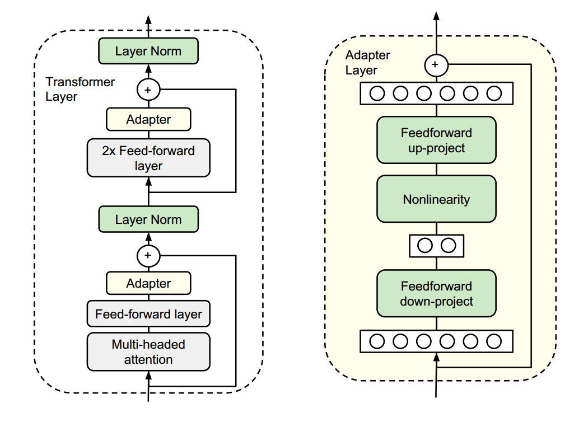
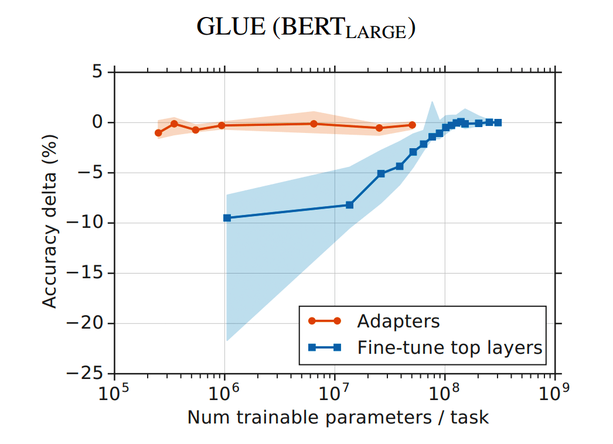
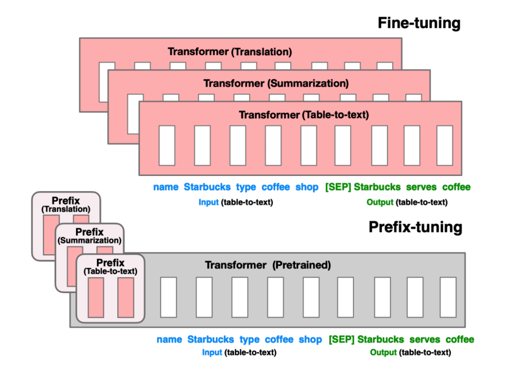
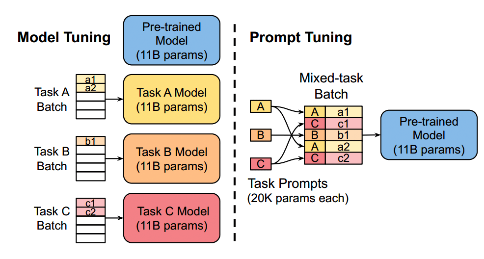
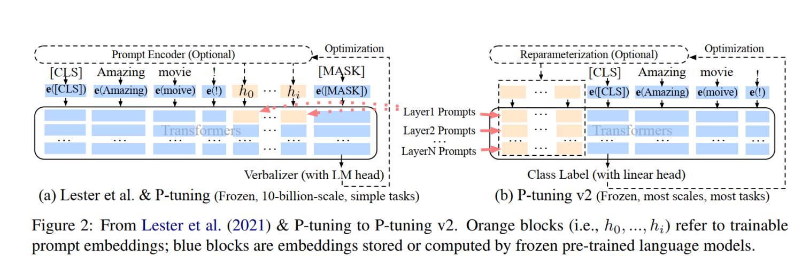
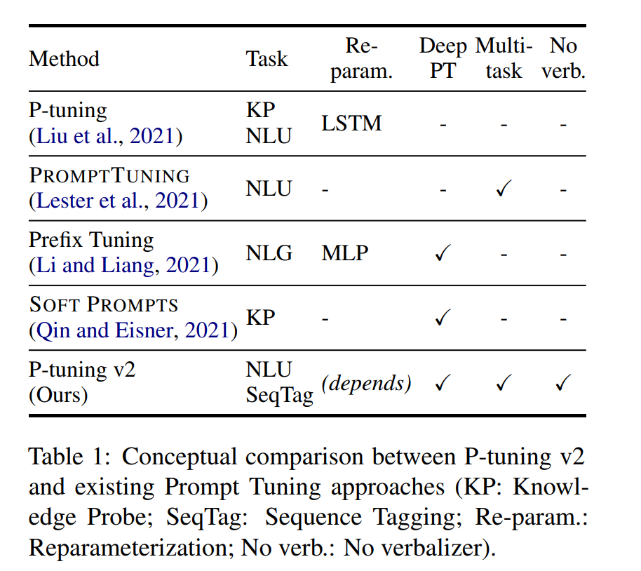
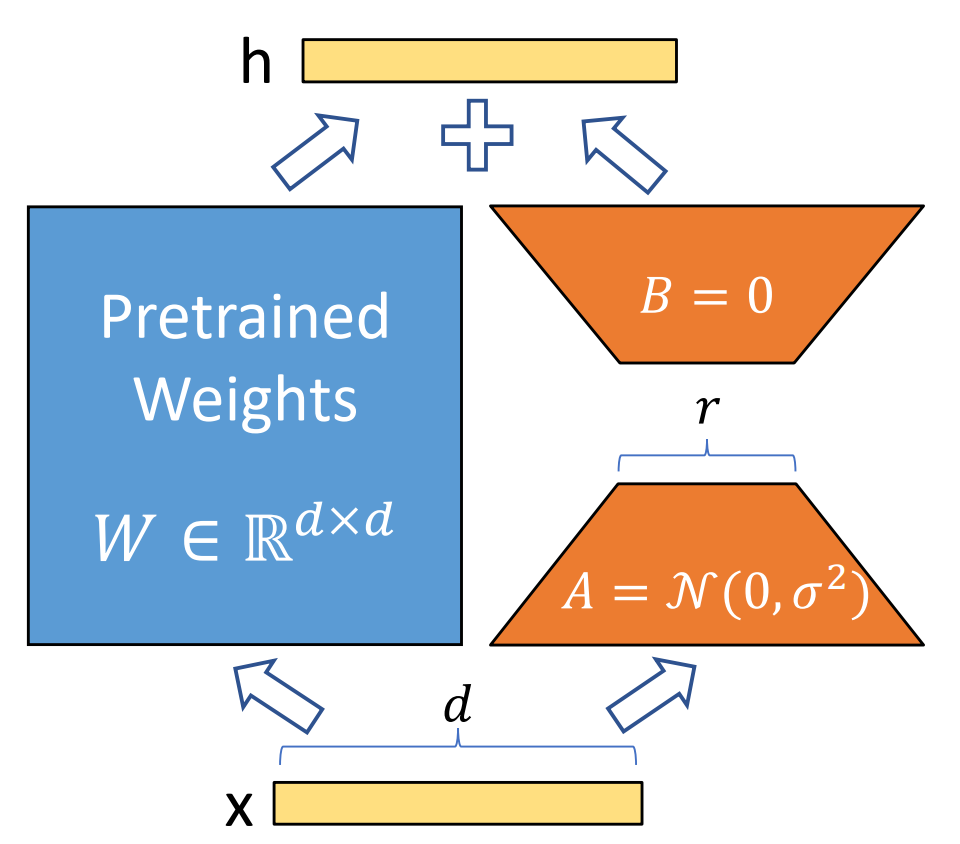
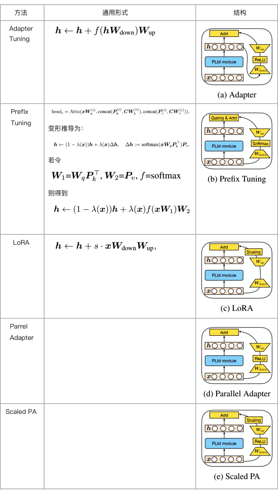

# LoRA

Parameter-Efficient Fine-Tuning

PEFT 旨在通过最小化微调参数的数量和计算复杂度，来提高预训练模型在新任务上的性能，从而缓解大型预训练模型的训练成本。这样一来，即使计算资源受限，也可以利用预训练模型的知识来迅速适应新任务，实现高效的迁移学习。因此，PEFT 技术可以在提高模型效果的同时，大大缩短模型训练时间和计算成本，让更多人能够参与到深度学习研究中来。

## Adapter Tuning

Parameter-Efficient Transfer Learning for NLP，对 BERT 微调。

在面对特定的下游任务时，如果进行 full-fintuning，太过低效；而如果采用固定预训练模型的某些层，只微调接近下游任务的那几层参数，又难以达到较好的效果，因此设计了 Adapter 结构，将其嵌入 Transformer 的结构里面，在训练时，固定住原来预训练模型的参数不变，只对新增的 Adapter 结构进行微调。

Adapter 结构是为了保证训练的高效性，即尽可能少的引入更多参数，首先是一个 down-project 层将高维度特征映射到低维特征，然后过一个非线形层之后，再用一个 up-project 结构将低维特征映射回原来的高维特征；同时也设计了 skip-connection 结构，确保了在最差的情况下能够退化为 identity。



从实验结果来看，该方法能够在只额外对增加的 3.6% 参数规模（相比原来预训练模型的参数量）的情况下取得和 Full-finetuning 接近的效果（GLUE 指标在 0.4% 以内）。



## Prefix Tuning

Stanford

与 Full-finetuning 更新所有参数的方式不同，Prefix Tuning 是在输入 token 之前构造一段任务相关的 virtual tokens 作为 Prefix，然后训练的时候只更新 Prefix 部分的参数，而 Transformer 中的其他部分参数固定。该方法其实和构造 Prompt 类似，只是 Prompt 是人为构造的“显式”的提示，并且无法更新参数，而 Prefix 则是可以学习的“隐式”的提示。



同时，为了防止直接更新 Prefix 的参数导致训练不稳定的情况，在 Prefix 层前面加了 MLP 结构（相当于将 Prefix 分解为更小维度的 Input 与 MLP 的组合后输出的结果），训练完成后，只保留 Prefix 的参数。

除此之外，还做了一系列的消融实验说明该方法的有效性：

1. Prefix 长度的影响：不同的任务所需要的 Prefix 的长度有差异。
2. Full vs Embedding-only：对比了 Embedding-only（只有最上层输入处的 Embedding 作为参数更新，后续的参数固定）和 Full（每一层的 Prefix 相关的参数都训练）的方式的效果。
3. Prefixing vs Infixing：对比了 [PREFIX; x; y] 方式与 [x; INFIX; y] 方式的差异，还是 Prefix 方式最好。
4. Initialization： 用任务相关的 Prompt 去初始化 Prefix 能取得更好的效果。

## Prompt Tuning

The Power of Scale for Parameter-Efficient Prompt Tuning

（Scale is All You Need）只要模型规模够大，简单加入 Prompt tokens 进行微调，就能取得很好的效果。

Prompt Tuning 可以看作是 Prefix Tuning 的简化版本，只在输入层加入 prompt tokens，并不需要加入 MLP 进行调整来解决难训练的问题，主要在 T5 预训练模型上做实验。似乎只要预训练模型足够强大，其他的一切都不是问题。作者也做实验说明随着预训练模型参数量的增加，Prompt Tuning 的方法会逼近 Fine-tune 的结果。



做了一系列对比实验，都说明：随着预训练模型参数的增加，一切的问题都不是问题，最简单的设置也能达到极好的效果。

1. Prompt 长度影响：模型参数达到一定量级时，Prompt 长度为 1 也能达到不错的效果，Prompt 长度为 20 就能达到极好效果。
2. Prompt 初始化方式影响：Random Uniform 方式明显弱于其他两种，但是当模型参数达到一定量级，这种差异也不复存在。
3. 预训练的方式：LM Adaptation 的方式效果好，但是当模型达到一定规模，差异又几乎没有了。
4. 微调步数影响：模型参数较小时，步数越多，效果越好。同样随着模型参数达到一定规模，zero shot 也能取得不错效果。

## P-Tuning

### v1

P-Tuning 方法的提出主要是为了解决大模型的 Prompt 构造方式严重影响下游任务的效果的问题。

P-Tuning 提出将 Prompt 转换为可以学习的 Embedding 层，只是考虑到直接对 Embedding 参数进行优化会存在两个挑战：

1. Discretenes：对输入正常语料的 Embedding 层已经经过预训练，而如果直接对输入的 prompt embedding 进行随机初始化训练，容易陷入局部最优。
2. Association：没法捕捉到 prompt embedding 之间的相关关系。

作者在这里提出用 MLP+LSTM 的方式来对 prompt embedding 进行一层处理：

$$
\begin{aligned}
h_i & =\text{MLP}\left(\left[\overrightarrow{h_i}: \overleftarrow{h_i}\right]\right) \\
& =\text{MLP}\left(\left[\text{LSTM}\left(h_{0: i}\right): \text{LSTM}\left(h_{i: m}\right)\right]\right)
\end{aligned}
$$

与 Prefix-Tuning 的区别

P-Tuning（2021-03）和 Prefix-Tuning（2021-01）差不多同时提出，做法其实也有一些相似之处，主要区别在：

- Prefix Tuning 是将额外的 embedding 加在开头，看起来更像是模仿 Instruction 指令；而 P-Tuning 的位置则不固定。
- Prefix Tuning 通过在每个 Attention 层都加入 Prefix Embedding 来增加额外的参数，通过 MLP 来初始化；而 P-Tuning 只是在输入的时候加入 Embedding，并通过 LSTM+MLP 来初始化。

### V2

P-Tuning v2: Prompt Tuning Can Be Comparable to Fine-tuning Universally Across Scales and Tasks

P-Tuning v2 的目标就是要让 Prompt Tuning 能够在不同参数规模的预训练模型、针对不同下游任务的结果上都达到匹敌 Fine-tuning 的结果。

那也就是说当前 Prompt Tuning 方法未能在这两个方面都存在局限性。

- 不同模型规模：Prompt Tuning 和 P-tuning 这两种方法都是在预训练模型参数规模够足够大时，才能达到和 Fine-tuning 类似的效果，而参数规模较小时效果则很差。
- 不同任务类型：Prompt Tuning 和 P-tuning 这两种方法在 sequence tagging 任务上表现都很差。

相比 Prompt Tuning 和 P-tuning 的方法，P-tuning v2 方法在多层加入了 Prompts tokens 作为输入，带来两个方面的好处：

1. 带来更多可学习的参数（从 P-tuning 和 Prompt Tuning 的 0.1% 增加到 0.1%-3%），同时也足够 parameter-efficient。
2. 加入到更深层结构中的 Prompt 能给模型预测带来更直接的影响。





- Reparameterization：Prefix Tuning 和 P-tuning 中都有 MLP 来构造可训练的 embedding。作者发现在自然语言理解领域，面对不同的任务以及不同的数据集，这种方法可能带来完全相反的结论。
- **Prompt Length：**不同的任务对应的最合适的 Prompt Length 不一样，比如简单分类任务下 length=20 最好，而复杂的任务需要更长的 Prompt Length。
- **Multi-task Learning：**多任务对于 P-Tuning v2 是可选的，但可以利用它提供更好的初始化来进一步提高性能。
- **Classification Head：**使用 LM head 来预测动词是 Prompt Tuning 的核心，但在完整的数据设置中没有必要这样做，并且这样做与序列标记不兼容。P-tuning v2 采用和 BERT 一样的方式，在第一个 token 处应用随机初始化的分类头。

**实验结果**

- 不同预训练模型大小下的表现，在小模型下取得与 Full-finetuning 相近的结果，并远远优于 P-Tuning。
- 不同任务下的 P-Tuning v2 效果都很好，而 P-Tuning 和 Prompt Learning 效果不好；同时，采用多任务学习的方式能在多数任务上取得最好的结果。
- Verbalizer with LM head v.s. [CLS] label with linear head，两种方式没有太明显的区别；
- Prompt depth，在加入相同层数的 Prompts 前提下，往更深层网络加效果优于往更浅层网络（只有 BoolQ 中 17-24 反而低于 1-8 是例外）。

## LoRA

现有的一些 PEFT 的方法还存在这样一些问题：

- 由于增加了模型的深度从而额外增加了模型推理的延时，如 Adapter 方法
- Prompt 较难训练，同时减少了模型的可用序列长度，如 Prompt Tuning、Prefix Tuning、P-Tuning 方法
- 往往效率和质量不可兼得，效果差于 full-finetuning

语言模型虽然参数众多，但是起到关键作用的还是其中低秩的本质维度（low instrisic dimension）。本文受此启发，提出了 Low-Rank Adaption（LoRA），设计了如下所示的结构，在涉及到矩阵相乘的模块，引入 A、B 这样两个低秩矩阵模块去模拟 Full-finetune 的过程，相当于只对语言模型中起关键作用的低秩本质维度进行更新。



$$
h = W_0x+\Delta Wx = W_0 x + BAx
$$

对于左右两个部分，右侧看起来像是左侧原有矩阵 $W$ 的分解，将参数量从 $d∗d$ 变成了 $d∗r+d∗r$，在 $r<<d$ 的情况下，参数量就大大地降低了。$r$ 是 LoRA 的秩。

在加入 LoRA 之前, 模型训练的优化表示为:

$$
\max _{\Phi} \sum_{(x, y) \in Z} \sum_{t=1}^{|y|} \log \left(P_{\Phi}\left(y_t \mid x, y_{<t}\right)\right)
$$

其中，模型的参数用 $\Phi$ 表示。

而加入了 LoRA 之后，模型的优化表示为：

$$
\max _{\Theta} \sum_{(x, y) \in Z} \sum_{t=1}^{|y|} \log \left(p_{\Phi_0+\Delta \Phi(\Theta)}\left(y_t \mid x, y_{<t}\right)\right)
$$

其中，模型原有的参数是 $\Phi_0$，LoRA 新增的参数是 $\Delta \Phi(\Theta)$ 。

从中可以看到，尽管参数看起来增加了 (多了 $\Delta \Phi(\Theta)$ )，但是从前面的 max 的目标来看，需要优化的参数只有 $\Theta$。而根据假设，$\Theta<<\Phi$，这就使得训练过程中，梯度计算量少了很多。在低资源的情况下，可以只消耗 $\Theta$ 这部分的资源，这样一来就可以在单卡低显存的情况下训练大模型了。

但是相应地，引入 LoRA 部分的参数，并不会在推理阶段加速，因为在前向计算的时候，$\Phi$ 部分还是需要参与计算的，而 $\Theta$ 部分是凭空增加了的参数，所以理论上，推理阶段应该比原来的计算量增大一点。

这么做就能完美解决以上存在的 3 个问题：

- 相比于原始的 Adapter 方法“额外”增加网络深度，必然会带来推理过程额外的延迟，该方法可以在推理阶段直接用训练好的 A、B 矩阵参数与原预训练模型的参数相加去替换原有预训练模型的参数，这样推理过程就相当于和 Full-finetune 一样，没有额外的计算量，从而不会带来性能的损失。
- 由于没有使用 Prompt 方式，自然不会存在 Prompt 方法带来的一系列问题。
- 该方法由于实际上相当于是用 LoRA 去模拟 Full-finetune 的过程，几乎不会带来任何训练效果的损失，后续的实验结果也证明了这一点。

在实验中，研究人员将 LoRA 模块与 Transformer 的 attention 模块相结合，在 RoBERTa 、DeBERTa、GPT-2 和 GPT-3 175B 这几个大模型上都做了实验，实验结果也充分证明了该方法的有效性。

```python
# 设置超参数及配置
LORA_R = 8
LORA_ALPHA = 16
LORA_DROPOUT = 0.05
TARGET_MODULES = [
    "q_proj",
    "v_proj",
]

config = LoraConfig(
    r=LORA_R,
    lora_alpha=LORA_ALPHA,
    target_modules=TARGET_MODULES,
    lora_dropout=LORA_DROPOUT,
    bias="none",
    task_type="CAUSAL_LM",
)

# 创建基础transformer模型
model = AutoModelForSeq2SeqLM.from_pretrained(model_name_or_path)
# 加入PEFT策略
model = get_peft_model(model, config)

```

| 参数            | 含义                                                         |
| --------------- | ------------------------------------------------------------ |
| r               | LoRA 的秩，矩阵 A 和矩阵 B 相连接的宽度，r<<d                |
| lora_alpha      | 归一化超参数，LoRA 参数 $\Delta Wx$  会被以 $\frac \alpha r$ 归一化，以便减少改变 $r$ 时需要重新训练的计算量 |
| lora_dropout    | LoRA 层的 dropout 比率                                       |
| merge_weights   | eval 模式中，是否将 LoRA 矩阵的值加到原有 $W_0$ 的值上       |
| fan_in_fan_out  | 只有应用在 Conv1D 层时置为 True，其他情况 False              |
| bias            | 是否可训练 bias，none：均不可；all：均可；lora_only：只有 LoRA 部分的 bias 可训练 |
| modules_to_save | 除了 LoRA 部分之外，还有哪些层可以被训练，并且需要保存       |


$$
h = Wx + \frac{\alpha}{r}BAx
$$

其中， $W$ 表示预训练权重（旧知识）， $\frac{\alpha}{r}BA$ 表示增量权重 $\Delta W$ 的近似（新知识）。理论上说，当 $r$ 较小时，我们提取的是 $\Delta W$ 中信息含量最丰富的维度，此时信息精炼，但不全面；当 $r$ 较大时，我们的低秩近似越逼近$\Delta W$，此时信息更加全面，但带来的噪声也越多（含有很多冗余无效的信息）。


基于这个猜想，当我们第一次做实验时，我们会尽量把 $r$ 调得大些，例如 32、64，并假设在这个秩下，低秩权重已经非常近似 $\Delta W$ 了，因此这时我们设置 $\alpha = r$ ，意味着我们假定 LoRA 低秩微调的效果和全参数微调持平。


那么接下来，我们肯定就要往小的 $r$ 进行尝试了。这时我们把 $\alpha$ 固定住，意味着随着 $r$ 的减小，$\frac{\alpha}{r}$ 会越来越大


- 当 $r$ 越小时，低秩矩阵表示的信息精炼，但不全面。我们通过调大 $\frac{\alpha}{r}$，来放大 forward 过程中新知识对模型的影响。
- 当 $r$ 越小时，低秩矩阵表示的信息精炼，噪声/冗余信息少，此时梯度下降的方向也更加确信，所以我们可以通过调大 $\frac{\alpha}{r}$ ，适当增加梯度下降的步伐，也就相当于调整 learning rate了。

## Towards a Unified View of PETL 

这篇 ICLR2022 的文章研究了典型的 PEFT 方法，试图将 PEFT 统一到一个框架下，找出它们起作用的具体原因，并进行改进。主要研究了三个问题：

- 典型的 PEFT 方法有什么联系？
- 典型的 PEFT 方法中是哪些关键模块在起作用？
- 能否对这些关键模块进行排列组合，找出更有用的 PEFT 方法？



通过对 Prefix Tuning 的推导，得出了和 Adapter Tuning 以及 LoRA 形式一致的形式。

更近一步地，可以将这些 Tuning 的方法统一在同一套框架下，

包括这几大要素：

- $\Delta h$ 的形式
- 嵌入 Transformer 结构的方式（分为 Parrell 和 Sequential 两种。Parallel 指的是在输入层嵌入，这样与原有结构可以并行计算；Sequential 指的是在输出层嵌入，相当于增加了网络的深度，与原有结构存在依赖关系）
- 修改的表示层（主要指对 Attention 层的修改还是对 FFN 层的修改）
- 组合方式：怎么与原有的参数组合，包括简单相加（Adapter）、门控式（Prefix Tuning）、缩放式（LoRA）三种

根据这个统一的框架，还另外设计了三种变体 Parallel Adapter、Multi-head Parallel Adapter、Scaled Parallel Adapter。

**哪种嵌入形式更好：Parallel or Sequencial？**

答案是：**Parallel 更好**

**对哪块结构做修改更好？Attention or FFN？**

- 当微调的参数量较多时，从结果来看，对 FFN 层进行修改更好 。 一种可能的解释是 FFN 层学到的是任务相关的文本模式，而 Attention 层学到的是成对的位置交叉关系，针对新任务并不需要进行大规模调整。
- **当微调参数量较少（0.1%）时，对 Attention 进行调整效果更好。**

**哪种组合方式效果更好？**

**从结果来看，缩放式的组合效果更好。**

基于以上的经验，

- Scaled parallel adapter is the best variant to modify FFN
- FFN can better utilize modification at larger capacities
- modifying head attentions like prefix tuning can achieve strong performance with only 0.1% parameters

研究者设计出最新的结构 MAM Adapter，取得了最好的效果。