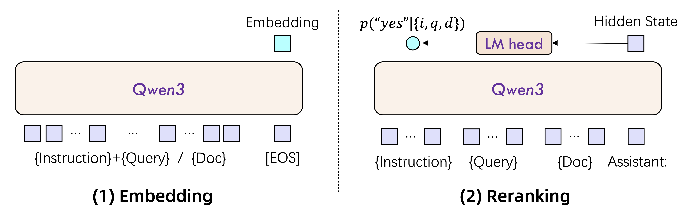
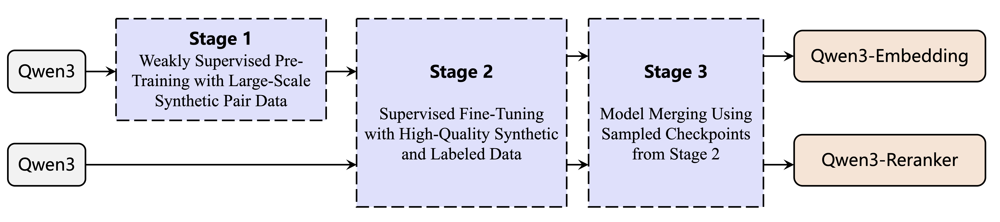

# Qwen3 Embedding

- 指令感知（Instruction Aware）：无论是 Embedding 还是 Reranking 模型，都支持用户根据不同任务定制输入指令，使模型能更好地适应特定场景的任务。
- 多表示层支持（MRL Support）：Embedding 模型支持自定义最终输出的 embedding 维度（768-4096），为不同应用场景下的效率和存储需求提供了灵活性。



## Embedding 模型

接受单文本输入，将最后一层的 [EOS] Token 的隐藏状态向量作为文本的语义向量，支持 MRL 动态维度，最小为 32 维，也支持根据不同任务定制输入指令。

为了实现指令遵循，Query 的输入为：`{Instruction} {Query} <|endoftext|>`。Documents 则直接输入，不加额外指令。

训练阶段：LoRA 微调

1. 第一阶段：大规模弱监督预训练，利用 150M（1.5 亿）个弱监督合成 Pair 对数据，对比学习预训练
2. 第二阶段：高质量有监督微调，从 150M 个弱监督数据中筛选 12M 个高质量 Pair 对数据，再加上 7M 榜单数据，进行二次训练
3. 第三阶段：模型合并，将第二阶段的多个 checkpoint 进行参数融合，在完成有监督为微调之后，采用基于球面线性插值（SLERP）的模型合并技术，提高模型在各种数据分布中的鲁棒性和泛化性能

**SLERP 融合** → 化解单点过拟合

训练数据：

1. 第一阶段训练数据：大规模合成数据驱动的弱监督训练，利用 Qwen3-32B 生成四类任务（Retrieval / STS / Bitext / 分类），并引入 Persona-Hub “角色”提示，提升多样性。融合 query-type（例如关键词、事实、摘要、判断）、长度、难度、语言等信息。
2. 第二阶段训练数据：在监督微调中使用高质量的合成数据，通过余弦相似度过滤，保留相似度大于 0.7 的数据对。

训练目标：

基于 InfoNCE 框架改进的对比损失，硬负例和 batch 内负例。



### MRL 动态维度

**Matryoshka Representation Learning**

让同一个 embedding 模型在训练时学会 嵌套的（prefix-friendly）多级表征，从而在推理时可以任意截取前 k 维作为低维嵌入（比如 32/128/512/1024），无需重训即可按场景切换维度与资源/精度权衡。

核心直觉是：把最大维度 $D_{max}$ 的向量看成若干“套娃”（Matryoshka）——**较短的前缀本身就要能携带有用语义**。训练时不仅让完整向量用于对比学习，也要让若干前缀（例如前 32/128/512/1024 … 维）分别通过相同或类似的检索损失去学习，从而保证“截断后仍有效”。这种训练方式使得前缀维度在信息量上被“优先填充”。

实现

- 在 backbone（例如 Qwen3 的 encoder/decoder-based hidden）之后设置一个**单一线性投影头** $W \in \mathbb{R}^{D_{max}\times H}$，或一组 **嵌套投影头**（nested/progressive heads）。
- 得到原始 embedding $e = W h \in \mathbb{R}^{D_{max}}$。
- 用单一投影头更简单；用嵌套头可以更显式地保证“前缀优先性”（每个头输出的维度严格构成前缀）。

训练时定义一组候选维度，例如 $\mathcal{K}=\{32,128,256,512,1024,2048,4096\}$。训练目标会在这些 k 上同时优化。

**多重对比损失（prefix-aware contrastive loss）**

对每个 $k\in\mathcal{K}$：

- 截取 $e^{(k)} = \text{normalize}(e[:k])$（一般做 $L_2$ 标准化）。

- 使用 contrastive/InfoNCE loss（in-batch negatives/hard negatives）

$$
\mathcal{L}_k = -\sum_{i}\log\frac{\exp(\mathrm{sim}(q_i^{(k)}, d_i^{+(k)})/\tau)}{\sum_j \exp(\mathrm{sim}(q_i^{(k)}, d_j^{(k)})/\tau)}
$$

最终总损失为加权和：

$$
\mathcal{L} = \sum_{k\in\mathcal{K}} w_k \,\mathcal{L}_k
$$
通常会给较小的 k 一定权重，确保前缀快速学到关键语义（权重选择是超参）。

- 嵌套投影（Matryoshka head）：把投影参数显式切分为多段，使得第一段专门输出 32 维，第二段输出接下来的 96 维……这样前缀的语义更易被约束成“独立有用”的子空间。
- dimension-dropout/stochastic truncation：训练时随机仅对部分 k 计算损失，或随机屏蔽尾部维度，增强鲁棒性。
- 正则化：对尾部维度施加 L2/L1 或能量衰减约束，促使信息集中到前缀。
- 正交/互补约束：可对不同维段施加互补性或去相关损失，减少冗余。
- 温度与权重调优：温度 $\tau$、各 $w_k$ 的选择影响不同维度间的性能平衡。

## Reranking 模型

接受文本对输入， 经过 chat template 拼接之后，输入到模型中，预测下一个 token 是“是”或“否”的概率，来判断两个文本的相关性。

文本对（例如用户查询与候选文档）作为输入，抽取最后一层的，yes 和 no 这两个token的logit 取log_softmax后 取yes 所在位置的分数作为 score。

只有高质量有监督微调和模型合并两个阶段。

|     Model Type     |        Models        | Size | Layers | Sequence Length | Embedding Dimension | MRL Support | Instruction Aware |
| :----------------: | :------------------: | :--: | :----: | :-------------: | :-----------------: | :---------: | :---------------: |
| **Text Embedding** | Qwen3-Embedding-0.6B | 0.6B |   28   |       32K       |        1024         |     Yes     |        Yes        |
|                    |  Qwen3-Embedding-4B  |  4B  |   36   |       32K       |        2560         |     Yes     |        Yes        |
|                    |  Qwen3-Embedding-8B  |  8B  |   36   |       32K       |        4096         |     Yes     |        Yes        |
| **Text Reranking** | Qwen3-Reranker-0.6B  | 0.6B |   28   |       32K       |          -          |      -      |        Yes        |
|                    |  Qwen3-Reranker-4B   |  4B  |   36   |       32K       |          -          |      -      |        Yes        |
|                    |  Qwen3-Reranker-8B   |  8B  |   36   |       32K       |          -          |      -      |        Yes        |

Embedding Code

```python
# Requires vllm>=0.8.5
import torch
import vllm
from vllm import LLM

def get_detailed_instruct(task_description: str, query: str) -> str:
    return f'Instruct: {task_description}\nQuery:{query}'

# Each query must come with a one-sentence instruction that describes the task
task = 'Given a web search query, retrieve relevant passages that answer the query'

queries = [
    get_detailed_instruct(task, 'What is the capital of China?'),
    get_detailed_instruct(task, 'Explain gravity')
]

# No need to add instruction for retrieval documents
documents = [
    "The capital of China is Beijing.",
    "Gravity is a force that attracts two bodies towards each other. It gives weight to physical objects and is responsible for the movement of planets around the sun."
]
input_texts = queries + documents

model = LLM(model="Qwen/Qwen3-Embedding-0.6B", task="embed")

outputs = model.embed(input_texts)
embeddings = torch.tensor([o.outputs.embedding for o in outputs])
scores = (embeddings[:2] @ embeddings[2:].T)
print(scores.tolist())
# [[0.7620252966880798, 0.14078938961029053], [0.1358368694782257, 0.6013815999031067]]
 
```

Reranking Code

```python
import torch

from transformers import AutoTokenizer, is_torch_npu_available
from vllm import LLM, SamplingParams
from vllm.distributed.parallel_state import destroy_model_parallel
import math
from vllm.inputs.data import TokensPrompt

def format_instruction(instruction, query, doc):
    text = [
        {"role": "system", "content": "Judge whether the Document meets the requirements based on the Query and the Instruct provided. Note that the answer can only be \"yes\" or \"no\"."},
        {"role": "user", "content": f"<Instruct>: {instruction}\n\n<Query>: {query}\n\n<Document>: {doc}"}
    ]
    return text

def process_inputs(pairs, instruction, max_length, suffix_tokens):
    messages = [format_instruction(instruction, query, doc) for query, doc in pairs]
    messages =  tokenizer.apply_chat_template(
        messages, tokenize=True, add_generation_prompt=False, enable_thinking=False
    )
    messages = [ele[:max_length] + suffix_tokens for ele in messages]
    messages = [TokensPrompt(prompt_token_ids=ele) for ele in messages]
    return messages

def compute_logits(model, messages, sampling_params, true_token, false_token):
    outputs = model.generate(messages, sampling_params, use_tqdm=False)
    scores = []
    for i in range(len(outputs)):
        final_logits = outputs[i].outputs[0].logprobs[-1]
        token_count = len(outputs[i].outputs[0].token_ids)
        if true_token not in final_logits:
            true_logit = -10
        else:
            true_logit = final_logits[true_token].logprob
        if false_token not in final_logits:
            false_logit = -10
        else:
            false_logit = final_logits[false_token].logprob
        true_score = math.exp(true_logit)
        false_score = math.exp(false_logit)
        score = true_score / (true_score + false_score)
        scores.append(score)
    return scores

number_of_gpu = torch.cuda.device_count()
tokenizer = AutoTokenizer.from_pretrained('Qwen/Qwen3-Reranking-4B')
model = LLM(model='Qwen/Qwen3-Reranking-0.6B', tensor_parallel_size=number_of_gpu, max_model_len=10000, enable_prefix_caching=True, gpu_memory_utilization=0.8)
tokenizer.padding_side = "left"
tokenizer.pad_token = tokenizer.eos_token
suffix = "<|im_end|>\n<|im_start|>assistant\n<think>\n\n</think>\n\n"
max_length=8192
suffix_tokens = tokenizer.encode(suffix, add_special_tokens=False)
true_token = tokenizer("yes", add_special_tokens=False).input_ids[0]
false_token = tokenizer("no", add_special_tokens=False).input_ids[0]
sampling_params = SamplingParams(temperature=0, 
    max_tokens=1,
    logprobs=20, 
    allowed_token_ids=[true_token, false_token],
)

        
task = 'Given a web search query, retrieve relevant passages that answer the query'
queries = ["What is the capital of China?",
    "Explain gravity",
]
documents = [
    "The capital of China is Beijing.",
    "Gravity is a force that attracts two bodies towards each other. It gives weight to physical objects and is responsible for the movement of planets around the sun.",
]

pairs = list(zip(queries, documents))
inputs = process_inputs(pairs, task, max_length-len(suffix_tokens), suffix_tokens)
scores = compute_logits(model, inputs, sampling_params, true_token, false_token)
print('scores', scores)

destroy_model_parallel()
```

## Embedding 微调

负样本的构建

1. **相似度计算和候选生成**：通过 embeding 模型或者 reranker 模型，计算查询与语料库的相似度，获取 top-k 最相似的候选
2. **负样本的挑选**：排除正例 ，应用各种筛选条件对负样本进行挑选

可以根据向量模型或者 reranker 的输出值去动态调整这些参数，挑选出合适的负样本。

- absolute_margin：绝对相似度差异阈值
- relative_margin：相对相似度比例阈值
- max_score/min_score：相似度分数阈值

```python
from datasets import load_dataset
from sentence_transformers import SentenceTransformer
from sentence_transformers.util import mine_hard_negatives

dataset = load_dataset("parquet", data_files="/Chinese-QA-Agriculture/Chinese-QA-AFAF-train-v2.parquet")

split_dataset = dataset["train"].train_test_split(test_size=0.95, seed=42)

# 输出划分后的数据集信息
print("划分后的数据集:", split_dataset)
print(f"训练集大小: {len(split_dataset['train'])}")
print(f"测试集大小: {len(split_dataset['test'])}")

# 加载小的embeding模型
embedding_model = SentenceTransformer("/m3e-small")

train_dataset = split_dataset['train']

# 挖掘难负样本
hard_train_dataset = mine_hard_negatives(
    train_dataset,
    embedding_model,
    anchor_column_name="prompt",
    positive_column_name="response",
    num_negatives=5,  # How many negatives per question-answer pair
    range_min=20,  # Skip the x most similar samples
    range_max=50,  # Consider only the x most similar samples
    max_score=0.8,  # Only consider samples with a similarity score of at most x
    absolute_margin=0.1,  # Similarity between query and negative samples should be x lower than query-positive similarity
    sampling_strategy="top",  # Randomly sample negatives from the range
    batch_size=64,  # Use a batch size of 4096 for the embedding model
    output_format="labeled-list",  
    use_faiss=True,  # Using FAISS is recommended to keep memory usage low (pip install faiss-gpu or pip install faiss-cpu)
)

def convert_format(example):
    # 获取正确答案和被拒绝的答案
    correct_response = next(resp for resp, label in zip(example['response'], example['labels']) if label == 1)
    rejected_responses = [resp for resp, label in zip(example['response'], example['labels']) if label == 0]
    return {
        "query": example['prompt'],
        "response": correct_response,
        "rejected_response": rejected_responses
    }
# 数据格式转换
transformed_dataset = hard_train_dataset.map(convert_format, remove_columns=hard_train_dataset.column_names)
transformed_dataset.to_json("qwen3_emb.json",force_ascii=False)
```

Loss: InfoNCE

$$
L = - \log \left( \frac{\exp(sim(q, r^+))}{\exp(sim(q, r^+)) + \sum_{i=1}^k \exp(sim(q, r^-_i))} \right)
$$
**数据格式如下：**response 为正样本，rejected_response 为负样本

```text
{'response': '绿色环境可以帮助老年人放松紧张的中枢神经，改善和调节身体功能，降低皮肤温度，减少脉搏和呼吸频率，保持血压稳定，减轻心脏负担，提供精神舒适感。这对于冠心病、高血压患者以及身体机能退化的老年人尤为有益。',
 'query': '绿色对老年人有哪些健康益处？',
 'rejected_response': ['绿茶的主要功效是预防癌症和心血管疾病，还能抗氧化，提高免疫力，抑制和杀灭细菌等；白茶的主要功效有保护脑神经，增强记忆，减少焦虑等。',
  '绿茶水洗脸可以防止肌肤衰老，抗辐射，尤其适合长期用电脑的女性，可抑制皮肤色素沉着，减少过敏反应的发生。',
  '绿色食物代表有花椰菜，菠菜，芦笋。它们具有超强的减肥功效，每杯绿果蔬的热量还不到50千卡，适合于大量食用；它们含有的抗氧化剂具有延长寿命的功效。',
  '生态养殖可以改善肉、蛋、奶品质，能生产出天然绿色食品。',
  '绿水对锦鲤有发色和提供营养的作用，还能对锦鲤有一定的康复作用。锦鲤在游动时可能会遇到小的擦伤，将鱼放在绿水中进行调养可以促进康复。']}
```

训练脚本：

```bash
INFONCE_MASK_FAKE_NEGATIVE=true
swift sft \
    --model /Qwen3-Embedding-0.6B \
    --task_type embedding \
    --model_type qwen3_emb \
    --train_type lora \
    --dataset /qwen3_emb.json \
    --split_dataset_ratio 0.05 \
    --eval_strategy steps \
    --output_dir output \
    --eval_steps 100 \
    --num_train_epochs 1 \
    --save_steps 100 \
    --per_device_train_batch_size 4 \
    --per_device_eval_batch_size 4 \
    --gradient_accumulation_steps 4 \
    --learning_rate 6e-6 \
    --loss_type infonce \
    --label_names labels \
    --dataloader_drop_last true
```

正负样例的 margin 从 0.20 上升到 0.235，其中 margin = sim(q,r+) - sim(q,r-) ，模型对正负样本的区分能力显著变强。

## Rerank 微调

- input：包含 <Instruct>，<Query>，<Document>
- output: <think>\n\n</think>\n\n 然后加上 yes or no，也就是 label

直接 SFT 微调，训练模型输出 yes 和 no，采用 SFT 的损失即可，最终用 yes 和 no 输出的概率进行排序。

### 数据格式

> {'system': 'Judge whether the Document meets the requirements based on the Query and the Instruct provided. Note that the answer can only be "yes" or "no".',
>
> 'input': "<Instruct>: Given a search query, retrieve relevant passages that answer the query'\n<Query>: 封闭式阳台冬季气温偏高时，艺兰人可以通过哪些措施解决影响春兰春化的问题？\n<Document>: 连栋温室大棚中降低湿度的基本方法是通风除湿。",
>
> 'output': '<think>\n\n</think>\n\nno'}

其中最重要的就是 system，引导 LLM 生成 yes or no ，后面采用 yes 和 no 的概率对 docs 进行排序

> Judge whether the Document meets the requirements based on the Query and the Instruct provided. Note that the answer can only be \"yes\" or \"no\".

### 训练脚本

```bash
swift sft \
    --model /mnt/d/wsl/work/jupyter/model_hub/Qwen3-Reranker-0.6B \
    --dataset /mnt/d/wsl/work/jupyter/data_hub/qwen3_rerank.json \
    --model_type qwen3 \
    --split_dataset_ratio 0.05 \
    --torch_dtype bfloat16 \
    --lora_rank 8 \
    --lora_alpha 32 \
    --target_modules all-linear \
    --eval_strategy steps \
    --output_dir output_rerank_base \
    --max_steps 1000 \
    --eval_steps 100 \
    --num_train_epochs 1 \
    --save_steps 100 \
    --per_device_train_batch_size 4 \
    --per_device_eval_batch_size 4 \
    --gradient_accumulation_steps 4 \
    --learning_rate 6e-6 \
    --loss_scale ignore_empty_think \
    --system 'Judge whether the Document meets the requirements based on the Query and the Instruct provided. Note that the answer can only be \"yes\" or \"no\".' \
    --warmup_ratio 0.05 
```

**结合金融特性可以加：**

1. **Ticker-aware 对比损失**

   - 同一 ticker 下的“非该主题段落”作为 **hard negative**；
   - 不同 ticker 但同一行业段落做负样本，教模型区分「公司级」信息。

2. **时间窗负样本**

   - 对于一个事件 query，只允许在事件前/附近的文档是正样本；
   - 显式把明显滞后（例如一年后）的相似描述当负样本，让模型更注意时间上下文。

3. **多任务 joint loss**（可选）

   - 例如给每个文本打「主题标签」（分红、并购、业绩预告、监管处罚），加一个分类头，loss：
     $$
     \mathcal{L} = \mathcal{L}_{\text{cl}} + \lambda \mathcal{L}_{\text{cls}}
     $$

   - 这样 embedding 既有「检索结构」，又 encode「金融主题」，对事件因子很友好。
