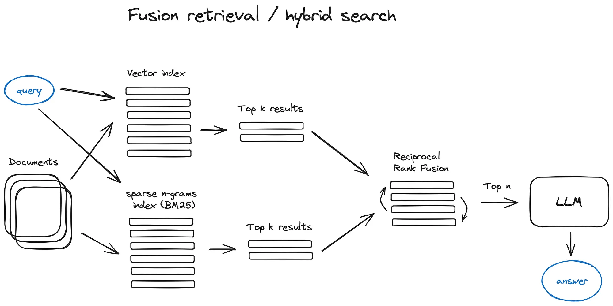
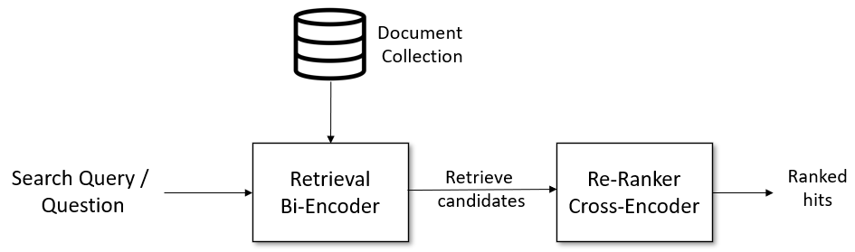
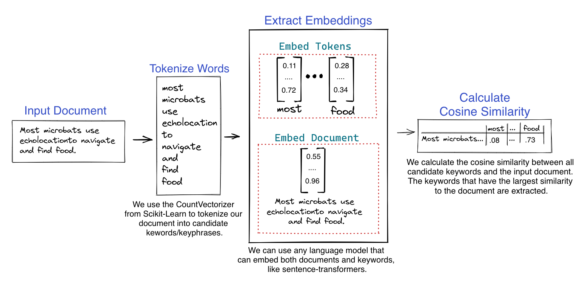
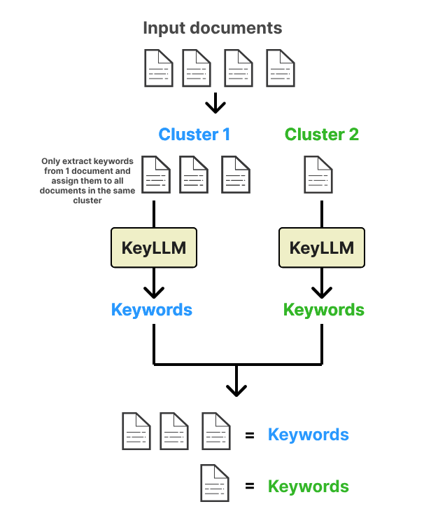
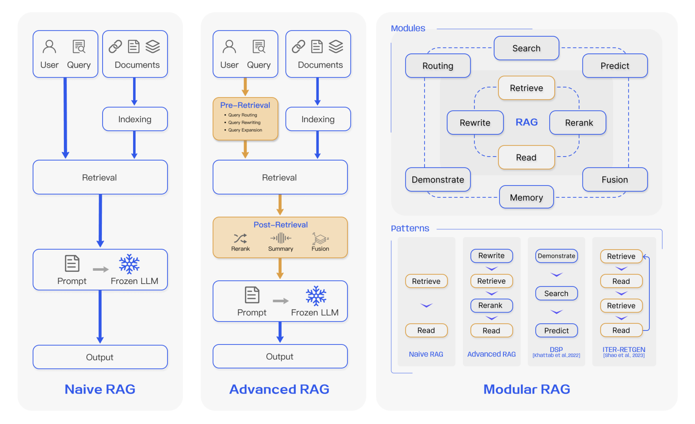
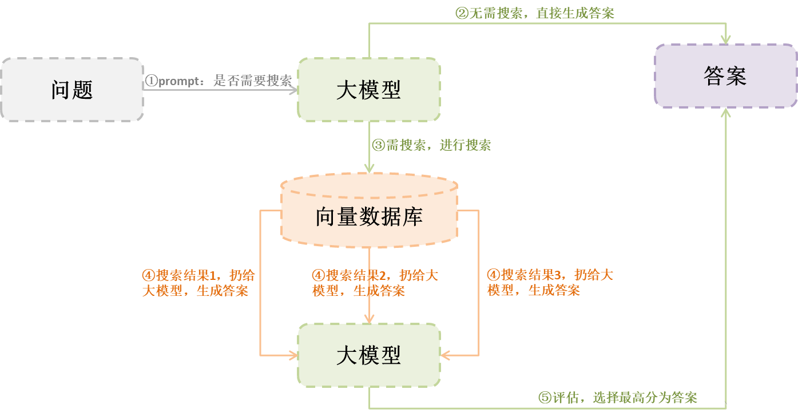
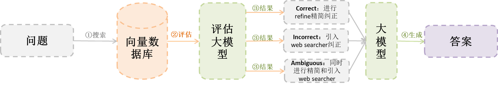

# RAG

## TFIDF

TFIDF（Term Frequency-Inverse Document Frequency），用于信息检索和文本挖掘的常用权重计算，旨在衡量一个词项对于一个文档集合中某个文档的重要性。该方法结合了两个方面的信息：词项在文档中的频率（TF）和在整个文档集合中的逆文档频率（IDF）。

词项在文档中的频率（TF）：

$$
TF(t,d)= \frac{词项t在文档d中出现的次数}{文档d中所有词项的总数}
$$

其中，$t$ 表示词项，$d$ 表示文档。TF 表示了一个词项在文档中的相对频率，即在文档中出现的次数相对于文档总词项数的比例。

逆文档频率（IDF）：

$$
IDF(t)=\log(\frac{文档集合中的文档总数}{包含词项t的文档数 + 1})
$$

其中，$t$ 表示词项。IDF 表示了一个词项在整个文档集合中的稀有程度，如果词项在许多文档中都出现，其 IDF 值较低，反之则较高。

TFIDF 的计算：

$$
TFIDF(t,d,D)=TF(t,d)×IDF(t)
$$

其中，$D$ 表示文档集合。TFIDF 的最终值是将词项在文档中的频率和在整个文档集合中的逆文档频率相乘，这样可以得到一个更全面的评估，既考虑了在文档中的重要性，也考虑了在整个文档集合中的稀有性。

## BM25

BM25Okapi 是 BM25 算法的一种变体，它在信息检索中用于评估文档与查询之间的相关性。以下是 BM25Okapi 的原理和打分方式的概述：

BM25Okapi 的主要参数：

- $k_1$：控制词项频率对分数的影响，通常设置为 1.5。
- $b$：控制文档长度对分数的影响，通常设置为 0.75。
- $\epsilon$：用于防止逆文档频率 IDF 为负值的情况，通常设置为 0.25。

打分的计算过程：

BM25Okapi 的打分过程基于以下三个因素：词项在文档中的频率（TF）、文档的长度（doc_len）以及逆文档频率（IDF）。

文档长度对分数的影响通过 $b$ 控制。文档长度越长，该项的分数越小。BM25Okapi 的打分公式综合考虑了以上三个因素，通过对每个词项的打分求和得到最终的文档与查询的相关性分数。

$$
\text{score} = \sum_{q \in \text{query}} \left(\text{IDF}(q) \cdot \frac{q_{freq} \cdot (k_1 + 1)}{q_{freq} + k_1 \cdot (1 - b + b \cdot \frac{\text{doc\_len}}{\text{avgdl}})} \right)
$$

其中，$\text{avgdl}$ 是文档集合中的平均文档长度。BM25Okapi 通过合理调整参数，兼顾了词项频率、文档长度和逆文档频率，使得在信息检索任务中能够更准确地评估文档与查询之间的相关性，提高检索效果。

改进：

- 在实际进行文本检索时，特别是在大规模数据集和生产环境中，应该使用专业的文本检索引擎工具，例如 Elasticsearch，以确保高效、可扩展和内存友好的实现。
- 对整个文本集合构建矩阵并进行相似度计算可能导致内存占用较大，尤其在大规模数据集情况下。考虑使用基于倒排索引等数据结构的文本检索引擎，以减小内存占用并提高检索效率。
- 未对文本进行停用词筛选和额外的单词筛选。在实际应用中，建议进行停用词的去除，以排除常见但无实际意义的词汇，提高检索的准确性。同时，考虑引入领域专有的单词筛选，以过滤掉与任务无关的词汇，优化检索结果。

## 文本多路召回与重排序

单一的召回方法可能由于模型特性或数据特点而存在局限性，多路召回逻辑引入了多个召回路径，通过多个召回路径或方法综合获取候选文档，以提高检索的全面性和准确性。一种实现方法是将 BM25 的检索结果和语义检索果按照排名进行加权，另外也可以按照段落、句子、页不同的角度进行语义编码进行检索，综合得到检索结果。



### 重排序逻辑（BM25 + BGE Rerank）


重排序逻辑是文本检索领域中一种重要的策略，主要用于优化原有文本检索方法返回的候选文档顺序，以提高最终的检索效果。在传统的文本检索方法中，往往采用打分的逻辑，如计算 BERT 嵌入向量之间的相似度。而重排序逻辑引入了更为复杂的文本交叉方法，通过特征交叉得到更进一步的打分，从而提高排序的准确性。



重排序常常使用更为强大的模型，如交叉编码器（cross-encoder）模型。这类模型能够更好地理解文本之间的交叉关系，捕捉更复杂的语义信息。首先通过传统的嵌入模型获取初始的 Top-k 文档，然后使用重排序逻辑对这些文档进行重新排序。这样可以在保留初步筛选文档的基础上，更精确地排列它们的顺序。

### RRF 算法

Reciprocal Rank Fusion，倒数排名融合

$$
RRF score = \sum_{i=1}^k \frac{1}{rank_i + c}
$$

- 其中，$rank_i$ 是一个项目在第 $i$ 个源中的排名。
- $k$ 是源的数量。
- $c$ 是一个常数，通常设为 60，用于减轻排名靠后的项目的权重。

RRF 是一个融合策略，通过将不同召回方法得到的排名进行加权融合，减少单一方法的偏差。同时减少大量文档直接进行 rerank 的消耗，提升效率并且节省计算资源。

```python
def reciprocal_rank_fution(results: list[list], c=60):
    fused_scores = {}
    for docs in results:
        for rank, doc in enumerate(docs):
            doc_str = dumps(doc)
            if doc_str not in fused_scores:
                fused_scores[doc_str] = 0
            fused_scores[doc_str] += 1 / (rank + c)

    reranked_results = [
        (loads(doc), score) for sorted(fused_scores.items(), key=lambda x: x[1], reverse=True)
    ]
    return reranked_results
```

## 问答优化

### 问答意图识别

### 问答关键词提取

从给定的文本中提取出最具代表性和有意义的单词或短语，这些关键词通常反映了文本的主题、内容或重要信息。主要包括分词、词性标注、停用词移除、计算词语权重以及关键词抽取算法等过程。

#### IDF

1. **分词（Tokenization）：** 将文本拆分为单词或短语，将文本转换为基本的语言单元，为后续的处理做准备。
2. **移除通用词（Stopword Removal）：** 剔除常见的停用词，如 "and"、“the”、"is" 等，这些词在文本中普遍出现但往往没有实际的信息价值，减少噪音，使关键词更集中在文本的内容性词汇上。
3. **计算逆文档频率（IDF）：** 对于每个单词，计算其逆文档频率。
4. **计算 TF-IDF 得分：** 对于每个单词，计算其 TF-IDF 得分，即词频（TF）与逆文档频率（IDF）的乘积。
5. **排序和选取关键词：** 根据计算得到的 TF-IDF 得分对单词进行排序，选择排名前几的单词作为关键词。排名越高的单词表示在当前文档中具有更高的重要性。

#### KeyBERT

1. **Embedding 文本：** 首先，KeyBERT 使用预训练的 BERT 模型，例如 `distilbert-base-nli-mean-tokens`，将输入的文本嵌入到一个高维的向量空间中。BERT 模型能够学习丰富的语义表示，因此生成的向量能够捕捉文本的语义信息。
2. **计算余弦相似度：** 然后，KeyBERT 计算文档中每个候选关键词或关键短语与整个文档之间的余弦相似度，用于衡量两个向量之间相似性。
3. **排序关键词：** 最后，根据计算得到的余弦相似度值，KeyBERT 将关键词或关键短语排序，从而形成最终的关键词列表。余弦相似度越高，表示关键词与文档的语义相似度越大，因此在排序中位置越靠前。



#### 关键词提取优化策略

1. 将所有文档通过预训练的嵌入模型映射到向量空间中，生成它们的向量表示。
2. 通过计算文档之间的相似性，使用余弦相似度等度量方法，将相似的文档聚合成一个文档聚类。在每个文档聚类中，选择一个代表性文档，利用关键词提取模型生成关键词。




### 扩展词与扩展查询

查询改写（Query Rewriting，或称为查询扩展 Query Expansion）。对原始 Query 拓展出与用户需求关联度高的改写词，多个改写词与用户搜索词一起做检索，从而用更好的表述，帮用户搜到更多符合要求的文本。

#### 通过词向量找到同义词

在进行查询改写时，可以利用词向量等技术找到同义词，以建立更丰富的词汇关联，从而提升搜索的全面性和准确性。



## Query 理解与扩展

查询侧除了关键词提取与扩展词，还有一组系统化的 Query 理解与扩展技术，按改写、增强、分解三类整理如下。

背景：

1. 用户表达的模糊性，通过 query 理解，分析上下文、判断用户的真实意图。
2. Query 和 doc 不在一个语义空间，如非正式和口语化的自由表达，文档则是正式的书面表达，query 改写
3. 复杂 query 拆解为更小更具体的子问题，逐一处理。

### Query 改写

#### 上下文信息补全

上下文不仅包括多轮会话信息，还包括当前对话的背景信息，如时间、地点等，使用 LLM 对前 query 进行重写。

注意多调用一次 LLM，增加整体流程的 latency，权衡计算复杂度和延迟的问题。

#### RAG-Fusion

根据用户的原始 query 生成多个不同角度的 query，以捕捉 query 的不同方面的细微差别，然后通过逆向排名融合（Reciprocal Rank Fusion）技术，将多个 query 的检索结果进行融合，生成一个统一的排名列表，从而增加最相关文档出现在最终 topk 的机会。

#### Multi-Query

也是生成多视角的查询来检索。不同的是不使用 RRF，而是将多个搜索结果放到 context 中，在上下文保留更多的检索结果，提供更丰富的信息源，减少了在排名融合上的复杂性。

### Query 增强

#### HyDE

首先针对 query 生成一个假设性文档 hypo_doc，然后对这个假设性回答进行向量化处理，最后使用向量化的假设性回答去检索相似性文档。

将 query-doc 检索变成 query-hypo_doc-doc 检索，此时 hypo_doc 和 doc 在语义空间上更接近。

在缺乏标注数据的情况下，仍能显著提高检索的准确性和效率。

问题：假设性回答的质量取决于 LLM 的生成能力，如果模型生成的内容不准确或不相关，或者主题对 LLM 来说比较陌生，比较无效。

#### Step-back prompting

1. 抽象：不直接针对问题回答，而是首先提出一个更高级别的回溯问题（step-back question）这个问题涉及更广泛的高级概念或原则，并检索这些概念或原则相关的事实
2. 推理：在高级概念或原则的基础上，利用 LLM 的内在推理能力，对原始问题进行推理回答，基于抽象的推理（Abstraction-grounded Reasoning）

更适合需要复杂推理的领域，如：

- STEM 学科：涉及大量物理化学等科学原理的应用问题
- 知识问答：需要大量事实性知识的问题回答
- 多跳推理：需要通过多个步骤或信息源进行推理的问题

### Query 分解

#### IR-CoT

Interleaving Retrieval with Chain-of-Thought

交替执行检索和推理步骤，将检索步骤与推理步骤相结合，以指导检索过程并反过来使用检索结果来改进推理链。

步骤

1. 初始化检索
2. 交替执行：
    1. 扩展 CoT：利用问题、到目前为止搜集的段落和已经生成的 CoT 句子来扩展生成下一个 Cot 句子
    2. 扩展检索信息：使用上一个 CoT 句子作为查询来检索额外的段落，并将其添加到已收集的段落中。
3. 重复上述步骤，直到 CoT 报告答案或达到最大允许的推理步骤数。

#### Least-to-Most

分解+子问题查询

## 基础 RAG

原始 RAG 一般只包含 3 个简单的组件，索引、检索和生成。主要挑战：

- 检索质量：查询的结果并不一定适合给定的 query，原因可能是索引和文档预处理的问题（如分块导致的内容缺失、知识覆盖率等）、向量的问题等。
- 回复质量：不限于幻觉，尽管 RAG 能很大程度约束大模型的随意生成，但不见得能绝对保证约束，模型还是可能会存在生成编造、违背现实、拒答、不参考检索结果的问题。
- 增强过程问题：指检索结果和大模型回复协同的问题，不合适的文档或者是不够强的模型都可能导致失效，大模型可能会被检索结果误导，或者是被重复信息影响，从而生成杂乱无章、重复、答非所问的问题。另一方面，大模型的生成如果过度依赖检索结果，也可能会让回复内容受到限制。

## Advanced RAG

### Pre-Retrieval Process 优化

数据 Indexing 优化

- 提升数据粒度：直接进行向量表征得到的向量往往粒度比较粗，很多信息在转化为向量后就会被稀释，因此提前做标准化或者剔除一些无关的字符，对检索有很大帮助，再者对知识的准确性、上下文连贯性、及时性等因素也要加以把控。
- 优化索引结构：通过调整数据块大小、跨多个索引路径查询、加入图结构的方式，优化检索效果。
- 添加元数据信息：为原有的文档或者文档块增加元数据信息，例如修改时间、用途等，这些信息如果能被参考检索，能提升检索的灵活性和及时性。
- 对齐优化：指检索的内容和用户的提问尽可能对齐，这样计算的相似度会比较高，容易被检索到，这时候可以通过大模型对文档或者文档块挖掘问题来处理。
- 混合检索：不拘泥于一个向量检索，可以有多个表征方式的向量检索，也可以加入字面、数字等的检索，混合检索能提升有效文档的召回率。
- query 优化：query 重写，query 转换和 query 扩展。

### Retrieval 优化

- 微调：针对特定问题、特定领域或者是特定的检索对，用特定的向量表征一般都会有比较好的效果，因此有一定训练数据时，微调可以获取更高的上限。
- 动态嵌入：每个词对应的表征会根据上下文变化。

### Post-Retrieval Process 优化

- 重排：一方面，Diversity Ranker 会根据文档的多样性进行重新排序，而 Lost In The Middle Ranker 则会交替地将最佳文档放在上下文窗口的开始和结束位置，从而获取更加合适而又丰富的结果；另一方面，为了进一步强化排序结果，通过一些精排模型，也能进一步优化排序结果，如 bge-rerank 等。
- Prompt 压缩：在进行大模型生成之前，先进行 Prompt 压缩，减少噪音信息，凸显关键段落，有利于最终的回复。

### 进一步优化

考虑进一步优化整个 RAG 的流程，思路主要集中在混合检索、递归检索和搜索引擎、HyDE 等方案：

- RAG 中的 R 本质就是检索，原来搜索领域留下的各种宝贵经验很多都能够借鉴，如关键词、字面匹配等。
- 递归检索：把索引文段和返回文段进行分拆，计算相似度的时候用 query 和小片段，但是返回的是大片段，用大片段给大模型做检索增强。
- stepback prompt：一种 prompt 工程方案，通过诱导让大模型逐步探索出方案。
- 子查询（subquery）：类似“检索语法树”的概念，例如可以用 “should”、“must”、“filter” 之类的检索策略来约束整个检索，更加精准可控，提升检索效果。
- HyDE 方案：让大模型对 query 先生成一个答案，这个答案可以是错的，但里面的关键词基本不会差异很大，在这个假设下，对答案做 embedding 相比对原 query 能更接近索引中的 doc 的 embedding，这样检索难度会有很大程度的下降。本质是通过 query 拓展的手段让检索 query 和 doc 拉到更接近的语义空间，类似于之前的 query2doc。

## Modular RAG

- 搜索模块：相比于前面提及的 RAG 中的简单搜索，搜索可以涵盖大量经典搜索的必要组件，如 query 改写、意图识别、实体检索，利用 LLM 生成的代码、SQL 等查询语言，还涉及多路召回等工程思路，也要处理各种千奇百怪的文档形式，表格、数字公式等。
- Fusion：Multi query 扩展用户 query，从多个角度利用平行向量搜索和智能重排。
- 记忆模块：借助大模型本身的记忆功能来实现，寻找和大模型历史回复最接近的进行回复。
- 额外生成模块：提供除生成回复结果之外的其他生成能力，例如对文档的精简，删除检索噪音等。
- 路由模块：选择 query 的最佳路径，导航至各种数据源。
- 任务适配模块：让 RAG 系统能够适配不同的下游任务，比如用大模型进行分类也能使用 RAG 的模式进行优化。
- 对齐模块：用于对齐 query 和 doc，毕竟 query 和 doc 本身的语义空间就有巨大差异，直接进行相似度计算的难度很大，因此可以进行一定的调整。
- 验证模块：作为检索的后处理，验证 query 和检索结果的相关性，即确定检索得到的文档是否能够回答这个问题。

由于 RAG 的模块化，诞生了许多新模式：

- Rewrite-Retrieve-Read 模型：利用 LLM 的能力，通过重写模块和 LM 反馈机制优化检索查询。
- Generate-Read：用 LLM 生成的内容替代传统检索。
- ReciteRead：强调从模型权重中检索，增强模型处理知识密集型任务的能力。
- Hybrid retrieval strategies：结合关键词、语义和向量搜索，以满足多样化查询。
- 使用子 query 和 HyDE 方法：基于"生成文档"与”实际文档"之间的 embedding 相似性提高检索相关性
- 集成 SFT&RL：比如微调检索器更好的检索结果，微调生成器获得个性化输出，或进行协同微酒

RAG 本就是一个高度组织性的项目，在迭代过程中，需要对这些模块进行优化和调整，而新增模块主要有两种形式：

- 直接进行增加和替换。
- 调整模块之间的协同流程，尤其是大模型和检索模块之间的互动。（self-RAG）

### self-RAG

RAG 本身是借助外部知识，利用大模型推理得出答案，但是会存在问题：

- 搜索知识过多，通过相似度检索很容易过多搜索出知识，哪怕进行 top k 的处理也还是很多且有可能不是真正相关，并且很多模型并不能支持过长的 token 数
- 大模型生成的结果，本身无法确保与搜出来的知识保持一致，哪怕通过增加 prompt，也难保本身搜出来的知识就存在错误



- 判断是否需要检索：可以解决搜索知识过多问题，因为有些问题其实不需要进行检索
- 搜索结果分别生成：可以解决大模型 token 不足的问题（相对于传统 RAG 是一起扔给大模型进行生成）
- 评估生成结果：可以解决生成结果与知识内容的一致性

为了让大模型具备反思能力，self-RAG 在微调过程中，加入了有标志的“反省 Token”，当大模型生成这些标志性的“反省 Token”时，就要进行不同 token 的自我反省操作。如模型输出如下例子：

> [Relevant] ChatGLM3 是北京智谱华章科技有限公司和清华大学 KEG 实验室联合发布的对话预训练模型。关于北京智谱华章科技有限公司[Retrieval]

其中有 2 个特殊的 token，分别是 [Relevant] 和 [Retrieval]。当有这 2 个特别含义的 token 时，模型会根据这些 token 做出对应的反省操作，比如 [Relevant] 代表内容与问题相关，[Retrieval] 代表这里需要进行搜索，self-RAG 共设计了四种类型的评判指标：

| 特殊 token | 作用 | 取值 |
| --- | --- | --- |
| Retrieve   | 是否需要知识检索，表示 LLM 后续的内容生成是否需要做额外知识检索 | [No Retrieval]：无需检索，LLM 直接生成；[Retrieval]：需要检索；[Continue to Use Evidence]：无需检索，使用之前内容 |
| IsRel | 知识相关性，表示检索出来的知识是否提供了解决问题所需的信息 | [Relevant]：检索出来的知识与需要解决的问题足够相关；[Irrelevant]：检索出来的知识与需要解决的问题无关 |
| IsSup | 响应支持度，表示生成的响应内容是否得到检索知识的足够支持 | [Fully supported]：输出内容陈述被检索的知识完全支持；[Partially supported]：输出内容陈述只有部分被检索的知识所支持；[No support / Contradictory]：输出内容不被检索的知识所支持（即编造） |
| IsUse | 响应有效性，表示生成的响应内容对于回答/解决输入问题是否有用 | [Utility : x]：按有效的程度 x 分成 1-5 分，即最高为[Utility:5] |

### CRAG

self-RAG 提出一种解决 RAG 痛点的流程框架，但是实际操作起来却是有些难度，特别是微调带有特殊 token 的模型，不仅仅数据准备费时费力，并且微调后的模型稳定性也不一定能达到预期效果。

相比于传统的 RAG，CRAG 增加了一个用于矫正检索到的文档和用户问题之间知识相关性的可插拔模块。



- Correct：表示文档与用户问题有一定相关性的，但是 doc 其中仍会存在噪音或者过大问题，因此对文档进行 refine 精简。对文档进行 knowledge strips 操作，然后从中过滤出有用的 strip 重新整合，最后得到矫正后的文档。
- Incorrect：表示文档对用户问题并没有相关性，需要引入新的知识源。引入 web searcher 从网上检索相关信息，并从中选出有用的内容，最后得到矫正后的文档。
- Ambiguous：表示评估大模型无法判断文档是否与用户问题有关，就会同时做 Correct 和 Incorrect 时的动作。

相比于 self-RAG 来说，CRAG 是一种可插拔的设计模式，其中只是增加评估大模型，这个模型可以是微调模型，也可以是效果最好的大模型。

## 检索模块的优化

三个问题：

1. 如何获得准确的语义表示
2. 如何匹配 query 和文档的语义空间
3. 如何让大模型和检索结果更好的协同

### 如何获得准确的语义表示

为了获得准确的语义表示，针对文档和 query，主要有两个大方向：分块和语义模型的微调。

- 分块的根源问题是，语义块太大太小对结果都有影响，固定的滑动窗口可能很难获得最优。
- 微调向量表征模型：领域知识微调，加入领域的数据语料进行训练，never stop pretraining 论文中的 DAPT（ Domain-Adaptive Pretraining）；下游任务微调，直面任务，never stop pretraining 论文中的 TAPT（ Task-Adaptive Pretraining）。

### 如何匹配 query 和文档的语义空间

向量化本质是把一段文本映射到对应的一个语义空间上，如果两个文本在语义接近，则在语义空间上的位置也必然是接近的，但 query 和 doc 其实本身的语义其实并不相似，只是相关。所以要通过两者的改写、归一，匹配 query 和文档的语义空间。

Query 侧做改写（query2doc），拓展出更多和 doc 匹配的信息；doc 侧可以通过特征抽取、问题挖掘等方式来让 doc 和 query 更接近。

### 如何让大模型和检索结果更好的协同

- 用 LLM 的结果来反馈给上游的检索，从而训练上游的检索模型；
- 用 adapter 用于做关键信息的抽取和筛选。

### 迭代检索和自适应检索

- 迭代检索：某些知识可能会分散在很多文档里，此时通过特定的检索策略，能够把这些分散信息给融合起来，保证知识的稳健性和完整性。
- 适应性检索：强调让大模型来控制检索策略，类似 agent 思路，查什么、怎么查等，提升检索的效率和准确性。

## 分块策略

分块（Chunking）是影响检索质量的基础环节，上面提到的"语义块太大太小对结果都有影响"正是分块策略要解决的核心问题，常见方法小结如下：

- 较小的分块大小通常能够提高检索效果，但可能会导致生成的内容缺乏上下文关联。没有通用的分块解决方案，适用于一个数据的方法可能不适用于另一个数据。
- 分块显著影响生成内容质量、较大的分块窗口效果明显，当超过某个最佳窗口后就开始减弱、虽然较大的块大小可以提高性能，但过多的上下文可能会引入噪音。
- 实验时发现短切片相较长切片的召回效果更优，猜测因为 query-doc 本来就是非对称的，长度差异过大的情况下 embedding 模型性能下降。

### 基于规则的切分方法

- 按 token 切分：较为简单且鲁棒。实验中选择 1000-3000 token 比较合适。在按照 token 切分时，容易将一句话切断，若召回是无法召回相邻块，则会影响 RAG 的性能，最好的办法是设定一定长度的 overlap。
- 按句子切分：避免句子被切断。
- 按文档结构切分：典型的 markdown 切分工具，按照文档结构，仅提取标题至元信息，并不关心其他语义结构。

核心：

1. 结构即语义，如标题、代码、引用、公式等，做到定类处理。
2. 切分时，保证 chunk 尽可能接近最大长度，保证信息的密集性。
3. 尽量避免句子或段落被切断。

### 基于语义聚类的切分方法

基于嵌入的语义分块本质上是通过一个滑动窗口（combined_sentence）来计算相似度。那些相邻并且满足阈值的句子会被归为一个分块。如 LlamaIndex 中的 SemanticSplitterNodeParser 方法。

步骤：

1. 文本嵌入：做 embedding，向量可以表征文本的语义特征
2. 语义分析：如计算余弦相似度
3. 分块决策：确定断点，确保每个分块在语义上尽可能的独立和完整。

### 基于机器学习模型的方法

1. Naive BERT：使用 BERT 模型的下一句预测（NSP）功能来判断两个句子之间是否存在直接的连续关系。这种方法通过分析相邻句子的语义关系来确定分块点。
2. Cross Segment Attention：采用跨片段的注意力机制来分析文本，如通过 BERT 和双向 LSTM 结合的方式，来更细致地理解和划分文本。这种方法不仅考虑单个句子，还考虑其周围的上下文，以确定分割点。
3. SeqModel：在 Cross Segment Attention 的基础上进一步改进，利用 BERT 同时编码多个句子，在进行句子向量计算之前，建模了更长上下文内的依赖关系。然后，预测每个句子之后是否会发生文本分割。此外，采用自适应性滑动窗口方法来提高推理速度，同时不牺牲准确性。

### 基于模型的切分方法

通过将文本分解为独立的命题或信息单元，并根据这些单元的语义相关性进行聚类和组织。通常依赖于先进的自然语言处理技术来提取和评估文本中的关键信息，然后基于这些信息创建结构化的数据块。

利用 LLM 理解文本，然后将文本分解为命题。命题是文本中的独立观点或信心片段，每个命题都包含一个完整的思想或陈述。

接下来，模型会评估每个命题的相关性和上下文，比如模型可能会问："这个命题是否与我已经划分出的其他信息块有逻辑上的联系？"基于评估结果，模型决定将命题放入现有的信息块中，还是为其创建一个新的块。如果一个命题与现有块紧密相关，它就会被添加到那个块中。如果它是一个全新的观点或信息片段，就会创建一个新的块。

模型会不断评估和调整，直到文本被有效地分割成一系列有意义的、相互关联的信息块。

## 生成模块的优化

把检索到的信息转化为针对回答、语言流畅的回复，与此同时，需要确保回复的忠诚度，以及特定场景下指令对回复风格的约束。

### 检索后处理

对检索结果进行进一步加工，关键就是压缩和重排。

- 压缩的重点在于抽取关键信息，把里面无关的，尤其对回复无关的内容进行删减，同时还要考虑有关文档过多时，如何让大模型更好地接受大量信息。
- 重排的任务是进一步对检索答案进行筛选，对信息的多样性要求，对重复信息的删减约束。

### 生成器对检索结果的处理

为了解决一个关键问题——如何解决检索正确的情况下大模型生成的回复仍旧出错，一定程度归因就在于生成器对检索结果的处理能力不足，文中主要分为两种流派，通用优化流程和对比学习：

- 前者是比较经典的方式，就是有监督学习了，这个大概都能理解。
- 后者，则是为了避免“暴露偏差”，即要让模型接触到更丰富的反馈，而做出的操作，能提升模型回复的多样性和鲁棒性。

## Augment RAG

- 预训练阶段，如用 MLM，或者是类似 RAG 的方式，让大模型在预训练阶段学到知识，从而提升 RAG 整体的效果。
- 微调阶段，除了大模型本身，还有检索器、生成器。既可以单独提升其中一个的效果，也能够联合训练，提升各自能力的同时提升他们的系统配合能力。但要注意，微调所需要的数据结构比预训练阶段要求是更高的，资源要求也不低。
- 推理阶段，即融合检索结果与大模型，如增加知识引导、跨语言、思维链引导等。这些优化轻量、高效、无需更新模型参数，在项目落地时能快速尝试。

## RAG 评估

### 端到端评估

query 输入到最终结果回复的匹配度。又分为有标注评估和无标注评估。

- 无标注评估更多是主观性的（人工）看的，更多关注答案的准确性、相关性和无害性，
- 有标注则可以直接根据标注来进行，例如准确率和精准匹配率，当然因为最后一环还是生成任务，所以生成方面的指标也可以用，例如 rouge、bleu。

### 关键指标和能力

关键指标：答案的准确性、答案的相关性和上下文相关性。

答案准确性要求生成的答案必须和上下文一致，尤其是检索知识库；同时也要求符合事实；相关性要求所答要对应所问，聚焦“答非所问”这个问题；而上下文相关性更多是关注长文本下的信息继承和提取能力，一般用在长文本的 RAG 问题。

能力主要是指模型在应对各种 query 时所体现的综合能力，分别是抗噪声能力、拒绝无效回答能力、信息综合能力、反事实鲁棒性能力。

### 评估框架

自动化评估：

- RAGAS 关注检索模块信息筛选能力、答案利用能力和生成内容质量，基本是基于大模型对答案进行分解、拆分进行评估。
- ARES 评估也是基于上述三种能力，尽管用了少数标注数据，本质还是一种基于大模型进行生成和比对的方法。

## OpenAI: A Survey of Techniques for Maximizing LLM Performance

### 第一阶段

baseline：使用余弦相似度进行检索

### 第二阶段

- HyDE 替代语义相似度检索：模型先给出一个假的回答，然后用假的回答去检索知识库，看是否有知识返回。这种方案在有些场景上表现良好，但在另一些场景上表现不行。
- 微调 Embedding 模型：通过模型训练改变向量的分布空间。从准确率提升的角度是有效的，但是费钱费力。
- 尝试不同的 Chunk 切分方法，同时切块后重新进行 embedding。经过 20 轮迭代，准确率由 45% 上升至 65%。

### 第三阶段

- 使用 Cross-Encoder 对结果进行排序：Cross-Encoder 主要用于文本匹配和相似度分析，在问答系统中可以判断一个给定的问题和一系列可能的答案之间的匹配度。同时在排序的基础上增加少量规则策略，如选择召回文档中日期最接近的一篇作为上下文。对结果提升很大。
- 如果有多个知识库，可以先由分类模型判断应该检索哪个知识库。

### 第四阶段

- Prompt Engineering
- 更进一步地分析 badcase，查看 badcase 中出错的类别，并针对这些错误针对性地引入工具。如当模型需要从文档中提取数字时表现不佳，因此考虑将数字引入到数据库数据表中，并执行 SQL 语句来完成最终的数值提取和计算。
- 问题拆分：将问题拆分为多个独立的问题，分别使用 RAG 进行检索回答之后，再对答案进行拼接，统一答案返回给用户。


### Retrieval-Augmented Generation for AI-Generated Content: A Survey

RAG 的四种基本范式

1. Query-based RAG: 源于提示增强的思想，将用户的查询与检索到的信息无缝整合，直接输入到语言模型的初始阶段。在检索后，获取的内容与用户的原始查询合并，然后由生成器处理以创建响应。
2. Latent Representation-based RAG: 检索到的对象作为潜表示被纳入生成模型中，增强模型的理解能力并提高生成内容的质量。FiD（Faithful Information Distillation）模型通过不同的编码器处理检索到的段落及其标题，将得到的潜表示合并，由单个解码器进行解码以产生最终输出。
3. Logit-based RAG: 生成模型在解码过程中通过逻辑整合检索信息。通常，逻辑通过简单的求和或模型组合来计算逐步生成的概率。
4. Speculative RAG: 推测性 RAG 使用检索代替纯生成，目的是节省资源并加快响应速度。REST（Retrieval-based Speculative Decoding）通过检索代替小模型的推测解码，实现草稿的生成。