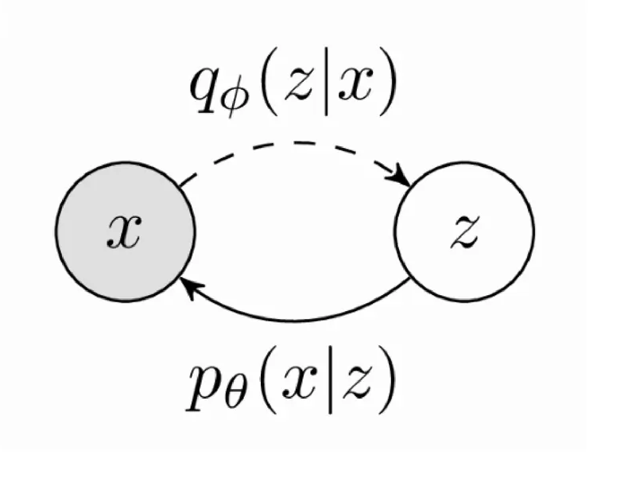
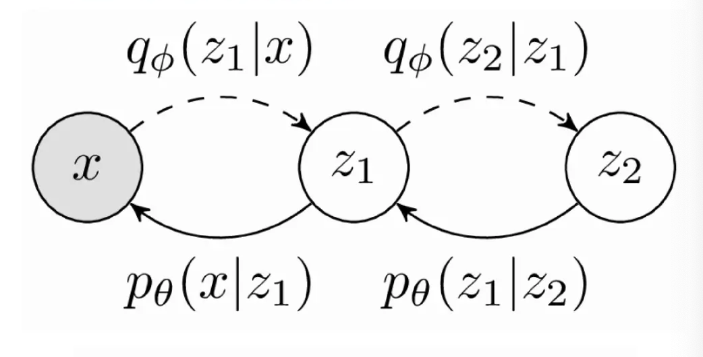
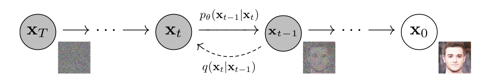

## Diffusion Model

### Variational Lower Bound

VLB (Variational Lower Bound) 是在 VAE 中用到的一种优化手段。

VAE 本身用数学公式来描述的话，用 $x$ 来表示真实数据，$z$ 来表示将 $x$ 编码后的向量，就是：

1.  有一个预先知道的概率分布 $p(z)$。
2.  有一个似然函数 $p(x\vert z)$。

它生成的过程，就是从预先知道的概率分布（通常使用标准多元高斯分布）$z\sim \mathcal N(0,I)$ 随机采样一个 $z_0$，然后利用似然函数从 $p(x\vert z=z_0)$ 再生成一个  $\hat{x}$。

DNN 建模的就是这个似然函数，输入是 $z_0$，输出解释为在以输入为条件下，从这个建模的似然函数中生成某个具体的值。假设它的参数为 $\theta$，那么建模逼近的这个似然函数就可以表示为 $p_\theta(x \vert z)$。

通常来说，优化似然函数采用极大似然估计，也就是假如有真实数据样本 $\{x^{(0)},x^{(1)},...,x^{(n−1)}\}$，那么 DNN 所优化得到最好的参数  $\theta^*$ 应该为：

$$
\theta^* = \arg \max\limits_\theta \prod\limits_{i = 0}^{n-1} p_\theta(x^{(i)})
$$
$p_\theta(x)$ 实际上代表的就是模型建模近似得到的真实数据的分布，具体意义为生成真实数据的概率。

对乘积形式取对数变为累加，方便优化求导，同时也是因为对数函数是单调函数，当对数函数取最小时，原函数自然也会取最小。

$$
\theta^* = \arg \max\limits_\theta \sum\limits_{i = 0}^{n-1} \log p_\theta(x^{(i)})
$$

具体 $p_\theta(x^{(i)})$ 实际上就是积分形式的全概率公式：

$$
p_\theta (x^{(i)})=\int p_\theta(x^{(i)}\vert z)p(z)dz
$$
但是存在一个问题也很明显，用 DNN 对 $p_\theta(x^{(i)}\vert z)$ 建模，不可能采样所有可能的 $z$ 值，然后让他们向前传播通过 DNN 计算积分。

VAE 巧妙的地方就在于，通过后验概率的优化来绕开了直接优化极大似然。

首先，对于第一个 DNN 建模的近似的 $p_\theta(x\vert z)$ 有一个后验概率的定义 $q_\theta(z\vert x)$，然后它使用了另一个 DNN 来建模这个后验概率，假设它的参数表示为 $\phi$，则这个近似后验概率就可以表示为 $q_\phi(z \vert x)$。

优化的目标就变为了优化 $p_\theta(z\vert x)$ 和 $q_\phi(z \vert x)$ 之间的 KL divergence $D_{KL}(q_\phi(z \vert x)\Vert p_\theta(z\vert x))$。一般来说在 KL 散度中，左侧放的是真实的概率分布，右边放的是近似的，但是这里是反着的。这个的原因在 Eric Jang 的一个 [post](https://blog.evjang.com/2016/08/variational-bayes.html) 中有介绍。

$$
\begin{aligned}
D_{KL}\left(q_{\phi}(\mathbf{z} \vert \mathbf{x}) \Vert p_{\theta}(\mathbf{z} \vert \mathbf{x})\right)
&=\int q_{\phi}(\mathbf{z} \vert \mathbf{x}) \log \frac{q_{\phi}(\mathbf{z} \vert \mathbf{x})}{p_{\theta}(\mathbf{z} \vert \mathbf{x})} d \mathbf{z} \\
&=\int q_{\phi}(\mathbf{z} \vert \mathbf{x}) \log \frac{q_{\phi}(\mathbf{z} \vert \mathbf{x}) p_{\theta}(\mathbf{x})}{p_{\theta}(\mathbf{z}, \mathbf{x})} d \mathbf{z} \\
&=\int q_{\phi}(\mathbf{z} \vert \mathbf{x})\left(\log p_{\theta}(\mathbf{x})+\log \frac{q_{\phi}(\mathbf{z} \vert \mathbf{x})}{p_{\theta}(\mathbf{z}, \mathbf{x})}\right) d \mathbf{z} \\
&=\log p_{\theta}(\mathbf{x})+\int q_{\phi}(\mathbf{z} \vert \mathbf{x}) \log \frac{q_{\phi}(\mathbf{z} \vert \mathbf{x})}{p_{\theta}(\mathbf{x} \vert \mathbf{z}) p(\mathbf{z})} d \mathbf{z} \\
&=\log p_{\theta}(\mathbf{x})+D_{K L}\left(q_{\phi}(\mathbf{z} \vert \mathbf{x}) \Vert p(\mathbf{z})\right)-\mathbb{E}_{\mathbf{z} \sim q_{\phi}(\mathbf{z} \vert \mathbf{x})} \log p_{\theta}(\mathbf{x} \vert \mathbf{z})
\end{aligned}
$$

做一点移项，就可以得到：

$$
\log p_{\theta}(\mathbf{x}) - D_{KL}\left(q_{\phi}(\mathbf{z} \vert \mathbf{x}) \Vert p_{\theta}(\mathbf{z} \vert \mathbf{x})\right) = \mathbb{E}_{\mathbf{z} \sim q_{\phi}(\mathbf{z} \vert \mathbf{x})} \log p_{\theta}(\mathbf{x} \vert \mathbf{z}) - D_{K L}\left(q_{\phi}(\mathbf{z} \vert \mathbf{x}) \Vert p(\mathbf{z})\right)
$$
而左式正是我们想要最大化的，也就是第一个 DNN 建模的生成真实数据的概率加上第一个 DNN 建模的后验概率与第二个 DNN 建模的后验概率之间的 DL divergence。左式不好直接计算，但是右式可以很方便的计算，因此损失函数 $L$ 就是右式的相反数。那么损失函数最小化，就是左式的最大化，而 KL divergence 总是大于等于 0 的，所以：

$$
\log p_\theta(x)\ge −L
$$
$L$ 变小，就是在提高第一个 DNN 建模的近似真实数据分布生成真实数据的概率的 lower bound，也就是 VAE 的内涵。

期望的含义是在给定 $q_\phi(z\mid x)$（编码器输出）的情况下，$p_\theta(x\mid z)$（解码器输出）的值尽可能高，其实就是一个类似于 Auto-Encoder 的损失函数。

$$
\begin{gathered}
p(x)=\int_z p_\theta(x \vert z) p(z)dz \\
p(x)=\int q_\phi(z \vert x) \frac{p_\theta(x \vert z) p(z)}{q_\phi(z \vert x)}dz \\
\log p(x)=\log \mathbb{E}_{z \sim q_\phi(z \vert x)}\left[\frac{p_\theta(x \vert z) p(z)}{q_\phi(z \vert x)}\right] \\
\log p(x) \geq \mathbb{E}_{z \sim q_\phi(z \vert x)}\left[\log \frac{p_\theta(x \vert z) p(z)}{q_\phi(z \vert x)}\right]
\end{gathered}
$$

### 多层 VAE 的原理公式与置信下界

$$
\begin{gathered}
p(x)=\int_{z_1} \int_{z_2} p_\theta\left(x, z_1, z_2\right) d z_1, d z_2 \\
p(x)=\iint q_\phi\left(z_1, z_2 \vert x\right) \frac{p_\theta\left(x, z_1, z_2\right)}{q_\phi\left(z_1, z_2 \vert x\right)} \\
p(x)=\mathbb{E}_{z_1, z_2 \sim q_\phi\left(z_1, z_2 \vert x\right)}\left[\frac{p_\theta\left(x, z_1, z_2\right)}{q_\phi\left(z_1, z_2 \vert x\right)}\right] \\
\log p(x) \geq \mathbb{E}_{z_1, z_2 \sim q_\phi\left(z_1, z_2 \vert x\right)}\left[\log \frac{p_\theta\left(x, z_1, z_2\right)}{q_\phi\left(z_1, z_2 \vert x\right)}\right] \\
p\left(x, z_1, z_2\right)=p\left(x \vert z_1\right) p\left(z_1 \vert z_2\right) p\left(z_2\right) \\
q\left(z_1, z_2 \vert x\right)=q\left(z_1 \vert x\right) q\left(z_2 \vert z_1\right)
\end{gathered}
$$

$$
\mathcal L(\theta, \phi) = \mathbb E_{q(z1, z2\vert x)}\left[\log p(x\vert z_1) -\log q(z_1\vert x) + \log p(z_1\vert z_2) - \log q(z_2\vert z_1) + \log p(z_2) \right]
$$

#### Stochastic Langevin Dynamics

Langevin Dynamics 是一个物理里面的概念，假设想要从一个数据分布  $p(x)$ 中采样，可以不需要预先知道  $p(x)$，而是借助 $\nabla _x \log p(x)$，通过一个 Markov Chain 来逐步迭代得到最终的目标样本。

$$
x_{t}=x_{t+1}+\frac{\epsilon}{2} \nabla_{x} \log p\left(x_{t-1}\right)+\sqrt{\epsilon} z_{t}, \text { where } z_{t} \sim \mathcal N(0,1)
$$
其中，$\epsilon$ 代表每步步长，$T$ 代表步数。 $\nabla_{x} \log p(x)$ 可以理解为在当前位置 $x$，如果要让它符合目标数据分布 $p(x)$，最有可能的移动方向。可以证明当 $T \rightarrow \infty, \epsilon \rightarrow 0$，最终得到的 $x_{T}$ 等于从 $p(x)$ 中随机采样的某个样本。

之所以要加上高斯噪声，是为了避免陷入某个局部最优。

### 重参数技巧

若希望从高斯分布 $\mathcal N(\mu, \sigma)$ 中采样，可以先从标准分布 $\mathcal N(0,1)$ 采样出 $z$，再得到 $\sigma \times z +\mu$。这样做的好处是将随机性转移到了 $z$ 这个常量上，而 $\mu$ 和 $\sigma$ 则当做仿射变换网络的一部分。

## Diffusion Model

### 扩散

Diffusion Model 的思路可以理解为两个过程：

#### 1. Forward Diffusion Process

1. 给定初始数据分布 $x_0～ q(x)$，可以不断地向分布中添加高斯噪声，该噪声的标准差是以固定值 $\beta_t$ 确定的，均值是以固定值 $\beta_t$ 和当前 t 时刻的数据 $x_t$ 决定的。这个过程是一个马尔科夫链过程。
2. 随着 t 的不断增大，最终数据 $x_T$ 变成了一个各向独立的高斯分布。
3. 任意时刻的 $q(x_t)$ 推导也可以完全基于 $x_0$ 和 $\beta_t$ 来计算 ，而不需要做迭代。

通过在原始样本上不断添加一些高斯噪声，来逐渐破环原本样本的结构，直到变为一个单纯的变量之间互相独立的多元高斯分布。这就是一个 Stochastic Langevin Dynamics 的过程。

假设原样本为 $\mathbf{x}_{0}$，每一步得到的结果为 $\mathbf{x}_{t}, t=1,2, \ldots, T$，每一步的变换都可以用一个条件概率来描述（体现为 Markov Chain）：

$$
\begin{gathered}
q\left(\mathbf{x}_{t} \vert \mathbf{x}_{t-1}\right)=\mathcal N\left(\mathbf{x}_{t} ; \sqrt{1-\beta_{t}} \mathbf{x}_{t-1}, \beta_{t} \mathbf{I}\right) \\
\mathbf{x}_{t}=\sqrt{1-\beta_{t}} \mathbf{x}_{t-1}+\sqrt{\beta_{t}} \mathbf{z}_{t-1}, \text { where } \mathbf{z}_{t-1} \sim \mathcal N(\mathbf{0}, \mathbf{I})
\end{gathered}
$$

其中 $\beta_{t}$ 是一个 $(0,1)$ 的量，实际上控制了每一步添加的噪声的大小。越大噪声越多，破坏的也就越多；越小噪声越小，保留的也就越多。

从原始数据到最终高斯分布的整个过程就可以描述为：

$$
q\left(\mathbf{x}_{1: T} \vert \mathbf{x}_{0}\right)=\prod_{t=1}^{T} q\left(\mathbf{x}_{t} \vert \mathbf{x}_{t-1}\right), \text { where } \mathbf{x}_{1: T}=\mathbf{x}_{1} \mathbf{x}_{2} \ldots \mathbf{x}_{T}
$$

这步推导背后其实是 Markov Chain 的性质：下一状态只跟当前状态有关（无记忆性）：

$$
q\left(\mathbf{x}_{t} \vert \mathbf{x}_{t-1}\right)= q\left(\mathbf{x}_{t} \vert \mathbf{x}_{t-1} \mathbf{x}_{t-2} \ldots \mathbf{x}_{t-i}\right), \text { where } i \leq t
$$
如果定义 $\alpha_{t}=1-\beta_{t}$ 和 $\overline{\alpha}_{t}=\prod\limits_{i=1}^{T} \alpha_{i}$，那么就可以不用迭代的得到每一步的结果，而是直接得到任意步的结果：

$$
\begin{aligned}
\mathbf{x}_{t} &=\sqrt{\alpha_{t}} \mathbf{x}_{t-1}+\sqrt{1-\alpha_{t}} \mathbf{z}_{t-1} \\
&=\sqrt{\alpha_{t} \alpha_{t-1}} \mathbf{x}_{t-2}+\sqrt{\alpha_{t}\left(1-\alpha_{t-1}\right)} \mathbf{\overline{z}}_{t-2} \\
&=\ldots \\
&=\sqrt{\overline{\alpha}_{t}} \mathbf{x}_{0}+\sqrt{1-\overline{\alpha}_{t}} {\mathbf{z}}
\end{aligned}
$$

即：

$$
q\left(\mathbf{x}_{t} \vert \mathbf{x}_{0}\right)=\mathcal N\left(\mathbf{x}_{t} ; \sqrt{\overline{\alpha}_{t}} \mathbf{x}_{0},\left(1-\overline{\alpha}_{t}\right) \mathbf{I}\right)
$$

注意这里，两个正态分布 $X \sim \mathcal N\left(\mu_1, \sigma_1\right)$ 和 $Y \sim\mathcal N\left(\mu_2, \sigma_2\right)$ 的叠加后的分布 $a X+b Y$ 的均值为 $a \mu_1+b \mu_2$ ，方差为 $a^2 \sigma_1^2+b^2 \sigma_2^2$ 。所以 $\sqrt{\alpha_t(1 -\alpha_{t-1})} \mathbf{z}_{t-2}+\sqrt{1-\alpha_t} \mathbf{z}_{t-1}$ 可以重参数化成只含一个随机变量 $\mathbf{z}$ 构成的$\sqrt{1-\alpha_t \alpha_{t-1}} \mathbf{z}$ 的形式。

通常来说，Forward Diffusion Process 中 $\beta_{1}<\beta_{2}<\ldots<\beta_{T}$，也就是说破坏的力度是越来越大的。相应的 $\alpha_{1}>\alpha_{2}>\ldots>\alpha_{T}$ 。

#### 2. Reverse Diffusion Process

逆过程是从高斯噪声中恢复原始数据，我们可以假设它也是一个高斯分布，但是无法逐步地去拟合分布，所以需要构建一个参数分布来去做估计。

逆扩散过程仍然是一个马尔可夫链过程。

对原本的 Forward Diffusion Process 进行一个逆变换，它需要得到的就是 $p(x_{t−1}\vert x_t)$。

也就是  $p(x_{t}\vert x_{t-1})$ 的后验概率，它并不好计算，但是它的形式很容易让人想起 VAE 里面的  $p(x\vert z)$ 和  $p(z\vert x)$。 $p(x_{t}\vert x_{t-1})$ 就是一个 probabilistic decoder，$p(x_{t−1}\vert x_t)$ 就是一个相对的 probabilistic encoder，而 VAE 中的 encoder 就是一个条件高斯分布。所以这里也可以把 Reverse Diffusion Process 中的每个变换定义为一个条件高斯分布，也就是说：

$$
p(x_{t−1}\vert x_t)=\mathcal N(x_{t−1};\mu (x_t,t),\Sigma (x_t,t))
$$

> 其实，根据 [Feller, W. et al. 1949](https://digitalassets.lib.berkeley.edu/math/ucb/text/math_s1_article-21.pdf) 的一篇论文，如果 Forward Diffusion Process 中使用高斯噪声，并且每一步很小的话，那么可以证明 Reversed Diffusion Process 中每一步也是一个多元高斯分布。这是它的理论依据，上面的解释是一个比较直觉的想法。

而我们就需要一个 DNN 来近似的表达这个 $p$，假设参数为 $\theta$，那么就记为 $p_\theta$。通常对于多变量高斯分布，在模型中实际上默认使用的是变量之间互相独立的多变量高斯分布，原因在 [这里](https://stats.stackexchange.com/questions/388620/variational-autoencoder-and-covariance-matrix) 有一个很棒的分析。也就是说：

$$
p_\theta(x_{t−1}\vert x_t)=\mathcal N(x_{t−1};\mu(x_t,t),\sigma^2(x_t,t)\mathbf I)
$$

$$
\mathbf x_{t−1}=\mu(x_t,t)+\sigma(x_t,t)\odot \mathbf z_t, \quad where \quad \mathbf z_t∼\mathcal N(0,I)
$$

其中的 $\sigma$ 是标准差，但是标准差是大于 0 的，所以通常我们模型输出的是 $\log\sigma^2$，也就是方差的对数，它的值域就是 $(−\infin,\infin)$，需要再变换一下。

而从高斯分布到真实数据分布的过程就可以描述为：

$$
\begin{aligned}
&p_\theta\left(\mathbf{x}_{0: T-1} \vert \mathbf{x}_T\right)=\prod_{t=1}^T p_\theta\left(\mathbf{x}_{t-1} \vert \mathbf{x}_t\right) \\
&p_\theta\left(\mathbf{x}_{0: T}\right)=p_\theta\left(\mathbf{x}_T\right) \prod_{t=1}^T p_\theta\left(\mathbf{x}_{t-1} \vert \mathbf{x}_t\right)
\end{aligned}
$$

后验的扩散条件概率 $q(x_{t-1}\vert x_t, x_0)$ 分布是可以用公式表达的，也就是说，给定 $x_t$ 和 $x_0$，可以计算出 $x_{t-1}$。

注意：高斯分布的概率密度函数是 $f(x)=\frac{1}{\sqrt{2\pi }\sigma}e^{-\frac{(x-\mu)^2}{2\sigma^2}}$

注意：$ax^2+bx=a(x+\frac{b}{2a})^2+C$

$$
q\left(\mathbf{x}_{t-1} \vert \mathbf{x}_t, \mathbf{x}_0\right)=\mathcal{N}\left(\mathbf{x}_{t-1} ; \tilde{\boldsymbol{\mu}}\left(\mathbf{x}_t, \mathbf{x}_0\right), \tilde{\beta}_t \mathbf{I}\right)
$$

根据 Bayes' rule 有：

$$
\begin{aligned}
q\left(\mathbf{x}_{t-1} \vert \mathbf{x}_t, \mathbf{x}_0\right) &=q\left(\mathbf{x}_t \vert \mathbf{x}_{t-1}, \mathbf{x}_0\right) \frac{q\left(\mathbf{x}_{t-1} \vert \mathbf{x}_0\right)}{q\left(\mathbf{x}_t \vert \mathbf{x}_0\right)} \\
& \propto \exp \left(-\frac{1}{2}\left(\frac{\left(\mathbf{x}_t-\sqrt{\alpha_t} \mathbf{x}_{t-1}\right)^2}{\beta_t}+\frac{\left(\mathbf{x}_{t-1}-\sqrt{\overline \alpha_{t-1}} \mathbf{x}_0\right)^2}{1-\overline{\alpha}_{t-1}}-\frac{\left(\mathbf{x}_t-\sqrt{\overline\alpha_t} \mathbf{x}_0\right)^2}{1-\overline{\alpha}_t}\right)\right) \\
&=\exp \left(-\frac{1}{2}\Big((\frac{\alpha_t}{\beta_t}+\frac{1}{1-\overline{\alpha}_{t-1}}) \mathbf{x}_{t-1}^2-(\frac{2 \sqrt{\alpha_t}}{\beta_t} \mathbf{x}_t+\frac{2 \sqrt{\overline\alpha_{t-1}}}{1-\overline{\alpha}_{t-1}} \mathbf{x}_0) \mathbf{x}_{t-1}+C\left(\mathbf{x}_t, \mathbf{x}_0\right)\Big)\right)
\end{aligned}
$$

其中 $C\left(\mathbf{x}_t, \mathbf{x}_0\right)$ 是不涉及 $\mathbf{x}_{t-1}$ 的函数。

按照标准高斯密度函数，均值和方差可参数化如下：

$$
\begin{aligned}
\tilde{\beta}_t &=1 /\left(\frac{\alpha_t}{\beta_t}+\frac{1}{1-\overline{\alpha}_{t-1}}\right)=\frac{1-\overline{\alpha}_{t-1}}{1-\overline{\alpha}_t} \cdot \beta_t \\
\tilde{\mu}_t\left(\mathbf{x}_t, \mathbf{x}_0\right) &=(\frac{\sqrt{\alpha_t}}{\beta_t} \mathbf{x}_t+\frac{\sqrt{\overline{\alpha}_t}}{1-\overline{\alpha}_t} \mathbf{x}_0) /(\frac{\alpha_t}{\beta_t}+\frac{1}{1-\overline{\alpha}_{t-1}})=\frac{\sqrt{\alpha_t}\left(1-\overline{\alpha}_{t-1}\right)}{1-\overline{\alpha}_t} \mathbf{x}_t+\frac{\sqrt{\overline\alpha_{t-1}} \beta_t}{1-\overline{\alpha}_t} \mathbf{x}_0
\end{aligned}
$$

根据前面 $\mathbf x_0$ 与 $\mathbf x_t$ 之间的关系式，我们可以知道

$$
\mathbf{x}_0=\frac{1}{\sqrt{\overline{\alpha}_t}}\left(\mathbf{x}_t-\sqrt{1-\overline{\alpha}_t} \mathbf{z}_t\right)
$$

将 $\mathbf x_0$ 的表达式代入到 $q\left(x_{t-1} \vert x_t, x_0\right)$ 的分布中，可以重新给出该分布的均值表达式，这个时候表达式中不再含有$\mathbf x_0$，并且多了噪声项，这为后面我们设计神经网络提供了基础。也就是说，在给定 $\mathbf x_0$ 的条件下，后验条件高斯分布的均值计算只与 $\mathbf x_t$ 和 $\mathbf z_t$ 有关。 $\mathbf z_t$ 是 $t$ 时刻的随机正态分布变量，源自重参数化：

$$
\begin{aligned}
\tilde{\boldsymbol{\mu}}_t &=\frac{\sqrt{\alpha_t}\left(1-\overline{\alpha}_{t-1}\right)}{1-\overline{\alpha}_t} \mathbf{x}_t+\frac{\sqrt{\overline{\alpha}_{t-1}} \beta_t}{1-\overline{\alpha}_t} \frac{1}{\sqrt{\overline{\alpha}_t}}\left(\mathbf{x}_t-\sqrt{1-\overline{\alpha}_t} \mathbf{z}_t\right) \\
&=\frac{1}{\sqrt{\alpha_t}}\left(\mathbf{x}_t-\frac{\beta_t}{\sqrt{1-\overline{\alpha}_t}} \mathbf{z}_t\right)
\end{aligned}
$$

###  优化目标

同样，整个模型的生成过程可以描述为 $p_\theta(x_{0:T})$，是一个似然函数。

值得注意的是，不同于 VAE 一次输出结果，我们生成的过程实际上是一个逐步迭代的过程，中间的每一步结果都是所以是 $x_{0:T}$，而不是 $x_T$。

但是我们优化的目标仍然是生成真实数据的概率，使用的优化方法还是 VLB。

$$
\begin{aligned}
-\log p_\theta\left(\mathbf{x}_0\right) & \leq-\log p_\theta\left(\mathbf{x}_0\right)+D_{\mathrm{KL}}\left(q\left(\mathbf{x}_{1: T} \vert \mathbf{x}_0\right) \Vert p_\theta\left(\mathbf{x}_{1: T} \vert \mathbf{x}_0\right)\right) \\
&=-\log p_\theta\left(\mathbf{x}_0\right)+\mathbb{E}_{\mathbf{x}_{1: T} \sim q(\mathbf{x}_{1: T} \vert \mathbf{x}_0)}\left[\log \frac{q\left(\mathbf{x}_{1: T} \vert \mathbf{x}_0\right)}{p_\theta\left(\mathbf{x}_{0: T}\right) / p_\theta\left(\mathbf{x}_0\right)}\right] \\
&=-\log p_\theta\left(\mathbf{x}_0\right)+\mathbb{E}_q\left[\log \frac{q\left(\mathbf{x}_{1: T} \vert \mathbf{x}_0\right)}{p_\theta\left(\mathbf{x}_{0: T}\right)}+\log p_\theta\left(\mathbf{x}_0\right)\right] \\
&=\mathbb{E}_q\left[\log \frac{q\left(\mathbf{x}_{1: T} \vert \mathbf{x}_0\right)}{p_\theta\left(\mathbf{x}_{0: T}\right)}\right]
\end{aligned}
$$

进一步可以写出交叉熵的上界：

$$
\mathcal L = \mathbb{E}_{q\left(\mathbf{x}_0\right)} [-\log p_\theta\left(\mathbf{x}_0\right)] \leq \mathbb{E}_{q\left(\mathbf{x}_{0: T})\right.}\left[\log \frac{q\left(\mathbf{x}_{1: T} \vert \mathbf{x}_0\right)}{p_\theta\left(\mathbf{x}_{0: T}\right)}\right] = L_{\mathrm{VLB}}
$$

接下来可以对交叉熵的上界进行简化：

$$
\begin{aligned}
L_{\mathrm{VLB}} &=\mathbb{E}_{q\left(\mathbf{x}_{0: T})\right.}\left[\log \frac{q\left(\mathbf{x}_{1: T} \vert \mathbf{x}_0\right)}{p_\theta\left(\mathbf{x}_{0: T}\right)}\right] \\
&=\mathbb{E}_q\left[\log \frac{\prod_{t=1}^T q\left(\mathbf{x}_t \vert \mathbf{x}_{t-1}\right)}{p_\theta\left(\mathbf{x}_T\right) \prod_{t=1}^T p_\theta\left(\mathbf{x}_{t-1} \vert \mathbf{x}_t\right)}\right] \\
&=\mathbb{E}_q\left[-\log p_\theta\left(\mathbf{x}_T\right)+\sum_{t=1}^T \log \frac{q\left(\mathbf{x}_t \vert \mathbf{x}_{t-1}\right)}{p_\theta\left(\mathbf{x}_{t-1} \vert \mathbf{x}_t\right)}\right] \\
&=\mathbb{E}_q\left[-\log p_\theta\left(\mathbf{x}_T\right)+\sum_{t=2}^T \log \frac{q\left(\mathbf{x}_t \vert \mathbf{x}_{t-1}\right)}{p_\theta\left(\mathbf{x}_{t-1} \vert \mathbf{x}_t\right)}+\log \frac{q\left(\mathbf{x}_1 \vert \mathbf{x}_0\right)}{p_\theta\left(\mathbf{x}_0 \vert \mathbf{x}_1\right)}\right] \\
&=\mathbb{E}_q\left[-\log p_\theta\left(\mathbf{x}_T\right)+\sum_{t=2}^T \log \left(\frac{q\left(\mathbf{x}_{t-1} \vert \mathbf{x}_t, \mathbf{x}_0\right)}{p_\theta\left(\mathbf{x}_{t-1} \vert \mathbf{x}_t\right)} \cdot \frac{q\left(\mathbf{x}_t \vert \mathbf{x}_0\right)}{q\left(\mathbf{x}_{t-1} \vert \mathbf{x}_0\right)}\right)+\log \frac{q\left(\mathbf{x}_1 \vert \mathbf{x}_0\right)}{p_\theta\left(\mathbf{x}_0 \vert \mathbf{x}_1\right)}\right] \\
&=\mathbb{E}_q\left[-\log p_\theta\left(\mathbf{x}_T\right)+\sum_{t=2}^T \log \frac{q\left(\mathbf{x}_{t-1} \vert \mathbf{x}_t, \mathbf{x}_0\right)}{p_\theta\left(\mathbf{x}_{t-1} \vert \mathbf{x}_t\right)}+\sum_{t=2}^T \log \frac{q\left(\mathbf{x}_t \vert \mathbf{x}_0\right)}{q\left(\mathbf{x}_{t-1} \vert \mathbf{x}_0\right)}+\log \frac{q\left(\mathbf{x}_1 \vert \mathbf{x}_0\right)}{p_\theta\left(\mathbf{x}_0 \vert \mathbf{x}_1\right)}\right] \\
&=\mathbb{E}_q\left[-\log p_\theta\left(\mathbf{x}_T\right)+\sum_{t=2}^T \log \frac{q\left(\mathbf{x}_{t-1} \vert \mathbf{x}_t, \mathbf{x}_0\right)}{p_\theta\left(\mathbf{x}_{t-1} \vert \mathbf{x}_t\right)}+\log \frac{q\left(\mathbf{x}_T \vert \mathbf{x}_0\right)}{q\left(\mathbf{x}_1 \vert \mathbf{x}_0\right)}+\log \frac{q\left(\mathbf{x}_1 \vert \mathbf{x}_0\right)}{p_\theta\left(\mathbf{x}_0 \vert \mathbf{x}_1\right)}\right] \\
&=\mathbb{E}_q\left[\log \frac{q\left(\mathbf{x}_T \vert \mathbf{x}_0\right)}{p_\theta\left(\mathbf{x}_T\right)}+\sum_{t=2}^T \log \frac{q\left(\mathbf{x}_{t-1} \vert \mathbf{x}_t, \mathbf{x}_0\right)}{p_\theta\left(\mathbf{x}_{t-1} \vert \mathbf{x}_t\right)}-\log p_\theta\left(\mathbf{x}_0 \vert \mathbf{x}_1\right)\right] \\
&=\mathbb{E}_q\left[\underbrace{-\log p_\theta\left(\mathbf{x}_0 \mid \mathbf{x}_1\right)}_{L_0}+\sum_{t=2}^T \underbrace{D_{\mathrm{KL}}\left(q\left(\mathbf{x}_{t-1} \mid \mathbf{x}_t, \mathbf{x}_0\right) \Vert p_\theta\left(\mathbf{x}_{t-1} \mid \mathbf{x}_t\right)\right)}_{L_{t-1}}+\underbrace{D_{\mathrm{KL}}\left(q\left(\mathbf{x}_T \mid \mathbf{x}_0\right) \Vert p_\theta\left(\mathbf{x}_T\right)\right)}_{L_T}\right]
\end{aligned}
$$

根据贝叶斯公式：

$$
q\left(\mathbf x_t \vert \mathbf x_{t-1}\right)=q\left(\mathbf x_t \vert \mathbf x_{t-1}, \mathbf x_0\right)=\frac{q\left(\mathbf x_t, \mathbf x_{t-1}, \mathbf x_0\right)}{q\left(\mathbf x_{t-1}, \mathbf x_0\right)}=\frac{q\left(\mathbf x_{t-1} \vert \mathbf x_t, \mathbf x_0\right) q\left(\mathbf x_t \vert \mathbf x_0\right) q\left(\mathbf x_0\right)}{q\left(\mathbf x_{t-1}, \mathbf x_0\right)}
$$

上式中，$L_0$ 在 DDPM 原论文中由于选择了固定方差，故 $L_T$ 为常数，而 $L_0$ 相当于从连续空间到离散空间的解码 Loss，这里可以仿照 VAE 或自回归模型中的做法，将连续的高斯分布转换成离散的分布，具体公式见 DDPM 论文 Section3.3 或者见 Improved Diffusion。

这里论文将 $p_\theta\left(x_{t-1} \vert x_t\right)$ 分布的方差设置成一个与 $\beta$ 相关的常数，因此可训练的参数只存在于其均值中。

对于两个单一变量的高斯分布 $p$ 和 $q$ 而言，它们的 KL 散度为：

$$
KL(p, q)=\log \frac{\sigma_2}{\sigma_1}+\frac{\sigma^2+\left(\mu_1-\mu_2\right)^2}{2 \sigma_2^2}-\frac{1}{2}
$$

$$
L_{t-1}=\mathbb{E}_q\left[\frac{1}{2 \sigma_t^2}\left\|\tilde{\boldsymbol{\mu}}_t\left(\mathbf{x}_t, \mathbf{x}_0\right)-\boldsymbol{\mu}_\theta\left(\mathbf{x}_t, t\right)\right\|^2\right]+C
$$

既然这里的 Loss 是从 KL divergence 出发的，或者说是与分布有关的， 那我们可以设计一个黑箱子神经网络，把它称之为 $D_\theta$ 网络。对于 $D_\theta$ 网络，输入是 $x_t$ 和时间编码 $t$ ，对于输出是什么，取决于我们的建模目标。

而我们可以有多种建模目标：

1. 直观的做法是让 $D_\theta$ 网络的输出等于前向过程中的后验分布均值 $\tilde{\mu}(x_t,x_0)$，这种建模方法又称为预测后验分布的期望值
2. 根据 $\tilde{\mu}(x_t,x_0)$ 表达式，它里面的 $x_0$ 对于 $D_\theta$ 网络是未知的，因此第二种做法是让 $D_\theta$ 网络的输出等于 $x_0$，这种做法即直接预测原始数据。有人问，既然可以通过 $D_\theta$ 网络直接预测 $x_0$ 了，那是不是采样过程就直接计算 $D_\theta(x_T,T)$ 的输出，即可认为是生成了样本了呢？答案是如果直接一步到位，质量会比较差，还是需要通过马尔科夫高斯条件迭代才能获得最终高质量的生成样本
3. 当我们把 $\tilde{\mu}(x_t,x_0)$ 中的 $x_0$ 用 $x_t$ 去表示的时候，$\tilde{\mu}(x_t,x_0)$ 就变成了如下只包含 $x_t$ 和随机变量 $\epsilon$ 的式子。其中 $x_t$ 对于 $D_\theta$ 网络是已知的，而 $\epsilon$ 是未知的，因此这时可以选择建模目标是让 $D_\theta$ 网络的输出等于 $\epsilon$ 了，这种建模方法又称为预测随机变量 （噪音）法：

$$
\begin{aligned}
L_{t-1}-C &=\mathbb{E}_{\mathrm{x}_0, \epsilon}\left[\frac{1}{2 \sigma_t^2} \left\| \tilde{\mu}_t\left(\mathrm{x}_t\left(\mathrm{x}_0, \epsilon\right), \frac{1}{\sqrt{\overline{\alpha}_t}}\left(\mathrm{x}_t\left(\mathrm{x}_0, \epsilon\right)-\sqrt{\left.1-\overline{\alpha}_t \epsilon\right)}\right)-\mu_\theta\left(\mathrm{x}_t\left(\mathrm{x}_0, \epsilon\right), t\right) \right\|^2\right]\right.\\
&=\mathbb{E}_{\mathrm{x}_0, \epsilon}\left[\frac{1}{2 \sigma_t^2}\left\|\frac{1}{\sqrt{\alpha_t}}\left(\mathrm{x}_t\left(\mathrm{x}_0, \epsilon\right)-\frac{\beta_t}{\sqrt{1-\overline{\alpha}_t}} \epsilon\right)-\mu_\theta\left(\mathrm{x}_t\left(\mathrm{x}_0, \epsilon\right), t\right)\right\|^2\right]
\end{aligned}
$$

在 DDPM 论文中，作者选择了方案3，即让 $D_\theta$ 网络的输出等于 $\epsilon$ 预测噪音法。于是，新的逆向条件分布的均值可以表示成：

$$
\boldsymbol{\mu}_\theta\left(\mathrm{x}_t, t\right)=\tilde{\mu}_t\left(\mathrm{x}_t, \frac{1}{\sqrt{\overline{\alpha}_t}}\left(\mathrm{x}_t-\sqrt{1-\overline{\alpha}_t} \epsilon_\theta\left(\mathrm{x}_t\right)\right)\right)=\frac{1}{\sqrt{\alpha_t}}\left(\mathrm{x}_t-\frac{\beta_t}{\sqrt{1-\overline{\alpha}_t}} \epsilon_\theta\left(\mathrm{x}_t, t\right)\right)
$$
式中的 $\epsilon_\theta$ 相当于我们定义的广义的 $D_\theta$ 网络的具体目标形式。

于是 $L_{t-1}$ 可以化简成：

$$
\mathbb{E}_{\mathbf{x}_0, \epsilon}\left[\frac{\beta_t^2}{2 \sigma_t^2 \alpha_t\left(1-\overline{\alpha}_t\right)}\left\|\boldsymbol{\epsilon}-\boldsymbol{\epsilon}_\theta\left(\sqrt{\overline{\alpha}_t} \mathbf{x}_0+\sqrt{1-\overline{\alpha}_t} \boldsymbol{\epsilon}, t\right)\right\|^2\right]
$$
DDPM 作者又发现，干脆将系数丟掉，训练更加稳定质量更好，于是有了下面的 $L_{\text {simple }}$：

$$
L_{\text {simple }}(\theta):=\mathbb{E}_{t, \mathbf{x}_0, \epsilon}\left[\left\|\epsilon-\epsilon_\theta\left(\sqrt{\overline{\alpha}_t} \mathbf{x}_0+\sqrt{1-\overline{\alpha}} \epsilon, t\right)\right\|^2\right]
$$

### 总结

1.  首先 Forward Diffusion Process 不断添加 Gaussian noise ，直到将原数据变为变量之间互相独立的多元高斯分布。
2.  Reversed Diffusion Process，每一步也建模为一个多元高斯分布。
3.  优化的方法是采用 VLB，最后是归结于服从多元高斯函数的随机变量之间的 KL divergence。
