# LSTM

## 循环神经网络

RNN 假设样本是基于序列的，比如是序列索引 1 到序列索引 $\tau$ 。对于这其中的任意序列索引号 $t$, 它对应的输入是对应的样本序列中的 $x^{(t)}$。而模型在序列索引号 $t$ 位置的隐藏状态 $h^{(t)}$，则由 $x^{(t)}$ 和在 $t-1$ 位置的隐藏状态 $h^{(t-1)}$ 共同决定。在任意序列索引号 $t$，都有对应的模型预测输出 $o^{(t)}$。通过预测输出 $o^{(t)}$ 和训练序列真实输出 $y^{(t)}$, 以及损失函数 $L^{(t)}$，就可以用 DNN 类似的方法来训练模型，接着用来预测测试序列中的一些位置的输出。

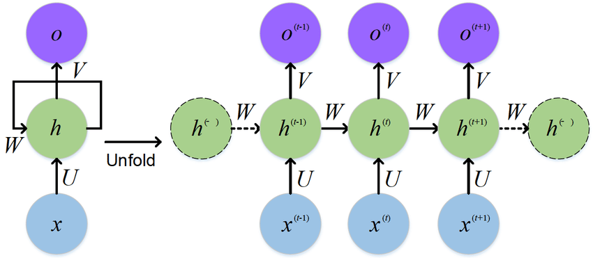

上图中左边是 RNN 模型没有按时间展开的图，右边是按时间序列展开的图，描述了在序列索引号 $t$ 附近 RNN 的模型。其中：

1. $x^{(t)}$ 代表在序列索引号 $t$ 时训练样本的输入。同样的，$x^{(t-1)}$ 和 $x^{(t+1)}$ 代表在序列索引号 $t-1$ 和 $t+1$ 时训练样本的输入。
2. $h^{(t)}$ 代表在序列索引号 $t$ 时模型的隐藏状态。$h^{(t)}$ 由 $x^{(t)}$ 和 $h^{(t-1)}$ 共同决定。
3. $o^{(t)}$ 代表在序列索引号 $t$ 时模型的输出。$o^{(t)}$ 只由模型当前的隐藏状态 $h^{(t)}$ 决定。
4. $L^{(t)}$ 代表在序列索引号 $t$ 时模型的损失函数。
5. $y^{(t)}$ 代表在序列索引号 $t$ 时训练样本序列的真实输出。
6. $U,W,V$ 这三个矩阵是我们的模型的线性关系参数，它在整个 RNN 网络中是共享的，这点和 DNN 很不相同。也正因为是共享，体现了 RNN 的模型的“循环反馈”的思想。

## RNN 前向传播算法

对于任意一个序列索引号 $t$，隐藏状态 $h^{(t)}$ 由 $x^{(t)}$ 和 $h^{(t-1)}$ 得到：

$$
h^{(t)} = \sigma(z^{(t)}) = \sigma(Ux^{(t)} + Wh^{(t-1)} +b )
$$

其中 $\sigma$ 为 RNN 的激活函数，一般为 $tanh$，$b$ 为线性关系的偏置。

序列索引号 $t$ 时模型的输出 $o^{(t)}$ 的表达式比较简单：

$$
o^{(t)} = Vh^{(t)} +c
$$

在最终在序列索引号 $t$ 时的预测输出为：

$$
\hat{y}^{(t)} = \sigma(o^{(t)})
$$

通常由于 RNN 是识别类的分类模型，所以上面这个激活函数一般是 softmax。

通过损失函数 $L^{(t)}$，比如对数似然损失函数，我们可以量化模型在当前位置的损失，即 $\hat{y}^{(t)}$ 和 $y^{(t)}$ 的差距。

## RNN 反向传播算法

有了 RNN 前向传播算法的基础，很容易推导出 RNN 反向传播算法的流程了。RNN 反向传播算法的思路和 DNN 是一样的，即通过梯度下降法一轮轮的迭代，得到合适的 RNN 模型参数 $U,W,V,b,c$。

由于是基于时间反向传播，所以 RNN 的反向传播有时也叫做 BPTT(back-propagation through time)。当然 RNN 的 BPTT 和 DNN 有很大的不同点，即所有的 $U,W,V,b,c$ 在序列的各个位置是共享的，反向传播时更新的是相同的参数。

为了简化描述，损失函数为交叉熵损失函数，输出的激活函数为 softmax 函数，隐藏层的激活函数为 tanh 函数。

对于 RNN，由于在序列的每个位置都有损失函数，因此最终的损失 $L$ 为：

$$
L = \sum\limits_{t=1}^{\tau}L^{(t)}
$$

其中 $V,c$ 的梯度计算是比较简单的：

$$
\frac{\partial L}{\partial c} = \sum\limits_{t=1}^{\tau}\frac{\partial L^{(t)}}{\partial c} = \sum\limits_{t=1}^{\tau}\hat{y}^{(t)} - y^{(t)}
$$

$$
\frac{\partial L}{\partial V} =\sum\limits_{t=1}^{\tau}\frac{\partial L^{(t)}}{\partial V} = \sum\limits_{t=1}^{\tau}(\hat{y}^{(t)} - y^{(t)}) (h^{(t)})^\top
$$

但是 $W,U,b$ 的梯度计算就比较的复杂了。从 RNN 的模型可以看出，在反向传播时，在某一序列位置 $t$ 的梯度损失由当前位置的输出对应的梯度损失和序列索引位置 $t+1$ 时的梯度损失两部分共同决定。对于 $W$ 在某一序列位置 $t$ 的梯度损失需要反向传播一步步的计算。定义序列索引 $t$ 位置的隐藏状态的梯度为：

$$
\delta^{(t)} = \frac{\partial L}{\partial h^{(t)}}
$$

可以像 DNN 一样从 $\delta^{(t+1)}$ 递推 $\delta^{(t)}$。

$$
\begin{aligned} \delta^{(t)} &= (\frac{\partial o^{(t)}}{\partial h^{(t)}} )^T\frac{\partial L}{\partial o^{(t)}} + (\frac{\partial h^{(t+1)}}{\partial h^{(t)}})^T\frac{\partial L}{\partial h^{(t+1)}} \\ & = V^T(\hat{y}^{(t)} - y^{(t)}) + W^Tdiag(1-(h^{(t+1)})^2)\delta^{(t+1)} 
\end{aligned}
$$

对于 $\delta^{(\tau)}$，由于它的后面没有其他的序列索引了，因此有：

$$
\delta^{(\tau)} =( \frac{\partial o^{(\tau)}}{\partial h^{(\tau)}})^T\frac{\partial L}{\partial o^{(\tau)}} = V^T(\hat{y}^{(\tau)} - y^{(\tau)})
$$

有了 $\delta^{(t)}$, 计算 $W,U,b$ 就容易了，这里给出 $W,U,b$ 的梯度计算表达式：

$$
\frac{\partial L}{\partial W} = \sum\limits_{t=1}^{\tau}diag(1-(h^{(t)})^2)\delta^{(t)}(h^{(t-1)})^T
$$

$$
\frac{\partial L}{\partial b}= \sum\limits_{t=1}^{\tau}diag(1-(h^{(t)})^2)\delta^{(t)}
$$

$$
\frac{\partial L}{\partial U} =\sum\limits_{t=1}^{\tau}diag(1-(h^{(t)})^2)\delta^{(t)}(x^{(t)})^T
$$

除了梯度表达式不同，RNN 的反向传播算法和 DNN 区别不大，因此这里就不再重复总结了。

RNN 虽然理论上可以很漂亮的解决序列数据的训练，但是它也像 DNN 一样有梯度消失时的问题，当序列很长的时候问题尤其严重。因此，上面的 RNN 模型一般不能直接应用。在语音识别，手写书别以及机器翻译等 NLP 领域实际应用比较广泛的是基于 RNN 模型的一个特例 LSTM。

RNN 缺点：

1. 梯度消失与梯度爆炸原因
2. 梯度消散并不是指梯度就没有，而是远距离位置的梯度值变得越来越微弱，无法对序列中长距离的依赖性进行建模。

### LSTM 解决梯度消失

梯度消失的原因是使用多个激活函数偏导乘积的形式来计算梯度时，如果梯度权重小于 1，多次相乘后会趋近于 0。

LSTM 的 memory 值 C 是将 memory 值和 input 累加的，传统 RNN 每次都会把之前的 memory 直接清空。

LSTM 有门控机制，在 forget 门关闭的情况下，memory 的值是不更新的

1. Cell state 传播函数中的“加法”结构确实起了一定作用，它使得导数有可能大于 1；
2. LSTM 中逻辑门的参数可以一定程度控制不同时间步梯度消失的程度。

### RNN 与 GRU，LSTM 区别

1. RNN 没有单元状态；LSTM 通过单元状态记忆信息。
2. RNN 激活函数只有 tanh；LSTM 通过输入门、遗忘门、输出门引入 sigmoid 函数并结合 tanh 函数，添加求和操作，减少梯度消失和梯度爆炸的可能性。
3. RNN 只能够处理短期依赖问题；LSTM 既能够处理短期依赖问题，又能够处理长期依赖问题。
4. LSTM 含有更多的参数需要学习，从而导致 LSTM 的学习速度大大降低

GRU：重置门与更新门

## 循环神经网络/递归神经网络

我们知道人类并不是从零开始思考东西，就像你读这篇文章的时候，对每个字的理解都是建立在前几个字上面，读完每个字后并不是直接丢弃然后又从零开始读下一个字，因为思想是具有持续性的，很多东西要通过上下文才能理解。

然而传统的神经网络并不能做到持续记忆理解这一点，这是传统神经网络的主要缺点。举个例子，在使用传统的神经网络去对电影里每个时间点发生的事情进行分类的时候，传统的神经网络不能使用前一个事件去推理下一个事件。

RNN（递归神经网络）是带有循环的神经网络，允许信息在其中保留，可以解决这个问题。

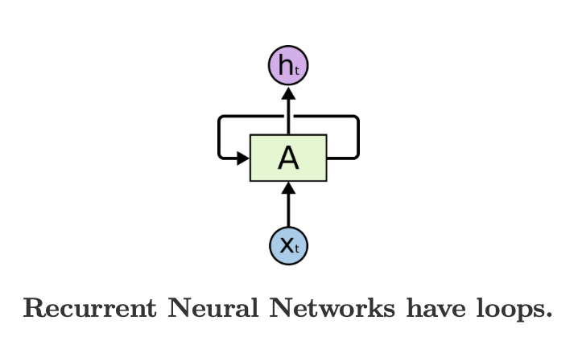

其中，$A$ 代表神经网络主体，$x_t$ 表示网络的输入，$h_t$ 表示网络的输出。循环结构允许信息从当前输出传递到下个时间点的网络输入。

RNN 可以看作是一个网络的多次拷贝，其中每次网络的输出都是下一次的输入。如果展开这个循环结构：

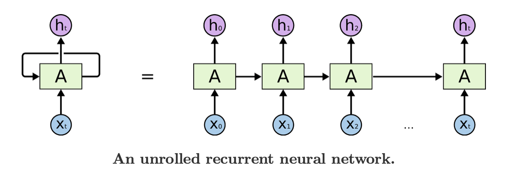

这种像是链状的网络结构表明 RNN 和序列以及列表有着天然的联系，这些神经网络天然擅长处理序列数据。

在最近的几年，RNN 在很多问题上都取得了成功：如语音识别，语音模型，翻译，图片注释等等。在 Andrej Karpathy 的这篇文章——[The Unreasonable Effectiveness of Recurrent Neural Networks](http://karpathy.github.io/2015/05/21/rnn-effectiveness/) 中讨论了 RNN 取得的惊人成果。

这些成功的案例的共同点就是都是用了 LSTM，一种非常特殊的循环神经网络，对于许多任务来说，LSTM 比普通 RNN 好的多。

## 长依赖存在的问题

我们希望 RNN 可以将一些之前的信息连接到当前的任务中来，比如使用之前的视频帧来帮助理解当前帧，如果 RNN 可以做到就太好了。那 RNN 能做到吗？这要视情况而定。

有时候，我们只需要当前的信息来完成当前的任务。举个例子，一个语音模型试图基于之前的单词去预测下一个单词。如果我们尝试预测 “the clouds are in the sky”，不需要太多的上下文信息——很明显最后一个单词会是 sky。在像这样不需要太多的相关信息的场合下，RNN 可以学习到之前使用的信息。

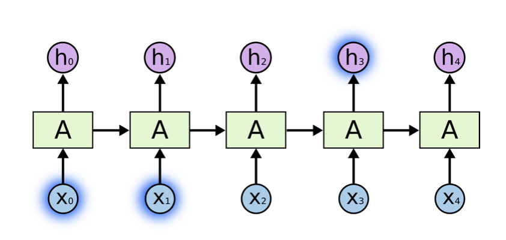

但是要注意，也有很多场景需要使用更多的上下文。当试图去预测 “I grew up in France… I speak fluent French” 这句话的最后一个单词，最近的信息会表明这应该是一种语言的名字，但是如果需要知道具体是哪一种语言，那么就需要 France 这个在句子中比较靠前的上下文信息，这种相关信息和需要预测的点的间隔很大的情况经常会发生。

不幸的是，随着间隔变大，RNN 变得无法连接到太前的信息。

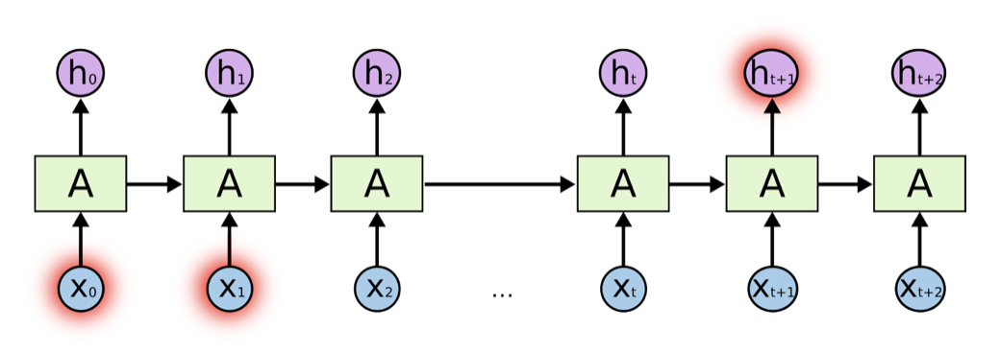

理论上 RNN 完全可以处理这种长期依赖（long-term dependencies）的问题，可以通过精心设计参数来解决这个问题。然而实践表明 RNN 并不能很好地解决这个问题。[Hochreiter(1991)[German]](http://people.idsia.ch/~juergen/SeppHochreiter1991ThesisAdvisorSchmidhuber.pdf) 和 [Bengio, et al. (1994)](http://www-dsi.ing.unifi.it/~paolo/ps/tnn-94-gradient.pdf)，曾经深入的研究过这个问题，他们发现一些底层原因，解释 RNN 为什么不 work。

Thankfully，LSTM 没有这个问题！

## LSTM Networks

长短记忆神经网络 LSTM，是一种特殊的 RNN，能够学习长的依赖关系。 由 [Hochreiter &amp; Schmidhuber (1997)](http://www.bioinf.jku.at/publications/older/2604.pdf) 引入，并被许多人进行了改进和普及。LSTM 在各种各样的问题上工作的非常好，因而被广泛使用。

LSTM 是为了避免长依赖问题而精心设计的。记住较长的历史信息实际上是 LSTM 的天生行为，而不是努力学习的东西。

所有循环神经网络都具有一系列重复模块的神经网络形式。在标准的 RNN 中，该重复模块仅有非常简单的结构，例如单个 tanh 层。如果略去每层都有的 $o^{(t)}, L^{(t)}, y^{(t)}$，则 RNN 的模型可以简化成如下图的形式：

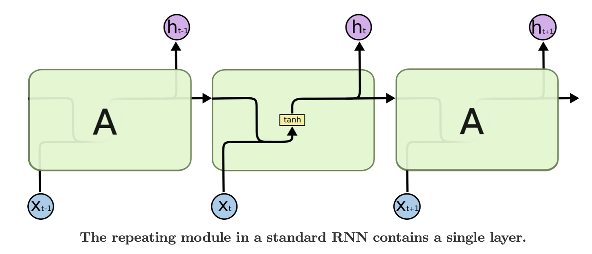

可以清晰看出在隐藏状态 $h^{(t)}$ 由 $x^{(t)}$ 和 $h^{(t-1)}$ 得到。得到 $h^{(t)}$ 后一方面用于当前层的模型损失计算，另一方面用于计算下一层的 $h^{(t+1)}$。

由于 RNN 梯度消失的问题，对于序列索引位置 $t$ 的隐藏结构做了改进，可以说通过一些技巧让隐藏结构复杂了起来，来避免梯度消失的问题，这样的特殊 RNN 就是 LSTM。

LSTM 也拥有 RNN 的链状结构，但是重复模块有不同的结构。与神经网络的简单的一层相比，LSTM 有四层，以特殊的方式进行交互。

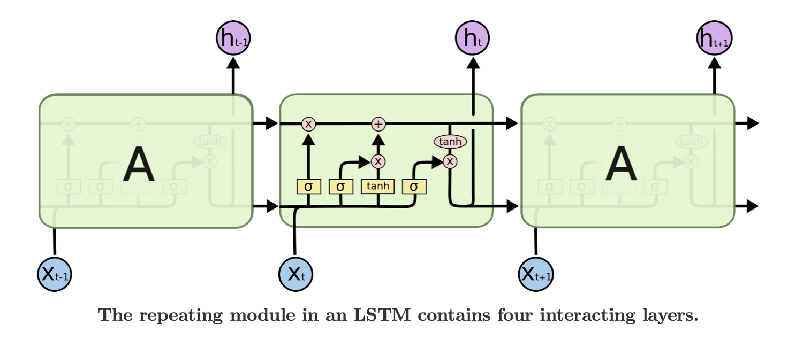

首先熟悉一下要使用符号：

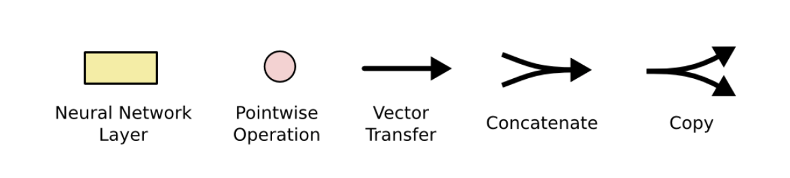

在上图中，每一条线都带有一个向量，该向量从一个节点的输出到其他节点的输入。粉红色圆圈表示 pointwise 运算，如向量加法、点乘，黄色框是学习神经网络层。线的合并表示连接，而线的交叉表示将内容复制到不同的位置。

## LSTM 背后的核心理念

LSTM 的关键是 cell state（神经元状态），表示 cell state 的这条线水平的穿过图的顶部。cell state 类似于输送带，cell state 在整个链上运行，只有很小的线性作用，但却贯穿了整个链式结果。信息就在这个传送带上流动但是状态却不会改变。cell state 上的状态相当于长期记忆，而下面的 $h_t$ 则代表短期记忆。

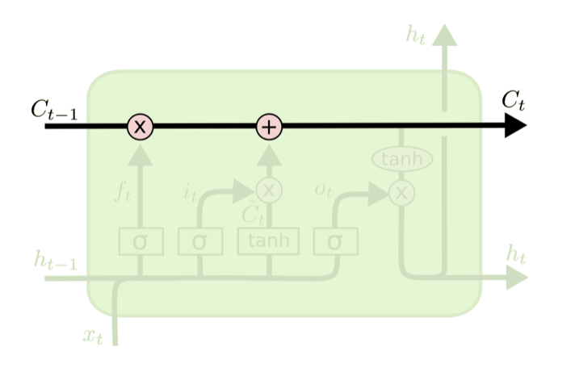

LSTM 具有删除或添加信息到 cell state 的能力，是由被称为门 (Gate) 的结构赋予的。

门 (Gate) 选择性让信息通过，由一个 Sigmoid 神经网络层和一个 pointwise multiplication 运算组成。

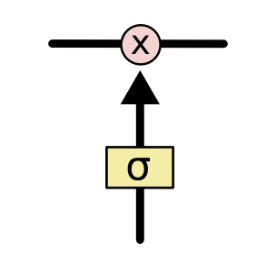

Sigmoid 神经网络层输出 0 和 1 之间的数字，表示每个组件有多少信息可以通过，0 表示不通过任何信息，1 表示全部通过。

LSTM 中还有了很多门控结构 (Gate)，一般包括遗忘门，输入门和输出门三种。

###  遗忘门

LSTM 的第一步是决定要从 cell state 中丢弃什么信息，该决定由“遗忘门”的 Sigmoid 层实现。遗忘门从 $h_{t-1}$（前一个输出）和 $x_t$（当前输入）获取信息，并为 cell state $C_{t-1}$（上一个状态）中的每个数字输出 0 和 1 之间的数字。1 代表完全保留，而 0 代表彻底删除。

让我们再次回到一开始举的例子：根据之前的单词去预测下一个单词的语言模型。在这个问题中，cell state 或许包括当前主语中的性别信息，这样接下来就可以使用正确的代词。而当看到一个新的主语（输入），遗忘门会去遗忘之前的性别信息。

使用下图中的公式计算“遗忘系数” $f_t$：

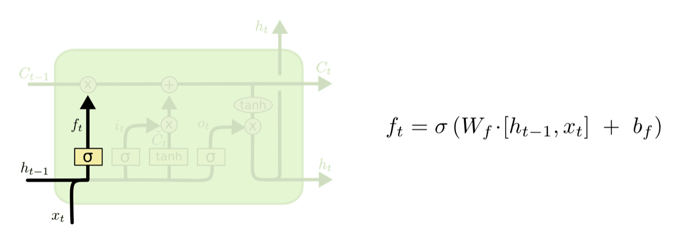

图中输入的有上一序列的隐藏状态 $h^{(t-1)}$ 和本序列数据 $x^{(t)}$，通过一个激活函数，一般是 Sigmoid，得到遗忘门的输出 $f^{(t)}$。由于 Sigmoid 的输出 $f^{(t)}$ 在 [0,1] 之间，因此这里的输出 $f^{(t)}$ 代表了遗忘上一层隐藏单元状态的概率。用数学表达式即为：

$$
f{(t)}= \sigma(W_fh^{(t-1)} + U_fx^{(t)} + b_f)
$$

其中 $W_f, U_f, b_f$ 为线性关系的系数和偏置，和 RNN 中的类似。 $\sigma$ 为 sigmoid 激活函数。

###  输入门

下一步就是决定要在 cell state 中保留什么信息，首先，一个被称为“输入门层”的 Sigmoid 层会决定我们要更新的数值。然后一个 $tanh$ 层创建候选向量 $\tilde{C}_t$，该向量将会被加到 cell state 中。下一步将结合这两个向量来创建更新值。

在开始语言模型例子中，我们希望给 cell state 增加主语的性别，来替换将要遗忘的旧的主语。

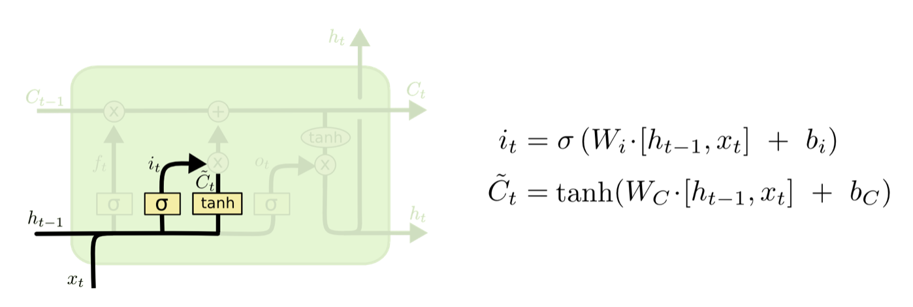

从图中可以看到输入门由两部分组成，第一部分使用了 Sigmoid 激活函数，输出为 $i^{(t)}$，第二部分使用了 tanh 激活函数，输出为 $\tilde{C}^{(t)}$，两者的结果后面会相乘再去更新单元状态。用数学表达式即为：

$$
i^{(t)} = \sigma(W_ih^{(t-1)} + U_ix^{(t)} +b_i)
$$

$$
\tilde{C}^{(t)} = \tanh(W_Ch^{(t-1)} + U_Cx^{(t)} + b_C)
$$

其中 $W_i, U_i, b_i, W_C, U_a, b_a$ 为线性关系的系数和偏置，和 RNN 中的类似。$\sigma$为 sigmoid 激活函数。

### 单元状态更新

接下来更新上一个状态值 $C_{t-1}$ ，将其更新为 $C_t$。

给旧的状态乘一个遗忘系数 $f_t$，来遗忘掉我们之前决定要遗忘的信息。之后将得到的值加上 $i_t*\tilde{C}_t$，得到更新每个状态值的新的候选值。

在语言模型中，就是要丢弃之前主语的性别信息，增加新的主语的性别信息。

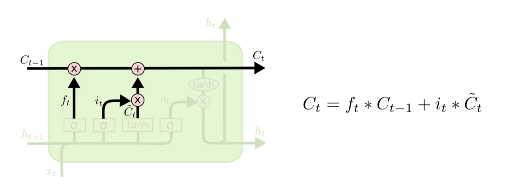

单元状态 $C^{(t)}$ 由两部分组成，第一部分是 $C^{(t-1)}$ 和遗忘门输出 $f^{(t)}$ 的乘积，第二部分是输入门的 $i^{(t)}$ 和 $\tilde{C}^{(t)}$ 的乘积，即：

$$
C^{(t)}= C^{(t-1)} \odot f^{(t)} + i^{(t)} \odot \tilde{C}^{(t)}
$$

其中，$\odot$ 为 Hadamard 积，在 DNN 中也用到过。

### 输出门

最后需要决定输出什么，cell state 通过 filtered 之后输出。首先，通过一个 sigmoid 层决定要输出 cell state 的哪些部分。然后，将 cell state 通过 $\tanh$（将值规范化到-1 和 1 之间），并将其乘以 Sigmoid 门的输出，至此输出了我们想要的那些部分。

对于语言模型的例子，当看到一个新的主语的时候，可能想输出相关动词的信息，因为动词是跟在主语后面的。

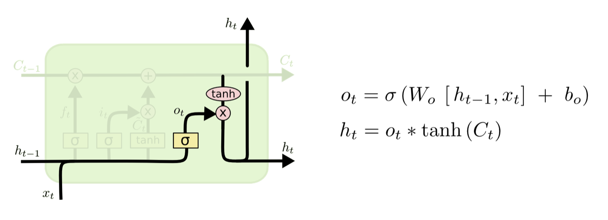

从图中可以看出，隐藏状态 $h^{(t)}$ 的更新由两部分组成，第一部分是 $o^{(t)}$，它由上一序列的隐藏状态 $h^{(t-1)}$ 和本序列数据 $x^{(t)}$，以及激活函数 sigmoid 得到，第二部分由隐藏状态 $C^{(t)}$ 和 tanh 激活函数组成，即：

$$
o^{(t)} = \sigma(W_oh^{(t-1)} + U_ox^{(t)} + b_o)
$$

$$
h^{(t)} = o^{(t)}\odot tanh(C^{(t)})
$$

## LSTM 的前向传播

LSTM 模型有两个隐藏状态 $h^{(t)}, C^{(t)}$，模型参数几乎是 RNN 的 4 倍，因为现在多了 $W_f,U_f, b_f, W_C, U_a, b_a, W_i, U_i, b_i, W_o, U_o, b_o$ 这些参数。

前向传播过程在每个序列索引位置的过程为：

1. 更新遗忘门输出：

$$
f^{(t)} = \sigma(W_fh^{(t-1)} + U_fx^{(t)} + b_f)
$$

2. 更新输入门两部分输出：

$$
i^{(t)} = \sigma(W_ih^{(t-1)} + U_ix^{(t)} + b_i)
$$

$$
\tilde{C}^{(t)} = \tanh(W_Ch^{(t-1)} + U_Cx^{(t)} + b_C)
$$

3. 更新单元状态：

$$
C^{(t)} = C^{(t-1)} \odot f^{(t)} + i^{(t)} \odot \tilde{C}^{(t)}
$$

4. 更新输出门输出：

$$
o^{(t)} = \sigma(W_oh^{(t-1)} + U_ox^{(t)} + b_o)
$$

$$
h^{(t)} =o^{(t)} \odot tanh(C^{(t)})
$$

5. 更新当前序列索引预测输出：

$$
\hat{y}^{(t)} = \sigma(Vh^{(t)} + c)
$$

## LSTM 反向传播算法推导

有了 LSTM 前向传播算法，推导反向传播算法就很容易了，思路和 RNN 的反向传播算法思路一致，也是通过梯度下降法迭代更新所有的参数，关键点在于计算所有参数基于损失函数的偏导数。

在 RNN 中，为了反向传播误差，通过隐藏状态 $h^{(t)}$ 的梯度 $\delta^{(t)}$ 一步步向前传播。在 LSTM 里也类似，只不过这里有两个隐藏状态 $h^{(t)}$ 和 $C^{(t)}$。

这里定义两个 $\delta$，即：

$$
\delta_h^{(t)}= \frac{\partial L}{\partial h^{(t)}}
$$

$$
\delta_C^{(t)} = \frac{\partial L}{\partial C^{(t)}}
$$

为了便于推导，将损失函数 $L(t)$ 分成两块，一块是时刻 $t$ 位置的损失 $l(t)$，另一块是时刻 $t$ 之后损失 $L(t+1)$，即：

$$
L(t) =\begin{cases} l(t) + L(t+1) & \text{if } \, t < \tau \\ l(t) & \text{if } \, t= \tau\end{cases}
$$

而在最后的序列索引位置 $\tau$ 的 $\delta_h^{(\tau)}$ 和  $\delta_C^{(\tau)}$ 为：

$$
\delta_h^{(\tau)} =(\frac{\partial o^{(\tau)}}{\partial h^{(\tau)}})^T\frac{\partial L^{(\tau)}}{\partial o^{(\tau)}} = V^T(\hat{y}^{(\tau)} - y^{(\tau)})
$$

$$
\delta_C^{(\tau)} =(\frac{\partial h^{(\tau)}}{\partial C^{(\tau)}})^T\frac{\partial L^{(\tau)}}{\partial h^{(\tau)}} = \delta_h^{(\tau)} \odot o^{(\tau)} \odot (1 - tanh^2(C^{(\tau)}))
$$

接着由 $\delta_C^{(t+1)},\delta_h^{(t+1)}$ 反向推导 $\delta_h^{(t)}, \delta_C^{(t)}$。

$\delta_h^{(t)}$ 的梯度由本层 $t$ 时刻的输出梯度误差和大于 $t$ 时刻的误差两部分决定，即：

$$
\begin{aligned} \delta_h^{(t)} =\frac{\partial L}{\partial h^{(t)}} &=\frac{\partial l(t)}{\partial h^{(t)}} + ( \frac{\partial h^{(t+1)}}{\partial h^{(t)}})^T\frac{\partial L(t+1)}{\partial h^{(t+1)}} \\ &= V^T(\hat{y}^{(t)} - y^{(t)}) + (\frac{\partial h^{(t+1)}}{\partial h^{(t)}})^T\delta_h^{(t+1)} \end{aligned}
$$

整个 LSTM 反向传播的难点就在于 $\frac{\partial h^{(t+1)}}{\partial h^{(t)}}$ 这部分的计算。仔细观察，由于 $h^{(t)} = o^{(t)} \odot tanh(C^{(t)})$，在第一项 $o^{(t)}$ 中，包含一个 $h$ 的递推关系，第二项 $tanh(C^{(t)})$ 就复杂了，$tanh$ 函数里面又可以表示成：

$$
C^{(t)} = C^{(t-1)} \odot f^{(t)} + i^{(t)} \odot \tilde{C}^{(t)}
$$

$tanh$ 函数的第一项中，$f^{(t)}$ 包含一个 $h$ 的递推关系，在 $tanh$ 函数的第二项中，$i^{(t)}$ 和 $\tilde{C}^{(t)}$ 都包含 $h$ 的递推关系，因此，最终 $\frac{\partial h^{(t+1)}}{\partial h^{(t)}}$ 这部分的计算结果由四部分组成。即：

$$
\Delta C = o^{(t+1)} \odot [1-tanh^2(C^{(t+1)})]
$$

$$
\begin{aligned}
\frac{\partial h^{(t+1)}}{\partial h^{(t)}} &= diag[o^{(t+1)} \odot (1-o^{(t+1)}) \odot tanh(C^{(t+1)})]W_o \\ &+ diag[\Delta C \odot f^{(t+1)} \odot (1-f^{(t+1)}) \odot C^{(t)}] W_f \\ & + diag { [\Delta C \odot i^{(t+1)} \odot [1-(\tilde{C}^{(t+1)})^2] } W_C \\ &+ diag [\Delta C \odot \tilde{C}^{(t+1)} \odot i^{(t+1)} \odot (1-i^{(t+1)})]W_i
\end{aligned}
$$

而 $\delta_C^{(t)}$ 的反向梯度误差由前一层 $\delta_C^{(t+1)}$ 的梯度误差和本层的从 $h^{(t)}$ 传回来的梯度误差两部分组成，即：

$$
\begin{aligned}
\delta_C^{(t)} &=(\frac{\partial C^{(t+1)}}{\partial C^{(t)}} )^T\frac{\partial L}{\partial C^{(t+1)}}  + (\frac{\partial h^{(t)}}{\partial C^{(t)}} )^T\frac{\partial L}{\partial h^{(t)}} \\ &= (\frac{\partial C^{(t+1)}}{\partial C^{(t)}})^T\delta_C^{(t+1)} + \delta_h^{(t)} \odot o^{(t)} \odot (1 - tanh^2(C^{(t)})) \\ &= \delta_C^{(t+1)} \odot f^{(t+1)} + \delta_h^{(t)} \odot o^{(t)} \odot (1 - tanh^2(C^{(t)}))
\end{aligned}
$$

有了 $\delta_h^{(t)}$ 和 $\delta_C^{(t)}$，计算这一大堆参数的梯度就很容易了，这里只给出 $W_f$ 的梯度计算过程，其他的 $U_f, b_f, W_C, U_a, b_a, W_i, U_i, b_i, W_o, U_o, b_o, V, c$ 的梯度只要照搬就可以了。

$$
\frac{\partial L}{\partial W_f} =\sum\limits_{t=1}^{\tau} [\delta_C^{(t)} \odot C^{(t-1)} \odot f^{(t)}\odot(1-f^{(t)})] (h^{(t-1)})^T
$$

## LSTM 的变种

到目前为止，描述的是一个常规的 LSTM。但并不是所有的 LSTM 都与上述相同。事实上，几乎每一篇涉及 LSTM 的论文都使用了一个略有不同的版本，差异很小，但有一些值得一看。

一个比较流行的 LSTM 变种是由 [Gers &amp; Schmidhuber (2000)](ftp://ftp.idsia.ch/pub/juergen/TimeCount-IJCNN2000.pdf) 提出的，添加 “peephole connections”。这意味着允许 gate 层得到 cell state 的信息。

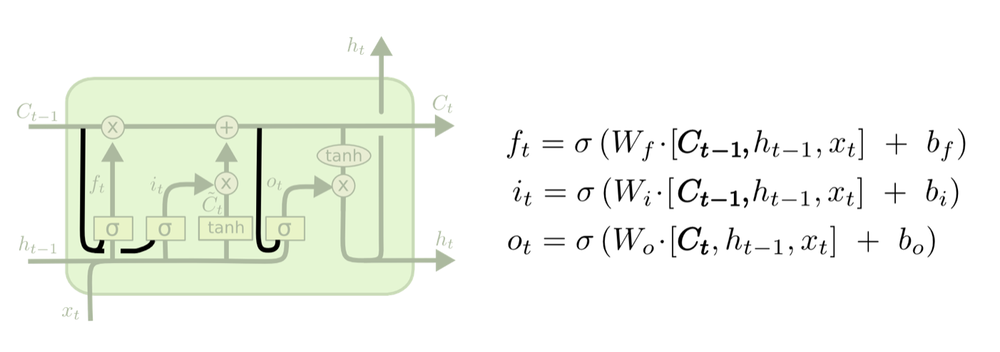

上面的图中将 peepholes 添加到所有的 gate 层，但许多论文的实现不是针对所有都增加，而是有针对性的增加。

另一种变化是使用成对的忘记和输入门，而不是单独决定要忘记什么、添加什么，相反这个决定一起做。只有当需要输入某些信息的时候，才会忘记这个位置的历史信息。只有当我们一些历史信息的时候，才在状态中添加新的信息。

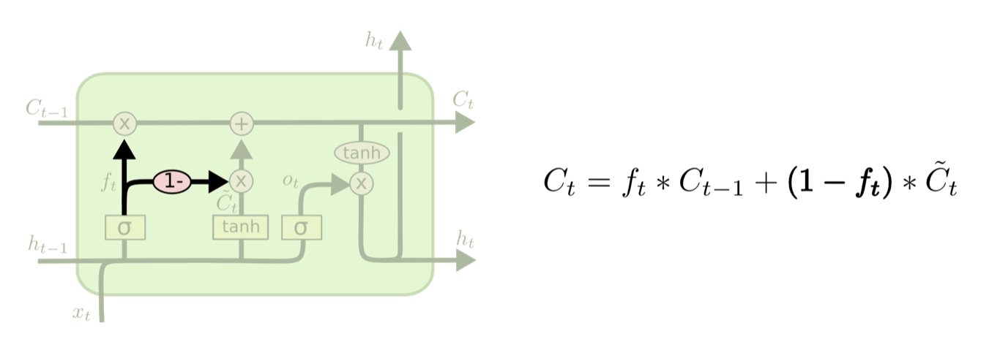

LSTM 的一个稍微更显着的变化是由 [Cho, et al. (2014)](http://arxiv.org/pdf/1406.1078v3.pdf) 介绍的门控循环单元（也就是大家常说的 GRU)。 它将忘记和输入门组合成一个单一的 “更新门”，将 cell state 和隐藏状态合并，并进行了一些其他改进。所得到的模型比标准 LSTM 模型更简单，并且越来越受欢迎。

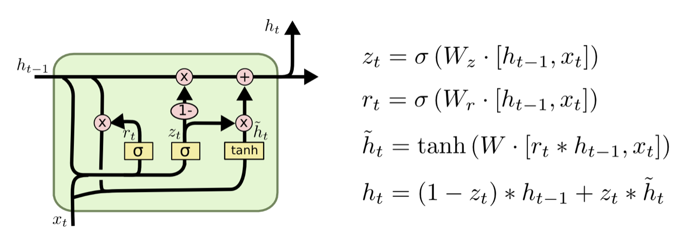

上述只是最显着的 LSTM 变体中的几个，还有很多其他的 LSTM 变体，比如 [Yao, et al. (2015)](http://arxiv.org/pdf/1508.03790v2.pdf) 提出的 Depth Gated RNNs（深度门递归神经网络），以及一些完全不同的处理长期依赖的方法，例如 [Koutnik, et al. (2014)](http://arxiv.org/pdf/1402.3511v1.pdf) 提出的 Clockwork RNNs（时钟机递归神经网络）。

对于哪些变体最好、差异的重要性等问题，[Greff, et al. (2015)](http://arxiv.org/pdf/1503.04069.pdf) 做了一个很好的变体的比较，发现他们大体上都差不多。 [Jozefowicz, et al. (2015)](http://jmlr.org/proceedings/papers/v37/jozefowicz15.pdf) 测试了大量的 RNN 架构，发现一些 RNN 结构在某些任务上要比 LSTM 更好。

## 参考

[Understanding LSTM Networks](http://colah.github.io/posts/2015-08-Understanding-LSTMs)

[LSTM模型与前向反向传播算法](https://www.cnblogs.com/pinard/p/6519110.html)
