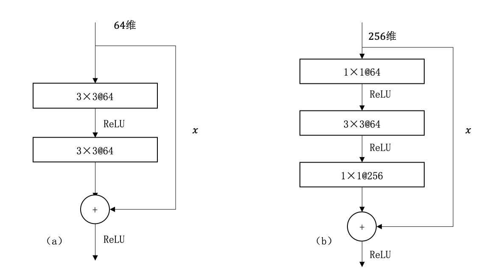
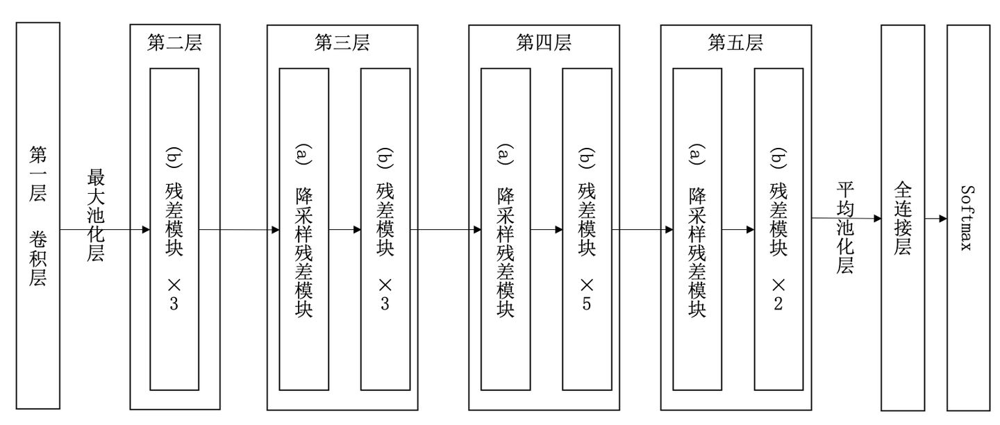
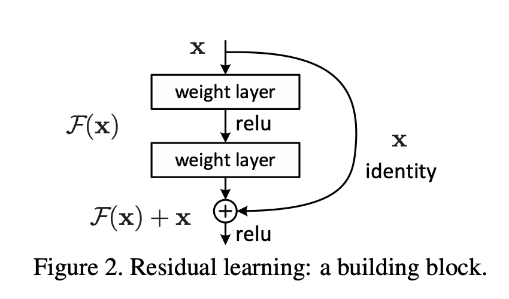
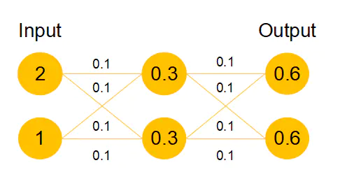

# ResNet

残差神经网络 (ResNet) 是由微软亚洲研究院的何恺明、张祥雨、任少卿、孙剑等人提出的，在 2015 年的 ILSVRC（ImageNet Large Scale Visual Recognition Challenge）中取得了冠军。

残差神经网络的主要贡献是发现了“退化现象（Degradation）”，并针对退化现象设计了 “快捷连接（Shortcut connection）”，极大的消除了深度过大的神经网络训练困难问题。神经网络的“深度”首次突破了 100 层、最大的神经网络甚至超过了 1000 层。

## 退化现象

从经验来看，当增加网络层数后，理论上可以取得更好的结果。但是实际上深度网络存在退化问题（Degradation problem）：网络深度增加时，网络准确度出现饱和，甚至出现下降。

“越深网络准确率越高”这个认知随着 VGGNet、Inception v1、Inception v2、Inception v3 不断验证、不断强化，得到越来越多的认可。这是因为，假设一个层数较少的神经网络已经达到了较高准确率，我们可以在这个神经网络之后，拼接一段恒等变换的网络层，这些恒等变换的网络层对输入数据不做任何转换，直接返回（y=x），就能得到一个深度较大的神经网络，并且，这个深度较大的神经网络的准确率等于拼接之前的神经网络准确率，准确率没有理由降低。

也就是说，层数较多的神经网络，可由较浅的神经网络和**恒等变换**网络拼接而成。

然而通过实验，着网络层不断的加深，模型的准确率先是不断的提高，达到最大值（准确率饱和），然后随着网络深度的继续增加，模型准确率毫无征兆的出现大幅度的降低。

这个现象与“越深的网络准确率越高”显然是矛盾的、冲突的。ResNet 把这一现象称为“退化（Degradation）”，把退化现象归因为深层神经网络难以实现“**恒等变换**（y=x）”。

与传统的机器学习相比，深度学习的关键特征在于网络层数更深、非线性转换（激活）、自动的特征提取和特征转换，其中，非线性转换是关键目标，它将数据映射到高纬空间以便于更好的完成“数据分类”。随着网络深度的不断增大，所引入的激活函数也越来越多，数据被映射到更加离散的空间，此时已经难以让数据回到原点（恒等变换）。或者说，神经网络将这些数据映射回原点所需要的计算量，已经远远超过我们所能承受的。

退化现象让我们开始对非线性转换进行反思，非线性转换极大的提高了数据分类能力，但是，随着网络的深度不断的加大，在非线性转换方面已经走的太远，竟然无法实现线性转换。显然，在神经网络中增加线性转换分支成为很好的选择，于是，ResNet 在 ResBlock 模块中增加了快捷连接分支，在线性转换和非线性转换之间寻求一个平衡。

### ResNet 网络架构

对于一个堆积层结构当输入为 $x$ 时其学习到的特征记为 $H(x)$，现在我们希望其可以学习到残差 $F(x) = H(x)-x$，这样其实原始的学习特征是 $F(x)+x$。这是因为残差学习相比原始特征直接学习更容易。当残差为 0 时，此时堆积层仅仅做了恒等映射，至少网络性能不会下降，实际上残差不会为 0，这也会使得堆积层在输入特征基础上学习到新的特征，从而拥有更好的性能。这有点类似与电路中的“短路”，所以是一种短路连接。

ResNet 分别构建了带有 Shortcut Connection 的 ResNet 构建块、以及降采样的 ResNet 构建块，降采样构建块的主干分支上增加了一个 1×1 的卷积操作。

下图是 34 层 ResNet 模型的架构图，仿照 AlexNet 的 8 层网络结构，将 ResNet 也划分成 8 个 Building Layer。一个 Building Layer 可以包含一个或多个网络层、以及一个或多个构建块（如 ResNet 构建块）。

第一个构建层，由 1 个普通卷积层和最大池化层构建。

第二个构建层，由 3 个残差模块构成。

第三、第四、第五构建层，都是由降采样残差模块开始，紧接着3个、5个、2个残差模块。

其余各个构建层见图3。

## ResNet 和恒等变换的作用

> 残差模块并不是就是恒等，可以理解为：**当网络需要这个模块是恒等时，它比较容易变成恒等**。而传统的 conv 模块是很难通过学习变成恒等的，因为根据信号与系统，恒等的话 filter 的冲激响应要为一个冲激函数，而神经网络本质是学概率分布局部一层不太容易变成恒等，而 ResNet 加入了这种模块给了神经网络学习恒等映射的能力。
>
> 所以 ResNet 除了减弱梯度消失外，还可以理解为这是一种自适应深度，也就是网络可以自己调节层数的深浅，不需要太深时，中间恒等映射就多，需要时恒等映射就少。当然实际的神经网络并不会有这么强的局部特性，它的训练结果基本是一个整体，并不一定会出现某些 block 就是恒等的情况。

也就是说，**ResNet 可以自己学习出有哪些层是冗余的，然后把这些冗余的层学成恒等变换**，这样网络在加深的时候就不会出现越深准确率反而越低的情况了。

## ResNet 解决深度网络瓶颈

### 网络退化问题的解决

1. 自适应深度：网络退化问题就体现了多层网络难以拟合恒等映射这种情况，也就是说 $H(x)$ 难以拟合 $x$，但使用了残差结构之后，拟合恒等映射变得很容易，直接把网络参数全学习到为 0，只留下那个恒等映射的跨层连接即可。于是当网络不需要这么深时，中间的恒等映射就可以多一点，反之就可以少一点。
2. “差分放大器”：假设最优 $H(x)$ 更接近恒等映射，那么网络更容易发现除恒等映射之外微小的波动
3. 缓解梯度消失：针对一个残差结构对输入 $x$ 求导就可以知道，由于跨层连接的存在，总梯度在 $F(x)$ 对 $x$ 的导数基础上还会加 1。

对于短路连接，当输入和输出维度一致时，可以直接将输入加到输出上。但是当维度不一致时（对应的是维度增加一倍），有两种策略：

1. 采用 zero-padding 增加维度，此时一般要先做一个 downsamp（降采样），可以采用 stride=2 的 pooling，这样不会增加参数；
2. 采用新的映射（projection shortcut），一般采用 1x1 的卷积，这样会增加参数，也会增加计算量。

假设该层是冗余的，在引入 ResNet 之前，想让该层学习到的参数能够满足 $h(x)=x$，即输入是 $x$，经过该冗余层后，输出仍然为 $x$。但是可以看见，要想学习 $h(x)=x$ 恒等映射时的这层参数时比较困难的。ResNet 想到避免去学习该层恒等映射的参数，使用了如上图的结构，让 $h(x)=F(x)+x$。其中 $F(x)$ 被称作残差项。

要想让该冗余层能够恒等映射，只需要学习 $F(x)=0$。学习 $F(x)=0$ 比学习 $h(x)=x$ 要简单得多，因为一般每层网络中的参数初始化偏向于 0，这样在相比于更新该网络层的参数来学习 $h(x)=x$，该冗余层学习 $F(x)=0$ 的更新参数能够更快收敛，如图所示：

假设该层网络只经过线性变换，没有 bias 也没有激活函数，随机初始化权重一般偏向于 0，那么经过该网络的输出值为 [0.6 0.6]，很明显会更接近与 [0 0]，而不是 [2 1]，相比与学习 $h(x)=x$，模型要更快到学习 $F(x)=0$。

并且 ReLU 能够将负数激活为 0，过滤了负数的线性变化，也能够更快的使得 $F(x)=0$。这样当网络自己决定哪些网络层为冗余层时，使用 ResNet 的网络很大程度上解决了学习恒等映射的问题，用学习残差 $F(x)=0$ 更新该冗余层的参数来代替学习 $h(x)=x$ 更新冗余层的参数。

这样当**网络自行决定了哪些层为冗余层**后，通过学习残差 $F(x)=0$ 来让该层网络恒等映射上一层的输入，使得有了**这些冗余层的网络效果与没有这些冗余层的网络效果相同，这样很大程度上解决了网络的退化问题**。

### 梯度消失或梯度爆炸问题的解决

很深的网络层由于参数初始化一般更靠近 0，这样在训练的过程中更新浅层网络的参数时，很容易随着网络的深入而导致梯度消失，浅层的参数无法更新。

$$
\begin{aligned}
\frac{\partial C}{\partial b_{1}}&=\sigma^{\prime}(z _1) w_{2} \sigma^{\prime}(z_2) w_{3} \sigma^{\prime}(z_3) w_{4} \sigma^{\prime}(z_4) \frac{\partial C}{\partial a_{4}} \\
&z_{i}=w_{i} a_{i-1}+b_{i} \\
&a_{i}=\sigma^{\prime}\left(z_{i}\right)
\end{aligned}
$$

可以看到，假设现在需要更新 $b_1$，$w_2,w_3,w_4$ 参数因为随机初始化偏向于 0，通过链式求导，$w_4w_3w_2$ 相乘会得到更加接近于 0 的数，那么所求的这个 $b_1$ 的梯度就接近于 0，也就产生了梯度消失的现象。

ResNet 最终更新某一个节点的参数时，由于 $h(x)=F(x)+x$，由于链式求导后的结果不管括号内右边部分的求导参数有多小，因为左边的 1 的存在，并且将原来的链式求导中的连乘变成了连加状态，都能保证该节点参数更新不会发生梯度消失或梯度爆炸现象。

这样在解决了阻碍更深层次网络优化问题的两个重要问题后，ResNet 就能训练更深层次几百层乃至几千层的网络并取得更高的精确度了。