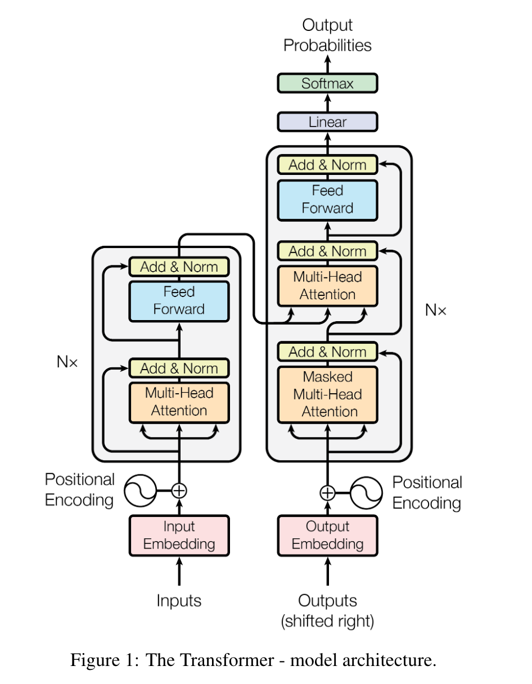
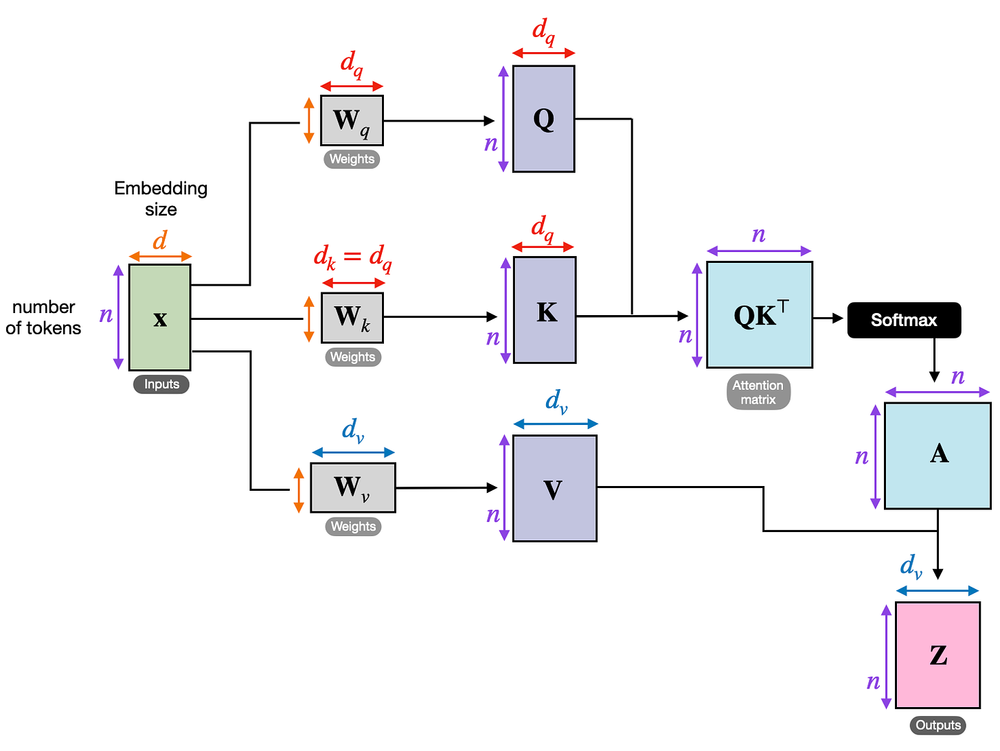
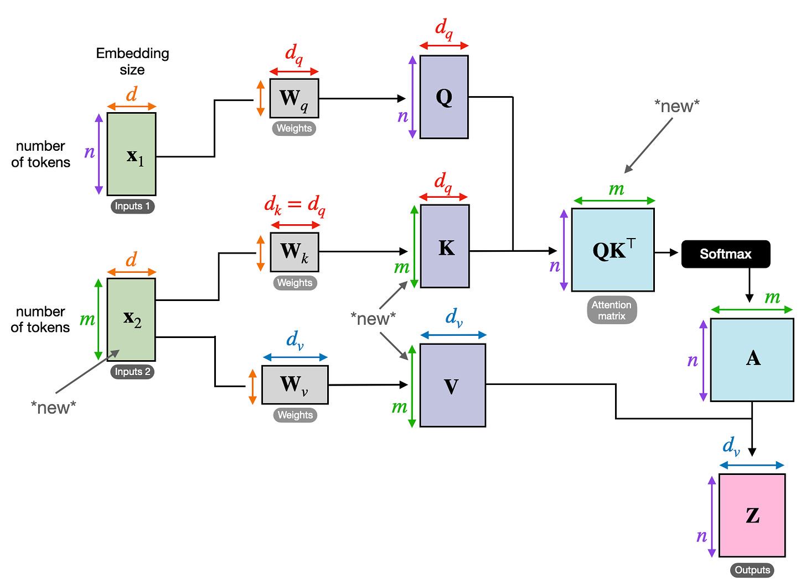
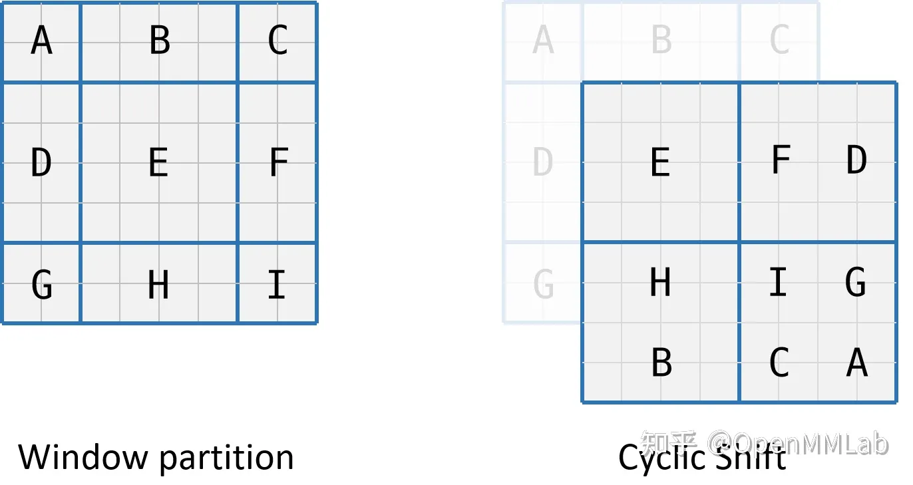
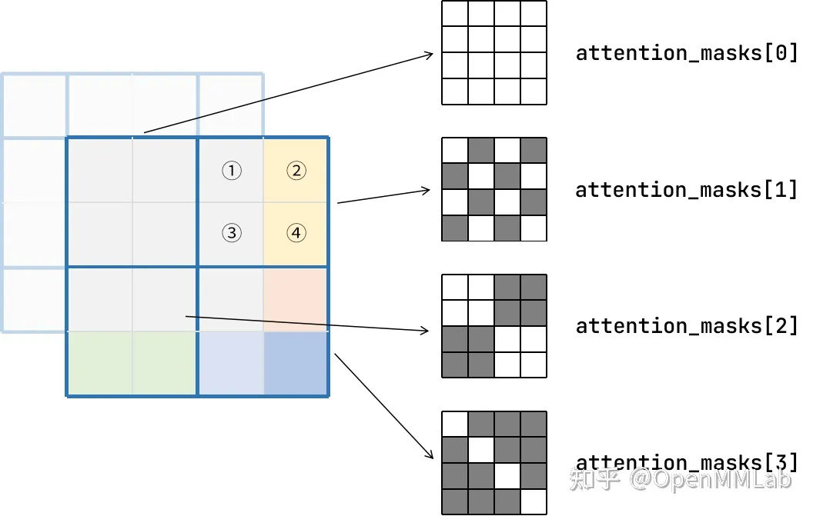

# Transformer



- 上下文语义（方向+长度）：Transformer > RNN > CNN
- 序列特征（顺序）：RNN > Transformer > CNN
- 速度：CNN > Transformer > RNN

长距离下，RNN 一般好于 Transformer，因为 Transformer 是每个词都要和所有词进行注意力计算，天然位置不敏感，位置编码只能改善但不能根治。

Transformer 中抛弃了传统的 CNN 和 RNN，整个网络结构完全是由 Attention 机制组成，采用 Attention 机制的原因是考虑到 RNN（或者 LSTM，GRU 等）的计算限制为是顺序的，也就是说 RNN 相关算法只能从左向右依次计算或者从右向左依次计算，这种机制带来了两个问题：

1. t 时间的计算依赖 t-1 时刻的计算结果，这样限制了模型的并行能力
2. 顺序计算的过程中信息会丢失，尽管 LSTM 等门机制的结构一定程度上缓解了长期依赖的问题，但是对于特别长期的依赖现象，LSTM 依旧无能为力。

Transformer 的提出解决了上面两个问题：

1. 首先使用了 Attention 机制，将序列中的任意两个位置之间的距离缩小为一个常量；
2. 其次 Transformer 不是类似 RNN 的顺序结构，因此具有更好的并行性，符合现有的 GPU 框架。

## Transformer 模型架构

Encoder：输入是单词的 Embedding，再加上位置编码，然后进入一个统一的结构，这个结构可以循环 N 次，也就是说有很多层（N 层）。每一层又可以分成 Attention 层和全连接层，再额外加了一些处理，比如 Skip Connection，做跳跃连接，然后还加了 Normalization 层。其实它本身的模型还是很简单的。

Decoder：第一次输入是前缀信息，之后的就是上一次产出的 Embedding，加入位置编码，然后进入一个可以重复很多次的模块。该模块可以分成三块来看，第一块也是 Attention 层，第二块是 Cross Attention，不是 Self-Attention，第三块是全连接层。也用了跳跃连接和 Normalization。

**输出**：最后的输出要通过 Linear 层（全连接层），再通过 softmax 做预测。

### Transformer 与 CNN

- Transformer 是动态闭环的，比静态好
- Transformer 关注两者之间关系，因此对离群点容错性较高，不关注自身 value，但是 CNN 具备 scale 平移不变形，Transformer 不具备

### Position encoding

最简单的位置编码就是计数，但是这样这个序列是没有上界的。一段很长的文本，最后一个字的位置编码非常大，这是很不合适的：

1. 它比第一个字的编码大太多，和词嵌入合并以后难免会出现特征在数值上的倾斜；
2. 它比一般的词嵌入的数值要大，难免会抢了词嵌入的「风头」，对模型可能有一定的干扰。

从这里，我们知道位置编码最好具有一定的值域范围。使用文本长度对每个位置作归一化。这样使得所有位置编码都落入一定区间，但是问题也是显著的：不同长度文本的位置编码步长是不同的，在较短的文本中紧紧相邻的两个字的位置编码差异，会和长文本中相邻数个字的两个字的位置编码差异一致。这显然是不合适的，我们关注的位置信息，最核心的就是相对次序关系，尤其是上下文中的次序关系，如果使用这种方法，那么在长文本中相对次序关系会被「稀释」。

重新审视一下位置编码的需求：

1. 需要体现同一个单词在不同位置的区别；
2. 需要体现一定的先后次序关系，并且在一定范围内的编码差异不应该依赖于文本长度，具有一定不变性。

一种思路是使用有界的周期性函数。如果我们放弃对绝对位置的追求，转而要求位置编码仅仅关注一定范围内的相对次序关系，那么使用一个 sin/cos 函数就是很好的选择，因为 sin/cos 函数的周期变化规律非常稳定，所以编码具有一定的不变性。简单的构造可以使用下面的形式

$$
PE(pos)=sin(\frac{pos}{\alpha})
$$

但是，周期函数的引入是为了复用位置编码函数的值域，但是这种 [-1,1] 的映射，还是太单调：如果 $\alpha$ 比较大，相邻字符之间的位置差异体现得不明显；如果比较小，在长文本中还是可能会有一些不同位置的字符的编码一样，这是因为 [-1,1] 空间的表现范围有限。既然字嵌入的维度是 $d_{model}$，自然也可以使用一个 $d_{model}$ 维向量来表示某个位置编码。

在不同维度上应该用不同的函数操纵位置编码，这样高维的表示空间才有意义。可以为位置编码的每一维赋予不同的 $\alpha$，甚至在一些维度将 sin 替换为 cos：

$$
\begin{gathered}
PE(pos,2i)=\sin(\frac{pos}{10000^{2i/d_{model}}})\\
PE(pos,2i+1)=\cos(\frac{pos}{10000^{2i/d_{model}}})
\end{gathered}
$$

这里不同维度上 sin/cos 的波长从 $2\pi$ 到 $10000\times 2\pi$​ 都有；区分了奇偶数维度的函数形式。这使得每一维度上都包含了一定的位置信息，而各个位置字符的位置编码又各不相同。





#### `nn.Transformer` 的构造参数：

- d_model：Encoder 和 Decoder 输入参数的特征维度，也就是词向量的维度。默认为 512
- nhead：多头注意力机制中，head 的数量。注意该值并不影响网络的深度和参数数量。默认值为 8
- num_encoder_layers：TransformerEncoderLayer 的数量。该值越大，网络越深，网络参数量越多，计算量越大。默认值为 6
- num_decoder_layers：TransformerDecoderLayer 的数量。该值越大，网络越深，网络参数量越多，计算量越大。默认值为 6
- dim_feedforward：Feed Forward 层（Attention 后面的全连接网络）的隐藏层的神经元数量。该值越大，网络参数量越多，计算量越大。默认值为 2048
- dropout：dropout 值。默认值为 0.1
- activation：Feed Forward 层的激活函数。取值可以是 string(“relu” or “gelu”) 或者一个一元可调用的函数。默认值是 relu。
- custom_encoder/custom_decoder：自定义 Encoder/Decoder。若不想用官方实现的 TransformerEncoder/TransformerDecoder，可以自己实现一个。默认值为 None
- layer_norm_eps：Add&Norm 层中，BatchNorm 的 eps 参数值。默认为 1e-5
- batch_first：batch 维度是否是第一个。如果为 True，则输入的 shape 应为（batch_size，词数，词向量维度），否则应为（词数，batch_size，词向量维度）。默认为 False。**这个要特别注意，因为习惯都是将 batch_size 放在最前面，而这个参数的默认值又是 False，所以会报错**。
- norm_first：是否要先执行 norm。图例中的执行顺序为 Attention -> Add -> Norm。若该值为 True，则执行顺序变为：Norm -> Attention -> Add。

#### Transformer 的 forward 参数：

S 是源序列长度 source sequence length，T 是目标序列长度 target sequence length，B 是 batch size，E 是词向量维度 feature number。

- src：Encoder 的输入，也就是将 token 进行 Embedding 并加上 Positional Encoding 之后的 tensor。必填参数。Shape: (B, S, E)
- tgt：与 src 同理，Decoder 的输入。 必填参数。Shape: (B, T, E)
- src_mask: 对 src 进行 mask，不常用。Shape: (S, S) or (B*num\_heads, S, S)
- tgt_mask：对 tgt 进行 mask，常用。Shape 为 (T, T) or (B*num\_heads, T, T)
- memory_mask：对 Encoder 的输出 memory 进行 mask。 不常用。Shape: (T, S)
- src_key_padding_mask：对 src 的 token 进行 mask。常用。Shape: (B, S)
- tgt_key_padding_mask：对 tgt 的 token 进行 mask。常用。Shape: (B, T)
- memory_key_padding_mask：对 memory 的 token 进行 mask。不常用。Shape: (B, S)

以上所有 mask 都是 `0` 代表不遮掩，`-inf` 代表遮掩。另外，memory_mask 不需要传 batch。

单个 encoder 过程：

1. 输入 $x$ 做层归一化： $x_1 = \text{layer\_norm}(x)$

1. 进入多头 self-attention: $x_2 = \text{self\_attention}(x_1)$
2. 残差加成：$x_3 = x + x_2$
3. 再做个层归一化：$x_4 = \text{layer\_norm}(x_3)$
4. 经过前馈网络: $x_5 = \text{feed\_forward}(x_4)$
5. 残差加成: $x_6 = x_3 + x_5$
6. 输出 $x_6$

单个 decoder 过程：

训练时：

初始 decoder 的 time step 为 1 时（也就是第一次接收输入），其输入为一个特殊的 token，可能是目标序列开始的 token（如 `<BOS>`），也可能是源序列结尾的 token（如 `<EOS>`），也可能是其它视任务而定的输入等等，不同源码中可能有微小的差异，其目标则是预测翻译后的第一个单词（token）是什么；然后 `<BOS>` 和预测出来的第一个单词一起，再次作为 decoder 的输入，得到第 2 个预测单词。

样本：“我/爱/机器/学习”和 "i/ love /machine/ learning"

1. 把“我/爱/机器/学习”进行 embedding 后输入到 encoder 里去，最后一层的 encoder 最终输出的 outputs [10, 512]，此 outputs 乘以新的参数矩阵，可以作为 decoder 里每一层用到的 K 和 V；
2. 将 `<bos>` 作为 decoder 的初始输入，将 decoder 的最大概率输出词 A1 和 "i" 做 cross entropy 计算 error。
3. 将 `<bos>`，"i" 作为 decoder 的输入，将 decoder 的最大概率输出词 A2 和 "love" 做 cross entropy 计算 error。
4. 将 `<bos>`，"i"，"love" 作为 decoder 的输入，将 decoder 的最大概率输出词 A3 和 "machine" 做 cross entropy 计算 error。
5. 将 `<bos>`，"i"，"love "，"machine" 作为 decoder 的输入，将 decoder 最大概率输出词 A4 和 "learning" 做 cross entropy 计算 error。
6. 将 `<bos>`，"i"，"love "，"machine"，"learning" 作为 decoder 的输入，将 decoder 最大概率输出词 A5 和终止符 `</s>` 做 cross entropy 计算 error。

实际训练中，并行处理：

decoder 输入：

```
<bos>, mask, mask, mask, mask
<bos>, "i", mask, mask, mask
<bos>, "i", "love", mask, mask
<bos>, "i", "love ", "machine", mask
<bos>, "i", "love ", "machine", "learning"
```

推理过程：

用“机器学习很有趣”当作样本，经过 encoder 后得到输出 tensor，送入到 decoder（并不是当作 decoder 的直接输入）

1. 用起始符 `<bos>` 当作 decoder 的输入，得到输出 "machine"

2. 用  `<bos>`  + machine 当作输入得到输出 "learning"

3. 用 `<bos>`  + machine + learning 当作输入得到 "is"

4. 用 `<bos>` + machine + learning + is 当作输入得到 "interesting"

5. 用 `<bos>` + machine + learning + is + interesting 当作输入得到结束符号 `<eos>`

这样就得到了完整的翻译 "machine learning is interesting"。在推理过程中，只能一个单词一个单词的进行输出，是串行进行的。


## Transformer 维度

### Encoder 输入

初始输入为待翻译语句的 embedding 矩阵，由于句子长度不一致，需要做统一长度处理，长度取 max_length，不够长的句子 padding 0 值，句尾加上 `</s>`。

```python
d = 512
input = [batchsize, maxlen1, d]
```

考虑到词语间的相对位置信息，还要加上语句的 position encoding，由函数形式直接求出。

```python
PE(pos, 2*i) = sin(pos/1000^(2*i/d))
PE(pos, 2*i+1) = cos(pos/1000^(2*i/d))
```

Padding 的值不做 position encoding。 [batchsize，maxlen1，d] ，最终:

```python
encoder input = position encoding + input embedding
encoder input: [batchsize，maxlen1，d]
```

### Encoder

Encoder 由 N=6 个相同的 layer 连接组成。每个 layer 中有两个 sublayer，分别是 multihead self-attention 以及 FFN。

```
Q = K = V = input
```

$$
MultiHead(Q, K, V) = concat(head_1, …, head_h)W_o
\\
head_i = Attention(Q_i，K_i，V_­i) = Attention(QW_i^Q，KW­_i^K，VW_­i^V) \\
Attention(Q, K, V) = softmax(\frac{QK^\top}{\sqrt{d}}) V
$$

softmax 前要做 key_mask，把 padding 0 的地方赋值为 -inf，softmax 后权重做 query mask，赋值 0。h = 8

$$
W­_i^Q, W­_i^K, W­_i^V :[d, d/h]
$$

```python
Q : [maxlen_q, d]
K = V : [maxlen_k, d]
maxlen_q = maxlen_k
so: Q = K = V : [max_length, d]
```

$$
QW­_i^Q，KW­_i^K，VW_­i^V: [maxlen1, d/h]
$$

$$
head_i : [maxlen1, d/h] \times [d/h, maxlen1] \times [maxlen1, d/h] = [maxlen1, d/h]
$$

```python
Wo: [d, d]
MultiHead(Q,K,V): [maxlen1, d]
```

Softmax([maxlen_q, maxlen_k]) 在最后一个维度即 maxlen_k 上做 softmax。

position-wise 是因为处理的 attention 输出是某一个位置 i 的 attention 输出。

```python
FFN(x) = ReLU(xW1 + b1) * W2 + b2
ReLU(x) = max(0, x)
dff = 4*d = 2048
W1 : [d, dff]
W2 : [dff, d]
```

流程：

```
Input -> dropout ->
(
    multihead self-attention -> dropout -> residual connection -> LN ->
    FFN-> dropout -> residual connection -> LN ->
) * 6
-> memory [batchsize，maxlen1，d]
```

代码中在 multihead attention 中对 score 做 dropout，FFN 后没有 dropout，但文章说每个 sublayer 的 output 都有一个 dropout。

### Decoder 输入

#### 训练

目标句子首尾分别加上 `<s>` , `</s>`。

```python
Decoder input = Output embedding + position encoding
Decoder input : [batchsize，maxlen2，d]
```

#### 预测

初始向量为 `<s>` 对应 embedding，之后将前一步的输出拼接到当前的所有预测构成当前的 decoder 输入。

### Decoder

Decoder 由 N = 6 个相同的 layer 组成，每个 layer 中有三个 sublayer，分别是 multihead self-attention, mutihead attention 以及 FFN。

```### 
decoder input -> dropout ->
(
    Masked multihead self-attention(dec, dec, dec) = dec-> dropout -> 
    multihead attention(dec, memory, memory) -> dropout -> residual connection 
    -> LN -> FFN -> dropout -> residual connection -> LN ->
) * 6
-> dec -> linear -> softmax
```

Self-attention 的 mask 为一个和 dec 相同维度的上三角全为 -inf 的矩阵。

```python
Linear(x) = xW
Dec: [batchsize，maxlen2，d]
W: [d, vocabsize]
Linear(x): [batchsize，maxlen2，vocabsize]
```

W 为词汇表 embedding 矩阵的转置，输入输出的词汇表 embedding 矩阵为 W。即三个参数共享。

Softmax函数：

$$
p\left( k\|x \right)=\frac{\exp({{z}_{k}})}{\sum\nolimits_{i=1}^{K}{\exp ({{z}_{i}})}}
$$

其中 $z_i$ 一般叫做 logits，即未被归一化的对数概率。

### 损失函数

Cross entropy。用 p 代表 predicted probability，用 q 代表 groundtruth。即：

$$
cross\_entropy\_loss=\sum\limits_{k=1}^{K}{q\left( k\|x\right)\log (p\left( k\|x \right))}
$$

groundtruth 为 one-hot，即每个样本只有唯一的类别，$q(k)={{\delta}_{k,y}}$，y 是真实类别。

$$
{{\delta }_{k,y}}\text{=}\left\{\begin{matrix} 1,k=y \\0,k\ne y \\\end{matrix} \right.
$$


对目标句子 onehot 做 label smoothing 用 $\tilde{q}(k|x)$ 代替 $q(k|x)$。（为了正则化，防止过拟合）

$$
\tilde{q}(k\|x)=(1-\varepsilon ){{\delta }_{k,y}}+\varepsilon u(k)
$$

可以理解为，对于 $q(k)={{\delta}_{k,y}}$ 函数分布的真实标签，将它变成以如下方式获得：首先从标注的真实标签的 $\delta$ 分布中取定，然后以一定的概率 $\varepsilon$，将其替换为在 $u(k)$ 分布中的随机变量。$u(k)$ 为均匀分布，即 $u(k)=1/K$

### 优化方法

Adam 优化器。

学习率使用 warm up learning rate:

```python
learningrate = dmodel-0.5 * min ( step_num-0.5, step_num * warmup_steps-1.5 ) 
warmup_steps ：4000
```

## Transformer 中的 attention 为什么需要 scaled?

> 向量的点积结果会很大，将 softmax 函数 push 到梯度很小的区域，scaled 会缓解这种现象。

### 比较大的输入会使得 softmax 的梯度变得很小

对于一个输入向量 $\mathbf{x}\in \mathbb{R}^d$，Softmax 函数将其映射/归一化到一个分布 $\hat{\mathbf{y}}\in\mathbb{R}^d$。在这个过程中，Softmax 先用一个自然底数 $e$ 将输入中的元素间差距先“拉大”，然后归一化为一个分布。假设某个输入 $\mathbf{x}$ 中最大的的元素下标是 $k$，如果输入的数量级变大（每个元素都很大），那么 $\hat{y}_k$ 会非常接近 1。

可以用一个小例子来看看 $\mathbf{x}$ 的数量级对输入最大元素对应的预测概率 $\hat{y}_k$ 的影响。假定输入 $\mathbf{x}=[a,a,2a]^\topT$），我们来看不同量级的 $a$ 产生的 $\hat{y}_3$ 有什么区别。

- a=1 时，$\hat{y}_3= 0.5761168847658291$;
- a=10 时，$\hat{y}_3=0.999909208384341$;
- a=100 时，$\hat{y}_3\approx 1.0$  （计算机精度限制）。

可以看到，数量级对 Softmax 得到的分布影响非常大。**在数量级较大时，Softmax 将几乎全部的概率分布都分配给了最大值对应的标签。**

然后我们来看 Softmax 的梯度。不妨简记 Softmax 函数为 $g$，Softmax 得到的分布向量 $\hat{\mathbf{y}}=g(\mathbf{x})$ 对输入 $\mathbf{x}$ 的梯度为：

$$
\frac{\partial g(\mathbf{x})}{\partial \mathbf{x}}=\text{diag}(\hat{\mathbf{y}})-\hat{\mathbf{y}} \hat{\mathbf{y}}^{\top} \quad \in \mathbb{R}^{d \times d}
$$

把这个矩阵展开：

$$
\frac{\partial g(\mathbf{x})}{\partial \mathbf{x}}=\left[\begin{array}{cccc}
\hat{y}_{1} & 0 & \cdots & 0 \\
0 & \hat{y}_{2} & \cdots & 0 \\
\vdots & \vdots & \ddots & \vdots \\
0 & 0 & \cdots & \hat{y}_{d}
\end{array}\right]-\left[\begin{array}{cccc}
\hat{y}_{1}^{2} & \hat{y}_{1} \hat{y}_{2} & \cdots & \hat{y}_{1} \hat{y}_{d} \\
\hat{y}_{2} \hat{y}_{1} & \hat{y}_{2}^{2} & \cdots & \hat{y}_{2} \hat{y}_{d} \\
\vdots & \vdots & \ddots & \vdots \\
\hat{y}_{d} \hat{y}_{1} & \hat{y}_{d} \hat{y}_{2} & \cdots & \hat{y}_{d}^{2}
\end{array}\right]
$$

根据前面的讨论，当输入 $\mathbf{x}$ 的元素均较大时，softmax 会把大部分概率分布分配给最大的元素，假设我们的输入数量级很大，最大的元素是 $x_{1}$，那么就将产生一个接近 one-hot 的向量 $\hat{\mathbf{y}} \approx[1,0, \cdots, 0]^{\top}$, 此时上面的矩阵变为如下形式：

$$
\frac{\partial g(\mathbf{x})}{\partial \mathbf{x}} \approx\left[\begin{array}{cccc}
1 & 0 & \cdots & 0 \\
0 & 0 & \cdots & 0 \\
\vdots & \vdots & \ddots & \vdots \\
0 & 0 & \cdots & 0
\end{array}\right]-\left[\begin{array}{cccc}
1 & 0 & \cdots & 0 \\
0 & 0 & \cdots & 0 \\
\vdots & \vdots & \ddots & \vdots \\
0 & 0 & \cdots & 0
\end{array}\right]=\mathbf{0}
$$

也就是说，在输入的数量级很大时，梯度消失为 0，造成参数更新困难。

### 维度与点积大小的关系

针对为什么维度会影响点积的大小，在论文的脚注中其实给出了一点解释：

> To illustrate why the dot products get large, assume that the components of $q$ and $k$ are independent random variables with mean 0 and variance 1. Then their dot product, $q\cdot k= \sum_{i=1}^{d_k}q_ik_i$, has mean 0 and variance $d_k$.

假设向量 $q$ 和 $k$ 的各个分量是互相独立的随机变量，均值是 0，方差是 1，那么点积 $q \cdot k$ 的均值是 0，方差是 $d_{k}$ 。这里给出一点更详细的推导：

对 $\forall i=1, \cdots, d_{k}, q_{i}$ 和 $k_{i}$ 都是随机变量，为了方便书写，不妨记 $X=q_{i}, Y=k_{i}$ 。 

这样有：$\quad D(X)=D(Y)=1, \quad E(X)=E(Y)=0$ 。

则：

$$
E(X Y)=E(X) E(Y)=0 \times 0=0
$$

$$
\begin{aligned}
D(X Y) &=E\left(X^{2} \cdot Y^{2}\right)-[E(X Y)]^{2} \\
&=E\left(X^{2}\right) E\left(Y^{2}\right)-[E(X) E(Y)]^{2} \\
&=E\left(X^{2}-0^{2}\right) E\left(Y^{2}-0^{2}\right)-[E(X) E(Y)]^{2} \\
&=E\left(X^{2}-[E(X)]^{2}\right) E\left(Y^{2}-[E(Y)]^{2}\right)-[E(X) E(Y)]^{2} \\
&=D(X) D(Y)-[E(X) E(Y)]^{2} \\
&=1 \times 1-(0 \times 0)^{2} \\
&=1
\end{aligned}
$$

这样 $\forall i=1, \cdots, d_{k}; q_{i} \cdot k_{i}$ 的均值是 0，方差是 1，又由期望和方差的性质，对相互独立的分量 $Z_{i}$，有

$$
E\left(\sum_{i} Z_{i}\right)=\sum_{i} E\left(Z_{i}\right)
$$

以及

$$
D\left(\sum_{i} Z_{i}\right)=\sum_{i} D\left(Z_{i}\right)
$$

所以有 $q \cdot k$ 的均值 $E(q \cdot k)=0$, 方差 $D(q \cdot k)=d_{k}$ 。方差越大也就说明，点积的数量级越大（以越大的概率取大值）。那么一个自然的做法就是把方差稳定到 1，做法是将点积除以 $\sqrt{d}_{k}$ , 这样有：

$$
D\left(\frac{q \cdot k}{\sqrt{d}_{k}}\right)=\frac{d_{k}}{\left(\sqrt{d}_{k}\right)^{2}}=1
$$

将方差控制为 1 , 也就有效地控制了前面提到的梯度消失的问题。

## Transformer 变长

用于图像分类的主干网络中，基于 CNN 结构的网络，通常不需要指定输入图像的尺寸，同一个主干网络就能够处理各种尺寸的图像输入。但基于 Transformer 结构的主干网络，就往往需要在搭建网络时指定输入的图像尺寸参数：`img_size`，而且网络的前向推理输入也必须是符合这一尺寸的图像。

### 原因：位置编码

Transformer 无法处理变长输入，问题并不出在注意力模块中，因为注意力模块天然地支持动态尺寸输入，问题的根源在于位置编码。

首先，将输入图片按照一个固定的 patch size 切分成若干个 patch。之后每个图像 patch 经过一个线性映射得到对应的一个特征向量。这一个个特征向量如果按照其对应 patch 在图像上的位置排列，就是一张图像经过编码后的特征图，其长和宽分别等于原图在纵向和横向切分成了多少个 patch。之后需要给这张特征图加上位置编码（position embedding），以体现每个 patch 在图像上的位置。

当输入图片尺寸发生变化时，由于每个 patch 的尺寸固定，图片切分出的 patch 数就会发生变化。表现在上述特征图中，就是特征图的尺寸发生了变化。这样一来，原本位置编码图的尺寸就和图像特征图的尺寸对不上了，无法进行后续的计算。

找到了问题所在，解决的方法也就顺理成章了。位置编码代表的是 patch 所在位置的附加信息，那么如果和图像特征图的尺寸不匹配，只需要使用双三次插值法（Bicubic）对位置编码图进行插值缩放，缩放到与图像特征图一致的尺寸，就同样可以表现每个 patch 在图片中的位置信息。

```python
import torch 
import torch.nn.functional as F 
 
# 原始位置编码 
pos_embed = torch.rand(1, 197, 64) 
# 原始图像尺寸下，长和宽方向的 patch 数 
src_shape = (14, 14) 
# 输入图像尺寸下，长和宽方向的 patch 数 
dst_shape = (16, 16) 
# 额外编码数，在 ViT 中为 1，指 class embedding；在 DeiT 中为 2 
num_extra_tokens = 1 
 
_, L, C = pos_embed.shape
src_h, src_w = src_shape 
# 位置编码第二个维度大小应当等于 patch 数 + 额外编码数 
assert L == src_h * src_w + num_extra_tokens 
 
# 拆分额外编码和纯位置编码 
extra_tokens = pos_embed[:, :num_extra_tokens] 
src_weight = pos_embed[:, num_extra_tokens:] 
 
# 将位置编码组织成 (1, C, H, W) 形式，其中 C 为通道数 
src_weight = src_weight.reshape(1, src_h, src_w, C).permute(0, 3, 1, 2)
# 进行双三次插值 
dst_weight = F.interpolate(src_weight, size=dst_shape, mode='bicubic')
# 重组位置编码为（1，H*W, C）形式，再拼接上额外编码，即获得新的位置编码 
dst_weight = torch.flatten(dst_weight, 2).transpose(1, 2)
pos_embed = torch.cat((extra_tokens, dst_weight), dim=1)
```

在官方实现中，这一方法已经有了一些应用。不过源码只把这一方法用于微调模型时，加载和微调模型输入尺寸不同的预训练模型权重。而在 [MMClassificaiton](https://github.com/open-mmlab/mmclassification") 中，将这一方法应用于每次模型的前向推理，使每次推理都可以应对不同尺寸的图像输入。

需要提醒的是，就像缩放照片会损失信息，这种对位置编码的插值也不是无损的，建议输入图像的尺度变化不要过大，同时需要在动态尺度输入下进行新的微调训练。下面例子，展示了在 MMClassification 中使用 ViT 模型处理不同尺寸输入的流程：

```python
import torch 
from mmcls.models import build_backbone 
 
cfg = dict(type='VisionTransformer', arch='base') 
vit_model = build_backbone(cfg) 

inputs = torch.rand(1, 3, 224, 224) 
patch_embed, cls_token = vit_model(inputs)[-1]  # 获取模型最后一层输出 
assert patch_embed.shape == (1, 768, 14, 14) 
 
inputs = torch.rand(1, 3, 256, 384) 
patch_embed, cls_token = vit_model(inputs)[-1] 
assert patch_embed.shape == (1, 768, 16, 24)  # 输入尺寸不同，输出特征图的尺寸也不同 
复制代码
```

### 特殊的 Swin-Transformer

Position embedding 的问题遍布于经典 ViT 结构的主干网络中，但并不存在于 Swin-Transformer 中。在 Swin-Transformer 中，没有使用绝对位置编码，也即上文所说的那种与输入图像 patch 一一对应的位置编码；而是配合窗口注意力机制，使用了一种局限于窗口内部的相对位置编码机制。当改变输入图像的大小，可能会改变窗口的数量，但并不会影响窗口内部的相对位置编码。

然而，Swin-Transformer 依然不是天然地具备处理动态输入尺寸的能力。在官方提供的分类 Swin-Transformer 实现中，依然需要指定输入图像的尺寸。这涉及到 Swin-Transformer 中的 shfit-window 注意力计算机制。



因为窗口偏移（shift）的原因，原本 4x4 的窗口大小，在边缘区域变成了一些更小的窗口。在 Swin-Transformer 中，为了高效计算这种情况下的窗口注意力，首先使用 `torch.roll` 函数，将原本的图像特征图循环偏移成右图所示的排布。之后，将这些原本小于 4x4 的边缘窗口组合，将所有窗口都拼凑成立了 4x4 的窗口。

但是虽然为了高效计算而临时组队成了一个窗口，但不同窗口的特征向量不应该能注意到其他窗口的特征向量。因此需要一个 mask，在计算属于 H 窗口的特征向量的注意力时，这个 mask 能够屏蔽属于 B 窗口的特征向量，使得 H 窗口只注意 H 窗口， B 窗口只注意 B 窗口。

为了便于理解 mask 的生成方式，以一个更小的特征图（4x4）及更小的窗口大小（2x2）为例，如下图所示，对特征图进行分窗，生成了 9 个窗口，对特征图进行偏移，并组合部分分窗后，生成了 4 个用于计算的分窗。这里每个窗口都对应了一种窗口组合情况，因此需要使用不同的 mask 来计算注意力。这里以 `attention_masks[1]` 为例，其为一个 4x4 的矩阵，其中第 1 行只有第 1 列和第 3 列为白色，表示计算特征 ① 的注意力时，只考虑 ① 和 ③ 特征。



显而易见的是，需要生成多少 mask，取决于分窗后有多少个窗口；每个 mask 的内容，取决于对应窗口内的边缘窗口组合形式。而如果输入图片的尺寸发生变化，那么整体的特征图尺寸、分出的窗口数量也会发生变化，进而影响 mask 的计算。因此，如果要支持动态的输入尺寸，必须同样动态地生成这些 mask。

幸运的是，这种动态生成 mask 的计算量不高，也不会涉及到插值等操作。通过在前向推理时根据输入图像尺寸动态生成这些 mask，MMClassification 同样支持了 Swin-Transformer 的动态输入尺寸。

解决了以上两个问题，就可以使绝大部分 Transformer 结构的视觉主干网络支持动态的输入图像尺寸。