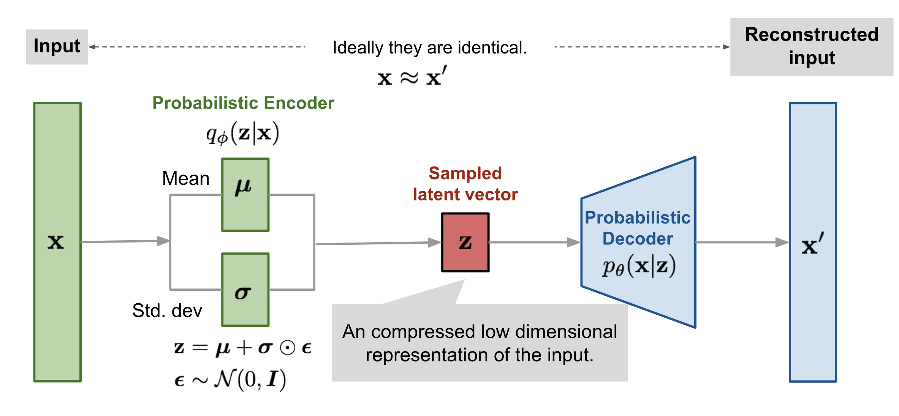
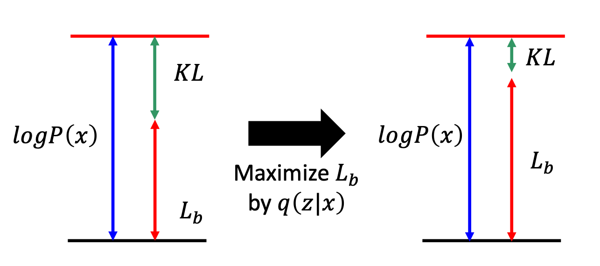
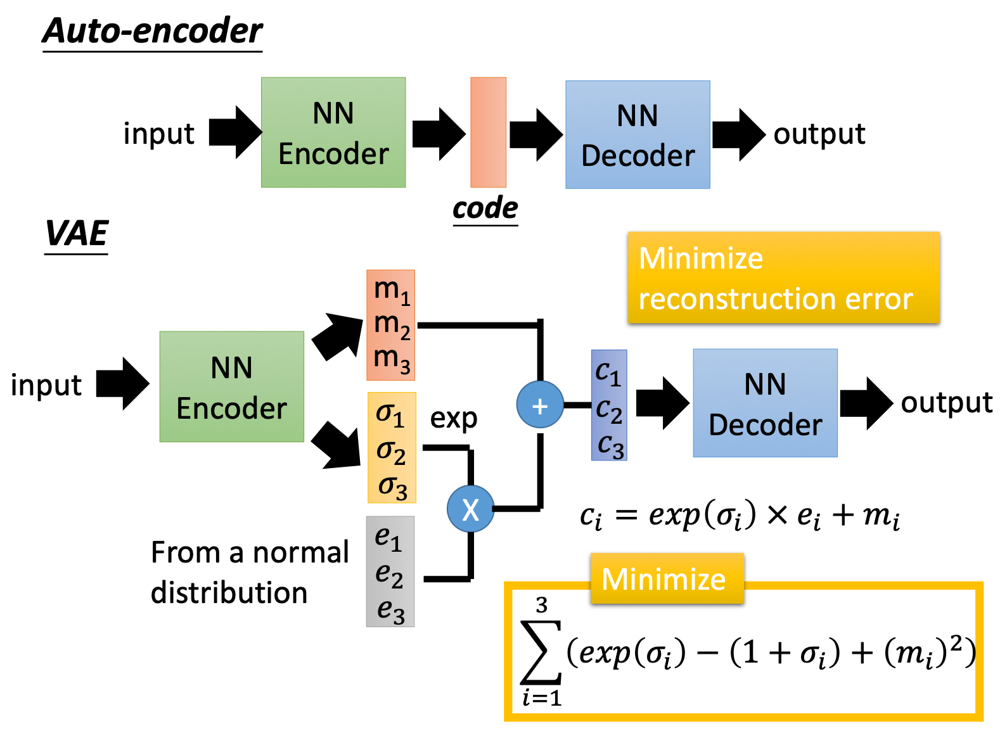

# 变分自编码器

对于生成模型而言，主流的理论模型可以分为隐马尔可夫模型 HMM、朴素贝叶斯模型 NB 和高斯混合模型 GMM，而 VAE 的理论基础就是高斯混合模型，即任何一个数据的分布，都可以看作是若干高斯分布的叠加。

首先假设 $z$ 服从高斯分布 $\mathcal N(0,1)$，每对于一个采样 $z$，会有两个函数 $\mu$ 和 $\sigma$，分别决定 $z$ 对应到的高斯分布的均值和方差，然后在积分域上所有的高斯分布的累加就成为了原始分布 $p(x)$，即：

$$
p_\theta(x)=\int\limits_z p(z)p_\theta(x\mid z) dz
$$

其中，$z \sim \mathcal N(0,1),x\mid z \sim \mathcal N\big(\mu(z,\theta),\sigma(z,\theta)\big)$。

接下来求解这个式子，由于 $p(z)$ 是已知的，$p(x\mid z)$ 未知，而 $x\mid z \sim \mathcal N\big(\mu(z),\sigma(z)\big)$，于是真正需要求解的，是 $\mu$ 和 $\sigma$ 两个函数的表达式。又因为 $p(x)$ 通常非常复杂，导致和难以计算，因此引入两个神经网络来帮助求解。

- 第一个神经网络 Decoder，求解的是 $\mu(z)$ 和 $\sigma(z)$ 两个函数，等价于求解 $p(x\mid z)$。
- 第二个神经网络 Encoder，求解的是 $q(z\mid x)$，$q$ 可以代表任何分布。

这里引入第二个神经网络 Encoder 的目的是辅助第一个 Decoder 求解，这也是整个 VAE 理论中最精妙的部分。

最大化 $p_\theta(x)$ 的对数似然函数（log likelihood function）：

$$
\log p_{\theta}(x) = \sum_{i=1}^{N}\log p_{\theta}(x^{(i)})
$$

其中：

$$
\log p_{\theta}(x^{(i)}) = \log \int p_{\theta}(z)) p_{\theta}(x\mid z)dz
$$

用梯度上升的方法求得最优解，需要计算梯度 $\nabla{\theta} \log p_{\theta}(x^{(i)})$。但是因为上面的公式包含了一个积分的形式，使得这个梯度并不好求解。最直观的思路就是找到一个方法消除 $z$ 的积分。回顾积分的定义，可以采样尽可能多的 $z$，然后用采样得到的 $z$ 去估计真实的 $z$ 分布，这样就能去掉积分了。这种方式被称为：Naive Monte Carlo Gradient Estimator。具体地，我们从 $p(z)$ 中采样出 $L$ 个数据点 $z^{(1)},z^{(2)},…,z^{(L)}$，然后用下面的公式去估计 $p_{\theta}(x^{(i)})$：

$$
p_{\theta}(x^{(i)}) \approx \frac{1}{L} \sum_{l=1}^{L} p_{\theta}(x^{(i)}\mid z^{(l)})
$$

新得到的公式中已经和 $z$ 无关了，这样就能计算出梯度 $\nabla{\theta} \log p_{\theta}(x^{(i)})$ 了。这个方法看上去很完美，但是很遗憾并不可行。主要原因是，$x$ 的维度远高于 $z$ 的维度，因此采样得到的 $p_{\theta}(x\mid z)$ 很容易偏斜（highly skewed），很容易只能采样到一小部分区域。因此，要获取准确的结果，采样的数据点个数必须非常大，而这很难做到。

既然凭空采样 $z$ 是困难的，那么可以利用原始数据 $X$ 来缩小 $x$ 的采样范围。于是引入 Encoder 网络 $q_{\phi} (z\mid x)$，也被称为识别模型（Recognition Model）。

$$
q_{\phi}(z\mid x) = \mathcal N(\mu(x,\phi), \sigma(x,\phi))
$$

仍然假设它服从高斯分布，并且它的两个参数 mean vector $\mu_z(x,\phi)$ 和协方差矩阵 $\sigma_{z}^2(x,\phi)I$ 也是通过一个神经网络学习得到的。

$$
\begin{align*}
\log p_{\theta}(x^{(i)}) & = E_{z \sim q_{\phi}(z\mid x^{(i)})} \left [ \log p_{\theta}(x^{(i)}) \right ] \\
& = \int q_{\phi}(z\mid x^{(i)})  \log p_{\theta}(x^{(i)}) dz \\
& = \int q_{\phi}(z\mid x^{(i)})  \log \frac{p_{\theta}(z, x)}{p_{\theta}(z \mid x^{(i)})}  dz \\
& = \int q_{\phi}(z\mid x^{(i)}) \log \frac{p_{\theta}(z, x)}{p_{\theta}(z \mid x^{(i)})}\frac{q_{\phi}(z\mid x^{(i)})}{q_{\phi}(z\mid x^{(i)})} dz \\
& = \int q_{\phi}(z\mid x^{(i)}) \log \frac{p_{\theta}(z, x)}{q_{\phi}(z\mid x^{(i)})} dz + \int q_{\phi}(z\mid x^{(i)}) \log \frac{q_{\phi}(z\mid x^{(i)})}{p_{\theta}(z \mid x^{(i)})} dz \\
& = \int q_{\phi}(z\mid x^{(i)}) \log \frac{p_{\theta}(z, x)}{q_{\phi}(z\mid x^{(i)})} dz + D_{KL} \left [ q_{\phi}(z\mid x^{(i)}) || p_{\theta}(z\mid x^{(i)}) \right ]
\end{align*}
$$

上式的第二项是一个大于等于 0 的值，于是我们就找到了一个 $\log p_{\theta}(x^{(i)}) $ 的下界：

$$
\log p_{\theta}(x^{(i)})  \geq \int q_{\phi}(z\mid x^{(i)}) \log \frac{p_{\theta}(z, x)}{q_{\phi}(z\mid x^{(i)})} dz
$$

将下界记作：

$$
L_b = \int q_{\phi}(z\mid x^{(i)}) \log \frac{p_{\theta}(z, x)}{q_{\phi}(z\mid x^{(i)})} dz
$$

于是原式化为：

$$
\log p_{\theta}(x^{(i)}) = L_b + D_{KL} \left [ q_{\phi}(z\mid x^{(i)}) || p_{\theta}(z\mid x^{(i)}) \right ]
$$

接下来，VAE 思维的巧妙设计就体现出来了。原本需要求 $p_\theta(x\mid z)$ 使得最大，现在引入了一个 $q_\phi(z\mid x)$，变成了同时求 $p_\theta(x\mid z)$  和 $q_\phi(z\mid x)$ 使得 $\log p_{\theta}(x)$ 最大。

不妨观察一下 $\log p_{\theta}(x)$ 和 $L_b$ 的关系：

一个有趣的现象是，当固定住 $p_\theta(x\mid z)$  时，因为 $\log p_{\theta}(x)$ 只与 $p_\theta(x\mid z)$ 有关，所以 $\log p(x)$ 的值是会不变的，此时调节 $q_\phi(z\mid x)$，使得 $L_b$ 越来越高，同时 KL 散度越来越小，当调节到 $q_\phi(z\mid x)$ 与 $p_\theta(x\mid z)$ 完全一致时，KL 散度就消失为 0，$L_b$ 与 $\log p_{\theta}(x)$ 完全一致。由此可以得出，不论 $\log p(x)$ 的值如何，总能够通过调节使得 $L_b$ 等于 $\log p(x)$，又因为 $L_b$ 是 $\log p_{\theta}(x)$ 的下界，所以求解 $\max \log p_{\theta}(x)$ 等价为求解 $\max L_b$。

从宏观上来看，调节 $p_\theta(x\mid z)$ 就是在调节 Decoder，调节 $q_\phi(z\mid x)$ 就是在调节 Encoder。于是，VAE 的训练逻辑就变成了，Decoder 每前进一步，Encoder 就调节成与其一致的样子，并且站在那拿“枪”顶住 Decoder，这样 Decoder 在下次训练的时候就只能前进，不能退步了。

再回到之前的步骤上，现在需求解 $\max L_b$：

$$
\begin{aligned}
L_b&=\int q_{\phi}(z\mid x^{(i)}) \log \frac{p_{\theta}(z, x^{(i)})}{q_{\phi}(z\mid x^{(i)})} dz \\
&=\int q_{\phi}(z\mid x^{(i)}) \log \frac{p_{\theta}(x^{(i)}\mid z)p_{\theta}(z)}{q_{\phi}(z \mid x^{(i)})} dz \\
&=\int q_{\phi}(z\mid x^{(i)}) \log p_{\theta}(x^{(i)}\mid z) dz + \int q_{\phi}(z\mid x^{(i)}) \log \frac{p_{\theta}}{q_{\phi}(z \mid x^{(i)})} dz \\
&= E_{z \sim q_{\phi}(z\mid x^{(i)})} \left [ \log p_{\theta}(x^{(i)} \mid z) \right ] – D_{KL} \left [ q_{\phi}(z \mid x^{(i)}) || p_{\theta}(z) \right ]
\end{aligned}
$$

求解 $\max L_b$，等价于求解第一项的最小值和第二项的最大值。

第一项的期望就是表明在给定 $q_\phi(z\mid x)$（编码器输出）的情况下，$p_\theta(x\mid z)$（解码器输出）的值尽可能高，其实就是一个类似于 Auto-Encoder 的损失函数（方差忽略不计的话）。

第二项展开式刚好等于：

$$
\sum_{i=1}^{J}\left(\exp \left(\sigma_{i}\right)-\left(1+\sigma_{i}\right)+\left(m_{i}\right)^{2}\right)
$$

总：

$$
\begin{aligned}
\log p_{\theta}(x^{(i)}) & = D_{KL} \left [ q_{\phi}(z\mid x^{(i)}) || p_{\theta}(z\mid x^{(i)}) \right ] + L_b \\
& = D_{KL} \left [ q_{\phi}(z\mid x^{(i)}) || p_{\theta}(z\mid x^{(i)}) \right ] + E_{z \sim q_{\phi}(z\mid x^{(i)})} \left [ \log p_{\theta}(x^{(i)} |z) \right ] – D_{KL} \left [ q_{\phi}(z\mid x^{(i)}) || p_{\theta}(z) \right ]
\end{aligned}
$$

## 生成过程

生成数据时只用到了 Decoder 网络，即 $z$ 不再是从 $q_\phi(z\mid x)$ 中采样，而是直接从标准正态分布中采样。因为 $q_\phi(z\mid x)$ 只是为了训练 Decoder 而引入的，目的是把样本数据集在潜在空间中聚拢，聚拢的目标是标准正态分布。经过训练后，Decoder 已经可以从这样的空间中区分不同类别的数据。生成时直接从标准正态分布采样 $z$ 即可。

## 重参数技巧

要从 $p(z\mid x_k)$ 中采样一个 $z_k$ 出来，尽管先验分布 $p(z\mid x_k)$ 是正态分布，但是均值方差都是靠模型算出来的，要靠这个过程反过来优化均值方差的模型，但是“采样”这个操作是不可导的，而采样的结果是可导的。根据

$$
\frac{1}{\sqrt{2\pi\sigma^2}}\exp\left(-\frac{(z-\mu)^2}{2\sigma^2}\right)dz = \frac{1}{\sqrt{2\pi}}\exp\left[-\frac{1}{2}\left(\frac{z-\mu}{\sigma}\right)^2\right]d\left(\frac{z-\mu}{\sigma}\right)
$$

$(z-\mu)/\sigma=\varepsilon$ 是服从均值为 0、方差为 1 的标准正态分布的，要同时把 $dz$ 考虑进去，是因为乘上 $dz$ 才算是概率，去掉 $dz$ 是概率密度而不是概率。

这样，从 $\mathcal{N}(\mu,\sigma^2)$ 中采样一个 $z$，相当于从 $\mathcal{N}(0,I)$ 中采样一个 $\varepsilon$，然后让 $z=\mu + \varepsilon \sigma$。

于是，从 $\mathcal{N}(\mu,\sigma^2)$ 采样就变成了从 $\mathcal{N}(0,I)$ 中采样，然后通过参数变换得到从 $\mathcal{N}(\mu,\sigma^2)$ 中采样的结果。这样一来，“采样”这个操作就不用参与梯度下降了，改为采样的结果参与，使得整个模型可训练了。

## 直观理解

在 Auto-encoder 中，编码器是直接产生一个编码的，但是在 VAE 中，为了给编码添加合适的噪声，编码器会输出两个编码，一个是原有编码 $(m_1,m_2,m_3)$，另外一个是控制噪声干扰程度的编码 $(\sigma_1,\sigma_2,\sigma_3)$，第二个编码其实很好理解，就是为随机噪声码 $(e_1,e_2,e_2)$ 分配权重，加上 $\exp(\sigma_i)$ 的目的是为了保证这个分配的权重是个正值，最后将原编码与噪声编码相加，就得到了 VAE 在 code 层的输出结果 $(c_1,c_2,c_2)$。其它网络架构都与 Deep Auto-encoder 无异。

损失函数方面，除了必要的重构损失外，VAE 还增添了一个损失函数（见上图第二个 Minimize 内容），这同样是必要的部分，因为如果不加的话，整个模型就会出现问题：为了保证生成图片的质量越高，编码器肯定希望噪声对自身生成图片的干扰越小，于是分配给噪声的权重越小，这样只需要将 $(\sigma_1,\sigma_2,\sigma_3)$ 赋为接近负无穷大的值就好了。所以，第二个损失函数就有限制编码器走这样极端路径的作用，这也从直观上就能看出来，$\exp(\sigma_i)-(1+\sigma_i)$ 在 $\sigma_i=0$ 处取得最小值，于是 $(\sigma_1,\sigma_2,\sigma_3)$ 就会避免被赋值为负无穷大。
