# 卷积

### 池化

1. 保留主要特征的同时减少参数和计算量，防止过拟合。
2. invariance（不变性），这种不变性包括 translation（平移），rotation（旋转），scale（尺度）。

Pooling 层说到底还是一个特征选择，信息过滤的过程。也就是说我们损失了一部分信息，这是一个和计算性能的一个妥协，随着运算速度的不断提高，这个妥协会越来越小。

## PyTorch nn.Conv2d

```python
torch.nn.Conv2d(in_channels, 
								out_channels, 
                kernel_size, 
                stride=1, 
                padding=0, 
                dilation=1, 
                groups=1, 
                bias=True, 
                padding_mode='zeros', 
                device=None, 
                dtype=None)
```

- Input: $\left(N, C_{i n}, H_{i n}, W_{i n}\right)$ or $\left(C_{i n}, H_{i n}, W_{i n}\right)$
- Output: $\left(N, C_{\text {out }}, H_{\text {out }}, W_{\text {out }}\right)$ or $\left(C_{\text {out }}, H_{\text {out }}, W_{\text {out }}\right)$

$$
\begin{aligned}
H_{out} &=\left\lfloor\frac{H_{in}+2 \times \text{padding}[0]-\text{kernel size}[0]}{\text{stride}[0]}+1\right\rfloor \\
W_{out} &=\left\lfloor\frac{W_{in}+2 \times \text{padding}[1]-\text{kernel size}[1]}{\text{stride}[1]}+1\right\rfloor
\end{aligned}
$$

如果是空洞卷积：

$$
\begin{aligned}
H_{out} &=\left\lfloor\frac{H_{in}+2 \times \text{padding}[0]-\text{dilation}[0] \times(\text{kernel size}[0]-1)-1}{\text{stride}[0]}+1\right\rfloor \\
W_{out} &=\left\lfloor\frac{W_{in}+2 \times \text{padding}[1]-\text{dilation}[1] \times(\text{kernel size}[1]-1)-1}{\text{stride}[1]}+1\right\rfloor
\end{aligned}
$$

- n 通道输入，单通道输出

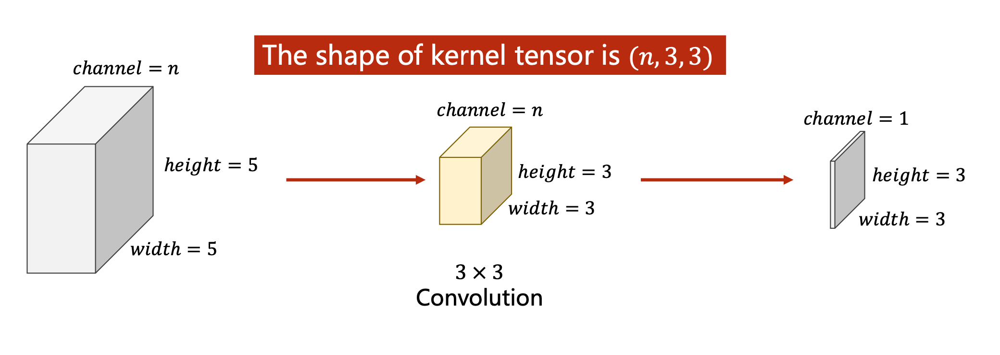

- n 通道输入，m 通道输出

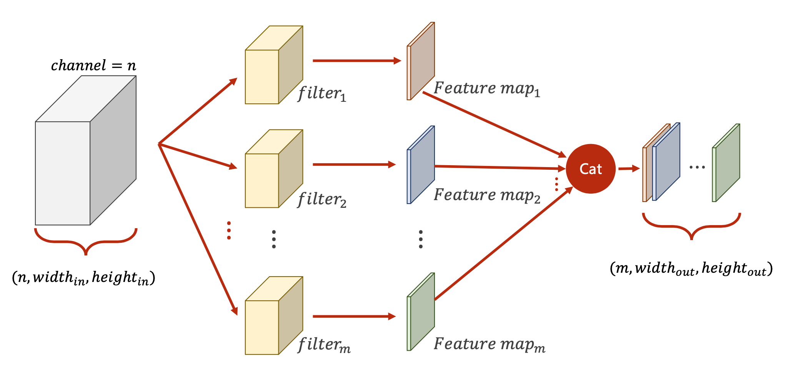

即 weights 参数 shape 为 `(m,n,kerner_size_width,kernel_size_height)`  是一个四维 tensor。

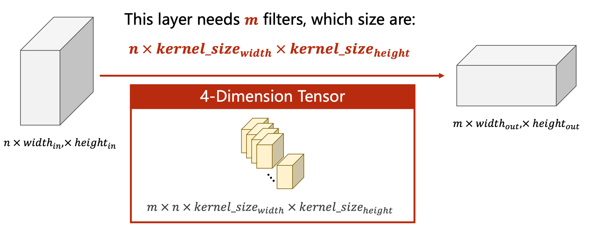

此外，若有 bias，参数 bias 的 shape 为 `(m)`。

```python
conv = torch.nn.Conv2d(4,5,(2,3))
for k,v in conv.named_parameters():
	print(k,v.shape)
	
Out:
weight torch.Size([5, 4, 2, 3])
bias torch.Size([5])
```

**kernel_size_width 与 kernel_size_height 不必相同**, 以 (5,2) 的核为例：

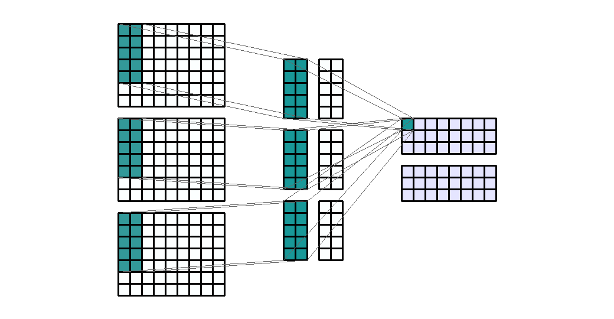

### 步长 stride

默认情况下，核从左到右，从下到上，从一个像素移动到另一个像素。但是这个步长也可以改变，通常用于对输出通道进行下采样。

两个方向可以分别设置 stride, 例如 stride=(1,3)：

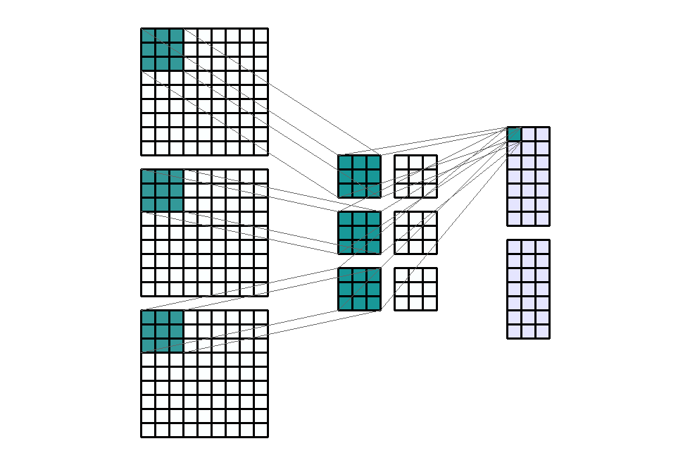

```python
x = torch.randn(3,3,9,9)
conv = torch.nn.Conv2d(3,2,(3,3),stride=(1,3))
print(conv(x).shape)

Out:
torch.Size([3, 2, 7, 3])
```

### 填充 padding

当需要输出通道的大小与输入通道的大小相等时，进行填充。当 kernel size 为 3*3 时，输出通道的大小每边少 1。为了解决这个问题，可以使用 padding 1。

padding 对参数的数量没有影响，但是会产生与 padding 的大小成比例的额外计算时间。但是通常来说，与输入通道的大小相比，padding 通常足够小，可以认为对计算时间没有影响。

常用的参数组合：

- kernel_size=3, stride=1, padding=1, 特征图大小不变
- kernel_size=5, stride=1, padding=2, 特征图大小不变
- kernel_size=3, stride=2, padding=1, 下采样 H/2 W/2
- kernel_size=5, stride=2, padding=2, 下采样 H/2 W/2

**一般希望输入输出以步长为比例，所以 padding 一般为 (kernel_size -1)/2**。

#### Half (same) padding

当 padding=$\lfloor k/2 \rfloor$，stride=1 时， 输入输出大小相同。（i.e., i = 5, k = 3, s = 1 and p = 1）


#### Full padding

当 padding=k-1，stride=1 时， 输出大小 $o=i+2(k-1)-(k-1) = i+(k-1)$。(i.e., i = 5, k = 3, s = 1 and p = 2)

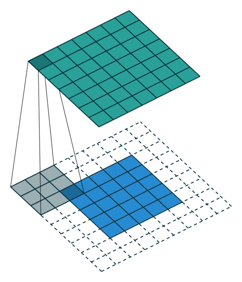

### 空洞卷积 dialation

默认值为 1，对应的是卷积时输入通道上的核的每个像素之间的偏移量。

两个方向可以分别设置 dialation, 例如 dialation=(4,2)：

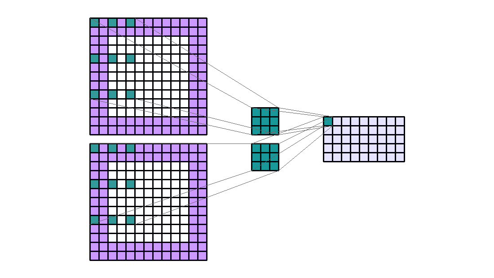

```python
x = torch.randn(3,2,9,9)
conv = torch.nn.Conv2d(2,1,(3,3),stride=(1,1),dilation=(4,2),padding=(2,2))
print(conv(x).shape)

Out:
torch.Size([3, 1, 5, 9])
```

与 padding 一样，Dilation 对参数的数量没有影响，对计算时间的影响非常有限

### groups

在特定的情况下，groups 是非常有用的。例如，如果有几个没有相互依赖的数据源，输入通道可以独立分组，输出通道最后再连接起来。

如果输入通道为 2，输出通道为 4，把输入通道分成两组（每组一个输入通道），然后使其经过卷积层，分组得到的输出通道数是原来的一半，最后将输出通道连接起来。

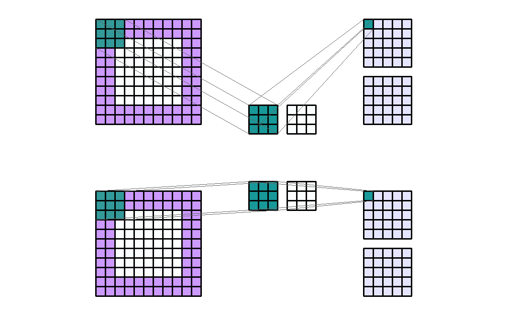

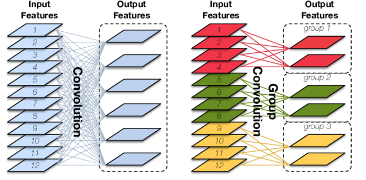

groups 的数量必须是输入通道数和输出通道数的公约数。

```python
x = torch.randn(3,2,7,7)
conv = torch.nn.Conv2d(2,4,(3,3),stride=(2,2),dilation=(1,1),padding=(2,2),groups=2)
print(conv(x).shape)

Out:
torch.Size([3, 4, 5, 5])

for k,v in conv.named_parameters():
    print(k,v.shape)

Out:
weight torch.Size([4, 1, 3, 3]) # input_channel=2, ouput_channel=4, 卷积核为 (4,1,3,3)，两组卷积核，每组 2 个
bias torch.Size([4])
```

## 转置卷积

```python
torch.nn.ConvTranspose2d(in_channels, 
                         out_channels, 
                         kernel_size, 
                         stride=1, 
                         padding=0, 
                         output_padding=0, 
                         groups=1, 
                         bias=True, 
                         dilation=1, 
                         padding_mode='zeros', 
                         device=None, 
                         dtype=None)
```

- Input: $(N, C_{in}, H_{in}, W_{in})$
- Output: $(N, C_{out}, H_{out}, W_{out})$

$$
\begin{aligned}
H_{out}&=(H_{in}−1)\times \text{stride}[0]−2×\text{padding}[0]+\text{dilation}[0]×(\text{kernel size}[0]−1)+\text{output padding}[0]+1 \\
W_{out}&=(W_{in}−1)\times \text{stride}[1]−2×\text{padding}[1]+\text{dilation}[1]×(\text{kernel size}[1]−1)+\text{output padding}[1]+1
\end{aligned}
$$

转置卷积也可以称为反卷积，但其并非卷积操作的反向操作。**转置卷积也是卷积！**

卷积操作会将输入映射到一个更小的 feature map 中，那么反卷积则可以将这个小的 feature map 映射为一个大的 feature map，但是切记，这不是卷积的反向操作，也不会得到与原始输入一样的输出，但是却保留了映射中相对位置关系的信息，可以将其理解为上采样。

实际上，上采样（upsampling）一般包括 2 种方式：

1. Resize，如双线性插值直接缩放，类似于图像缩放（这种方法在原文中提到）
2. Transposed Convolution，也叫 Deconvolution, Fractionally-strided Convolution。

传统的网络是 subsampling 的，对应的输出尺寸会降低；upsampling 的意义在于将小尺寸的高维度 feature map 恢复回去，以便做 pixelwise prediction，获得每个点的分类信息。

转置卷积通常用在三个方面：

1. CNN 可视化，通过反卷积将卷积得到的 feature map 还原到像素空间，来观察 feature map 对哪些 pattern 相应最大，即可视化哪些特征是卷积操作提取出来的；
2. FCN 全卷积网络中，由于要对图像进行像素级的分割，需要将图像尺寸还原到原来的大小，类似 upsampling 的操作，所以需要采用反卷积；
3. GAN 对抗生成网络中，由于需要从输入图像到生成图像，自然需要将提取的特征图还原到和原图同样尺寸的大小，即也需要反卷积操作。

卷积和转置卷积对比：

- 卷积 (convolution)：卷积核为 3x3；padding=1，stride=2

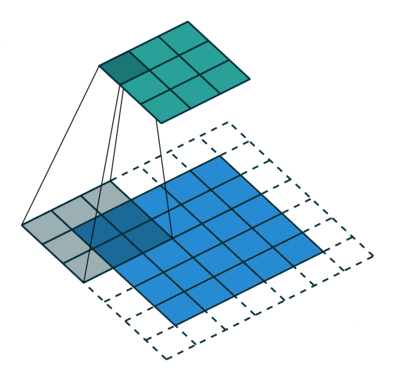

- 转置卷积 (the transpose of conv) 可以理解为 upsample conv。卷积核为：3x3；no padding；stride=1
- 这里可见是有 padding 的，但因为转置卷积对应的卷积操作的 padding p'=2，所以 k-p-1=0 是 no padding。

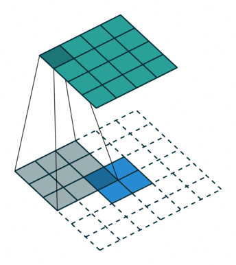

转置卷积运算步骤：（k 为卷积核大小 kernel size，s 为步长 striding，p 为填充 padding）

- 在输入特征图元素间填充 s-1 行和列

- 在输入特征图四周填充 k-p-1 行和列

- 将卷积核参数上下、左右翻转

- 做正常卷积运算（填充 0，步距 1）

### 填充

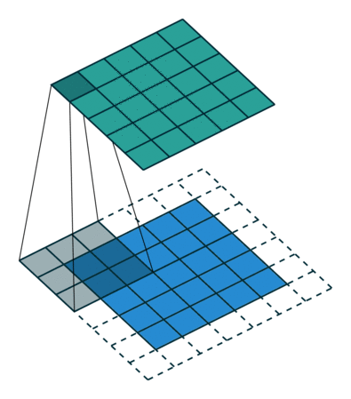

如图转置卷积 i=5，k=3，s=1，p=1，相当于做正常卷积时 padding=k-p-1=1，即 i'=5, k'=k, s'=1, p'=1。out=s×(input-1)+k-2p=5

### 步长

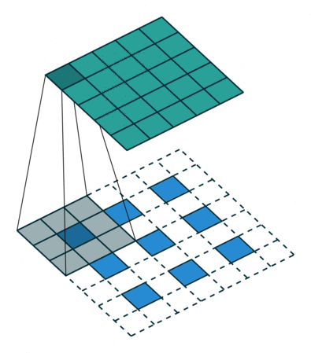

如图转置卷积 i=3，k=3，s=2，p=1，相当于做正常卷积时，先在输入之间填充 s-1=1 个 0 元素，padding=k-p-1=1，即 i'=5, k'=k, s'=1, p'=1。out=s×(input-1)+k-2p=5

如果让高宽成倍增加，那么 k=2p+s。

如果设置了 output_padding=1（output_padding 的值必须小于 stride 和 dilation），需要根据 output_padding=1 在右边和下边填充 0。**一般在使用时，希望输入输出尺寸以步长为比例，所以 output_padding 一般设置为 stride-1，padding 取 (kernel_size-1)/2。**

在实际计算过程中要转化为矩阵的乘积的形式，一个转化为 Toeplitz matrix，一个 reshape 为列矩阵。

比如 input = [3,3]，Reshape 之后，为 A = [1,9]。B（可以理解为滤波器）= [9,4] (Toeplitz matrix)，那么 A*B = C = [1,4]。Reshape C = [2,2]。所以，通过 B 卷积，我们从 input shape = [3,3] 变成了output shape = [2,2]。

反过来，输入 A=[2,2]，reshape 之后为 [1,4]。B 的转置为 [4,9]，那么 A*B=C=[1,9], reshape 为 [3,3]。所以，通过 B 的转置卷积，就从 input shape=[2,2] 得到了 output shape=[3,3]

也就是卷积过程为输入 feature map A=[3,3] 经过了卷积核 B=[2,2] 输出为 [2,2] , 其中 padding=0, stride=1。转置卷积则是输入 feature map A=[2,2], 经过了转置卷积核 B=[2,2]，输出为 [3,3]，其中 padding=0, stride=1。

### 卷积矩阵

顾名思义就是把卷积操作写成一个矩阵的形式，通过一次矩阵乘法就可以完成整个卷积操作。卷积矩阵的构造是通过对卷积核的重排列构造的。例如对于 3x3 的卷积核：

$$
\left[\begin{array}{rrr}
1 & 4 & 1 \\
1 & 4 & 3 \\
3 & 3 & 1
\end{array}\right]
$$

可以重排列为一个 4x16 的卷积矩阵：

$$
\left[\begin{array}{rrrr}
1 & 4 & 1 & 0 & 1 & 4 & 3 & 0 & 3 & 3 & 1 & 0 & 0 & 0 & 0 & 0 \\
0 & 1 & 4 & 1 & 0 & 1 & 4 & 3 & 0 & 3 & 3 & 1 & 0 & 0 & 0 & 0 \\
0 & 0 & 0 & 0 & 1 & 4 & 1 & 0 & 1 & 4 & 3 & 0 & 3 & 3 & 1 & 0 \\
0 & 0 & 0 & 0 & 0 & 1 & 4 & 1 & 0 & 1 & 4 & 3 & 0 & 3 & 3 & 1
\end{array}\right]
$$

先来看正常卷积。设该输入矩阵为：

$$
\left[\begin{array}{rrrr}
4 & 5 & 8 & 7 \\
1 & 8 & 8 & 8 \\
3 & 6 & 6 & 4 \\
6 & 5 & 7 & 8
\end{array}\right]
$$

以 1 为步长没有填充，那么卷积结果为：

$$
\left[\begin{array}{rr}
122 & 148 \\
126 & 134 
\end{array}\right]
$$

将输入矩阵转换为一个 16x1 的列向量，那么该列向量与卷积矩阵相乘会得到一个 1x4 的向量，再将该向量 reshape 为 2x2 的矩阵即为卷积结果。

$$
\left[\begin{array}{rrrr}
1 & 4 & 1 & 0 & 1 & 4 & 3 & 0 & 3 & 3 & 1 & 0 & 0 & 0 & 0 & 0 \\
0 & 1 & 4 & 1 & 0 & 1 & 4 & 3 & 0 & 3 & 3 & 1 & 0 & 0 & 0 & 0 \\
0 & 0 & 0 & 0 & 1 & 4 & 1 & 0 & 1 & 4 & 3 & 0 & 3 & 3 & 1 & 0 \\
0 & 0 & 0 & 0 & 0 & 1 & 4 & 1 & 0 & 1 & 4 & 3 & 0 & 3 & 3 & 1
\end{array}\right] \times
\left[\begin{array}{r}
4 \\ 5 \\ 8 \\ 7 \\ 1 \\ 8 \\ 8 \\ 8 \\ 3 \\ 6 \\ 6 \\ 4 \\ 6 \\ 5 \\ 7 \\ 8
\end{array}\right] 
=\left[\begin{array}{r}
122 \\ 148 \\ 126 \\ 134 
\end{array}\right]
$$

再 reshape 输出结果为：

$$
\left[\begin{array}{rr}
122 & 148 \\
126 & 134 
\end{array}\right]
$$

### 转置卷积矩阵

转置卷积矩阵就是将卷积矩阵进行转置，可以得到一个 16x4 的转置卷积矩阵，对于输出的 2x2 的 feature map，reshape 为 4x1，再将二者相乘即可得到一个 16x1 的转置卷积的结果，此时再 reshape 即可得到一个 4x4 的输出。

$$
\left[\begin{array}{llll}
1 & 0 & 0 & 0 \\
4 & 1 & 0 & 0 \\
1 & 4 & 0 & 0 \\
0 & 1 & 0 & 0 \\
1 & 0 & 1 & 0 \\
4 & 1 & 4 & 1 \\
3 & 4 & 1 & 4 \\
0 & 3 & 0 & 1 \\
3 & 0 & 1 & 0 \\
3 & 3 & 4 & 1 \\
1 & 3 & 3 & 4 \\
0 & 1 & 0 & 3 \\
0 & 0 & 3 & 0 \\
0 & 0 & 3 & 3 \\
0 & 0 & 1 & 3 \\
0 & 0 & 0 & 1
\end{array}\right] \times\left[\begin{array}{c}
122 \\
148 \\
126 \\
134
\end{array}\right]=\left[\begin{array}{c}
122 \\ 636 \\ 714 \\ 148 \\ 248 \\ 1274 \\ 1620 \\  578 \\  492 \\ 1448 \\ 1480 \\
        550 \\  378 \\  780 \\  528 \\  134
\end{array}\right]
$$

输出为：

$$
\left[\begin{array}{rrrr}
122 & 636 &  714 & 148 \\
248 & 1274 & 1620 &  578 \\
492 & 1448 & 1480 & 550 \\
378 &  780 & 528 &  134
\end{array}\right]
$$

这样就通过转置卷积将 2x2 的矩阵转置卷积为一个 4x4 的矩阵，但是从结果也可以看出反卷积的结果与原始输入信号不同。只是保留了位置信息，以及得到了想要的形状。

在实际计算转置卷积过程中，会先将输入 [122,148,126,134] 填充 k-p-1=2 行 0，然后与原卷积核的反转计算卷积：
$$
\left[\begin{array}{rr}
0 & 0 & 0 & 0 & 0 & 0 \\
0 & 0 & 0 & 0 & 0 & 0 \\
0 & 0 & 122 & 148 & 0 & 0 \\
0 & 0 & 126 & 134 & 0 & 0 \\
0 & 0 & 0 & 0 & 0 & 0 \\
0 & 0 & 0 & 0 & 0 & 0
\end{array}\right] \text{conv} 
\left[\begin{array}{rrr}
1 & 4 & 1 \\
1 & 4 & 3 \\
3 & 3 & 1
\end{array}\right] =
\left[\begin{array}{rrrr}
122 & 636 &  714 & 148 \\
248 & 1274 & 1620 &  578 \\
492 & 1448 & 1480 & 550 \\
378 &  780 & 528 &  134
\end{array}\right]
$$
可以看到，转置卷积实际计算卷积时使用的卷积核正好是原始卷积核的反转。所以转置卷积本质上也是卷积！

反卷积可以应用在生成对抗网络 (GAN) 的生成器上，可以参考 DCGAN 进行理解。

### Checkerboard Artifacts

使用转置卷积时会出现棋盘格伪影：

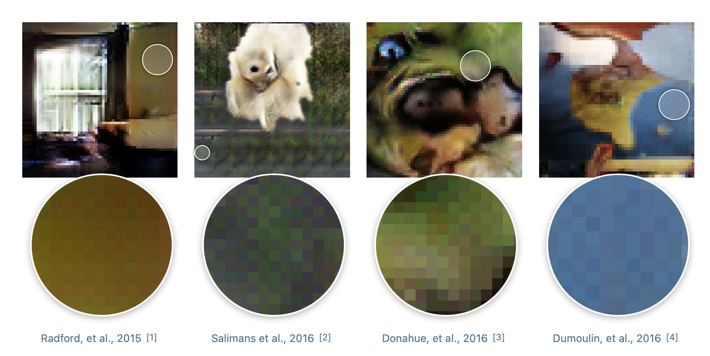

棋盘状伪影是由转置卷积的“不均匀重叠”引起的。在下图中，顶部的图层是输入图层，底部的图层是转置卷积后的输出图层。在转置卷积期间，具有较小尺寸的层被映射到具有较大尺寸的层。

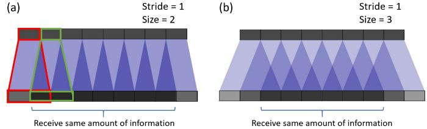

在 (a) 中，步长为 1 且 filters 大小为 2。如红色所示，输入上的第一个像素映射到输出上的第一个和第二个像素。如绿色所示，输入上的第二个像素映射到输出上的第二个和第三个像素。输出上的第二个像素从输入上的第一个和第二个像素接收信息。总的来说，输出中间部分（有效输出）的像素从输入端接收相同数量的信息，这里存在中心重叠的区域。

在示例 (b) 中 filters 大小增加到 3 时，接收最多信息的中心部分收缩。但这可能不是什么大问题，因为重叠仍然是均匀的，输出中心部分的像素从输入接收相同数量的信息。

然而，对于下面的示例，当 stride = 2 时。

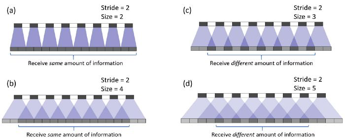

在示例 (a) 中，filter 的大小 = 2，输出上的所有像素都从输入接收相同数量的信息。它们都从输入上的单个像素接收信息，这里没有转置卷积的重叠。

如果在示例 (b) 中将 filters 的大小更改为 4，则均匀重叠的区域会缩小。但是，仍然可以使用输出的中心部分作为有效输出，其中每个像素从输入接收相同数量的信息。

但是，如果在示例 (c) 和 (d) 中将 filters 的大小更改为 3 和 5，输出上的每个像素与其相邻像素相比接收不同数量的信息，这样就无法在输出上找到连续且均匀重叠的区域。

**当 filters 的大小不能被步长整除时，转置卷积有不均匀的重叠**。这种“不均匀的重叠”使得某些地方的像素比其他地方更多，从而产生棋盘格效果。事实上，不均匀重叠的区域在两个维度上往往更加极端。不均匀性是平方的。

在应用转置卷积的时，可以通过两种方法来减少此类伪像。**首先，确保使用的 filters 的大小能被步长整除，以避免不均匀的重叠问题**。其次，**可以使用步长=1 的转置卷积，以减少棋盘效应**。但是，正如许多模型中所看到的那样，伪影仍可能出现。

[这篇文章](https://distill.pub/2016/deconv-checkerboard/) 提出了一种更好的上采样方法：首先，调整图像的大小（使用最近邻插值或双线性插值），然后做一个卷积层，这样有效避免了棋盘效应。

## 空洞卷积

Dilated Convolution，又叫膨胀卷积，扩张卷积。

系统能以相同的计算成本，提供更大的感受野，扩张卷积在实时分割领域特别受欢迎。在需要更大的观察范围，且无法承受多个卷积或更大的 kennels，可以用空洞卷积。

- 标准卷积


- 扩张卷积

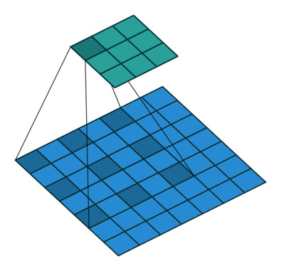

当 $d=1$ 时，扩张卷积变成标准的卷积。

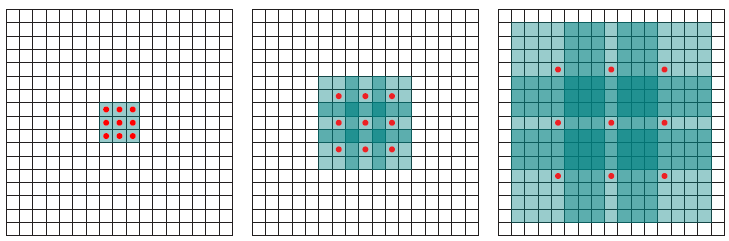

直观上，空洞卷积通过在卷积核部分之间插入空间让卷积核「膨胀」。这个增加的参数 $d$ （空洞率）表明了我们想要将卷积核放宽到多大。图中显示了当 $d=1,2,4$  时的卷积核大小。

### Grading Effect

Rethinking Convolution：在 VGG 中，最大的贡献并不是 VGG 网络本身，而是对于卷积叠加的一个巧妙观察。

> This (stack of three 3 × 3 conv layers) can be seen as imposing a regularisation on the 7 × 7 conv. filters, forcing them to have a decomposition through the 3 × 3 filters (with non-linearity injected in between).

这里意思是 7 x 7 的卷积层的正则等效于 3 个 3 x 3 的卷积层的叠加，而这样的设计不仅可以大幅度的减少参数，其本身带有正则性质的 convolution map 能够更容易学一个 generlisable, expressive feature space。这也是现在绝大部分基于卷积的深层网络都在用小卷积核的原因。

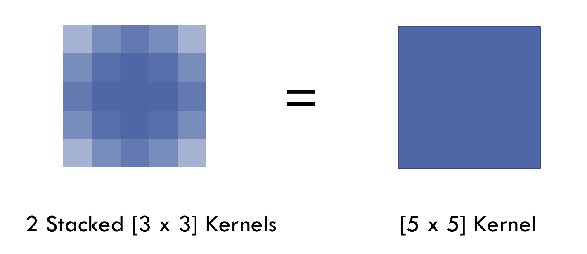

然而 Deep CNN 对于其他任务还有一些致命性的缺陷。较为著名的是 up-sampling 和 pooling layer 的设计。这个在 Hinton 的演讲里也一直提到过。

主要问题有：

1. Up-sampling/pooling layer (e.g. bilinear interpolation) is deterministic. (a.k.a. not learnable)
2. 内部数据结构丢失；空间层级化信息丢失。
3. 小物体信息无法重建 （假设有四个 pooling layer 则任何小于 $2^4 = 16$ pixel 的物体信息将理论上无法重建。)

在这样问题的存在下，语义分割问题一直处在瓶颈期无法再明显提高精度， 而 dilated convolution 的设计就良好的避免了这些问题。

### Dilated Convolution to the Rescue

空洞卷积的拯救之路： [MULTI-SCALE CONTEXT AGGREGATION BY DILATED CONVOLUTIONS ](https://arxiv.org/pdf/1511.07122.pdf) 是第一篇尝试用 dilated convolution 做语义分割的文章，后续图森组和 Google Brain 都对于 dilated convolution 有着更细节的讨论，推荐阅读：[Understanding Convolution for Semantic Segmentation](https://arxiv.org/abs/1702.08502)， [Rethinking Atrous Convolution for Semantic Image Segmentation](https://arxiv.org/abs/1706.05587)。

对于 dilated convolution，已经发现了其优点为内部数据结构的保留和避免使用 down-sampling 这样的特性。但是完全基于 dilated convolution 的结构如何设计则是一个新的问题。

#### 潜在问题 1：The Gridding Effect

假设仅仅多次叠加 dilation rate 2 的 3 x 3 kernel 的话，则会出现这个问题：

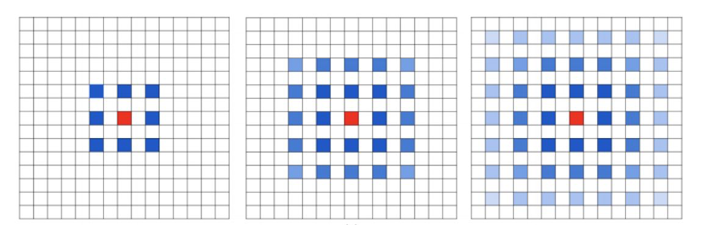

发现 kernel 并不连续，也就是并不是所有的 pixel 都用来计算了，因此这里将信息看做 checker-board 的方式会损失信息的连续性。这对 pixel-level dense prediction 的任务来说是致命的。

#### 潜在问题 2：Long-ranged information might be not relevant.

从 dilated convolution 的设计背景来看就能推测出这样的设计是用来获取 long-ranged information。然而光采用大 dilation rate 的信息或许只对一些大物体分割有效果，而对小物体来说可能则有弊无利了。如何同时处理不同大小的物体的关系，则是设计好 dilated convolution 网络的关键。

### 通向标准化设计：Hybrid Dilated Convolution (HDC)

对于上面提到的几个问题，图森组的文章对其提出了较好的解决的方法。他们设计了一个称之为 HDC 的设计结构。

第一个特性是，叠加卷积的 dilation rate 不能有大于 1 的公约数。比如 [2, 4, 6] 则不是一个好的三层卷积，依然会出现 gridding effect。

第二个特性是，将 dilation rate 设计成**锯齿状结构**，例如 [1, 2, 5, 1, 2, 5] 循环结构。

第三个特性是，需要满足一下这个式子：

$$
M_i=\max[M_{i+1}-2r_i,M_{i+1}-2(M_{i+1}-r_i),r_i]
$$

其中 $r_i$ 是 $i$ 层的 dilation rate，而 $M_i$ 是指在 $i$ 层的最大 dilation rate，那么假设总共有 $n$ 层的话，默认 $M_n=r_n$ 。假设应用 kernel 为 $k x k$ 的话，我们的目标则是 $M_2\leq k$ ，这样我们至少可以用 dilation rate 1 即 standard convolution 的方式来覆盖掉所有洞。

一个简单的例子：dilation rate [1, 2, 5] with 3 x 3 kernel （可行的方案）。

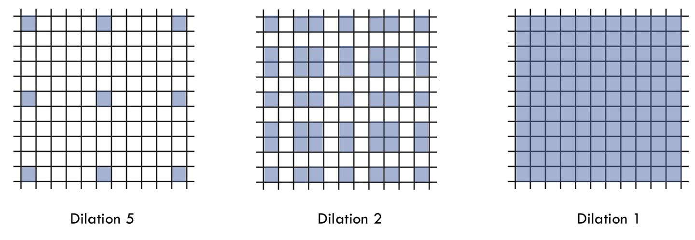

而这样的锯齿状本身的性质就比较好的来同时满足小物体大物体的分割要求（小 dilation rate 来关心近距离信息，大 dilation rate 来关心远距离信息）。

这样我们的卷积依然是连续的也就依然能满足 VGG 组观察的结论，大卷积是由小卷积的 regularisation 的叠加。

以下的对比实验可以明显看出，一个良好设计的 dilated convolution 网络能够有效避免 gridding effect.

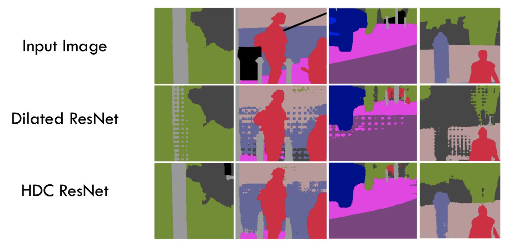

## 数据增强

数据增强主要指在计算机视觉领域中对图像进行数据增强，从而弥补训练图像数据集不足，达到对训练数据扩充的目的。

数据增强是一种数据扩充方法，可分为同类增强（如：翻转、旋转、缩放、移位、模糊等）和混类增强（如 mixup）两种方式。

1. 单一样本数组增强
2. 多样本数据增强

#### 数据不平衡的解决方法

- 对较多类别进行欠采样 (under-sampling)，舍弃一部分数据，使其与较少类别的数据相当。
  - 缺点：浪费数据，丢失重要信息
- 对较少类别进行过采样 (over-sampling)，生成一部分数据，使其与较多类别的数据相当。
  - 缺点：对大规模且高度不平衡的数据集，过采样可能会生成大量的少数类样本，这会增大训练集的样本数量，增大计算开销，减慢训练速度，并可能导致过拟合。
- 随机森立模型+合理阈值调整（threshold moving），将原本默认为 0.5 的阈值调整到较少类别/（较少类别+较多类别）即可
  - 这个方法核心思想是：通过组合/集成方法解决样本不均衡，它指的是在每次生成训练集时使用所有分类中的小样本量，同时从分类中的大样本量中随机抽取数据来与小样本量合并构成训练集，这样反复多次会得到很多训练集和训练模型。最后在应用时，使用组合方法（例如投票、加权投票等）产生分类预测结果。这种解决问题的思路类似于随机森林。在随机森林中，虽然每个小决策树的分类能力很弱，但是通过大量的“小树”组合形成的“森林”具有良好的模型预测能力。
  - 优点：集成学习降低过拟合风险，使用阈值调整规避和采样问题，同时选择合适的评估手段以防止偏见，准确率较高。
  - 缺点：计算量大。

### 1. 为什么需要做特征归一化、标准化？

- 使不同量纲的特征处于同一数值量级，减少方差大的特征的影响，使模型更准确。
- 加快学习算法的收敛速度。

**参考资料**:[归一化 （Normalization）、标准化 （Standardization）和中心化/零均值化 （Zero-centered）](https://www.jianshu.com/p/95a8f035c86c)，《百面机器学习》

### 2. 常用常用的归一化和标准化的方法有哪些？

- 线性归一化（min-max 标准化）

$$
x' = \frac{x-\min(x)}{\max(x)-\min(x)}
$$

其中 max 是样本数据的最大值，min 是样本数据的最小值。适用于数值比较集中的情况，可使用经验值常量来来代替 max，min。

- 标准差归一化（z-score 0 均值标准化）

$x'=(x-\mu) / \sigma$，其中 $\mu$ 为所有样本的均值，$\sigma$ 为所有样本的标准差，经过处理后符合标准正态分布，即均值为 0，标准差为 1。

- 非线性归一化

使用非线性函数 log、指数、正切等，如 $y = 1-e^{(-x)}$，在 $x\in [0, 6]$ 变化较明显，用在数据分化比较大的场景。

### 3. 介绍一下空洞卷积的原理和作用

空洞卷积 (Atrous Convolution) 也叫做膨胀卷积、扩张卷积，最初的提出是为了解决图像分割在用下采样（池化、卷积）增加感受野时带来的特征图缩小，后再上采样回去时造成的精度上的损失。空洞卷积通过引入了一个扩张率的超参数，该参数定义了卷积核处理数据时各值的间距。


可以在增加感受野的同时保持特征图的尺寸不变，从而代替下采样和上采样，通过调整扩张率得到不同的感受野不大小： 

a. 是普通的卷积过程 (dilation rate = 1), 卷积后的感受野为 3
b. 是 dilation rate = 2 的空洞卷积，卷积后的感受野为 5
c. 是 dilation rate = 3 的空洞卷积，卷积后的感受野为 8

可以说，普通卷积是空洞卷积的一种特殊情况 

**参考资料**: [吃透空洞卷积 (Dilated Convolutions)](https://zhuanlan.zhihu.com/p/113285797)、[『计算机视觉』空洞卷积](https://www.cnblogs.com/hellcat/p/9687624.html)

### 4. 怎么判断模型是否过拟合，有哪些防止过拟合的策略？

在构建模型的过程中，通常会划分训练集、测试集。当模型在训练集上精度很高，在测试集上精度很差时，模型过拟合；当模型在训练集和测试集上精度都很差时，模型欠拟合。

**预防过拟合策略：**

- 增加训练数据：获取更多数据，也可以使用图像增强、增样等；
- 使用合适的模型：适当减少网络的层数、降低网络参数量；
- Dropout：随机抑制网络中一部分神经元，使的每次训练都有一批神经元不参与模型训练；
- L1、L2 正则化：训练时限制权值的大小，增加惩罚机制，使得网络更稀疏；
- 数据清洗：去除问题数据、错误标签和噪声数据；
- 限制网络训练时间：在训练时将训练集和验证集损失分别输出，当训练集损失持续下降，而验证集损失不再下降时，网络就开始出现过拟合现象，此时就可以停止训练了；
- 在网络中使用 BN 层（Batch Normalization）也可以一定程度上防止过拟合。

**参考资料**：[N，LN，IN，GN 都是什么？不同归一化方法的比较](https://cloud.tencent.com/developer/article/1651655)、[深度学习中的五种归一化（BN、LN、IN、GN 和 SN）方法简介](https://blog.csdn.net/u013289254/article/details/99690730)、[层归一化，循环批归一化（2016）和批归一化 RNN（2015）有什么区别？](https://qastack.cn/datascience/12956/paper-whats-the-difference-between-layer-normalization-recurrent-batch-normal)

### 5. 除了 SGD 和 Adam 之外，你还知道哪些优化算法？

主要有三大类：

1. 基本梯度下降法，包括 GD，BGD，SGD；
2. 动量优化法，包括 Momentum，NAG 等；
3. 自适应学习率优化法，包括 Adam，AdaGrad，RMSProp 等。

**参考资料**: [从 SGD 到 NadaMax，十种优化算法原理及实现](https://mp.weixin.qq.com/s/L9jCK5rtyq3fJZEBpLvagg)

### 6. 阐述一下感受野的概念，并说一下在 CNN 中如何计算

- 感受野指的是卷积神经网络每一层输出的特征图上每个像素点映射回输入图像上的区域的大小，神经元感受野的范围越大表示其接触到的原始图像范围就越大，也就意味着它能学习更为全局，语义层次更高的特征信息，相反，范围越小则表示其所包含的特征越趋向局部和细节。因此感受野的范围可以用来大致判断每一层的抽象层次，并且我们可以很明显地知道网络越深，神经元的感受野越大。
- 卷积层的感受野大小与其之前层的卷积核尺寸和步长有关，与 padding 无关。

[计算 CNN 的感受野](https://mp.weixin.qq.com/s?__biz=MzI4ODY2NjYzMQ%3D%3D&chksm=ec3ba8eddb4c21fbb3083e5508b7370d8885661a775bd6c95368fb2638b1b22e92f179b94f54&idx=1&mid=2247486853&scene=21&sn=f98b7038ec4ac67be69537a3efb93206#wechat_redirect)

### 7. 训练神经网络有哪些调参技巧

[深度学习调参技巧合集](https://mp.weixin.qq.com/s/Ml9MrdbgxRZAnLYxIrev4Q)
[22 个神经网络训练技巧](https://mp.weixin.qq.com/s/lmh0J-to5V8jylPWeUymzQ)

### 8. 神经网路的深度和宽度分别指的是什么？

神经网络的深度决定了网络的表达能力，早期的 backbone 设计都是直接堆叠卷积层，它的深度指的是神经网络的层数；后来的 backbone 设计采用了更高效的 module（或 block）堆叠的方式，每个 module 是由多个卷积层组成，这时深度指的是 module 的个数。

神经网络的宽度决定了网络在某一层学习到的信息量，指的是卷积神经网络中最大的通道数，由卷积核数量最多的层决定。通常的结构设计中卷积核的数量随着层数越来越多的，直到最后一层 feature map 达到最大，这是因为越到深层，feature map 的分辨率越小，所包含的信息越高级，所以需要更多的卷积核来进行学习。通道越多效果越好，但带来的计算量也会大大增加，所以具体设定也是一个调参的过程，并且各层通道数会按照 8×的倍数来确定，这样有利于 GPU 的并行计算。

### 9. 上采样的原理和常用方式

在卷积神经网络中，由于输入图像通过卷积神经网络 (CNN) 提取特征后，输出的尺寸往往会变小，而有时我们需要将图像恢复到原来的尺寸以便进行进一步的计算（如图像的语义分割），这个使图像由小分辨率映射到大分辨率的操作，叫做上采样，它的实现一般有三种方式：

1. 插值，一般使用的是双线性插值，因为效果最好，虽然计算上比其他插值方式复杂，但是相对于卷积计算可以说不值一提，其他插值方式还有最近邻插值、三线性插值等；
2. 转置卷积又或是说反卷积，通过对输入 feature map 间隔填充 0，再进行标准的卷积计算，可以使得输出 feature map 的尺寸比输入更大；
3. Max Unpooling，在对称的 max pooling 位置记录最大值的索引位置，然后在 unpooling 阶段时将对应的值放置到原先最大值位置，其余位置补 0；

**参考资料**：[深度卷积网络中如何进行上采样？](https://www.cnblogs.com/jiangkejie/p/12904304.html)、[三种上采样方法 | Three up sampling methods](https://zhuanlan.zhihu.com/p/344354520)、[上采样（upsampling）](https://www.malaoshi.top/show_1EF52HM7gu6g.html)

### 10. 下采样的作用是什么？通常有哪些方式？

下采样层有两个作用，一是减少计算量，防止过拟合；二是增大感受野，使得后面的卷积核能够学到更加全局的信息。

下采样的方式主要有两种：

1. 采用 stride 为 2 的池化层，如 Max-pooling 和 Average-pooling，目前通常使用 Max-pooling，因为他计算简单而且能够更好的保留纹理特征；
2. 采用 stride 为 2 的卷积层，下采样的过程是一个信息损失的过程，而池化层是不可学习的，用 stride 为 2 的可学习卷积层来代替 pooling 可以得到更好的效果，当然同时也增加了一定的计算量。

**参考资料**：[CNN 详解（卷积层及下采样层）](https://blog.csdn.net/baidu_14831657/article/details/60570765)

### 11. 模型的参数量指的是什么？怎么计算？

参数量指的是网络中可学习变量的数量，包括卷积核的权重 weights，批归一化（BN）的缩放系数γ，偏移系数β，有些没有 BN 的层可能有偏置 bias，这些都是可学习的参数，即在模型训练开始前被赋予初值，在训练过程根据链式法则不断迭代更新，整个模型的参数量主要是由卷积核的权重 weights 的数量决定，参数量越大，则该结构对平台运行的内存要求越高。

**参数量的计算方式：**
- $K_h × K_w × C_{in} × C_{out}$ （Conv 卷积网络）
- $C_{in} × C_{out}$ （FC 全连接网络）

### 12. 模型的 FLOPs（计算量）指的是什么？怎么计算？

神经网络的前向推理过程基本上都是乘累加计算，所以它的计算量也是指的前向推理过程中乘加运算的次数，通常用 FLOPs 来表示，即 floating point operations（浮点运算数）。计算量越大，在同一平台上模型运行延时越长，尤其是在移动端/嵌入式这种资源受限的平台上想要达到实时性的要求就必须要求模型的计算量尽可能地低，但这个不是严格成正比关系，也跟具体算子的计算密集程度（即计算时间与 IO 时间占比）和该算子底层优化的程度有关。

**FLOPs 的计算方式：**
- Kh × Kw × Cin × Cout × H × W = params × H × W （Conv 卷积网络）
- Cin x Cout （FC 全连接网络）
- 计算量 = 输出的 feature map * 当前层 filter 即（H × W × Cout） × （K × K × Cin）

**参考资料**：[CNN 模型所需的计算力 flops 是什么？怎么计算？](https://zhuanlan.zhihu.com/p/137719986)、[pytorch: 计算网络模型的计算量 (FLOPs) 和参数量 (Params)](https://blog.csdn.net/Caesar6666/article/details/109842379)、[神经网络的计算量和参数量估计总结](https://mp.weixin.qq.com/s/RoyqxxAWE1zSxlL-wqau9A)

### 13. 有哪些经典的卷积类型？

[经典的卷积类型](https://blog.csdn.net/weixin_37737254/article/details/102920408)

### 14. 深度可分离卷积的概念和作用

深度可分离卷积将传统的卷积分两步进行，分别是 depthwise 和 pointwise。首先按照通道进行计算按位相乘的计算，深度可分离卷积中的卷积核都是单通道的，输出不能改变 feature map 的通道数，此时通道数不变；然后依然得到将第一步的结果，使用 1*1 的卷积核进行传统的卷积运算，此时通道数可以进行改变。

计算量的前后对比：
$K_h × K_w × C_{in} × C_{out} × H × W$ 变成了 $K_h × K_w × C_{in} × H × W + 1 × 1 × C_{in} × C_{out} × H × W$

### 15. 神经网络中 Addition / Concatenate 区别是什么？

Addition 和 Concatenate 分支操作统称为 shortcut，Addition 是在 ResNet 中提出，两个相同维度的 feature map 相同位置点的值直接相加，得到新的相同维度 feature map，这个操作可以融合之前的特征，增加信息的表达，

Concatenate 操作是在 Inception 中首次使用，被 DenseNet 发扬光大，和 addition 不同的是，它只要求两个 feature map 的 HW 相同，通道数可以不同，然后两个 feature map 在通道上直接拼接，得到一个更大的 feature map，它保留了一些原始的特征，增加了特征的数量，使得有效的信息流继续向后传递。

**参考资料**：[The difference and connection between contact and add operation (feature fusion)](https://www.programmersought.com/article/48464790207/)

### 16. 激活函数是什么？你知道哪些常用的激活函数？

激活函数（又叫激励函数，后面就全部统称为激活函数）是模型整个结构中的非线性扭曲力，神经网络的每层都会有一个激活函数。

常用的激活函数：Sigmoid 函数、tanh 函数、Relu 函数、Leaky ReLU 函数（PReLU）、ELU (Exponential Linear Units) 函数、MaxOut 函数

**参考资料**：[常用激活函数的比较](https://zhuanlan.zhihu.com/p/32610035)、[深度学习领域最常用的 10 个激活函数，一文详解数学原理及优缺点](https://www.jiqizhixin.com/articles/2021-02-24-7)、[26 种神经网络激活函数可视化](https://www.jiqizhixin.com/articles/2017-10-10-3)、[深度学习笔记——常用的激活（激励）函数](https://www.cnblogs.com/wj-1314/p/12015278.html)

### 17. 神经网络中 1*1 卷积有什么作用？

- 降维，减少计算量；在 ResNet 模块中，先通过 11 卷积对通道数进行降通道，再送入 33 的卷积中，能够有效的减少神经网络的参数量和计算量；
- 升维；用最少的参数拓宽网络通道，通常在轻量级的网络中会用到，经过深度可分离卷积后，使用 1*1 卷积核增加通道的数量，例如 mobilenet、shufflenet 等；
- 实现跨通道的交互和信息整合；增强通道层面上特征融合的信息，在 feature map 尺度不变的情况下，实现通道升维、降维操作其实就是通道间信息的线性组合变化，也就是通道的信息交互整合的过程；
- 1*1 卷积核可以在保持 feature map 尺度（不损失分辨率）不变的情况下，大幅增加非线性特性（利用后接的非线性激活函数）。

**参考资料**：[卷积神经网络中用 1*1 卷积有什么作用或者好处呢？](https://www.zhihu.com/question/56024942)、[深度学习——1×1 卷积核理解](https://www.cnblogs.com/czifan/p/9490565.html)

### 18. 随机梯度下降相比全局梯度下降好处是什么？

- 当处理大量数据时，比如 SSD 或者 faster-rcnn 等目标检测算法，每个样本都有大量候选框参与训练，这时使用随机梯度下降法能够加快梯度的计算；
- 每次只随机选取一个样本来更新模型参数，因此每次的学习是非常快速的，并且可以进行在线更新。

### 19. 如果在网络初始化时给网络赋予 0 的权重，这个网络能正常训练嘛？

不能，因为初始化权重是 0，每次传入的不同数据得到的结果是相同的。网络无法更新

### 20. 为什么要对网络进行初始化，有哪些初始化的方法？

权重初始化的目的是在深度神经网络中前向传递时，阻止网络层的激活函数输出爆炸（无穷大）或者消失（0）。如果网络层的输出爆炸或者消失，损失函数的梯度也会变得很大或者很小，无法有效后向传递，使得神经网络需要更长的时间才能收敛甚至无法收敛。

**初始化方法有：** Xavier 初始化、Kaiming 初始化、随机初始化

**参考资料**：[神经网络中的权重初始化一览：从基础到 Kaiming](https://zhuanlan.zhihu.com/p/62850258)、[深度学习中神经网络的几种权重初始化方法](https://blog.csdn.net/u012328159/article/details/80025785)、[神经网络参数初始化方法](https://blog.csdn.net/yyl424525/article/details/100823398)

### 21. 增大感受野的方法？

空洞卷积、池化操作、较大卷积核尺寸的卷积操作

### 22. 神经网络的正则化方法？过拟合的解决方法？

- 数据增强（镜像对称、随机裁剪、旋转图像、剪切图像、局部弯曲图像、色彩转换）
- early stopping（比较训练损失和验证损失曲线，验证损失最小即为最优迭代次数）
- L2 正则化（权重参数的平方和）
- L1 正则化（权重参数的绝对值之和）
- dropout 正则化（设置 keep_pro 参数随机让当前层神经元失活）

### 23. 梯度消失和梯度爆炸的原因是什么？

原因：激活函数的选择。

梯度消失：令 bias=0，则神经网络的输出结果等于各层权重参数的积再与输入数据集相乘，若参数值较小时，则权重参数呈指数级减小。
梯度爆炸：令 bias=0，则神经网络的输出结果等于各层权重参数的积再与输入数据集相乘，若参数值较大时，则权重参数呈指数级增长。

**参考资料**：[出现梯度消失与梯度爆炸的原因以及解决方案](https://www.cnblogs.com/XDU-Lakers/p/10553239.html)、[详解机器学习中的梯度消失、爆炸原因及其解决方法](https://blog.csdn.net/qq_25737169/article/details/78847691)

### 24. 深度学习为什么在计算机视觉领域这么好？

传统的计算机视觉方法需首先基于经验手动设计特征，然后使用分类器分类，这两个过程都是分开的。而深度学习里的卷积网络可实现对局部区域信息的提取，获得更高级的特征，当神经网络层数越多时，提取的特征会更抽象，将更有助于分类，同时神经网路将提取特征和分类融合在一个结构中。

### 25. 为什么神经网络常用 ReLU 作为激活函数？

- 在前向传播和反向传播过程中，ReLU 相比于 Sigmoid 等激活函数计算量小；
- 在反向传播过程中，Sigmoid 函数存在饱和区，若激活值进入饱和区，则其梯度更新值非常小，导致出现梯度消失的现象。而 ReLU 没有饱和区，可避免此问题；
- ReLU 可令部分神经元输出为 0，造成网络的稀疏性，减少前后层参数对当前层参数的影响，提升了模型的泛化性能。

### 26. 卷积层和全连接层的区别是什么？

- 卷积层是局部连接，所以提取的是局部信息；全连接层是全局连接，所以提取的是全局信息；
- 当卷积层的局部连接是全局连接时，全连接层是卷积层的特例；

### 27. 什么是正则化？L1 正则化和 L2 正则化有什么区别？

所谓的正则化，就是在原来 Loss Function 的基础上，加了一些正则化项，或者叫做模型复杂度惩罚项，正则化机器学习中一种常用的技术，其主要目的是控制模型复杂度，减小过拟合。

两者的区别：
- L1：它的优良性质是能产生稀疏性，导致 W 中许多项变成零。 稀疏的解除了计算量上的好处之外，更重要的是更具有“可解释性”。
- L2：使得模型的解偏向于范数较小的 W，通过限制 W 范数的大小实现了对模型空间的限制，从而在一定程度上避免了过拟合。不过岭回归并不具有产生稀疏解的能力，得到的系数仍然需要数据中的所有特征才能计算预测结果，从计算量上来说并没有得到改观。
- L1 范数更容易产生稀疏的权重，L2 范数更容易产生分散的权重

**参考资料**：[l1 正则与 l2 正则的特点是什么，各有什么优势？](https://www.zhihu.com/question/26485586)、[深入理解 L1、L2 正则化](https://www.cnblogs.com/zingp/p/10375691.html)

### 28. 常见的损失函数有哪些？你用过哪些？

平方损失（预测问题）、交叉熵（分类问题）、hinge 损失（SVM 支持向量机）、CART 回归树的残差损失

[总结：深度学习损失函数大全](https://mp.weixin.qq.com/s/jYvTvA_LZjJrDQ2q6Crg3w)

### 29. dropout 为什么能解决过拟合？

防止参数过分依赖训练数据，减少神经元之间复杂的共适应关系，增加参数对数据集的泛化能力。

### 30. 深度学习中的 batch 的大小对学习效果有何影响？

一般来说，在合理的范围之内，越大的 batch size 使下降方向越准确，震荡越小；batch size 如果过大，则可能会出现内存爆表和局部最优的情况。小的 bath size 引入的随机性更大，难以达到收敛，极少数情况下可能会效果变好。

**参考资料**：[深度学习中的 batch 的大小对学习效果有何影响？](https://www.zhihu.com/question/32673260)，[深度学习中 Batch size 对训练效果的影响](https://blog.csdn.net/xjp_xujiping/article/details/102235107)

### 31. PyTorch 和 TensorFlow 的特点分别是什么？

- TensorFlow 与 PyTorch 编程方式不同
PyTorch：命令式编程；TensorFlow：符号式编程
- 图的创建及调试不同
pytorch 图结构的创建是动态的，即图是运行时创建；更易调试 pytorch 代码，调试 pytorch 代码就像调试 python 代码一样，可以利用 pdp 在任何地方设置断点
- 灵活性、设备管理不同 

**参考资料**：[pytorch 和 tensorflow 的区别和选择](https://www.huaweicloud.com/articles/da8df2db34a0b4a101a8bfbd6fe04366.html)；[TensorFlow 与 PyTorch 编程方式不同](https://blog.csdn.net/wuzhuoxi7116/article/details/103706390)

tensorflow 图结构的创建是静态的，即图首先被"编译"，然后在运行；不易调试要么从会话请求检查变量，要么学习使用 tfdbg 调试器

### 32. Pytorch 多卡并行的时候怎么实现参数共享，通信梯度是指平均梯度，还是最大梯度，还是梯度总和？

**参考资料**：[Pytorch 分布式训练](https://zhuanlan.zhihu.com/p/76638962)；[深度学习框架分布式训练总结](https://blog.kkyan.cn/posts/2019/05/07/distributed-train.html)

### 33. 数据不平衡的解决方法

- 欠采样 - 随机删除观测数量足够多的类，使得两个类别间的相对比例是显著的。虽然这种方法使用起来非常简单，但很有可能被我们删除了的数据包含着预测类的重要信息。
- 过采样 - 对于不平衡的类别，我们使用拷贝现有样本的方法随机增加观测数量。理想情况下这种方法给了我们足够的样本数，但过采样可能导致过拟合训练数据。
- 合成采样（ SMOTE ）-该技术要求我们用合成方法得到不平衡类别的观测，该技术与现有的使用最近邻分类方法很类似。问题在于当一个类别的观测数量极度稀少时该怎么做。比如说，我们想用图片分类问题确定一个稀有物种，但我们可能只有一幅这个稀有物种的图片。
- 在 loss 方面，采用 focal loss 等 loss 进行控制不平衡样本。

### 34. ReLU 函数在 0 处不可导，为什么还能用？

反馈神经网络正常工作需要的条件就是每一个点提供一个方向，即导数；0 值不可微，本质上来说是因为这个地方可画多条切线，但我们需要的只是一条；由于这出现的 0 值的概率极低，任意选择一个子梯度就 OK 了，在 0 处的次微分集合是 [0，1]；即选择其中一个就 OK 了；一般默认是 0；

### 35. Pooling 层的作用以及如何进行反向传播

池化层没有可以训练的参数，因此在卷积神经网络的训练中，池化层只需要将误差传递到上一层，并不需要做梯度的计算。要追求一个原则，那就是梯度之和不变。

- average pooling: 前向传播是取某特征区域的平均值进行输出，这个区域的每一个神经元都是有参与前向传播了的，因此，在反向传播时，框架需要将梯度平均分配给每一个神经元再进行反向传播；


- max pooling: 前向传播是取某特征区域的最大值进行输出，这个区域仅有最大值神经元参与了前向传播，因此，在反向传播时，框架仅需要将该区域的梯度直接分配到最大值神经元即可，其他神经元的梯度被分配为 0 且是被舍弃不参与反向传播的，但如何确认最大值神经元，这个还得框架在进行前向传播时记录下最大值神经元的 Max ID 位置。


**参考资料**：[池化层（pooling）的反向传播是怎么实现的](https://blog.csdn.net/Jason_yyz/article/details/80003271)

### 36. 为什么 max pooling 要更常用？什么场景下 average pooling 比 max pooling 更合适？

- 作用：对输入的特征图进行压缩，一方面使特征图变小，简化网络计算复杂度；一方面进行特征压缩，提取主要特征。
- 通常来讲，max-pooling 的效果更好，虽然 max-pooling 和 average-pooling 都对数据做了下采样，但是 max-pooling 感觉更像是做了特征选择，选出了分类辨识度更好的特征，提供了非线性。 pooling 的主要作用一方面是去掉冗余信息，一方面要保留 feature map 的特征信息，在分类问题中，我们需要知道的是这张图像有什么 object，而不大关心这个 object 位置在哪，在这种情况下显然 max pooling 比 average pooling 更合适。在网络比较深的地方，特征已经稀疏了，从一块区域里选出最大的，比起这片区域的平均值来，更能把稀疏的特征传递下去。
- average-pooling 更强调对整体特征信息进行一层下采样，在减少参数维度的贡献上更大一点，更多的体现在信息的完整传递这个维度上，在一个很大很有代表性的模型中，比如说 DenseNet 中的模块之间的连接大多采用 average-pooling，在减少维度的同时，更有利信息传递到下一个模块进行特征提取。
- average-pooling 在全局平均池化操作中应用也比较广，在 ResNet 和 Inception 结构中最后一层都使用了平均池化。有的时候在模型接近分类器的末端使用全局平均池化还可以代替 Flatten 操作，使输入数据变成一位向量。

**参考资料**：[计算机视觉面试常见问题](https://blog.nowcoder.net/n/9c67c993bf9842a68aaa7622228c2299)

### 37. 为什么要反向传播？手推反向传播公式展示一下 

反向传播算法的 motivation 是期望通过在神经网络的训练过程中自适应的调整各神经元间的连接权值，以寻求最佳的输入输出间的映射函数，使得目标函数或损失函数达到最小，完成分类、回归等任务。 

手推反向传播公式：[BP（反向传播算法）公式推导及例题解析](https://zhuanlan.zhihu.com/p/32819991)

### 38. CV 中的卷积操作和数学上的严格定义的卷积的关系？
CNN 的卷积运算并非数学定义的卷积，CNN 中的运算是不需要翻转卷积核的。

### 39. 简述 CNN 分类网络的演变脉络及各自的贡献与特点

**参考答案**：[卷积神经网络发展历程](https://zhuanlan.zhihu.com/p/76275427)；[CNN 模型演变](https://zhuanlan.zhihu.com/p/108522266)；[一文详解卷积神经网络的演变历程！](https://cloud.tencent.com/developer/article/1065373)

### 42. 有什么数据增强的方式？

- 单样本几何变换：翻转，旋转，裁剪，缩放
- 单样本像素内容变换：噪声，模糊，颜色扰动
- 多样本插值 Mixup：图像和标签都进行线性插值 

**参考资料**：[计算机视觉中的数据增强](https://www.cnblogs.com/shuiyj/p/13185329.html)

### 43. 为什么在模型训练开始会有 warm up？

warm up, 在刚刚开始训练时以很小的学习率进行训练，使得网络熟悉数据，随着训练的进行学习率慢慢变大，到了一定程度，以设置的初始学习率进行训练，接着过了一些 inter 后，学习率再慢慢变小；学习率变化：上升——平稳——下降。

- 有助于减缓模型在初始阶段对 mini-batch 的提前过拟合现象，保持分布的平稳；
- 有助于保持模型深层的稳定性。

**参考资料**：[深度学习 warmup 策略](https://blog.csdn.net/comway_Li/article/details/105016725)；[神经网络中 warmup 策略为什么有效；有什么理论解释么？](https://www.zhihu.com/question/338066667)

### 44. VGG 使用 3\*3 卷积核的优势是什么？

2 个 3\*3 的卷积核串联和 5\*5 的卷积核有相同的感知野，前者拥有更少的参数。多个 3\*3 的卷积核比一个较大尺寸的卷积核有更多层的非线性函数，增加了非线性表达，使判决函数更具有判决性。

### 45. 什么是 Group Convolution

若卷积神将网络的上一层有 N 个卷积核，则对应的通道数也为 N。设群数目为 M, 在进行卷积操作的时候，将通道分成 M 份，每个 group 对应 N/M 个通道，然后每个 group 卷积完成后输出叠在一起，作为当前层的输出通道。

### 46. 训练过程中，若一个模型不收敛，那么是否说明这个模型无效？导致模型不收敛的原因有哪些？

并不能说明这个模型无效，导致模型不收敛的原因可能有数据分类的标注不准确，样本的信息量太大导致模型不足以 fit 整个样本空间。学习率设置的太大容易产生震荡，太小会导致不收敛。可能复杂的分类任务用了简单的模型。数据没有进行归一化的操作。

### 47. Relu 比 Sigmoid 的效果好在哪里？

Sigmoid 的导数只有在 0 的附近时有较好的激活性，而在正负饱和区域的梯度趋向于 0, 从而产生梯度弥散的现象，而 relu 在大于 0 的部分梯度为常数，所以不会有梯度弥散现象。Relu 的导数计算的更快。Relu 在负半区的导数为 0, 所以神经元激活值为负时，梯度为 0, 此神经元不参与训练，具有稀疏性。

### 48. Batch Normalization 的作用

神经网络在训练的时候随着网络层数的加深，激活函数的输入值的整体分布逐渐往激活函数的取值区间上下限靠近，从而导致在反向传播时低层的神经网络的梯度消失。而 Batch Normalization 的作用是通过规范化的手段，将越来越偏的分布拉回到标准化的分布，使得激活函数的输入值落在激活函数对输入比较敏感的区域，从而使梯度变大，加快学习收敛速度，避免梯度消失的问题。

### 49. GAN 网络的思想

GAN 用一个生成模型和一个判别模型，判别模型用于判断给定的图片是不是真实的图片，生成模型自己生成一张图片和想要的图片很像，开始时两个模型都没有训练，然后两个模型一起进行对抗训练，生成模型产生图片去欺骗判别模型，判别模型去判别真假，最终两个模型在训练过程中，能力越来越强最终达到稳态。

### 50. Attention 机制的作用

减少处理高维输入数据的计算负担，结构化的选取输入的子集，从而降低数据的维度。让系统更加容易的找到输入的数据中与当前输出信息相关的有用信息，从而提高输出的质量。帮助类似于 decoder 这样的模型框架更好的学到多种内容模态之间的相互关系。
