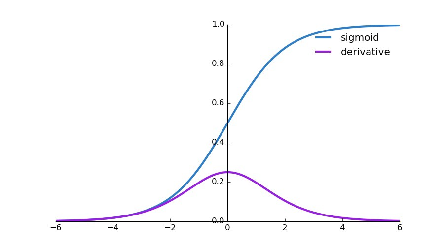
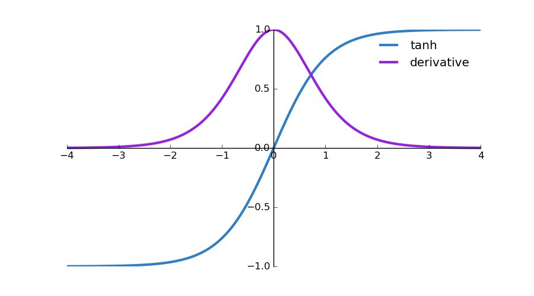
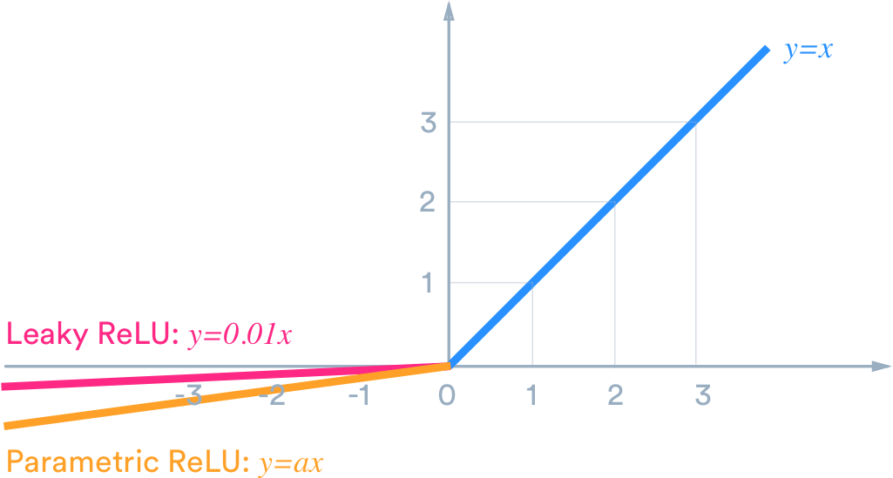

# 激活函数

1. 让多层感知机成为真正的多层，否则退化为单层网络
2. 引入非线性，使网络可以逼近任意非线性函数（万能逼近定理，universal approximator）

激活函数需要具备以下几点性质：

1. 连续并可导（允许少数点上不可导），便于利用数值优化的方法来学习网络参数
2. 单调性：保证梯度方向相对稳定
3. 激活函数及其导函数要尽可能的简单，有利于提高网络计算效率
4. 激活函数的导函数的值域要在合适区间内，不能太大也不能太小，否则会影响训练的效率和稳定性
5. 非饱和性：激活函数饱和会造成梯度值接近 0，导致梯度消失使模型无法收敛。

## Sigmoid S 型

Sigmoid 激活函数具有“连续可微”，“单调性”，“输出值有限”等性质。通过查看导函数图像，Sigmoid 激活函数最大的问题就是两端饱和，造成梯度消失（解决办法：使用 ReLU 激活函数，BN 等），此外输出不以 0 中心（以 0 中心的好处是可以加快模型收敛）。

目前 Sigmoid 激活函数多使用在二分类问题（对于大于二分类问题，如果类别之间存在相互关系使用 Sigmoid，反之使用 Softmax），门控机制的判断等。

$$
\begin{aligned}
Sigmoid(x) = f(x) = \frac{1}{1+e^{-x}} \\
f^{\prime}(x)=\frac{e^{-x}}{(1+e^{-x})^2} = f(x) \times (1-f(x))
\end{aligned}
$$



## Tanh 双曲正切

tanh 激活函数输出区间 [-1,1]，输出值以 0 为中心，与 Sigmoid 激活函数相比具有更大的梯度值，再加上输出值以 0 为中心，模型收敛更快。不过它依然存在两端饱和，梯度消失问题还是存在，tanh 激活函数在 RNN 模型中应用较多。

$$
Tanh(x) = f(x) = \frac{e^x-e^{-x}}{e^x+e^{-x}} \\
f^{\prime}(x) = \frac{(e^x+e^{-x})^2 - (e^x-e^{-x})^2}{(e^x+e^{-x})^2} = \frac{4}{(e^x+e^{-x})^2} = 1-(f(x))^2
$$



## ReLU 线性修正单元

$$
ReLU(x) = \max(0, x) \\
f^{\prime}(x)= \begin{cases}1 & \text { if } x>0 \\ \text {undefined} & \text { if } x=0 \\ 0 & \text { if } x<0\end{cases}
$$



ReLU 与线性单元的区别是在其一半的定义域上输出为 0，这使得它易于优化和计算。ReLU 激活函数的梯度不仅大，而且一致，更重要的是它没有 Sigmoid，tanh 激活函数的饱和性，有效缓解了梯度消失问题。目前，ReLU 激活函数是神经网络隐藏层的首选。

但是，它最大的问题是当输入小于 0 时，输出值为 0，此时神经元将无法学习。

优点：

1. 当输入为正时，不存在梯度饱和问题。
2. ReLU 函数中只存在线性关系，因此它的计算速度比 Sigmoid 和 tanh 更快。

缺点：

1. 当输入为负时，ReLU 完全失效，在正向传播过程中，这不是问题。有些区域很敏感，有些则不敏感。但是在反向传播过程中，如果输入负数，则梯度将完全为零，sigmoid 函数和 tanh 函数也具有相同的问题；
2. ReLU 函数不是以 0 为中心的函数。

ReLU 激活函数在零点是否可导？

答：不可导，而 ReLU 左导数等于 0，右导数等于 1，因此不可导间断点的求导按左导数来计算。也就是默认情况下（negative_slope=0），间断点处的导数认为是 0。

#### Leaky ReLU 

1. Leaky ReLU 通过把 x 的非常小的线性分量给予负输入（0.01x）来调整负值的零梯度（zero gradients）问题；
2. Leaky ReLU 激活函数一个缺点就是它有些近似线性，导致在复杂分类中效果不好。

## Softmax

$$
S_i = \hat{y}_i = \frac{e^i}{\sum_j e^j}
$$

### Softmax 损失函数的求导推导

通过最大似然和交叉熵都可以推出 Softmax 的损失函数为：

$$
L = -\sum\limits_{i=1}^m y_i \log(\hat y_i)
$$

其中，

$$
\hat y_i = \frac{e^{z_i}}{\sum\limits_{j=1}^ne^{z_j}}
$$

$$
z_i=\theta_i^\top\cdot x
$$

这里只求到 $\frac{\partial L}{\partial z_i}$。

需要注意的是，虽然 $L$ 是一个求和，但因为 $y_i$ 只有一个为 1，所以其实只有一项不为 0，在求导数时要牢记这一点。为了把多种情况综合起来写成一个表达式结果搞得后面的求导特别不好理解。

第一步，求 $\frac{\partial L}{\partial \hat y_i}$，假如 $y_k = 1$ 那么就只有 $\frac{\partial L}{\partial \hat y_k}$ 不为 0，其他所有 $\frac{\partial L}{\partial \hat y_i}$ 都等于 0，所以只需要求 $\frac{\partial L}{\partial \hat y_k}$：

$$
\frac{\partial L}{\partial \hat y_k}=-\frac{1}{\hat y_k}
$$

第二步，求 $\frac{\partial \hat y_k}{\partial z_i}$，这里要分两种情况：

1. $i=k$ 时，其实就是求 $\frac{\partial \hat y_k}{\partial z_k}$ 

此时有：

$$
\frac{\partial \hat y_k}{\partial z_k} = \frac{e^{z_k}\sum\limits_{j=1}^n e^{z_j}-(e^{z_k})^2}{(\sum\limits_{j=1}^n e^{z_j})^2} = \hat y_k -(\hat y_k)^2 
$$

2. $i\neq k$ 时：

$$
\frac{\partial \hat y_k}{\partial z_i} = - \frac{e^{z_k}e^{z_i}}{(\sum\limits_{j=1}^n e^{z_j})^2} = -\hat y_k \hat y_i 
$$


第三步，求 $\frac{\partial L}{\partial z_i}$，根据链式法则把第一步第二步的结果乘起来，由于第二步有两种情况，所以也要分两种情况：

1. $y_k =1$ 的情况：

$$
\frac{\partial L}{\partial \hat y_k}\frac{\partial \hat y_k}{\partial z_i}=-\frac{1}{\hat y_k}(-\hat y_k -(\hat y_k)^2) = -1 + \hat y_k
$$

2. 其他的 $y_i=0$ 的情况：

$$
\frac{\partial L}{\partial \hat y_k}\frac{\partial \hat y_k}{\partial z_i}=-\frac{1}{\hat y_k}(-\hat y_k \hat y_i) = \hat y_i
$$

这两个式子综合起来可以写成：

$$
\frac{\partial L}{\partial z_k} = - y_i + \hat y _i
$$

可见如果 $y_k =1$ 的时候，就是第一个式子，$y_i=0$ 的时候，就是第二个式子。

## Swish 

结合了 Sigmoid 函数和线性函数特性，由 Google 团队在 2017 年提出，其数学表达式为：

$$
\text{Swish}(x) = x \cdot \sigma(\beta x)
$$

其中，$\sigma$ 是 Sigmoid 激活函数（$\sigma(x) = \frac{1}{1 + e^{-x}}$），$\beta$ 是一个可学习的参数（或设为常数）。
特点：

- 自门控机制：通过 Sigmoid 函数对输入x进行 “门控”，动态调节信息流，类似 LSTM 的门控逻辑，但仅需单个标量输入。
- 平滑性：函数曲线连续且可微，避免了 ReLU 在 x<0 时梯度为 0 的 “神经元死亡” 问题。
- 灵活性：$\beta$ 值可调节函数形状，当 $\beta$ 趋近于无穷大时，Swish 近似于 ReLU；当 $\beta=1$ 时，也被称为 SiLU（Sigmoid Linear Unit），广泛用于现代大模型（如 LLaMA 系列）的 FFN 层。

## Transformer FFN 激活函数

GLU Variants Improve Transformer 论文提出使用 GLU 的变种（将 GLU 中原始的 Sigmoid 激活函数替换为其他的激活函数）来改进 Transformer 的 FFN 层，并列举了替换为 ReLU，GELU 和 SwiGLU 的三种变体。命名上将激活函数的缩写加在 GLU 前面作为前缀。论文用这种 GLU 变体替换 FFN 中的第一层全连接和激活函数，并且去除了 GLU 中偏置项 bias。

$$
\text{GLU}(x, W, V, b, c) = (xW + b) \otimes \sigma(xV + c)
$$

（其中 $\otimes$ 表示逐元素乘法，$\sigma$ 为 sigmoid 激活函数，W、V 为权重矩阵，b、c 为偏置项）

GLU 通过两个并行的线性变换处理输入 x：一个分支生成候选特征（xW + b），另一个分支通过 sigmoid 生成 “门控信号”（$\sigma(xV + c)$），门控信号像开关一样调节候选特征的信息流（值越接近 1，对应位置信息通过越多；越接近 0，信息被抑制）。

### 激活

$$
\begin{aligned} 
\text{FFN}_{\text{GLU}}\left(x, W, V, W_2\right) & =(\sigma(x W) \otimes x V) W_2 \\ 
\text{FFN}_{\text{Bilinear}}\left(x, W, V, W_2\right) & =(x W \otimes x V) W_2 \\ 
\text{FFN}_{\text{ReGLU}}\left(x, W, V, W_2\right) & =(\max (0, x W) \otimes x V) W_2 \\ 
\text{FFN}_{\text{GEGLU}}\left(x, W, V, W_2\right) & =(\text{GELU}(x W) \otimes x V) W_2 \\ 
\text{FFN}_{\text{SwiGLU}}\left(x, W, V, W_2\right) & =\left(\text{Swish}_1(x W) \otimes x V\right) W_2\end{aligned}
$$

### 基础

$$
\begin{aligned}
\text{ReGLU}(x, W, V, b, c) & = \max (0, x W+b) \otimes(x V+c) \\ 
\text{GEGLU}(x, W, V, b, c) & = \text{GELU}(x W+b) \otimes(x V+c) \\ 
\text{SwiGLU}(x, W, V, b, c, \beta) & = \text{Swish}_\beta(x W+b) \otimes(x V+c)
\end{aligned}
$$

### 激活函数

$$
\begin{aligned}
\text{ReLU}(\mathbf{x}) & = \max (\mathbf{x}, \mathbf{0}) \\ 
\text{GeLU}(\mathbf{x}) & = 0.5 \mathbf{x} \otimes[1+\text{erf}(\mathbf{x} / \sqrt{2})], \quad \text{erf}(x)=\frac{2}{\sqrt{\pi}} \int_0^x e^{-t^2} d t \\ 
\text{Swish}(\mathbf{x}) & = \mathbf{x} \otimes \text{sigmoid}(\mathbf{x}) \\ 
\text{SwiGLU}\left(\mathbf{x}_1, \mathbf{x}_2\right) & = \text{Swish}\left(\mathbf{x}_1\right) \otimes \mathbf{x}_2 \\ 
\text{GeGLU}\left(\mathbf{x}_1, \mathbf{x}_2\right) & = \text{GeLU}\left(\mathbf{x}_1\right) \otimes \mathbf{x}_2
\end{aligned}
$$

误差函数（Error Function，简称erf）是一个常见的数学函数，在概率论、统计学和机器学习等领域有广泛应用。

$$
\text{erf}(x) = \frac{2}{\sqrt{\pi}} \int_{0}^{x} e^{-t^2} dt
$$

简单来说，它表示高斯分布（正态分布）概率密度函数从 0 到 $x$ 的积分的 2 倍，描述了随机变量落在区间 $[-x, x]$ 内的概率相关特性。

误差函数的图像是一条过原点的 S 型曲线，值域为 $(-1, 1)$，具有奇函数性质（$\text{erf}(-x) = -\text{erf}(x)$），当 $x$ 趋近于正无穷时，$\text{erf}(x)$ 趋近于1；当 $x$ 趋近于负无穷时，趋近于-1。

```python
class FeedForward(nn.Module):
    def __init__(self, dim: int, hidden_dim: int, multiple_of: int, dropout: float):
        super().__init__()
        # 由于引入了更多的权重矩阵，通常会对隐藏层的大小做一个缩放，从而保证整体的参数量不变
        hidden_dim = multiple_of * ((2 * hidden_dim // 3 + multiple_of - 1) // multiple_of)
        self.w1 = nn.Linear(dim, hidden_dim)
        self.w2 = nn.Linear(hidden_dim, dim)
        self.w3 = nn.Linear(dim, hidden_dim)
        self.dropout = nn.Dropout(dropout)

    def forward(self, x: torch.Tensor) -> torch.Tensor:
        return self.dropout(self.w2(F.silu(self.w1(x)) * self.w3(x)))
```

SiLU 就是 beta 为 1 时的 Swish 激活函数。