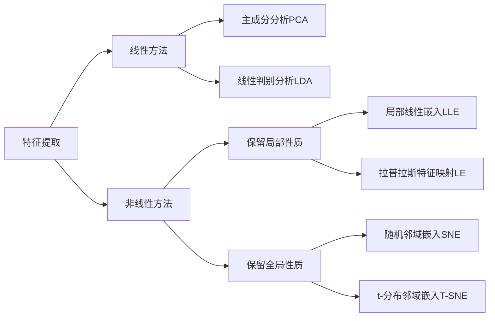

# 特征工程

## 一、数据预处理

### 缺失值处理

#### 缺失值删除（dropna）

#### 缺失值填充（fillna）

- 用固定值填充：`data['example'] = data['example'].fillna('0')`
- 用均值填充：`data['example'] = data['example'].fillna(data['example'].mean()))`
- 用众数填充：`data['example'] = data['example'].fillna(data['example'].mode()))`
- 用上下数据进行填充：`data['example'] = data['example'].fillna(method=pad)` ，pad/ffill：用前一个非缺失值去填充该缺失值；backfill/bfill：用下一个非缺失值填充
- 用插值法填充：`data['example'] = data['example'].interpolate()`
- 用 KNN 进行填充
- 用 random forest 进行填充

```python
from sklearn.ensemble import RandomForestRegressor

# 取出不为空的全部样本进行训练
know = dataset[dataset['example'].notnull()]

know_x2 = know.copy()
know_y2 = know.copy()

know_x2 = know_x2.drop(['example'], axis=1, inplace=True)
know_y2 = know['example']

# 取出灰度分为空的样本用于填充空值
unknow = dataset[dataset['example'].isnull()]

# RandomForestRegressor
rfr = RandomForestRegressor(random_state=0, n_estimators=200, n_jobs=-1)
rfr.fit(know_x2, know_y2)

unknow_x2 = unknow.copy()
unknow_x2 = unknow_x2.drop(['example'], axis=1, inplace=True)
unknow_y2 = rfr.predict(unknow_x2)
unknow_y2 = pd.DataFrame(unknow_y2, columns=['example'])
```

- 缺失值作为数据的一部分不填充：LightGBM 和 XGBoost 都能将 NaN 作为数据的一部分进行学习，不需要处理缺失值。

### 异常值处理

#### 特征异常平滑

- 基于统计的异常点检测算法：如**极差、四分位数间距、均差、标准差**等，这种方法适合于挖掘单变量的数值型数据。
- 基于距离的异常点检测算法：主要通过距离方法来检测异常点，将数据集中与大多数点之间距离大于某个阈值的点视为异常点，主要使用的距离度量方法有绝对距离（曼哈顿距离）、欧氏距离和马氏距离等方法。
- 基于密度的异常点检测算法：考察当前点周围密度，可以发现局部异常点。

## 二、特征转换

### 连续型特征

#### 1. 标准化

均值方差法（Z-score 标准化、StandardScaler 标准化）

```python
from sklearn.preprocessing import StandardScaler
from sklearn.datasets import load_iris
StandardScaler().fit_transform(load_iris().data)
```

```python
from sklearn import preprocessing
data = preprocessing.scale(values) # 注意，这里的 values 是 array
```

#### 2. 归一化

- 最大最小归一化（最常用）
- 对数函数转换（log）
- 反余切转换

```python
from sklearn.preprocessing import Normalizer
Normalizer().fit_transform(data)
```

#### 3. 区间缩放法

MinMaxScaler

```python
from sklearn.preprocessing import MinMaxScaler
MinMaxScaler().fit_transform(data)
```

#### 4. 二值化（定量特征）

将数值型数据输出为布尔类型

```python
from sklearn.preprocessing import Binarizer
Binarizer(threshold=3).fit_transform(data)
```

#### 5. Box-Cox 变换

一种广义幂变换方法，用于处理连续的响应变量不满足正态分布的情况。可以明显地改善数据的正态性、对称性和方差齐性。

- 引入一个参数（通常记为 $\lambda$），通过数据本身估计该参数，从而确定应采取的数据变换形式。
- 可以明显地改善数据的正态性、对称性和方差相等性。
- 对许多实际数据都是行之有效的。

变换公式：

- 假设原始数据为 $y$，且要求取值为正（若取值为负则需要对原始数据加上一个常数使其为正）。

- Box-Cox 变换一般形式为：
  $$
  y_{transformed}=\frac{y^{\lambda}−1}{\lambda} 当 \lambda \neq 0 \\
  y_{transformed}=ln(y) 当 \lambda=0
  $$

确定 $\lambda$ 值：通过求解 $\lambda$ 值即可确定具体的变换方式，$\lambda$ 值的估计方法可采用最大似然估计。

#### 6. 离散化分箱处理

例如某个特征的取值范围为 [0，10]，可以将其划分为 10 段，[0,1), [1,2),⋯, [9,10) 

- 离散特征的增加和减少都很容易，易于模型的快速迭代；
- 稀疏向量内积乘法运算速度快，计算结果方便存储，容易扩展；
- 离散化后的特征对异常数据有很强的鲁棒性，模型更稳定；
- 离散化后可以进行特征交叉，由 M+N 个变量变为 M*N 个变量，进一步引入非线性提升表达能力；
- 特征离散化以后，起到了简化了逻辑回归模型的作用，降低了模型过拟合的风险

常用的离散化方法：

- 等距离离散（等距分组）：离散点选取等距点。
- 等样本点离散（等深分组）：选取的离散点保证落在每段里的样本点数量大致相同。
- 决策树离散化（最优分组）：决策树离散化方法通常也是每次离散化一个连续特征，原理如下： 单独用此特征和目标值 y。训练一个决策树模型，然后把训练获得的模型内的特征分割点作为离散化的离散点。 
- 最优分组除决策树方法以外，还可以使用卡方分箱的方法，这种方法在评分卡开发中比较常见。

### 离散型特征

#### 1. 数值化处理

将类别属性转换成一个标量

#### 2. 哑编码

- 独热编码（one-hot）
- 顺序性哑变量

是将一个变量的 k 个值生成 k 个哑变量，但同时保护了特征的顺序关系。一般的表达方式如下：

bad: (1, 0, 0), normal: (1, 1, 0), good: (1, 1, 1)

显然 bad < normal < good，很巧妙地利用递进表达了值之间的顺序关系。

#### 3. 时间序列处理

时间戳处理

## 三、特征选择

作用：

- 简化模型，增加模型的可解释性
- 缩短训练时间
- 避免维度灾难
- 改善模型通用性、降低过拟合

方法：

- Filter：过滤法，按照发散性或者相关性对各个特征进行评分，设定阈值或者待选择阈值的个数，选择特征。
- Wrapper：包装法，根据目标函数（通常是预测效果评分），每次选择若干特征，或者排除若干特征。
- Embedded：嵌入法，先使用某些机器学习的算法和模型进行训练，得到各个特征的权值系数，根据系数从大到小选择特征。类似于Filter方法，但是是通过训练来确定特征的优劣。

### 过滤式 Filter

思想：自变量和目标变量之间的关联。

过滤式特征选择的评价标准从数据集本身的内在性质获得，与特定的学习算法无关，因此具有较好的通用性。通常选择和类别相关度大的特征或者特征子集。

过滤式特征选择的评价标准分为四种：距离度量、信息度量、关联度度量以及一致性度量。 

优点：算法的通用性强；省去了分类器的训练步骤，算法复杂性低，因而适用于大规模数据集；可以快速去除大量不相关的特征，作为特征的预筛选器非常合适。 

一般不会在数据集上进行迭代计算，且是分类器无关的，相比于训练分类器要快。评价数据中属性的本身的性质，而不是属性与特定分类器的关联关系（适合程度），所以得到的结果更具有一般性，而且对于很多分类器都能表现“良好”。

缺点：由于算法的评价标准独立于特定的学习算法，所选的特征子集在分类准确率方面通常低于 Wrapper 方法。倾向于选择全部最优的特征子集，导致决定停止的条件决定权交给了用户，具有较强的主观性。

#### 方差选择法

计算各个特征的方差，选择方差大于阈值的特征（Analysis of Variance: ANOVA，方差分析，通过分析研究不同来源的变异对总变异的贡献大小，从而确定可控因素对研究结果影响力的大小）。

```python
from sklearn.feature_selection import VarianceThreshold
VarianceThreshold(threshold=3).fit_transform(iris.data)
```

#### 相关系数法

计算各个特征对目标值的相关系数以及相关系数的 P 值。

```python
from sklearn.feature_selection import SelectKBest
from scipy.stats import pearsonr
# 选择 K 个最好的特征，返回选择特征后的数据
# 第一个参数为计算评估特征是否好的函数，该函数输入特征矩阵和目标向量，输出二元组（评分，P 值）的数组，数组第 i 项为第 i 个特征的评分和 P 值。在此定义为计算相关系数
# 参数 k 为选择的特征个数
SelectKBest(lambda X, Y: array(map(lambda x: pearsonr(x, Y), X.T)).T, k=2).fit_transform(iris.data, iris.target)
```

- Pearson 积差相关系数

$$
\rho_{X,Y} = \frac{cov(X,Y)}{\sigma_X\sigma_Y}=\frac{\sum_i(x_i-\bar{x})(y_i-\bar{y})}{\sqrt{\sum_i(x_i-\bar{x})^2\sum_i(y_i-\bar{y})^2}}
$$

- Spearman 秩相关系数

Spearman 秩相关系数是一个非参数性质（与分布无关）的秩统计参数，用来度量两个连续型变量之间单调关系强弱，取值范围也是 [−1,1]。在没有重复数据的情况下，如果一个变量是另外一个变量的严格单调函数，则 Spearman 秩相关系数就是 1 或 −1，称变量完全 Spearman 秩相关。

这里的秩相关 (Rank Correlation)，又称等级相关，是将两变量的样本值按数据的大小顺序排列位次，以各要素样本值的位次代替实际数据而求得的一种统计量。排序不论从大到小还是从小到大排都无所谓，只要保证大家排序的标准一致即可。

$$
\rho_s=1-\frac{6\sum{d_i^2}}{n(n^2-1)}
$$

其中，$n$ 表示数据点的个数；$d_i$ 表示数据点 $(x_i,y_i)$ 的秩次 $(r_{x_i},r_{y_i})$ 之差：$d_i=r_{x_i}-r_{y_i}$。

如果某个变量有重复数据，则计算变量之间的 Spearman 相关系数就是计算变量数据秩次之间的 Pearson 相关系数

$$
\rho_s=\rho_{r_x,r_y}=\frac{\text{cov}(r_x,r_y)}{\sigma_{r_x}\sigma_{r_y}}
$$

其中，$r_x$ 表示变量 $x$ 转换后的秩次。从这个定义可以看出来，Spearman 相关系数实际上就是对数据做了秩次变换后的 Pearson 相关系数。

```python
from scipy.stats import spearmanr
```

#### 互信息法

- 互信息法是用来捕捉每个特征与标签之间的任意关系（包括线性和非线性关系）的过滤方法，feature 和 target 关系越紧密，互信息越大。
  - 说“互信息”的时候，两个随机变量的地位是相同的；说“信息增益”的时候，是把一个变量看成减小另一个变量不确定度的手段。但其实二者的数值是相等的。 “互信息”或者“信息增益”经常作为决策树中选择特征的标准，两种称呼都很常见。 `Gain=H(X)-H(X/Y)`

$$
I(X ; Y)=\sum_{x \in X} \sum_{y \in Y} p(x, y) \log \frac{p(x, y)}{p(x) p(y)}
$$

```python
from sklearn.feature_selection import SelectKBest
from minepy import MINE
#由于 MINE 的设计不是函数式的，定义 mic 方法将其为函数式的，返回一个二元组，二元组的第 2 项设置成固定的 P 值 0.5
def mic(x, y):
    m = MINE()
    m.compute_score(x, y)
    return (m.mic(), 0.5)
#选择 K 个最好的特征，返回特征选择后的数据
SelectKBest(lambda X, Y: array(map(lambda x:mic(x, Y), X.T)).T, k=2).fit_transform(iris.data, iris.target)
```

```python
from sklearn.feature_selection import SelectKBest
from minepy import MINE

def mic_func(X, y):
    mic_scores = []
    for i in range(X.shape[1]):
        mine = MINE()
        mine.compute_score(X[:, i], y)
        mic_scores.append(mine.mic())
    return mic_scores

# 使用 SelectKBest 结合 MIC 方法选择特征
selector = SelectKBest(score_func=mic_func, k=2)
selected_features = selector.fit_transform(X, y)
```

#### 卡方检验（Chi-Square）

统计样本的实际观测值与理论推断值之间的偏离程度，实际观测值与理论推断值之间的偏离程度就决定卡方值的大小，卡方值越大，越不符合；卡方值越小，偏差越小，越趋于符合。

优点： 快速， 只需要基础统计知识。

缺点：特征之间的组合效应难以挖掘。

经典的卡方检验是检验定性自变量对定性因变量的相关性。假设自变量有 $N$ 种取值，因变量有 $M$ 种取值，考虑自变量等于 $i$ 且因变量等于 $j$​ 的样本频数的观察值与期望的差距。

$$
\chi^{2}=\Sigma\frac{\left( f_{o} -f_{e}\right)^{2}}{f_{e}}
$$

O 代表 observation，即实际频数；E 代表 Expectation，即期望频数。

```python
from sklearn.feature_selection import SelectKBest, chi2
SelectKBest(chi2, k=2).fit_transform(iris.data, iris.target)
```

### 封装式 Wrapper

思想：通过目标函数（AUC/MSE）来决定是否加入一个变量。

封装式特征选择是利用学习算法的性能评价特征子集的优劣。对于一个待评价的特征子集，Wrapper 方法需要训练一个分类器，根据分类器的性能对该特征子集进行评价。用以评价特征的学习算法可以是决策树、神经网络、贝叶斯分类器、近邻法、支持向量机等等。

优点：相对于 Filter 方法，Wrapper 方法找到的特征子集分类性能通常更好。由于特征子集是针对特定的分类器调准，能获得较好的准确率。同时泛化能力更好，有很多机制可以防止过拟合，例如在分类器中可以使用交叉验证等技术。 

缺点：Wrapper 方法选出的特征通用性不强，当改变学习算法时，需要针对该学习算法重新进行特征选择；由于每次对子集的评价都要进行分类器的训练和测试，所以算法计算复杂度很高，尤其对于大规模数据集来说，算法的执行时间很长。

#### 完全搜索（穷举）

递归消除特征法：使用一个基模型来进行多轮训练，每轮训练后，消除若干权值系数的特征，再基于新的特征集进行下一轮训练。使用 feature_selection 库的 RFE 类来选择特征。使用基模型（如 LR）在训练中进行迭代，选择不同特征构建单个特征的模型，通过模型的准确性为特征排序，借此来选择特征。

```python
from sklearn.feature_selection import RFE
from sklearn.linear_model import LogisticRegression
# 递归特征消除法，返回特征选择后的数据
# 参数 estimator 为基模型
# 参数 n_features_to_select 为选择的特征个数
RFE(estimator=LogisticRegression(), n_features_to_select=2).fit_transform(iris.data, iris.target)
```

#### 启发式搜索（贪心）

- 前向选择法：从 0 开始不断向模型添加能最大限度提升模型效果的特征数据用以训练，直到任何训练数据都无法提升模型表现。
- 后向剃除法：先用所有特征数据进行建模，再逐一丢弃贡献最低的特征来提升模型效果，直到模型效果收敛。优点： 直接面向算法优化， 不需要太多知识。缺点： 庞大的搜索空间，需要定义启发式策略。

#### 随机搜索（策略+好运气）

- GA
- SA

### 嵌入式 Embedded

思想：学习器自身自动选择特征。

在嵌入式特征选择中，特征选择算法本身作为组成部分嵌入到学习算法里。最典型的即决策树算法，如 ID3、C4.5 以及 CART 算法等，决策树算法在树增长过程的每个递归步都必须选择一个特征，将样本集划分成较小的子集，选择特征的依据通常是划分后子节点的纯度，划分后子节点越纯，则说明划分效果越好，可见决策树生成的过程也就是特征选择的过程。 

优点：效果最好，速度最快，模式单调，快速并且效果明显。但是需要精心设置参数设置。

#### 基于惩罚项

- L1: Lasso
- L2: Ridge
- Elastic Net

使用带惩罚项的基模型进行特征选择，如 LR 加入正则，在筛选出特征的同时也进行了降维。

L1 正则方法具有稀疏解的特性，因此天然具备特征选择的特性，但注意，L1 没有选到的特征不代表不重要，原因是两个具有高相关性的特征可能只保留了一个，如果要确定哪个特征重要应再通过 L2 正则方法交叉检验。

```python
from sklearn.feature_selection import SelectFromModel
from sklearn.linear_model import LogisticRegression
# 带 L1 惩罚项的逻辑回归作为基模型的特征选择
SelectFromModel(LogisticRegression(penalty="l1", C=0.1)).fit_transform(iris.data, iris.target)
```

L1 惩罚项降维的原理在于保留多个对目标值具有同等相关性的特征中的一个，所以没选到的特征不代表不重要。因此可结合 L2 惩罚项来优化：若一个特征在 L1 中的权值为 1，选择在 L2 中权值差别不大且在 L1 中权值为 0 的特征构成同类集合，将这一集合中的特征平分 L1 中的权值，故需要构建一个新的逻辑回归模型。

```python
from sklearn.linear_model import LogisticRegression

class LR(LogisticRegression):
    def __init__(self, threshold=0.01, dual=False, tol=1e-4, C=1.0, fit_intercept=True, intercept_scaling=1, class_weight=None, random_state=None, solver='liblinear', max_iter=100, multi_class='ovr', verbose=0, warm_start=False, n_jobs=1):

        # 权值相近的阈值
        self.threshold = threshold
        LogisticRegression.__init__(self, penalty='l1', dual=dual, tol=tol, C=C, fit_intercept=fit_intercept, intercept_scaling=intercept_scaling, class_weight=class_weight, random_state=random_state, solver=solver, max_iter=max_iter, multi_class=multi_class, verbose=verbose, warm_start=warm_start, n_jobs=n_jobs)

        # 使用同样的参数创建 L2 逻辑回归
        self.l2 = LogisticRegression(penalty='l2', dual=dual, tol=tol, C=C, fit_intercept=fit_intercept, intercept_scaling=intercept_scaling, class_weight=class_weight, random_state=random_state, solver=solver, max_iter=max_iter, multi_class=multi_class, verbose=verbose, warm_start=warm_start, n_jobs=n_jobs)

        def fit(self, X, y, sample_weight=None):
            # 训练 L1 逻辑回归
            super(LR, self).fit(X, y, sample_weight=sample_weight)
            self.coef_old_ = self.coef_.copy()

            # 训练 L2 逻辑回归
            self.l2.fit(X, y, sample_weight=sample_weight)

            cntOfRow, cntOfCol = self.coef_.shape
            # 权值系数矩阵的行数对应目标值的种类数目
            for i in range(cntOfRow):
                for j in range(cntOfCol):
                    coef = self.coef_[i][j]
                    # L1 逻辑回归的权值系数不为 0
                    if coef != 0:
                        idx = [j]
                        # 对应在 L2 逻辑回归中的权值系数
                        coef1 = self.l2.coef_[i][j]
                        for k in range(cntOfCol):
                            coef2 = self.l2.coef_[i][k]
                            # 在 L2 逻辑回归中，权值系数之差小于设定的阈值，且在 L1 中对应的权值为 0
                            if abs(coef1-coef2) < self.threshold and j != k and self.coef_[i][k] == 0:
                                idx.append(k)
                        # 计算这一类特征的权值系数均值
                        mean = coef / len(idx)
                        self.coef_[i][idx] = mean
            return self
```

```python
from sklearn.feature_selection import SelectFromModel
# 带 L1 和 L2 惩罚项的逻辑回归作为基模型的特征选择
# 参数 threshold 为权值系数之差的阈值
SelectFromModel(LR(threshold=0.5, C=0.1)).fit_transform(iris.data, iris.target)
```

#### 基于树模型

树模型中 GBDT 也可用来作为基模型进行特征选择。首先训练能够对特征打分的预选模型，RandomForest 和 Logistic Regression 等都能对模型的特征打分，通过打分获得相关性后再训练最终模型。

优点：快速， 并且面向算法。

缺点：需要调整结构和参数配置， 需要深入的知识和经验。

```python
from sklearn.feature_selection import SelectFromModel
from sklearn.ensemble import GradientBoostingClassifier
# GBDT 作为基模型的特征选择
SelectFromModel(GradientBoostingClassifier()).fit_transform(iris.data, iris.target)
```

#### 深度学习

深度学习具有自动学习特征的能力（这也是深度学习又叫 unsupervised feature learning 的原因），因此越来越多地使用深度学习进行特征选择，尤其是在计算机视觉领域。从深度学习模型中选择某一网络层的特征，就可以用来进行最终目标模型的训练。

## 四、特征提取

数据降维：

1. 避免维度灾难，导致算法失效，或者时间复杂度高
2. 避免高维数据中引入的噪声，防止过拟合
3. 压缩存储，可视化分析



### 主成分分析法

PCA: Principal Component Analysis

将 D 维的向量降为 M 维（0<M<D)，保留区分能力最强的 M 维特征（方差），同时这 M 维特征之间的相关性尽量小（协方差）。

```python
from sklearn.decomposition import PCA
# 主成分分析法，返回降维后的数据
# 参数 n_components 为主成分数目
PCA(n_components=2).fit_transform(iris.data)
```

### 线性判别分析法

LDA: Linear Discriminant Analysis

LDA 是有监督的降维，也就是说其数据集的每个样本是有类别输出的。PCA 是不考虑样本类别输出的无监督降维。

总结：投影后类内方差最小，类间方差最大。

```python
from sklearn.discriminant_analysis import LinearDiscriminantAnalysis
# 参数 n_components 为降维后的维数
lda = LinearDiscriminantAnalysis(n_components=2)
lda.fit_transform(load_iris().data, load_iris().target)
```

### 局部线性嵌入

LLE: Locally Linear Embedding

### 拉普拉斯特征映射

LE: Laplacian Eigenmap

算法思想：在高维空间中有关系（有边相连）的点，在降维后的低维空间中距离尽量小。

### 随机邻域嵌入

SNE: Stochastic Neighbor Embedding

算法思想：在高维空间相似的数据点，映射到低维空间也是相似的。

### t-分布邻域嵌入

T-SNE: T-Stochastic Neighbor Embedding

另外其他降维方法还有：

- 核主成分分析（KPCA）：带核函数的 PCA
- 迁移成分分析（TCA）：不同领域之间迁移学习降维

## 五、特征检验

特征重要性分析：

1. 基于线性模型的特征重要性：例如线性回归等模型可以通过计算每个特征的系数大小来衡量特征的重要性。
2. 基于树模型的特征重要性：例如随机森林、梯度提升树等模型可以通过计算每个特征在树模型中被使用的次数或者被用来进行分裂的重要性，来衡量特征的重要性。
3. 基于特征选择的特征重要性：例如方差分析（ANOVA）、互信息（Mutual Information）等方法可以通过分析特征与目标变量之间的关系来选择重要的特征。

4. 基于神经网络的特征重要性：例如通过计算神经网络中每个特征对输出的敏感度来衡量特征的重要性。

5. SHAP（SHapley Additive exPlanations）值：可以用来解释模型预测结果，评估每个特征对于预测结果的贡献程度。SHAP 值方法基于 Shapley 值的概念，是一种基于博弈论的特征重要性评估方法。SHAP 值方法可以为每个特征生成一个 SHAP 值，表示该特征对于某个样本的预测结果的影响程度。SHAP 值可以通过各种模型进行计算，包括线性模型、树模型、神经网络等等。SHAP 值方法的优点是能够考虑特征之间的交互作用，同时可以针对不同类型的模型进行解释。不过，SHAP值方法也存在一些局限性，例如计算复杂度较高，对于高维数据和复杂模型的解释可能存在困难等。

#### 单变量

1. 正态性检验
2. 显著性分析

#### 多变量

1. 一致性检
2. 多重共线性

