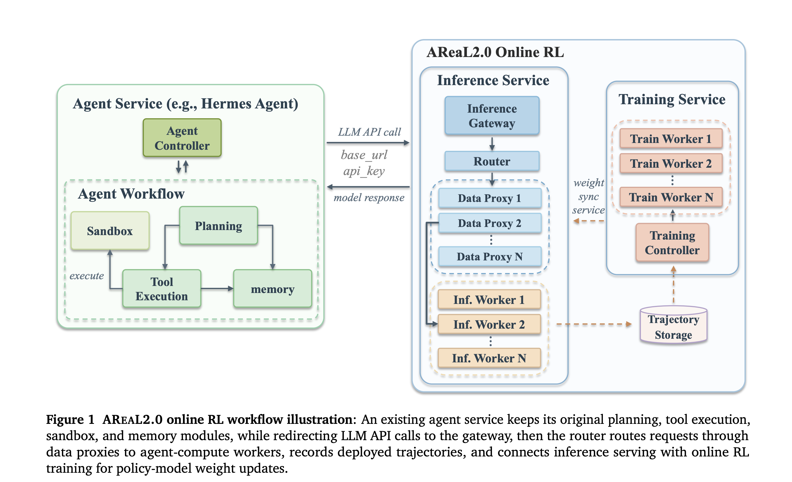

# Next-Generation Agentic Reinforcement Learning Systems Enable Self-Evolving Agents

> - 作者：Ran Yan, Wei Fu, Jiale Li, Shusheng Xu, Zhiyu Mei, Jiaxuan Gao, Jiarui Zhang 等（Ant Group、HKUST、Tsinghua University）
> - arXiv：2607.01120v2（cs.DC，2026-07-02）
> - 代码：https://github.com/areal-project/AReaL
> - 论文类型：**立场 / 愿景论文（position / vision paper）**，不是常规方法论文，正文没有实验对比，重点是提出系统级架构主张并给出一个受限的原型 AReaL2.0。

## 摘要

大语言模型（LLM）智能体正被迅速部署到生产环境中，包括编程助手、客服聊天机器人和科研助手，但在大规模企业级部署中，它们本质上仍然是静态的。LLM 权重、系统提示词、工具库以及上下文脚手架（in-context harness）在部署时被冻结，任何改进都需要一套由人工整理数据、离线微调、修改智能体范式再重新部署组成的手工循环。近期关于自演化智能体（self-evolving agents）的工作，例如面向个人用户的 OpenClaw，表明智能体能力的下一次飞跃将来自那些能够从自身经验中持续学习的智能体。在本文中，我们论证：这一面向企业级大规模智能体服务的自演化智能体部署愿景，其瓶颈并不在强化学习（RL）算法，而在智能体在线 RL 系统。具体而言，我们主张：当前的智能体 RL 系统以及周边的可观测性软件栈，在三个关键方面存在不足：（i）不存在一种标准化的**智能体轨迹数据协议（agent trajectory data protocol）**，能够在异构的智能体范式之间以步（step）粒度承载 RL 学习信号；（ii）不存在企业级的、全面的**数据代理（data proxy）**，能够把真实工作负载转化为受治理的学习底料；（iii）不存在一个**统一的智能体演化控制平面（unified agent evolution control plane）**，能够基于轨迹统计信息自动触发决策，判断何时更新策略模型权重、或通过相应 RL 算法演化上下文脚手架。我们主张，下一代智能体 RL 系统必须围绕这三根支柱进行协同设计，并勾勒出具体的架构承诺、案例研究和支撑论据来佐证我们的立场。我们进一步通过 AReaL2.0 实例化了我们愿景中一个受限的分支，展示现有 RL 基础设施如何被重新组织为面向智能体服务的在线 RL 循环，从已部署的在线智能体工作负载中实现策略 LLM 权重更新。

## 1. 核心论点：从离线后训练到在线自演化

### 1.1 部署方式与改进方式的错位

企业级部署的 LLM agent 在上线之后是**静态的**：LLM 权重、系统提示词、工具库以及上下文脚手架（in-context harness）在部署时被冻结，任何改进都要走"人工看 trace → 定义评测 → 改 prompt/微调 → 重新部署"的手工循环。这与 agent 每天产生海量交互经验的现实形成尖锐矛盾——**部署方式与改进方式脱节**（mismatch between how agents are deployed and how agents are improved）。

错位的深层原因是部署对象变了：部署对象不应再只是一个"把输入 token 序列映射为输出 token 序列"的 LLM，而应是一个嵌入在异构复杂业务环境中的**长时程 agent 策略**——读文件、调工具、检索文档、调 API、更新记忆、请求人工审批并完成复杂分析任务。而自演化 agent 已不再是假设（OpenClaw、OpenClaw-RL、Metaclaw 等已出现），agent 能力的下一跳将来自能从自身经验中持续学习的 agent。

### 1.2 核心主张：缺的是系统基底，不是算法

论文的核心主张：阻碍"自演化 agent"落地的**不是模型不够强、算法不够好，而是缺少一个企业级系统基底（enterprise-level system substrate）**，能把部署中的 agent 经验转化为受治理的、可信用归因的、可重放的学习材料。为此提出三大支柱（three pillars），并强调三者必须**协同设计**：

| 支柱 | 回答的问题 |
|---|---|
| **ATDP**（Agent Trajectory Data Protocol） | 该捕获什么数据 |
| **Agentic Data Proxy**（企业级数据代理） | 在异构企业环境中如何捕获这些数据 |
| **Agent Evolution Control Plane**（演化控制平面） | 何时、以何种方式触发演化 |

作者由此主张：自演化 agent RL 不应只被当作一个算法家族，而应被当作一门**系统学科（system discipline）**——如何捕获经验、把它转化为可信用分配（credit-assignable）的数据、选择演化机制、并恰当地部署由此产生的更新。

### 1.3 "自演化"的谨慎界定：有界闭环

这里对"自演化"有一个谨慎的界定：**不是无约束的递归自我修改，而是一个有边界的闭环**——用户交互轨迹可被观测、脱敏、验证、归因，然后转化为若干种受治理的更新之一。可选的更新类型有六种：记忆插入（memory insertion）、技能补丁（skill patch）、脚手架/harness 编辑（harness edit）、工具 schema 修改（tool-schema modification）、在线 RL 策略更新（on-policy RL update）、以及 no-op（不动）。

### 1.4 现有方法的痛点

- **个人助理式自演化智能体（OpenClaw）**：把助手重构为一个持久的、用户拥有的智能体，能跨收件箱、日历、航班、消息应用执行任务。但这与"跨多团队、多租户、多工作流、多合规边界的受治理企业学习底料"不是一回事。
- **已有的"可演化组件"机制各自为战**：Reflexion（把任务反馈转成语言反思存入记忆）、Memento-Skills（把技能做成一等可演化记忆产物）、context/harness edit、skill libraries、self-feedback。这些都证明了执行轨迹可以变成可复用指导，但它们更接近"个人助理式或算法特定的自我改进"，而非企业规模的受治理自演化服务。
- **现有 RL 系统（HybridFlow/verl、StreamRL、AsyncFlow、AReaL 一代）**：这些系统优化的是 RL 后训练的吞吐、异步执行、资源弹性等，但都是面向**离线后训练**的，不足以支撑"通过在线 RL 让智能体自演化"。
- **现有可观测性 / 日志栈**：普通智能体日志只记录 prompt、completion、工具调用、延迟、错误、token 用量，这些对调试有用，但对在线智能体 RL 而言"信息太不完整、不可复现、不安全"，无法充当自演化的底料。
- **现有标准化协议（MCP、A2A、ADP、D4RL、RLDS）**：MCP/A2A 解决的是工具发现与智能体互操作；ADP 提供了统一异构智能体轨迹的"中间语"以改善离线 SFT；D4RL/RLDS 是离线 RL 数据基础设施。但它们都没瞄准本文问题：面向部署的自演化智能体所需的、能保留步级因果上下文、延迟奖励、动作结果、脚手架与工具版本、治理元数据、回放边界、企业约束下学习资格的 RL 轨迹协议。

## 2. 方法设计：三根支柱串成的自演化闭环

整条闭环由三根支柱依次支撑：**捕获（ATDP）→ 治理采集（数据代理）→ 演化决策（控制平面）**。每一次干预都要经过"回放优先评估、离线回归测试、租户感知安全检查、版本化回滚"的晋升路径。

### 2.1 支柱一 · ATDP（Agent Trajectory Data Protocol）：该捕获什么数据

**要回答的问题**：应该捕获什么样的数据抽象来支撑学习？

现有 agent 日志（prompt、completion、工具调用、延迟、token 用量）够调试用，但**不够 RL 用**——信息不完整、不可复现、不安全。ATDP 把轨迹定义为类型化事件序列：

$$
\boldsymbol{\tau} = (\mathbf{e}_1,\, \mathbf{e}_2,\, \dots,\, \mathbf{e}_T)
$$

每个中间步骤定义为六元组：

$$
\mathbf{e}_t = \big\langle\, \mathbf{o}_t,\; \mathbf{h}_t,\; \mathbf{a}_t,\; \mathbf{y}_t,\; r_t,\; \mathbf{m}_t \,\big\rangle
$$

| 字段 | 含义 | 例子 |
|---|---|---|
| $\mathbf{o}_t$ | 可观测状态 | 工具输出、检索片段、用户消息、环境状态 |
| $\mathbf{h}_t$ | 隐藏内部状态 | 当前遵循的 plan、scratchpad、置信度、推理摘要 |
| $\mathbf{a}_t$ | 选择的动作 | 带类型化参数 schema 的工具调用、生成的消息、代码编辑、记忆更新 |
| $\mathbf{y}_t$ | 动作结果 | 工具返回值、用户 accept/edit/retry/delete、exit code |
| $r_t$ | 奖励信号 | 二元结局、标量分、自然语言 critique、从 $\mathbf{y}_t$ 提取的隐式信号 |
| $\mathbf{m}_t$ | 元数据 | 延迟、token、成本、租户、会话、harness 指纹、模型版本 |

当 $\mathbf{h}_t = \varnothing$ 且去掉 $\mathbf{m}_t$ 时退化为标准 POMDP 抽象，但完整形态能容纳 LLM 特有的产物：推理轨迹、检索片段、人工纠正、被拒绝的动作类别。一句话：**ATDP = 为 LLM 智能体扩展的、带治理与迟到奖励的 POMDP 事件记录**。

**六条设计原则**（这是这篇 position paper 最有信息量的部分）：

1. **决策相关的有界披露**：记录足以支撑信用分配、因果诊断和重放的结构，但不要求暴露每个隐藏 token / 完整思维链（后者通常无法成为可审计的学习信号）。
2. **跨框架跨任务统一**：学习单元既不是 prompt-response 对，也不是不透明 trace，而是**类型化、可审计、可信用归因的事件记录**。
3. **信用可归因**：必须能回答"哪个观测/prompt 片段/检索结果/工具调用/记忆项/护栏决策导致了成败"。因此工具调用要存工具版本、参数 schema、权限范围、延迟、错误类、返回对象，以及结果后来**被信任/忽略/纠正/反驳**的情况。
4. **迟到学习信号是一等公民**：很多奖励在动作之后才到——下一轮的用户纠正、后来才失败的测试、更慢的远程评估器。事件的 reward 字段允许事后更新/增补，同时保持原始因果记录不可变。
5. **版本化可重放**：每个事件绑定确切的执行封套——harness schema、工具版本、检索索引快照、护栏配置、策略 LLM checkpoint。没有这些，"agent 经验"统计上有用但操作上不可复现。
6. **治理内建的可观测性**：脱敏状态、数据分级标签、租户标识、保留策略、同意/法律依据、训练资格，从写入的那一刻就带上；支持"分裂可见性"——生产调试者看脱敏 trace，受控训练作业访问密封的、政策批准的字段。

### 2.2 支柱二 · Agentic Data Proxy（企业级数据代理）：如何在异构企业环境中捕获

**要回答的问题**：异构企业环境里怎么实际采到 ATDP 数据？

关键分工：**ATDP 规定"该表示什么"，数据代理规定"在异构企业环境里如何产出这些表示"**。数据代理不是 API 网关、tracing exporter 或日志服务，而是**把生产工作负载转化为受治理学习材料的机制**。它坐在 agent 与 LLM 之间、agent 与工具之间、agent 与记忆系统之间、agent 与人类反馈渠道之间。设计原则：

- **框架无关的边界拦截**：企业不会统一到一个 agent 框架（LangChain/LangGraph、CrewAI、OpenAI Agents SDK、Claude Agent SDK、自研编排并存），所以必须在稳定边界拦截：模型 API 调用、工具调用、检索调用、记忆读写、文件/浏览器动作、人工审批事件、最终用户反馈。
- **无损 ATDP 发射**：对 LLM 调用，无损=保留 prompt 模板指纹、系统提示版本、暴露的工具、解码参数、采样输出、token id、logprob、模型版本/checkpoint；对工具调用，无损=输入、输出、schema、版本、权限范围、错误类、下游使用。
- **重放能力（区分学习代理与监控代理的关键）**：监控 trace 只能说"agent 调了工具 X 失败了"；学习代理必须支撑反事实提问——"**换一个 prompt / 模型 / 记忆 / 检索策略 / 工具 schema，它会成功吗？**" 因此要捕获工具输入输出、环境状态、可许可时的 LLM 版本、文件/数据库快照、外部副作用边界，并区分确定性重放、近似重放、不可重放事件。
- **跨租户聚合 + 隔离**：企业想让一个 coding agent 从多个团队的轨迹中学习，但各团队权限、数据分级、法律限制不同。需要租户隔离存储、基于策略的聚合、必要时的联邦/分裂训练、租户感知评估。这不仅是隐私要求也是**学习要求**：没有租户元数据就无法判断从 A 团队学到的更新能否泛化到 B 团队。
- **奖励收割（reward harvesting）**：agentic 工作负载充满弱、延迟的奖励——用户回复、ticket reopen 率、测试失败、编译错误、人工纠正、升级决策、退款撤销、审批延迟、下游编辑、放弃行为。沿用 OpenClaw-RL 的中心观察（每次交互都会产生 next-state 信号），把运营状态变化统统当作候选学习信号捕获。**不是所有信号都是奖励、不是所有奖励都能直接优化**，但代理必须先捕获，控制平面再决定怎么用。
- **数据完整性先于学习**：脱敏、访问控制、保留、训练资格在数据进入学习队列**之前**强制执行——与"先攒日志、事后补治理"的常见模式正好相反。代理是 RL 学习环路的第一道安全边界。

### 2.3 支柱三 · Agent Evolution Control Plane（演化控制平面）：何时、以何种方式演化

**要回答的问题**：什么时候、以什么方式触发演化？

关键观点：**自演化 ≠ 盲目更新模型权重**。部署中时刻 $t$ 的 agent 是复合策略：

$$
\mathcal{A}_t = \big\langle\, \boldsymbol{\pi}_{\theta_t},\; \mathcal{H}_{\psi_t},\; \mathcal{M}_t,\; \mathcal{T}_t,\; \mathcal{G}_t \,\big\rangle
$$

- $\boldsymbol{\pi}_{\theta_t}$：由 $\theta$ 参数化的**策略 LLM**；
- $\mathcal{H}_{\psi_t}$：由 $\psi$ 参数化的 **in-context harness**（系统提示词、开发者指令、agent 提示模板、工具描述、router、记忆检索策略、规划模板、子 agent 定义、技能库等）；
- $\mathcal{M}_t$：**记忆**；
- $\mathcal{T}_t$：**工具库与工具 schema**；
- $\mathcal{G}_t$：**安全治理与护栏配置**。

直觉：部署的 agent 不是一个 LLM，而是"基座 LLM + 脚手架 + 记忆 + 工具 + 护栏"的**复合策略**，因此自演化的对象也是这五个面，而不只是权重。不同失败模式对应不同干预面：

| 失败模式 | 恰当干预 | 成本/风险 |
|---|---|---|
| 反复缺某个事实、有窄范围可复用的程序性经验 | **记忆插入** | 最便宜最安全 |
| 失败聚集在工具路由、检索格式、护栏措辞、开发者消息结构 | **harness 编辑 / skill patch** | 中 |
| 同类失败跨租户、跨任务、跨工具配置持续存在 | **权重更新**（SFT / DPO / on-policy RL / 过程奖励学习 / 蒸馏） | 最贵，需最强门禁 |

形式化：控制平面观察一个窗口的 ATDP 轨迹 $\mathcal{D}_t = \{\boldsymbol{\tau}_i\}_{i=t-W}^{t}$，选择演化动作：

$$
u^\star = \arg\max_{u \in \mathcal{U}} \big[\, \mathcal{J}_{\mathcal{A}}\big(u \mid \mathcal{A}_t,\, \mathcal{D}_t\big) \,\big]
$$

其中 $\mathcal{J}_{\mathcal{A}}$ 度量该演化动作对 agent $\mathcal{A}$ 的改进程度，演化动作集为

$$
\mathcal{U} = \{\, \text{更新 } \boldsymbol{\pi}_{\theta_t},\;\; \text{更新 } \mathcal{H}_{\psi_t},\;\; \text{更新 } \mathcal{M}_t,\;\; \text{更新 } \mathcal{T}_t,\;\; \text{回滚},\;\; \text{no-op} \,\}
$$

全程受护栏 $\mathcal{G}_t$ 约束。触发依据是**显式统计量而非轶事检查**：评估器分数、用户纠正率、过程奖励估计、工具级失败聚类、canary 差值、每成功任务成本、工作负载组成漂移。（论文引用 OpenClaw-RL 的 next-state 信号、AgentPRM 的 turn 级奖励、RLAnything 的 step+outcome 组合信号作为可用的统计量来源。）

实现层面的五条要求：

1. **多面自适应**：显式编码"失败模式→干预类别"的映射；
2. **算法多元主义、统一触发接口**：权重更新后端可以是 on-policy/near-on-policy RL、过程奖励学习、定向蒸馏；harness 适配可以是 prompt 优化、上下文演化、轨迹感知的文本编辑——控制平面决定**调哪个算法、用哪片数据、什么约束、什么部署路径**，而不是硬编码单一范式；
3. **安全的分阶段部署**：每个干预自带晋升路径——shadow 评估、回顾性重放检查、离线回归测试、canary 发布、回滚语义、与在任版本的差分监控；
4. **replay-first 评估**：演化后的 agent 先对**重放轨迹和反事实变体**评估——harness 编辑在历史失败和已知成功上测、工具 schema 变更在 tool-call 重放上测、权重更新在 held-out 轨迹/安全集/租户评估/分布漂移探针上测（这也反过来解释了为什么数据代理必须支持重放）；
5. **版本化溯源与回滚**：所有演化产物（checkpoint、prompt、工具 schema、记忆项、检索策略、护栏、skill 文件、router、数据集）强制版本化；**回滚是演化动作集 $\mathcal{U}$ 里的一等动作**，不是应急手段。"说不清自己改了什么的自演化 agent 不是在演化，只是在漂移。"

## 3. AReaL2.0 原型：部署即采样

原型有意只落地整幅愿景的**一条分支——在线策略权重更新**——来验证系统可行性（不覆盖记忆插入、技能补丁、脚手架编辑、工具 schema 演化）。

**核心设计原则**：不把 RL 基础设施当作与线上负载隔绝的离线后训练管线，而是**把 rollout 和训练所用的同一批计算单元（GPU worker）作为微服务组件暴露，可插入任何现有的在线 agent 部署**。也就是把 AReaL（一代）原有的 rollout worker 和 training worker 包在一个"agent 微服务抽象"背后，让任何 agent 服务都能把它标准的 LLM 推理后端换成 AReaL2.0 管理的 agent-compute worker，在几乎不改动 agent 脚手架的前提下，让部署 agent 产生的交互轨迹被捕获、存储并被在线 RL 训练循环消费。

**四个组件**：

- **Gateway（网关）**：对外暴露成标准推理端点的**替换品**——agent 服务把 base_url 从 SGLang/vLLM 换成 AReaL 2.0 网关即可接入，集成成本最小化。内部把外部 LLM 请求归一化、鉴权，并把 agent 的每一轮（turn）转发进在线 RL 服务织物；agent 服务照旧用常规推理式 API 通信，AReaL2.0 由此获得在线 RL 所需的交互流可见性。
- **Router（路由器）**：会话亲和管理。agentic 负载天然有状态（一个任务 = 多轮 + 工具调用 + 中间观测 + 延迟奖励），router 把每个会话固定分配到一个 data proxy 并跨轮保持，支持多个并发 RL 训练作业同时维持会话状态一致性。
- **Data Proxy（数据代理）**：为 agent 数据流量与存储实现控制平面管理，居中于外部服务请求和计算 worker 之间，记录会话历史、tool-call 事件与响应，把普通的部署流量整理成带策略改进所需信息的训练数据——"把普通部署流量转成在线 RL 可消费经验"的关键组件。
- **Agent-Compute Worker（计算 worker）**：连接部署 agent 服务与 rollout/训练后端的执行抽象，把推理引擎（SGLang/vLLM）和训练后端（Megatron / FSDP actor）包装成统一微服务接口，计算资源按轨迹流和训练需求动态分配/释放，权重通过 weight sync service 同步回推理侧。

**架构（Figure 1）**：左侧是 **Agent Service（如 Hermes Agent）**，含 Agent Controller 和 Agent Workflow（Sandbox、Planning、Tool Execution、memory 四个模块相互协作，Sandbox 执行、各模块间有 execute/协同箭头）。中间通过 **LLM API call（携带 base_url、api_key）** 把请求发给右侧的 **AReaL2.0 Online RL**；模型响应（model response）回传给智能体。AReaL2.0 内部分两块：**Inference Service**（Inference Gateway → Router → 一列 Data Proxy 1..N → 一列 Inf Worker 1..N）和 **Training Service**（Train Worker 1..N + Training Controller）。推理 worker 产生的轨迹写入 **Trajectory Storage**，训练服务消费它做策略训练，再通过 **weight sync service** 把更新后的权重回灌给推理 worker，形成闭环。

**动机性用例：Hermes agent 的在线 RL**：agent 服务基本不动，把推理后端换成 AReaL 2.0 网关暴露的 agent-compute worker；agent 原生工作流（多轮交互+工具使用）的真实流量直接成为 ATDP 轨迹来源，喂给在线 RL 循环。这消除了"离线后训练数据 vs. 线上真实行为"的分布差——不必再单独搭一个试图模仿生产行为的 RL 环境，是"从自身服务流量持续改进"的可行路径。

**原型的边界**：论文明确承认，完整 ATDP（step 级决策上下文+治理元数据）、覆盖工具/检索/记忆/文件/浏览器/人工反馈/延迟奖励的完整数据代理、重放与反事实评估、租户级隐私与训练资格执行、自动多面干预选择——都还是"完整基底"的待建部分。

## 总结

让上线的智能体从自己干活的记录里持续变强。

1. 智能体在真实业务里干活，把每一步"看到什么、做了什么、结果如何、好不好"都按统一格式记下来。
2. 一个中间层在干活现场把这些记录截下来，抹掉敏感信息、贴上归属和权限标签，存成能"倒带重放"的数据。
3. 一个总调度看一段时间的记录做诊断：这类错该补条记忆、该改改提示词、还是该真正回炉重训模型。
4. 选中的改法先在旧记录上灰度回放测一遍，安全达标才小范围上线，出问题能一键回滚。
5. 作者搭了个小原型（AReaL2.0），只把"重训模型权重"这一条打通：把训练机器伪装成智能体的推理后端，边服务边收数据边更新权重。
