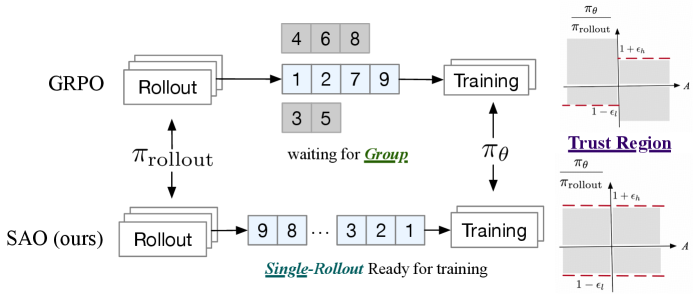
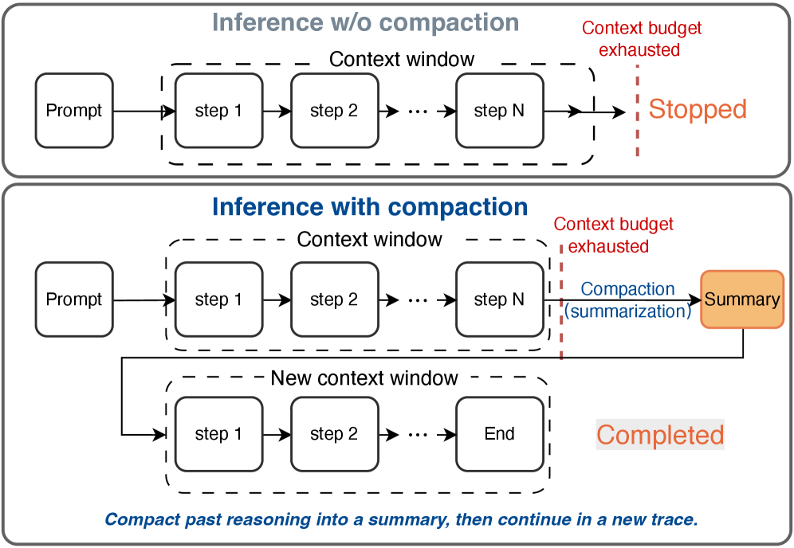
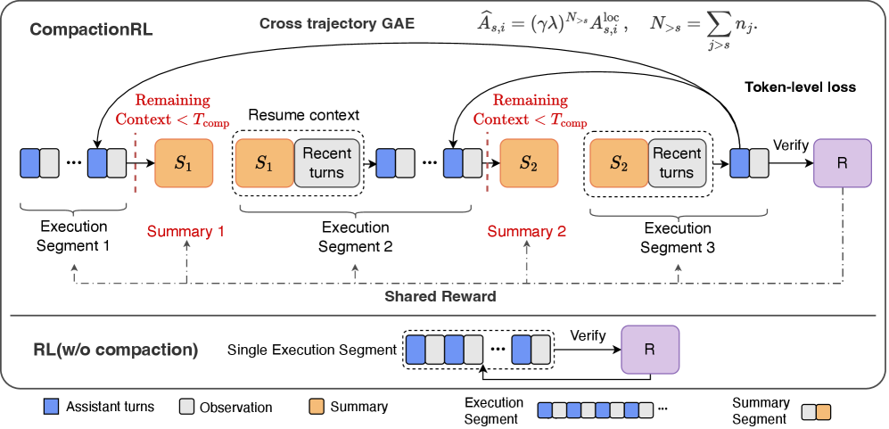

# GLM RL 算法

> GLM-5.2 技术报告：[z.ai/blog/glm-5.2](https://z.ai/blog/glm-5.2)。背后是两套算法：**SAO**（异步单轨迹优化）+ **CompactionRL**（可训练的上下文压缩）。GLM-5.2 报告中 "RL for Long-Horizon Tasks" 一节的表述：长程任务产生大幅变长的执行轨迹，一旦超长轨迹被 compaction 切成多条子轨迹，同一 prompt 的不同 rollout 会产生**段数不同、长度高度可变**的可训练轨迹——因此从组级优化转向 **critic-based PPO**（从单条 rollout 学习、用 critic 估计 token 级优势而非组内相对比较）；单轨迹公式天然适配 compaction（不约束每个 prompt 产生多少条轨迹、也不约束它们的相对长度）；把所有压缩子轨迹纳入可训练轨迹，并用 **token-level loss** 解决长度不均衡，同时配合 **anti-hacking** 措施。

## SAO：单轨迹异步优化

Single-Rollout Asynchronous Optimization for Agentic Reinforcement Learning

[arXiv:2607.07508](https://arxiv.org/html/2607.07508v1)

### 动机：异步 RL 的两大痛点

1. **Policy lag（策略滞后）**：agentic 轨迹生成动辄分钟到小时级，为了不让 GPU 空转必须异步——但一条轨迹生成期间训练侧已经更新了多版权重，轨迹里不同 token 可能出自**多个不同的旧策略**，产生系统性 off-policy 偏差。
2. **组采样与异步的天然冲突**：GRPO 需要同一 prompt 的 $G$ 条 completion 全部完成才能算组内归一化优势。agentic 任务的完成时间是重长尾分布，**组内最慢的样本决定了整组的可用时间**，异步的收益被组屏障吃掉；而且等待期间越长，组内样本的 off-policy 程度越深。

实验中的直观证据：标准 GRPO 在约 160 步后训练崩溃；GRPO+重要性采样修正能稳住但性能封顶；SAO 稳定训练 1000+ 步且在约 400 步后与对照拉开明显差距。

### 设计一：DIS（直接双侧重要性采样）

**为什么可以丢弃 $\pi_{\theta_{\text{old}}}$？先看它在标准 PPO 里承担的两个角色**：

|角色|含义|作用|
|---|---|---|
|$\pi_{\theta_{\text{old}}}$|**数据收集策略**|生成当前 batch 的 rollout，是"行为策略"（behavior policy）|
|$\pi_\theta$|**正在优化的策略**|在 batch 上做多次 epoch 更新，逐步远离 $\pi_{\theta_{\text{old}}}$|

重要性采样比率 $r_t = \frac{\pi_\theta(a_t|s_t)}{\pi_{\theta_{\text{old}}}(a_t|s_t)}$ 中，$\pi_{\theta_{\text{old}}}$ 承担两个任务：

1. **行为策略的分母**：修正 off-policy 偏差（数据不是由当前 $\pi_\theta$ 生成的）；
2. **信任区域的锚点**：裁剪 $r_t$ 到 $[1-\epsilon, 1+\epsilon]$，防止 $\pi_\theta$ 在一次 batch 内偏离 $\pi_{\theta_{\text{old}}}$ 太远。

**异步场景下，$\pi_{\theta_{\text{old}}}$ 变成"伪需求"**。rollout worker 和 training worker 是物理分离、并发运行的进程，rollout worker 上的策略版本持续滞后：

```text
Rollout Worker                    Training Worker
    │                                 │
    ├─ 持有 π_rollout（持续推理）        ├─ 持有 π_θ（持续更新）
    │                                 │
    └─ 生成 traj #k ──────────────→    └─ 收到 traj #k，立即训练
```

强行引入 $\pi_{\theta_{\text{old}}}$ 的两个问题：

- **问题一：语义模糊**。同步 PPO 里 $\pi_{\theta_{\text{old}}}$ 有清晰定义（"生成这个 batch 时的策略快照"）；异步系统中 traj #1 可能由版本 $v_1$ 生成、traj #2 由版本 $v_2$ 生成……**每条轨迹有自己的"旧策略"，没有统一的 $\pi_{\theta_{\text{old}}}$**。
- **问题二：追踪代价极高**。要么保存大量历史 checkpoint（内存爆炸），要么训练时动态加载旧版本前向（通信/IO 爆炸）。

**SAO 的简化**：丢弃 $\pi_{\theta_{\text{old}}}$，**直接用 rollout 时保存的 logprob 对当前策略做单级比率**：

$$
r_t(\theta) = \exp\Big( \log \pi_\theta(a_t \mid s_t) - \log \pi_{\text{rollout}}(a_t \mid s_t) \Big)
$$

**合法性来自重要性采样的数学本质**：$\mathbb{E}_{\pi_{\text{behavior}}}\left[ \frac{\pi_\theta}{\pi_{\text{behavior}}} \cdot f \right] = \mathbb{E}_{\pi_\theta}[f]$，只要分母是**真实的行为策略**，等式就成立——$\pi_{\text{rollout}}$ 正是实际生成这条轨迹的策略版本，所以修正仍然有效。

配合**双侧截断**（two-sided masking）：

$$
f(x;\, \varepsilon_\ell,\, \varepsilon_h) =
\begin{cases}
x, & 1 - \varepsilon_\ell < x < 1 + \varepsilon_h \\[4pt]
0, & \text{否则（该 token 完全屏蔽，不产生梯度）}
\end{cases}
$$

完整损失：$\mathcal{L}(\theta) = \hat{\mathbb{E}}_t\left[ f(r_t(\theta), \epsilon_\ell, \epsilon_h) \cdot \hat{A}_t \cdot \log \pi_\theta(a_t|s_t) \right]$。

实用超参 $\varepsilon_\ell = 0.3$，$\varepsilon_h = 5.0$。与 PPO 的 clip（截到边界值仍有梯度）不同，比率超出信任域的 token **直接踢出优化**——极端 off-policy token 是训练崩溃的元凶，与其修正不如放弃。训练动态分析（论文图4c）显示 SAO 把 token 截断比例始终维持在适度区间，这正是 1000+ 步不崩的直接原因。

**为什么"更简单"反而"更激进"**：$\pi_{\text{rollout}}$ 和 $\pi_\theta$ 之间的 lag 可能非常大（训练器可能已更新几十步），$r_t$ 的分布比同步 PPO 中 $\pi_\theta / \pi_{\theta_{\text{old}}}$ 更分散，所以需要更严格的双边裁剪来补偿更大的 off-policy 风险。射箭类比：

|场景|同步 PPO|异步 SAO|
|---|---|---|
|**靶子**|$\pi_{\theta_{\text{old}}}$（固定，batch 内不变）|$\pi_{\text{rollout}}$（动态，每条轨迹不同）|
|**射手**|$\pi_\theta$（batch 内小幅调整）|$\pi_\theta$（持续大幅调整）|
|**问题**|射手离靶子不远，轻微约束即可|射手和靶子可能相距甚远，需要更粗的"安全绳"|
|**安全绳**|单侧裁剪（细绳）|双侧掩码（粗绳）|

直觉：**与其花巨大代价追踪一个模糊的"旧靶子"，不如直接承认"靶子就是 rollout worker 上的那个版本"，然后用更粗的绳子把射手和靶子绑在一起。**

**PPO 单侧裁垫的由来**：严格说 PPO 的 `clip(r, 1-ε, 1+ε)` 函数本身是双侧的，但由于目标函数的 `min` 操作，实际起约束作用的只有一侧：

|优势符号|有效裁剪方向|具体表现|被忽略的一侧|
|---|---|---|---|
|$\hat{A}_t > 0$（好 token）|只裁**上限**|当 $r_t > 1+\epsilon$ 时强制使用 $(1+\epsilon)\hat{A}_t$（阻止概率过度增加）|$r_t < 1-\epsilon$ 不被约束|
|$\hat{A}_t < 0$（差 token）|只裁**下限**|当 $r_t < 1-\epsilon$ 时强制使用 $(1-\epsilon)\hat{A}_t$（阻止概率过度减少）|$r_t > 1+\epsilon$ 不被约束|

PPO 只阻止"对当前策略过度有利"的更新，不阻止"过度不利"的更新。核心是**信任区域的不对称保护**：防止贪婪（好 action 上 $r \gg 1$ 容易一步踩到策略空间"悬崖"），同时允许自我修正（新策略降低好 action 概率本来就是"错误"方向，梯度下降会自然拉回，用下界"保护"反而阻碍自我修复）。

**同步下单侧够用的原因**：$\pi_{\theta_{\text{old}}}$ 和 $\pi_\theta$ 相差不大，$r_t$ 很少跑到"被忽略的那一侧"。但异步 RL 中 off-policy 偏差极大——好 token 的概率可能被压到极低（$r \ll 1-\epsilon$）、差 token 可能被推到极高（$r \gg 1+\epsilon$），若仍只裁单侧，这些极端 token 会继续产生巨大梯度。SAO 因此双侧严格掩码，不给"错误方向"任何修复机会（严重 off-policy 时"错误方向"可能已经太远）。

### 设计二：单轨迹采样取代组采样

异步 RL 的动机：现在的 RL 流程大部分是同步的——策略生成一批 rollout → 等全部完成 → 再优化。对 Long Horizon Agent 任务（编程、多轮工具调用），rollout 长度差异极大：短轨迹很快完成，长轨迹成为 stragglers，大量 GPU 空闲等待。异步 RL 让 rollout 一完成就立即送入训练，不需要等待整个批次。但另有两大挑战：policy lag 导致的 off-policy（上文 DIS 解决），以及 **GRPO 与异步不兼容**——GRPO 要求组内所有样本完成后才能训练，天然与异步冲突；且 Agent 环境通常只给单条轨迹反馈，组采样不适用。

| | GRPO | SAO |
|---|---|---|
| 采样 | 每 prompt $G$ 条响应 | 每 prompt **1 条**响应 |
| 数据可用时机 | 等最慢样本 | rollout 完成即入队 |
| 优势基线 | 组内奖励归一化 | **value model（critic）$V_\phi$** |
| 异步友好度 | 差（组屏障） | 好 |
| off-policy 程度 | 随组等待加深 | 最小化 |

单轨迹范式的额外好处：天然适配**在线/非平稳场景**——没有"同一 prompt 攒一组"的概念，数据流式进流式出。论文 5.4 节做了一个在线学习模拟：写作风格偏好在训练中动态切换（可爱→中二→古典），奖励为质量与风格的乘积 $r = r_{\text{quality}} \times r_{\text{style}}$（GLM-4.7 当风格裁判），SAO 每次都能快速把策略重新对齐到新偏好，恢复速度和收敛水平都优于 running-mean 基线。这个实验是 SAO 与 AReaL 2.0 在线自演化愿景的直接衔接点。

### 设计三：让 critic 真正能用的三件套

放弃组基线就必须回到 value model，而"LLM 场景下 critic 训不好"正是当年 GRPO 取代 PPO 的理由。单 rollout 的梯度方差高（类似 REINFORCE），也需要高质量的价值模型提供低方差优势估计。SAO 用三个工程手段正面解决：

1. **TTUR（双时间尺度更新）**：每 1 次策略更新配 $K=2$ 次 value 更新（value 学习率 $5\times10^{-6}$ vs. policy 学习率 $1\times10^{-6}$），让 value 估计快速跟上策略分布的移动。消融：去掉后 AIME2025 $97.3\% \to 95.0\%$，BeyondAIME $74.8\% \to 69.8\%$。
2. **冻结 attention、只训 MoE 投影**：全参数训 value 时梯度范数爆炸。预训练好的 attention 已具备足够语义能力，冻结它等于强正则。消融：去掉后 AIME2025 掉到 $90.6\%$。训练动态（图4b）显示冻结后 value 梯度范数显著更低更平滑。
3. **value 预训练**：显著扩充 value 预训练语料解决冷启动。整体效果（图4a）：SAO 的 value explained variance 在 400 步后超过 $80\%$，单次更新基线停留在约 $40\%$。

另有**长度自适应 GAE**：

$$
\lambda = 1 - \frac{1}{\alpha \cdot l}, \qquad \alpha = 1.5
$$

其中 $l$ 为序列长度，$\lambda$ 随长度自适应。

### 设计四：跳过观测的 GAE（skip-observation GAE）

Multi-turn 轨迹 $\mathcal{T} = [\,a_0,\, o_0,\, a_1,\, o_1,\, \dots\,]$ 中，观测 $o_i$ 不是模型生成的。标准 GAE 沿完整 token 序列传播 TD 误差，但**从动作末 token $a_{i,\text{end}}$ 到观测首 token $o_{i,\text{start}}$ 的"转移"在模型视角根本不存在**（模型没有生成过它），在这些位置估计 $V$ 和 $\delta$ 只会注入噪声。

SAO 的做法：让 TD 误差**直接从上一个动作的最后一个 token 跨接到下一个动作的第一个 token**。记 $a_{i,N}$ 为第 $i$ 个动作的末 token、$a_{i+1,0}$ 为第 $i+1$ 个动作的首 token：

$$
\hat{A}(a_{i,N}) = \delta + \gamma\lambda\, \hat{A}(a_{i+1,0})
$$

$$
\delta = r_t + \gamma\, V(a_{i+1,0}) - V(a_{i,N})
$$

这样优势估计只依赖模型自身输出，隔绝了环境反馈的随机噪声。这与 Polar 的 loss mask 是同一原则在不同层面的体现：在损失层屏蔽环境 token，在优势估计层跳过环境 token。

### SAO 为什么要改成双侧严格裁剪

在同步 RL 中，旧策略 $\pi_{\theta_{\text{old}}}$ 和当前策略 $\pi_\theta$ 相差不大，$r_t$ 很少会跑到"被忽略的那一侧"，所以单侧保护足够。但在异步RL中，rollout策略和训练策略之间可能经过多轮更新，off-policy 偏差极大。此时：

- 好 token 的概率可能被压到极低（$r \ll 1-\epsilon$）
- 差 token 的概率可能被推到极高（$r \gg 1+\epsilon$）

如果仍然只裁剪单侧，这些极端偏离的 token 会继续产生巨大梯度，导致训练不稳定。因此 SAO 采用**双侧严格掩码**（mask），只要 $r_t$ 超出 $[1-\epsilon_\ell, 1+\epsilon_h]$ 就彻底屏蔽梯度，不给"错误方向"任何修复机会，因为在严重 off-policy 的情况下，"错误方向"可能已经太远了。



### 完整训练循环

初始化策略 $\pi_\theta$、价值函数 $V_\phi$、行为策略 $\pi_{\text{rollout}}$；批大小 128（1 prompt → 1 响应）。每个训练步：

1. 异步收集单条轨迹 $\tau$（完成即可用，同时保存 rollout 时的 token 级 $\log \pi_{\text{rollout}}$）；
2. 计算 token 级重要性比率 $r_t = \exp\big(\log \pi_\theta - \log \pi_{\text{rollout}}\big)$；
3. 双侧截断：比率超出 $(1-\varepsilon_\ell,\; 1+\varepsilon_h) = (0.7,\; 6.0)$ 区间的 token 置零屏蔽（式3）；
4. 对 multi-turn 轨迹计算 skip-observation GAE（式4–5）；
5. 更新：先做 $K=2$ 次 value 更新（冻结 attention，只训 MoE 投影），再做 1 次策略更新（使用截断后的梯度）；
6. 周期性同步 $\pi_{\text{rollout}} \leftarrow \pi_\theta$。

### 实验结果

**实验设置**：基座模型 Qwen3-30B-A3B-Thinking-2507；任务为数学推理（带 Python 工具：AIME2025、BeyondAIME、HMMT Nov 2025、IMOAnswerBench）和编程 Agent（SWE-Bench Verified，OpenHands 框架，最多 300 轮交互）；对比方法：SFT 基线、GRPO、GRPO(+DIS)、SAO。

**数学推理**（Qwen3-30B-A3B，带 Python 工具的 multi-turn 设定）：

| 基准 | SFT (w/ python) | GRPO (w/ python) | SAO | $\Delta$ vs GRPO |
|---|---|---|---|---|
| AIME2025 | 80.4 | 84.2 | **97.3%** | +13.1 |
| BeyondAIME | 53.3 | 54.8 | **74.8%** | +20.0 |
| HMMT Nov 2025 | 75.2 | 76.0 | **88.3%** | +12.3 |
| IMOAnswerBench | 53.3 | 55.8 | **74.0%** | +18.2 |

**代码 agent**（OpenHands harness，最多 300 轮交互）：SWE-Bench Verified $23.0\% \to \mathbf{29.8\%}$（相对提升 29.6%）。

**训练稳定性**：Vanilla GRPO 约 160 步崩溃；GRPO+DIS 能稳住训练但效果一般；SAO 从约 400 步开始与 GRPO(+DIS) 拉开差距，且能稳定训练到 1000 步。说明单 rollout + DIS + 强价值模型的组合不仅稳定，而且**最终性能更高**。

**消融汇总**：

| 配置 | AIME2025 | BeyondAIME |
|---|---|---|
| SAO 完整版 | 97.3 | 74.8 |
| − 更快 value 更新（TTUR，K=2→1） | 95.0 | 69.8 |
| − 冻结 attention（全参数更新价值模型） | 90.6 | 74.5 |
| 标准 VAPO（无 DIS） | 91.3 | 69.0 |
| running-mean 基线（滑动窗口奖励均值） | 79.8 | 55.3 |

1. **价值模型更新频率很重要**：$K=2$ 比 $K=1$ 提升显著（解释方差更高，图4a）；
2. **冻结注意力有效**：全参数更新导致价值模型梯度范数大、不稳定（图4b）；
3. **DIS 不可或缺**：无 DIS 时 clip ratio 接近 0，无法约束 off-policy 更新，导致训练崩溃（图4c）；
4. **参数化价值模型优于无模型基线**：running-mean 基线虽然能用，但性能差距大。

**局限**（论文附录 B 自述）：实验以 Qwen3-30B-A3B 为主，小模型迁移性未知；非 agentic 的 RLHF 场景适用性不确定；强依赖"异步生成期间可靠保存 token 级 logprob"的基础设施；在线学习应用需要强安全保障与监控。

## CompactionRL：可训练的上下文压缩

CompactionRL: Reinforcement Learning with Context Compaction for Long-Horizon Agents

[arXiv:2607.05378](https://arxiv.org/html/2607.05378v1)

### 动机：compaction 是决策，不是预处理

长程任务中累积的历史（工具输出、推理、报错）会撑爆上下文窗口。生产 harness（Claude Code 等）普遍配备 compaction 机制：快满时让模型总结历史、带着摘要重开上下文。业界通常把它当推理期启发式。论文的关键测量：**仅仅换一个 summarizer，端到端准确率就在 49% 到 55.5% 之间波动（6.5pp）**——摘要里丢掉一个未解决的报错、一个关键文件路径，后续所有决策都会跑偏。

两种推理模式的对比：

- **无压缩推理**：prompt → step 1 → … → step N → 上下文预算耗尽 → **Stopped**（任务失败）；
- **带压缩推理**：上下文快满时触发 compaction（summarization），把过去的推理压成 summary，在**新的上下文窗口**里继续 step 1 → … → End → **Completed**。

结论：**上下文压缩本身是性能关键的决策过程，应该作为策略的一部分，与任务执行在同一个任务奖励下联合优化。**



### 机制：把 compaction 放进 rollout

**触发**（式7）：设上下文窗口上限为 $C$、当前历史为 $h_t$、压缩阈值为 $T_{\text{comp}}$，当剩余上下文不足时触发压缩：
$$
C - |h_t| < T_{\text{comp}}
$$

**摘要采样**（式8）：摘要由**同一个策略模型自己生成**：
$$
S_t \sim \pi_\theta\big(\cdot \mid h_t \oplus q_{\text{sum}}\big)
$$

其中 $q_{\text{sum}}$ 是固定的总结指令，要求保留：原始目标、已完成的动作、重要观察、**未解决的错误**、当前状态、可行的下一步。

**上下文重构**（式9）：

$$
\bar{h}_t = (s) \,\oplus\, u_{\text{resume}}(S_t) \,\oplus\, (z_{t-k+1},\, \dots,\, z_t)
$$

即：系统提示 $(s)$ + 摘要恢复模板 $u_{\text{resume}}(S_t)$ + 最近 $k$ 步原文（默认 $k=2$）。长程信息经摘要 $S_t$ 保留，最近的环境状态保持精确原文。

**轨迹分段**：一条完整轨迹被压缩点切成 $K$ 个段：

$$
\tau = (\sigma_1,\, \dots,\, \sigma_K)
$$

包括执行段（解题时生成的 token）和摘要段（压缩时生成的摘要 token）——**所有段共享最终任务奖励 $R(\tau)$**。摘要 token 和动作 token 一样参与训练，摘要写得好不好由最终任务成败说话。

**不单独引入摘要质量奖励**：手工设计的摘要指标可能无法反映对任务有用的细节，所以让摘要质量由最终任务成败说话。反过来验证 summary 参与训练的必要性：实验中固定 execution agent、只换 summary agent，SWE-Verified 就从 $49.0 \to 55.5$——压缩质量直接影响最终结果。

**工程含义**：普通 RL 中一个 rollout 是一条连续序列；compaction 下被切成 $K$ 段独立序列——segment 1 是 `system + prompt + multi-step`，压缩后 segment 2 以 `system + prompt + summary` 开头，与 segment 1 的 token 流不连续，**一条 rollout 对应 $K$ 次独立 forward**。

**Outcome Reward 广播到每一段**：一条 rollout 只有一个最终 task reward，但可能有很多 segment——将 final reward 分配给所有 segment，execution 段和 summary 段都拿同一个 $R$。



### 为什么 GRPO 不适用，必须回到 PPO

压缩使轨迹结构变成"变段数、变长度"：

- 一组 $G$ 条轨迹会产生 $\sum_{g} K_g$ 个段，各轨迹段数 $K_g$ 不同——GRPO 的固定组统计失效；
- 压缩多的轨迹贡献更多段，**在组统计中被重复加权**；
- 段级优势估计无法保证跨段的正确时间信用。

所以 CompactionRL 采用 **PPO + value function**：value-based 优势估计天然支持任意段结构。（与 SAO 独立得出同一结论：multi-turn 的异质结构最终需要 critic。）

### 两个关键算法组件

**(1) Token 级损失归一化**（式12）。标准 PPO 按样本平均损失，但压缩引入段数/长度异质性——多段轨迹的每段若按样本计权，整条轨迹会被隐性放大。CompactionRL 在**全 batch 所有被优化的 assistant token 位置集合 $M$ 上直接平均**：

$$
\mathcal{L}_\pi = -\frac{1}{|M|} \sum_{(s,i) \in M} \min\Big( \rho_{s,i}(\theta)\, \hat{A}_{s,i},\;\; \mathrm{clip}\big(\rho_{s,i}(\theta),\, 1-\epsilon,\, 1+\epsilon\big)\, \hat{A}_{s,i} \Big)
$$

其中 $(s,i)$ 表示第 $s$ 段的第 $i$ 个 token，$\rho_{s,i}(\theta)$ 为该 token 的重要性比率。这样每个可训练 token 权重相等，消除了片段数量和长度带来的偏差。消融显示这是影响最大的组件：去掉后 SWE-bench $66.8\% \to 60.0\%$（$-6.8$pp）。

**数值直觉**：假设 batch 中 2 条 rollout 完成同样任务、拿到相同奖励 $R=1$——Rollout A 触发 1 次压缩产生 3 个 segment（每个 loss 平均后为 $L^A_1, L^A_2, L^A_3$），Rollout B 无压缩只有 1 个 segment（$L^B_1$）：

- **Segment 级平均**：$L_{\text{seg}} = \frac{1}{4}(L^A_1 + L^A_2 + L^A_3 + L^B_1)$——A 占 3/4 = 75% 权重，B 只占 25%。触发更多压缩的 rollout 获得不成比例的权重；
- **Token 级平均**：设 A 有 230 个可训练 token、B 有 200 个，$L_{\text{token}} = \frac{1}{430}\left(\sum_{i=1}^{230}\text{loss}_{A,i} + \sum_{i=1}^{200}\text{loss}_{B,i}\right)$——A 占 53.5%、B 占 46.5%，与 token 数成比例。

**(2) 跨轨迹 GAE（cross-trajectory GAE）**（式13-14）。朴素做法是把共享的终局奖励贴在**每个段的末尾**再各自做 GAE——但这样早期段的动作看起来离奖励"很近"，被系统性高估。修正分两步：

先算段内本地 GAE（$n_s$ 为段 $s$ 的被优化 token 数）：

$$
A^{\text{loc}}_{s,i} = \sum_{\ell=0}^{n_s - i} (\gamma\lambda)^{\ell}\, \delta_{s,\, i+\ell}
$$

再按"该 token 到轨迹真正终点的距离"补折扣：

$$
\hat{A}_{s,i} = (\gamma\lambda)^{N_{>s}}\, A^{\text{loc}}_{s,i}, \qquad N_{>s} = \sum_{j > s} n_j
$$

其中 $N_{>s}$ 是同一轨迹中段 $s$ 之后所有段的被优化 token 数。最终 token $(s,i)$ 收到的奖励折扣为

$$
(\gamma\lambda)^{\,N_{>s} \,+\, n_s \,-\, i}
$$

——**与它到最终结果的真实 token 距离精确匹配**，跨压缩边界的时间信用得以保留。消融：去掉后 $66.8\% \to 63.0\%$（$-3$pp）。

**具体例子**：一个完整 rollout 被压缩成 3 段：

```text
Segment 1 (执行):  [a1, a2, a3]  ──摘要1──►
Segment 2 (执行):  [b1, b2, b3, b4]  ──摘要2──►
Segment 3 (执行):  [c1, c2]  ──► 验证通过 ──► 获得奖励 R
```

标准 PPO 的 GAE 假设每个片段末尾就是轨迹终点：对 Segment 1，它认为 $R$ 就在 `a3` 之后 1 步；对 Segment 2，$R$ 在 `b4` 之后 1 步。但实际上从 `a1` 到 $R$ 还要经过 `a2, a3, 摘要1, b1, b2, b3, b4, 摘要2, c1, c2` 这么多 token。不补折扣就会高估早期 token 对最终结果的贡献——GAE 以为它们离奖励很近，实际上很远。

### 训练配置与流程

初始化 $\pi_\theta$、$V_\phi$；批大小 128，组大小 1（注意：也放弃了组采样）。

**实验配置细节**：训练数据 SWE-Dev 开源数据集；RL 框架 slime（开源异步 RL 框架）；上下文预算 64k/80k；学习率策略 $2\times10^{-6}$、critic $3\times10^{-6}$；压缩阈值 $T_{\text{comp}} = 10240$；评估基准 SWE-bench Verified（随机 200 例）和 Terminal-Bench 2.0（全集），评估环境 Harbor + Terminus-KIRA agent scaffold。

**Rollout 阶段**：

1. 按 $\pi_\theta$ 生成动作、与环境交互；
2. 当 $C - |h_t| < T_{\text{comp}}$ 时：采样摘要 $S_t \sim \pi_\theta(\cdot \mid h_t \oplus q_{\text{sum}})$，重构上下文 $\bar{h}_t$，继续执行（最多 3 次压缩、最多 250 轮交互）；
3. 得到分段轨迹 $\tau = (\sigma_1, \dots, \sigma_K)$。

**优化阶段**：

1. 计算段内本地 GAE $A^{\text{loc}}_{s,i}$（式13）；
2. 应用跨轨迹折扣修正 $\hat{A}_{s,i} = (\gamma\lambda)^{N_{>s}} A^{\text{loc}}_{s,i}$（式14）；
3. Token 级 PPO 损失（式12）+ value 回归；
4. 2 次 value 更新 : 1 次策略更新（与 SAO 的 TTUR 一致）。

### 实验结果

模型：GLM-4.7-Flash（30B-A3B，64k 上下文）、GLM-4.5-Air（106B-A30B，80k 上下文）。基准：SWE-bench Verified（200 实例）、Terminal-Bench 2.0。"压缩×4"= 允许 compaction、等效 4 倍窗口的评测设定。

| 模型 | 配置 | SWE-bench 单窗口 | SWE-bench 压缩 | T-Bench 单窗口 | T-Bench 压缩 |
|---|---|---|---|---|---|
| GLM-4.7-Flash | 基座 | 47.5 | 50.5 | 14.6 | 13.4 |
| | +RL（无压缩训练） | 50.0 | 48.0 | 16.9 | 12.4 |
| | +CompactionRL | 43.7 | **56.0** | 16.9 | **20.2** |
| GLM-4.5-Air | 基座 | 57.8 | 59.8 | 17.9 | 21.4 |
| | +RL（无压缩训练） | 58.3 | 62.5 | 20.2 | 23.6 |
| | +CompactionRL | 57.3 | **66.8** | 21.4 | **24.5** |

相对"无压缩 RL"基线：GLM-4.7-Flash 在 SWE-bench $+5.5$pp（进一步对比基座 $+8$pp）、Terminal-Bench $+6.8$pp；GLM-4.5-Air 在 SWE-bench $+7.0$pp、Terminal-Bench $+3.1$pp。且带压缩训练的模型与"2 倍上下文长度、无压缩 RL"的模型性能相当——**用学习换窗口**。

**其他要点**：

- **标准 RL 不兼容压缩**：标准 PPO 虽提升单窗性能，但在压缩推理下性能反而下降或提升有限——必须联合训练压缩才能可靠地从压缩中受益；
- **单窗设置不提升甚至略降**（如 43.7 那格）：禁用压缩与训练设置不匹配导致 overlong 率更高，是预期行为；
- **短上下文也能换长窗口**：即使峰值上下文较短（64k），CompactionRL 的压缩推理性能仍接近甚至超过更长上下文（128k/160k）的无压缩 RL；
- **摘要参与 RL 目标的价值**：包含摘要响应的 RL 目标 consistently 提升压缩推理性能。

**消融**（表3-4）：禁用摘要段的 RL 损失（摘要不训、只训执行）导致压缩性能明显下降；去 token 级损失 $-6.8$pp；去跨轨迹 GAE $-3$pp。

**行为分析**（图3-4，很有意思的涌现现象）：

- 训练后 agent **压缩次数变少**：CompactionRL 平均压缩 0.36 次/轨迹，低于基线（0.47）和不训练摘要的变体（0.58），但高于标准 RL（0.21/0.26）；平均 $<1.2$ 次/轨迹，触发过压缩的轨迹反而进入准确率最高的段位（触发压缩的任务子集上准确率 47.7% 最高）——说明模型学会了更高效的交互（少啰嗦、少无效尝试），把压缩留给真正的长任务；
- **工具调用次数更少**（60.7 vs 基线 83.4、不训摘要版 90.8）——学会更高效地利用扩展的上下文时程，减少冗余重探索；
- **摘要越写越长越详细**：摘要长度随训练增加，而不训练摘要的变体摘要长度递减——RL 自发地学出"信息保真优先"的摘要风格；
- 每轮**推理 token 递增**（对照的无压缩 RL 反而递减）——学到的压缩有效扩展了可用上下文窗口，允许更多推理预算；策略熵增长缓慢，优化更稳定。

**局限**（论文自述）：压缩感知训练不一定改善单窗口无压缩性能（见上表 43.7 那格，训练目标就不是它）；跨轨迹 GAE 是近似，多次压缩边界的长期效应可能未完全刻画；主要在代码类基准验证，网页交互等领域待检验。

## Multi-turn 信用分配的演化脉络

把 SAO 和 CompactionRL 放进更大的脉络（参考综述 [From Reasoning to Agentic: Credit Assignment in RL for LLMs, arXiv:2604.09459](https://arxiv.org/html/2604.09459v1)，覆盖 2024–2026 年初的 47 种方法，按"粒度 × 方法论"二维分类）：

**问题的两个 regime**：推理 RL 中，信用要在单次生成的 500–30K token 思维链内分配；agentic RL 中，multi-turn 交互引入随机转移、部分可观测、100+ 轮 / 100K–1M token 的 horizon，**episode 级信用的信息量随 horizon 增长急剧衰减**（[Signal Dilution in Multi-Turn Agent Training, arXiv:2606.22164](https://arxiv.org/pdf/2606.22164) 对这种"信号稀释"做了系统刻画：长轨迹里大量例行公事的轮次淹没了少数关键决策轮）。

**演化脉络**（四个阶段）：

1. **轨迹级组优势（GRPO 及直系变体，2024–2025 上半年）**：整条轨迹一个归一化优势，实现最简单。在 agentic 场景暴露三个问题：组屏障与异步冲突（SAO 的动机）、变段结构下组统计失效（CompactionRL 的动机）、长 horizon 信号稀释。
2. **Critic-free 的 turn/step 级修补（2025 下半年）**：不引入 critic，靠更细的分组和结构信息细化优势——**GiGPO**（把不同轨迹中的相同状态合并、算 state 级优势，与轨迹级优势组合）、**MT-GRPO**（turn 级信用）、[**GAGPO** (arXiv:2605.13217)](https://arxiv.org/html/2605.13217)（以环境 step 而非 token 为信用基本单位、优势沿时间传播、保持 critic-free）、[**Proximity-based Multi-Turn Optimization** (arXiv:2602.19225)](https://arxiv.org/html/2602.19225v1)（按与结局的邻近度分配信用的实用方案）。
3. **Critic 回归（2025 末–2026）**：[**Turn-PPO** (arXiv:2512.17008)](https://arxiv.org/html/2512.17008) 在 turn 级重新引入可学习 critic，指出 GRPO 在 multi-turn 训练中的局限（同期 GEM、ST-PPO 独立得出类似结论）；**SAO** 和 **CompactionRL** 从异步和压缩两个不同入口，同样落回 value-based PPO。
4. **GAE 手术（当前前沿）**：回归 critic 不是简单复辟，新方法都对 GAE 本身动了手术以适配 multi-turn 结构——SAO 的 **skip-observation GAE**（跳过环境 token）、CompactionRL 的 **cross-trajectory GAE**（跨压缩边界的距离修正折扣 $(\gamma\lambda)^{N_{>s}}$）、SAO 的**长度自适应** $\lambda = 1 - \frac{1}{\alpha l}$、Turn-PPO 的 turn 级优势。配套的是让 critic 可训的工程包（TTUR、冻结 attention、value 预训练）。

**一句话总结趋势**：钟摆正从"GRPO 一统天下"摆回 critic-based 方法，但带回来的是一套为 multi-turn 结构重造过的 GAE 与 value 训练工艺；critic-free 路线则在向更细粒度的结构化分组演进。两条路线共同的敌人是同一个：**episode 级奖励在长 horizon 下的信息坍缩**。