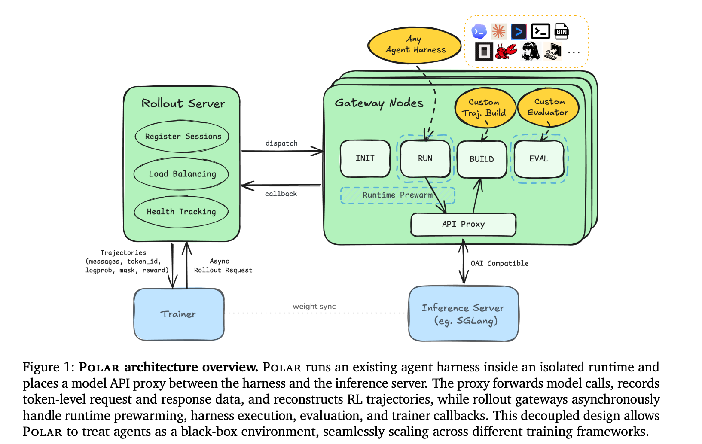

# Polar: Agentic RL on Any Harness at Scale

> **论文**: arXiv:2605.24220v1 [cs.DC]，2026年5月22日
> **作者**: Binfeng Xu, Hao Zhang, Shaokun Zhang 等（NVIDIA 团队，含 Jan Kautz、Yi Dong）
> **代码**: github.com/NVIDIA-NeMo/ProRL-Agent-Server
> **一句话总结**: Polar 是一个"不改一行 Agent 代码"就能对任意 Agent 框架（harness）做大规模强化学习训练的 rollout 系统——它通过代理（proxy）LLM API 调用来捕获 token 级交互，再重建出可训练的轨迹。

## 一、背景与动机

传统 RL 框架（比如训练游戏 AI 的框架）都假设环境有**标准化接口**：`reset()`、`step()`、明确的 observation 和 action。但如今的 LLM Agent 完全不是这样：

- Agent 运行在**复杂的软件系统**里：异构环境、各种外部工具、长时间运行的工作流；
- 现实中最好用的 Agent（如 Claude Code、Codex、Qwen Code）是**成熟的产品级软件**，有自己的事件循环、工具调用格式、上下文管理策略，有的甚至是闭源二进制程序；
- 现有 RL 系统（SkyRL-Agent、PRIME-RL 等）都要求**用户把 Agent 改写成适配 RL 框架的形式**——这既费力，又会破坏 Agent 原本的行为。

> **"能不能不打开盒子就训练 Agent？"**（Can we train agents with RL without opening the box?）

即：不碰 Agent 的内部代码、不强迫它符合某个 RL 框架的接口，就能对它做 RL 训练。

### 核心洞察

**每一个基于 LLM 的 Agent 都必须和模型对话。** 这个"模型 API 边界"是一个存在于 Agent 外部的天然公共接口。

所以 Polar 的做法是：不去集成 Agent 内部，而是**"偷听" Agent 打给模型的每一通电话**——把 Agent 的模型 API 地址指向 Polar 的代理，代理记录下所有 prompt、采样出的 token、log 概率和响应，然后把这些拼成 RL 训练轨迹。

### Contribution

1. **基于代理的 rollout**：把 Agent 的 LLM API 请求负载本身当作 RL rollout 接口；
2. **Rollout 即服务（Rollout-as-a-service）架构**：任务提交、运行时准备、harness 执行、轨迹重建、评估，全部隔离在异步服务边界之后；
3. **Token 忠实（token-faithful）的轨迹重建**：把原始模型请求转换成 token 级精确的训练轨迹；
4. **真实世界验证**：在软件工程任务上，用多个流行的编码 Agent 验证了有效性。

## 二、相关工作

| 系统 | 做法 | Polar 的区别 |
|------|------|--------------|
| **ProRL Agent** | 为多轮 Agent rollout 引入服务边界，但要求在服务内部实现 handler | Polar 改变了集成契约：用户只需提供一个"harness 适配器"（准备配置 + 启动原生可执行文件），不用在服务里写逻辑 |
| **SkyRL-Agent** | 任务需先表示成它自己的环境和 Agent 抽象，之后训练很高效 | Polar 面向**已存在的 harness**，其内部事件循环、工具格式、上下文策略都保持不变；两者互补 |
| **PRIME-RL** | 解决大规模异步 RL 的训练器-推理分离 | Polar 补充了它：能处理比"可验证奖励函数"重得多的 harness 工作负载 |
| **Agent Lightning / rLLM** | 也认识到"研究者不该为了训练而重写整个应用"，用通用可观测性插桩 | Polar 选择"harness 本来就在用的模型 API 端点"作为观测点，因此对命令行程序、包管理工具、甚至**二进制文件**形式的 harness 都鲁棒 |
| **Harbor** | 在容器化环境中评估 Agent | 缺少一个能翻译各家模型提供商协议的网关 |

**Token 保真原则**（继承自已有工作）：生成的 assistant token 直接从推理响应中复制；非生成的"间隙 token"取自规范的 prompt 分词结果。

## 三、系统架构与方法

### 3.1 总体架构：两个核心组件

- **Rollout Server（rollout 服务器）**：接收一个 `TaskRequest`，展开成 `num_samples` 个独立 session；持久化紧凑的终态结果；通过轮询暴露任务状态。
- **Gateway Node（网关节点）**：拥有每个 session 的生命周期——启动运行时、准备 harness、执行 harness 命令、从捕获的补全构建轨迹、评估输出、清理资源。
    - Model API Proxy：API 拦截与 token 级数据捕获
    - Runtime Interface：容器管理（Docker / Apptainer）
    - Trajectory Builder：会话结束后的轨迹重建
    - Evaluator：评估与奖励计算（registry 模式，可插拔）

**关键设计**：模型 API 代理端点就托管在网关上（与 session 同地部署），这让补全捕获与 session 注册表天然绑定，不会张冠李戴。

每个 session 携带：session ID、task ID、超时预算、运行时规格、Agent 规格、轨迹构建策略、评估器和回调 URL。

### 3.2 Harness 接入与代理捕获

**接入方式极其轻量**：只需通过 harness 自己的环境变量或配置文件，把它的模型 base URL 指向网关即可（比如设置 `ANTHROPIC_BASE_URL` 或 `OPENAI_BASE_URL`）。

**代理的四步处理流程**：

1. **检测提供商 API**：通过请求路径和 header 区分 Anthropic Messages、OpenAI Chat Completions、OpenAI Responses、Google generateContent；
2. **归一化请求**：把各家不同的 role/content/tool 格式统一转换成 OpenAI Chat Completions 形状，并加上 `logprobs=true`（训练需要）；
3. **捕获 token 级数据**：请求消息、响应消息、token ID、log 概率；
4. **返回提供商特定格式的响应**：harness 收到的响应和直连官方 API 一模一样，完全无感。

**流式响应的巧妙处理**：对于流式请求，代理先从上游拿到**非流式**的完整响应，再合成一个符合提供商格式的"假流"（synthetic stream）发回给 harness。这样既简化了 token 的忠实捕获，又兼容那些期望 SSE（server-sent events）的 harness。

**超时的容错**：如果 harness 在已捕获若干模型调用后超时，网关仍会进入 post-run 阶段——**部分轨迹可以被回收**，并标记为超时终态。

#### 已集成的 harness

`claude_code`（Claude Code）、`codex`（OpenAI Codex）、`gemini_cli`、`qwen_code`、`opencode`、`pi`

#### Harness 适配器（Adapter）

设计上刻意做小：它可以安装配置、注册 MCP 服务器或 skills、写入提供商设置，并返回运行 Agent 的 shell 命令。**仅此而已**——不需要实现任何 RL 逻辑。

#### 运行时接口（Runtime）

运行时实现统一接口：`start / stop / exec / upload / download / cancel`。首个版本支持 **Docker** 和 **rootless Apptainer**（后者面向 HPC 超算环境）。

### 3.3 异步 rollout 分阶段执行（Staging）

Agent rollout 的各阶段开销特性完全不同（准备环境吃 CPU/IO，运行 Agent 吃 GPU 推理，评估又吃 CPU）。Polar 用**阶段隔离的 worker 池**让它们互不阻塞：

| 阶段 | 职责 |
|------|------|
| **INIT** | 启动运行时、执行准备工作（装依赖、克隆仓库等） |
| **READY** | 缓存已初始化好的运行时，等待运行槽位空闲（相当于给 CPU 重的准备工作做缓冲） |
| **RUNNING** | 执行 harness（Agent 真正干活） |
| **POSTRUN** | 构建轨迹、运行评估器、发送回调、清理资源 |

**预热（Prewarm）**：如果评估器需要一个干净的运行时，网关会**在 Agent 还在运行时就开始准备它**，让评估环境的搭建脱离关键路径。

**效果**：GPU 不会因为等 CPU 准备环境而闲置，长尾任务不会拖垮整个批次。

### 3.4 轨迹重建

**术语**：
- **补全会话（completion session）**：一个 harness session 中被代理捕获的模型调用序列；
- **轨迹（trajectory）**：包含一个或多个 **Trace** 对象，每个 Trace 含有：prompt token ID、response token ID、loss mask、prompt 消息、response 消息、工具定义、log 概率、reward、元数据。

**问题**：一次会话产生 $T$ 次 API 调用 $C_1, \dots, C_T$，每次调用包含三元组 $(p_i,\, a_i,\, \ell_i)$（prompt token、采样响应 token、对数概率）。怎么把它们变成训练样本？

**朴素方案（per-request）**：每次 API 调用一条独立训练样本。优点是永远正确；缺点是极度碎片化——同一段对话历史被重复存储和重复前向计算几十次，且每条样本都很短，优势估计噪声大（论文观察到由此引发 reward hacking / credit assignment 噪声问题）。

**Polar 方案（token-faithful prefix merging，前缀合并）**：

第一步，**分链**。把补全序列按"严格 token 前缀关系"分组成有序链：

$$
\mathcal{G} = \{G_1, \dots, G_J\}, \qquad G_j = \big(C_{i_1^j},\, C_{i_2^j},\, \dots,\, C_{i_{K_j}^j}\big)
$$

相邻两次调用可合并当且仅当满足严格 token 前缀关系：

$$
p_{i_{m+1}}\big[\,1 : |p_{i_m}|\,\big] = p_{i_m}
$$

即后一次调用的 prompt 在 **token 级别**严格延伸前一次的 prompt——这正是 append-only 对话历史的特征。注意这个判断在 token 层面而非消息层面做，因此对 harness 的任何模板细节都稳健。

第二步，**合并**。对链 $G = (C_{i_1}, \dots, C_{i_K})$，定义相邻调用之间的"规范尾部"：

$$
t_m = p_{m+1}\big[\,|p_m| + 1 :\,\big]
$$

（即后一 prompt 中超出前一 prompt 的部分，包含前一响应 + 环境插入的观测/模板 token）。在 $t_m$ 中定位第一个 turn 边界 token $e$：若 $a_m$ 已以 $e$ 结尾，则间隙 $u_m$ 取 $e$ 之后的后缀；否则 $u_m$ 从该 $e$ 开始。合并后的训练序列为：

$$
z^{(j)} = p_1 \,\Vert\, a_1 \,\Vert\, u_1 \,\Vert\, a_2 \,\Vert\, u_2 \,\Vert\, \cdots \,\Vert\, a_K
$$

第三步，**loss mask**。来自采样响应 $a_m$ 的 token → $\text{mask}=1$（参与训练）；来自间隙 $u_m$ 的 token → $\text{mask}=0$（屏蔽）。由此保证核心不变量：

> **每一个可训练 token 都与 rollout 时行为策略的实际采样一致；所有非模型生成的 token 一律不参与训练。**

第四步，**自动断链**。子 agent（不同的系统提示，前缀关系断裂）、上下文 compaction（历史被摘要替换，前缀关系断裂）、并行分支自然形成各自独立的链——无需任何 harness 侧的标注，轨迹结构从 token 前缀关系中自动涌现。论文 Figure 4 的例子：一个包含三轮主 agent、一次 compaction、一个子 agent 的会话，per-request 方式产生 6 条碎片轨迹，prefix-merging 自动重建为 2 条长轨迹。

**奖励传播**：Evaluator 支持会话级 outcome reward（广播给该会话的所有轨迹链）和轨迹级 process reward，可插拔规则校验 / LLM-as-judge / 任务特定 reward shaping。

**正确性不变量（invariant）**：

> "每一个可训练 token 都与 rollout 时行为策略的输出严格一致；所有非生成 token 都被掩码排除。"

#### 为什么 token 保真如此重要？（重分词漂移问题）

论文原话：

> "Agent RL 的训练信号只有附着在行为策略采样出的 token 上才是正确的。这在 Agent harness 中很困难，因为提供商 API 返回的可能是文本、工具调用 JSON、推理字段或流式事件，而不是推理后端实际使用的确切 token ID 和 log 概率。"

**通俗解释**：如果你拿 Agent 输出的**文本**重新分词（retokenize）来训练，分词结果可能与模型当初实际采样的 token 序列不同（同一段文本可以有多种分词方式）——这叫**重分词漂移（retokenization drift）**。用漂移后的 token 训练，等于在给模型从没生成过的动作打分，策略梯度就错了。Polar 靠代理直接拿到原始 token ID 和 logprobs，从根上避免了这个问题。

### 3.5 评估与奖励传播

评估器（Evaluator）是**注册表支持的自定义策略**，在轨迹构建之后运行。内置评估器：
- 会话完成度奖励（session-completion reward）；
- 可配置的"对输出跑测试"评估器（test-on-output）；
- SWE-Bench / SWE-Gym harness 评估器。

奖励算出后附着到轨迹上，通过回调 URL 推送给训练器。

## 四、实验与结果

### 4.1 实验一：在四个编码 harness 上做 SWE-Gym GRPO 训练

**设置**：
- 基座模型：**Qwen3.5-4B**（一个很小的模型）
- 训练数据：NovaSky-AI/SkyRL-v0-293-data（**仅 293 个任务**）
- 训练器：Slime 异步 GRPO；1 个 epoch
- rollout batch size = 4；每个 prompt 采样 16 次
- 轨迹构建：prefix_merging；学习率 1×10⁻⁶；Adam，weight decay 0.1；启用 TIS

**主结果（表 1）：SWE-Bench Verified pass@1**

| Harness | 基座 | Polar RL 后 | 提升 |
|---------|------|------------|------|
| Codex | 3.8% | 26.4% | **+22.6** |
| Claude Code | 29.8% | 34.6% | +4.8 |
| Qwen Code | 34.6% | 35.2% | +0.6 |
| Pi | 34.2% | **40.4%** | +6.2 |

**怎么读这张表**：
- 同一个 4B 小模型，套在不同 harness 里基线差异巨大（Codex 下只有 3.8%，因为 Codex 的提示词/工具格式对该模型很不友好）；
- RL 训练在**所有四个 harness 上都有正提升**，其中原本最不适配的 Codex 提升最猛（+22.6 点）——RL 教会了模型适应这个 harness 的工作方式；
- 最好的组合（Pi + RL）让一个 4B 模型达到 40.4%。

**训练曲线（图 6）**：四个 harness 的逐步奖励都稳定上升——
- Codex：前 10 步平均 9.5% → 后 10 步 54.5%
- Claude Code：28.8% → 67.0%
- Qwen Code：61.6% → 66.0%（较噪）
- Pi：61.6% → 76.2%

（注意：训练奖励是在 SWE-Gym 训练任务上，比 SWE-Bench Verified 测试集数字高是正常的。）

**消融实验：per_request vs. prefix_merging（图 5b）**

在相同的三个训练步上对比：

| 指标 | prefix_merging | per_request |
|------|---------------|-------------|
| 训练器收到的更新条数 | 218 条合并 trace | 1,185 条请求级 trace |
| 墙钟时间 | 35.2 分钟 | 189.5 分钟 |
| rollout GPU 利用率 | **87.7%** | 20.4% |
| 加速比 | **5.39×** | — |

**per_request 还有更严重的问题——奖励作弊（reward hacking）**：把会话级的结果奖励广播到每条请求级 trace 上，会导致**嘈杂的信用分配**——单条请求可能"躺赢"拿到整个会话的奖励。作者观察到了显著的 reward hacking，并指出解决方案（会话归一化、PRM 式过程奖励的信用分配）在本文范围之外，已列入路线图。

### 4.2 实验二：作为离线数据生成服务（SFT 数据蒸馏）

Polar 的第二种用法：不做 RL，而是当作**分布式离线数据生成服务**，用大模型跑 Agent 任务、收集成功轨迹，来做小模型的 SFT（监督微调）语料。

**案例：生成 SWE-Gym SFT 轨迹**

- 教师模型：**Qwen3.5-122B-A10B**（MoE 大模型，TP=8，上下文 32,768）
- Harness：pi-coding-agent v0.67.68
- 数据：来自 7 个 SWE-Gym 仓库的 1,638 个实例
- 基础设施：8×H100 上的 SGLang 服务
- 参数：并发 5–8，重试 1 次，单任务超时 3,600 秒
- 过滤标准：通过 SWE-Bench 评估（FAIL_TO_PASS 测试通过才保留）

**结果（表 2）：**

| 仓库 | 尝试数 | 通过数 | 通过率 |
|------|-------|--------|--------|
| getmoto/moto | 343 | 184 | 53.6% |
| python/mypy | 257 | 101 | 39.3% |
| conan-io/conan | 71 | 27 | 38.0% |
| pydantic/pydantic | 81 | 24 | 29.6% |
| iterative/dvc | 219 | 45 | 20.5% |
| pandas-dev/pandas | 477 | 98 | 19.7% |
| dask/dask | 141 | 25 | 17.7% |
| **合计** | **1,638** | **504** | **30.8%** |

**轨迹特征**：平均每个会话 104 条消息、51 个 assistant 回合，长尾可达 200+ 回合；总成本约 **64 GPU 小时**。

**已开源发布**：
- HuggingFace 数据集：`nvidia/polar-swegym-pi-qwen35-122b-a10b-trajectories`
- 格式：OpenAI 风格 messages（role / content / tool_calls / tool_call_id）+ 元数据（instance_id、repo、problem_statement、base_commit）
- 按仓库分层 90/10 训练/测试划分；Apache-2.0 协议

## 五、结论与意义

### 5.1 论文结论

Polar 的核心范式：**把 Agent 的"测试时环境"当作 RL 系统的一等公民**。设计选择是把集成边界移到模型端点上——harness 正常运行，代理观测 token 级模型流量，rollout 服务把完成的执行转化为可训练的轨迹和奖励。

三大收益：
1. rollout 的扩展与训练/推理基础设施**解耦**；
2. **完整保留**非标准 harness 的原生行为；
3. 使 Agentic RL 基础设施可以真正规模化。

### 5.2 论文贡献

1. **解决了 Agentic RL 最大的工程瓶颈**。此前想对 Claude Code 这类产品级 Agent 做 RL，几乎必须重写一个"平替"环境，而重写版和真实产品的行为差异会让训练目标失真。Polar 让"你部署什么就训练什么"（train what you deploy）成为可能。
2. **代理边界是普适的**。只要 Agent 用 LLM（必然的），它就有 API 调用（几乎必然的），Polar 就能接入——包括闭源二进制。这个抽象非常干净。
3. **token 保真 + 前缀合并是关键技术贡献**。它同时解决了正确性（重分词漂移、行为策略一致性）和效率（5.39× 加速、GPU 利用率 20%→88%）两个问题，而且对上下文压缩、子 Agent 等复杂行为天然鲁棒。
4. **一鱼两吃**：同一套基础设施既能做在线 RL rollout，又能做离线 SFT 数据蒸馏。

### 5.3 局限与未来工作

- **奖励稀疏 & 信用分配**：目前主要靠结果奖励（outcome reward）+ 会话级 GRPO；per_request 级的细粒度信用分配会引发 reward hacking，需要会话归一化或 PRM（过程奖励模型），作者列入路线图；
- **实验规模有限**：训练只用了 293 个任务、4B 模型、1 个 epoch，属于验证性实验；论文也未披露网关节点数量、训练器与 rollout 之间的权重同步细节；
- **前缀合并的前提**：依赖"append-only 对话历史"这一常见但非必然的 harness 行为；不满足时退化为多条短链（正确但样本变短）。
