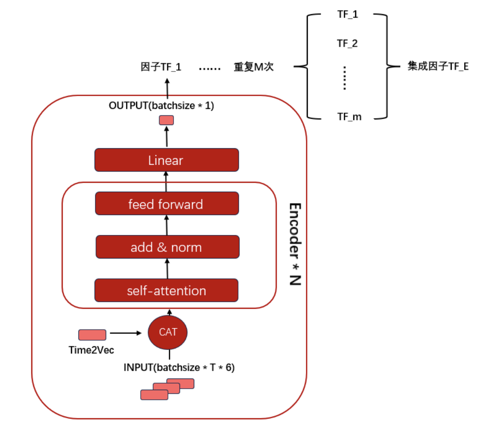
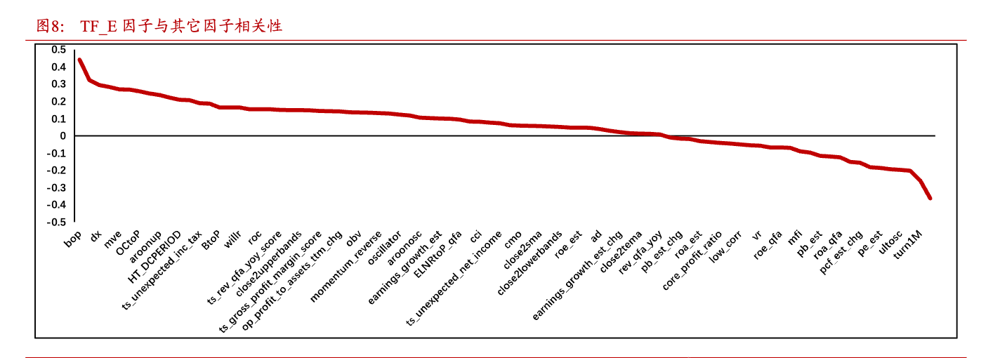

# 基于 Transformer 因子挖掘的指增策略

Transformer 是一种需要大参数量才能发挥性能优势的模型，而月频因子的样本量无法满足大参数模型的训练需求。相对于训练样本，过于复杂的模型设定非常容易出现过拟合。然而，浅层的模型设计又无法发挥出 Transformer 模型的优势。因此调整 Transformer 模型的功能设定，由因子加权改为因子挖掘，并且使用日频交易数据作为基础数据，大幅提升了可供模型训练的样本。

- **因子挖掘结果**
    - 使用 Transformer 架构对股票的时序价量信息进行特征提取并构建因子，经测试，基于 Transformer 挖掘的因子，样本外持有 20 日 IC 为 16.39%，IR 为 1.68。
    - 模型 10 分层效果良好，单调性良好。该因子与现存的各大类因子相关性较低，仅与两个因子相关性超过 0.3，最大相关系数 0.44。该因子可作为差异化的 Alpha 收益来源。
- **指增策略结果**
    - 以月频调仓中证 1000 指增策略为例，费率设定为双边 4‰，在现有因子库基础上，加入 Transformer 因子后，样本外，中证 1000 指增策略年化超额收益为 26.67%，提升 16.42%，最大超额回撤 3.18%，减小 1.54%，信息比率 3.56，提升 2.11。

## 数据处理

输入数据和模型架构调整：

- 模型实现的功能由因子加权调整为因子挖掘；
- 输入数据由月频因子数据，调整为日频价量数据，并对数据进行特别处理；
- 时序信息由特征加位置编码调整为特征拼接时间向量；
- 最终因子由多轮训练结果集成得到。

选用全 A 股票池，剔除上市不满 120 个交易日的股票和 ST 股票。ST 股票在取消 ST 标识 30 交易日后重新加入股票池。使用 2007 年 1 月 1 日至 2018 年 12 月 31 日的数据作为训练集，2019 年 1 月 1 日至 2019 年 12 月 31 日的数据作为验证集，2020 年 1 月 1 日至 2023 年 11 月 20 日的数据作为测试集。

基础特征数据：股票日频开盘价、最高价、最低价、收盘价、VWAP 和换手率。为了统一量纲，消除股票间绝对价格不可比的情况，且保存特征在时序上的动态信息，对于 5 个价格数据，单只股票时序上都除以 t-T 日收盘价；对于换手率，时序上都除以 t-T 日换手率。其中，t 为样本日，T 为模型的时间步长。经过测试，T 取 20 以上，模型的性能较好。为平衡计算开销和模型性能，T 取 30。

为了同时保存特征在截面和时序上的大小关系，在统一量纲之后，进行 z-score 标准化。对于同一特征，在整个训练集上采用相同的参数进行标准化。

未采用训练求解参数的方式，而是将参数固定为特征在训练集上的均值和标准差。验证集和测试集的标准化使用训练集的参数。

经过以上处理，可得到模型的输入数据，维度信息为 (samplesize * T * 6)。

## 模型架构

时间信息的赋值方法，改为 Time2Vec 与特征时序数据的合并。模型深度方面，使用的训练样本量提升至 623 万条，encoder 的层数限制得到突破。

集成学习：独立多轮训练模型，对每个模型得到的 TF 因子进行加权后，得到最终的集成因子 TF_E。



损失函数方面，测试了 $MSELoss, -IC, MSELoss -\lambda \times IC$ 三种损失计算的方法。不同损失函数的选取对模型输出的结果影响不明显。

Time2vec 时间编码公式：

$$
t2v(\tau)[i] =  \begin{cases} \omega_{i} \tau + \varphi_{i}, & \text{if } i = 0 \\ \mathcal{F}\left(\omega_{i} \tau + \varphi_{i}\right), & \text{if } 1 \leq i \leq k \end{cases}
$$

其中，t2v 为编码后的时间向量，$i$ 为时间编码的特征维度，若 $i$ = 0，则不对时间编码添加周期函数，$\omega$ 和 $\varphi$ 为可学习参数，这里使用固定参数 $\frac{\pi}{29}$ , $-\frac{\pi}{2}$，周期函数为 sin 函数。

### 弱化模型随机性

深度学习算法在多个方面受到随机变量的影响。不同的初始参数会影响模型的梯度大小和方向，进而影响模型的更新速度和路径，最终可能导致模型在训练过程中收敛到不同的局部最优解。数据集中的随机性也会对算法的结果产生影响。在模型训练的每个迭代中，随机抽样的数据批次可能会导致模型在不同迭代中学习不同的特征或模式，从而影响最终的结果。不同的优化器则可能会导致模型在参数空间中的轨迹不同，从而影响最终结果的质量和泛化能力。

为了弱化随机变量对模型输出的影响，对数据进行了增强，并集成多次训练结果。

- 数据增强方面，为了增加模型的鲁棒性，训练集的喂入顺序不按照原始时间顺序，而是整个训练集打乱后随机抽选 batch 喂入。
- 集成学习方面，随机选取 60 个种子，独立进行 60 次训练，对结果进行集成。
- 若连续 10 个 Epoch，验证集损失不下降，停止该轮次的训练。绝大部分模型在训练到 40 个 Epoch 后，验证集损失已经收敛。虽然各个模型的初始位置不同，但是最终验证集损失都收敛到一个狭窄的区间。

## 因子挖掘结果

通过 60 轮独立训练得到 60 个 TF 因子，然后使用 LGBM 对这 60 个因子进行集成，得到最终的 TF_E 因子。对 TF_E 因子进行中性化之后，评价因子表现。2020 年 1 月 1 日至 2023 年 11 月 20 日（样本外），持有 20 交易日，TF_E 因子 IC 为 16.39%，IR 为 1.68。

- TF_E 因子的分层：计算每层股票的组合净值/全 A 等权净值，结果显示，模型 10 分层效果良好，单调性良好。
- TF_E 因子的单调性：除第 2 和第 3 组的单调性走平之外，整体上，TF_E 因子的分层年化收益呈现单调递增，单调性较好。

### 因子相关性检测

|                             | 2020      | 2021      | 2022       | 2023      | 相关系数  |
| :-------------------------- | :-------- | :-------- | :--------- | :-------- | :-------- |
| bop                         | 0.3781    | 0.4630    | 0.3059     | 0.6214    | 0.4421    |
| asset_turnover_ttm_chg      | 0.2652    | 0.3961    | 0.4953     | 0.1334    | 0.3225    |
| dx                          | 0.1246    | 0.1338    | 0.5711     | 0.3500    | 0.2949    |
| mve                         | 0.0116    | 0.3629    | 0.3939     | 0.3071    | 0.2689    |
| vma                         | 0.2963    | 0.3771    | 0.1359     | 0.3250    | 0.2836    |
| adx                         | 0.1114    | 0.4393    | 0.2458     | 0.2772    | 0.2684    |
| OCtoP                       | -0.2505   | 0.6710    | 0.5503     | 0.0614    | 0.2581    |
| gross_profit_margin_ttm_qoq | 0.5786    | 0.1442    | 0.4961     | -0.2348   | 0.2460    |
| aroonup                     | 0.2473    | 0.3937    | -0.1944  | 0.4991    | 0.2364    |
| sales_growth_est_chg        | 0.4267    | 0.0742    | 0.0832     | 0.3008    | 0.2212    |
| roa_qfa                     | 0.3485    | -0.0106 | -0.1033  | -0.7334 | -0.1247 |
| roa_qfa_chg                 | 0.0994    | -0.0889 | -0.3180  | -0.2972 | -0.1512 |
| pcf_est_chg                 | -0.4192   | -0.3976 | 0.0252     | 0.1693    | -0.1556 |
| apo                         | -0.0804 | -0.5062 | -0.3737  | 0.2329    | -0.1818 |
| pe_est                      | -0.2903 | 0.0126    | -0.2754  | -0.1888 | -0.1855 |
| ps_est                      | -0.2749 | -0.0443 | -0.3624  | -0.0930 | -0.1936 |
| ultosc                      | 0.2000    | -0.7026 | -0. 5723 | 0.2834    | -0.1979 |
| roe_qfa_chg                 | 0.2304    | -0.3506 | -0.4084  | -0.2799 | -0.2021 |
| turn1M                      | -0.2425 | -0.4370 | -0.1594  | -0.2007 | -0.2599 |
| pvi                         | -0.3780 | -0.3857 | -0.5470  | -0.1425 | -0.3633 |

2020 年以来，与 TF_E 正相关最强的因子主要是估值、资产周转和规模因子；与 TF_E 负相关最强的因子主要是资产收益和一致预期类因子。经过因子检验后可知，TF_E 因子有效性强，因子收益稳定，分层效果良好，与现有基本面因子、技术类因子、预期类因子相关性较低。仅与两个因子相关性超过 0.3，最大相关系数 0.44。该因子可作为差异化的 Alpha 收益来源。



## 基于 TF_E 因子的指数增强策略 

得到 TF_E 因子后，在 2020 年 1 月 1 日至 2023 年 11 月 20 日区间内，构建主要宽基指数增强策略，并对比添加 TF_E 因子前后，各指增策略的绩效表现。为避免空气指增，构建的指增策略对行业偏离和个股偏离做出比较严格的约束。

| 各指增策略要素 | 最大行业偏离 | 最大个股偏离 | 成分内选股比例 | 策略股票数量 | 调仓频率 | 双边费率 |
| -------------- | ------------ | ------------ | -------------- | ------------ | -------- | -------- |
| 中证 1000 指增 | 0.50%        | 0.20%        | 100%           | 400          | 月频     | 千 4     |
| 沪深 300 指增  | 2.00%        | 1.50%        | 100%           | 50           | 月频     | 千 4     |
| 中证 500 指增  | 1.00%        | 0.50%        | 100%           | 200          | 月频     | 千 4     |

指增策略规定调仓频率为月频，绩效指标和回测曲线都是费后表现，费率设置为双边千分之四。

对于未添加 TF_E 因子的基准指增策略，本文使用浙商金工因子库进行指数增强，并规定大类因子的权重为等权，大类因子内部加权的方式为 ICIR 加权。得到基准指增策略后，再添加 TF_E 因子到技术类因子中，采取和基准策略相同的因子加权方式，以检验 TF_E 因子对于基准指增策略的边际收益贡献和回撤贡献。

| 各指增策略简要绩效对比        | 中证 1000 指增 | 中证 1000 指增_TFE | 沪深 300 指增 | 沪深 300 指增_TFE | 中证 500 指增 | 中证 500 指增_TFE |
| ----------------------------- | -------------- | ------------------ | ------------- | ----------------- | ------------- | ----------------- |
| 超额净值（指增净值/基准净值） | 1.46           | 2.51               | 1.26          | 2.32              | 1.23          | 2.14              |
| 超额净值最大回撤（%）         | 4.72           | 3.18               | 15.66         | 10.11             | 7.39          | 4.47              |
| 信息比率                      | 1.45           | 3.56               | 0.6           | 2.29              | 0.9           | 3.49              |

添加 TF_E 因子后，各宽基指数的指增策略绩效表现都有显著提升，以沪深 300 和中证 1000 指增提升最为显著。沪深 300 和中证 1000 指增在添加 TF_E 因子后，超额净值的增幅大于 1。信息比率方面，中证1000和中证500的信息比率提升大于2，TF_E因子能有效提升指增策略的性价比。

| 各指增策略月单边换手率对比 | 中证 1000 指增 | 中证 1000 指增_TFE | 沪深 300 指增 | 沪深 300 指增_TFE | 中证 500 指增 | 中证 500 指增_TFE |
| -------------------------- | -------------- | ------------------ | ------------- | ----------------- | ------------- | ----------------- |
| 平均换手率                 | 51.80%         | 43.12%             | 51.83%        | 42.78%            | 37.77%        | 32.09%            |
| 成分股数量                 | 400            | 400                | 50            | 50                | 200           | 200               |

添加 TF_E 因子后，各指增策略换手率有所降低。原因在于，在上述三个基准成分内的个股，其在 TF_E 因子的暴露较稳定。如果仅使用 TF_E 因子构建指增策略，经测试，中证 1000 指增的月单边换手率为 25%。其次，构建指增的因子增加后，单个因子权重降低，有助于平滑个股因子加权结果。

### 中证 1000 指增策略

在未使用 TF_E 因子对中证 1000 指数进行增强时，策略已经能取得较稳健的收益。其超额净值为 1.46，超额净值最大回撤发生在 2020 年 1 月，达到 4.72%。

添加 TF_E 因子后，指增策略曲线表现更为平滑。其超额净值上升至 2.51，超额净值最大回撤发生在 2020 年 1 月，降低至 3.18%。TF_E 因子边际贡献超额净值 104.45%，超额最大回撤 -1.54%。

### 沪深 300 指增策略

在未使用 TF_E 因子对沪深 300 指数进行增强时，策略收益低，回撤大。其超额净值仅 1.26，超额净值最大回撤发生在 2021 年 2 月，达到 15.66%。

添加 TF_E 因子对沪深 300 指数进行增强后，策略收益显著提升，最大超额回撤也有所收敛。策略超额净值 2.32，超额净值最大回撤发生在 2021 年 2 月，达到 10.11%。TF_E 因子边际贡献超额净值 105.72%，超额最大回撤 -5.55%。

### 中证 500 指增策略

在未使用 TF_E 因子对中证 500 指数进行增强时，策略收益低，回撤较大。策略超额净值仅 1.23，超额净值最大回撤发生在 2021 年 1 月，达到 7.39%。

添加 TF_E 因子对中证 500 指数进行增强后，策略收益显著提升，最大超额回撤有所收敛。策略超额净值 2.14，超额净值最大回撤发生在 2021 年 1 月，达到 4.47%。TF_E 因子边际贡献超额净值 90.32%，超额最大回撤 -3.22%。

添加了 TF_E 因子的指增策略相比未添加的策略，从收益，波动，回撤，夏普等多个方面对比，都有明显提升。

总体上来说，由于沪深 300 指增策略的成分股数量较少（成分股数量占基准成分的 1/6），策略月度换手率高于其它两个策略（成分股数量占基准成分的 2/5）。添加了 TF_E 因子后，各个策略在绝大多数月份，相比未添加 TF_E 因子，换手率都有所降低。

## 研究结论

Transformer 模型在因子加权端的应用，由于算法复杂度和样本量不匹配的原因，模型并未达到期望的目标。

通过数据提频，大幅增加训练样本，改变时间信息赋值方法，多轮训练结果集成的方式，使得 Transformer 模型可以达到预设的因子挖掘目标。

Transformer 模型能有效提取股票价量时序信息中的特征。通过多轮训练并集成后的 TF_E 因子，20 日 IC 均值为 16.39%，IR 为 1.68。因子有效性强，稳定性好。

通过 Transformer 挖掘出的因子，与现有的大类因子的相关性较低，因子收益来源较独立，可以作为传统基本面，技术面和预期类因子库的差异化补充。

在现有因子池进行指增策略构建的基础上，TF_E 因子带来边际贡献。以中证 1000 指增策略为例，TF_E 因子贡献超额净值回报 104.45%，贡献超额最大回撤 -1.54%，贡献换手率 -8.68%。其它指增策略也有类似的提升效果。

## 附

### 指增策略绩效对比 

| | 中证 1000 指增 | 中证 1000 指增_TFE | 沪深 300 指增 | 沪深 300 指增_TFE | 中证 500 指增 | 中证 500 指增_TFE |
| --- | --- | --- | --- | --- | --- | --- |
| 收益率 | 64.08% | 181.40% | 10.14% | 102.43% | 32.61% | 129.64% |
| 累积净值 | 1.6408 | 2.814 | 1.1014 | 2.0243 | 1.3261 | 2.2964 |
| 年化收益 | 13.59% | 30.51% | 2.52% | 19.9% | 7.54% | 23.86% |
| 年化波动率 | 21.73% | 21.65% | 18.77% | 19.15% | 19.57% | 19.60% |
| 夏普比率 | 0.5653 | 1.349 | 0.0643 | 0.971 | 0.3182 | 1.1508 |
| 超额净值收益率 | 46.07% | 150.52% | 26.16% | 131.88% | 23.42% | 113.74% |
| 年化超额收益率 | 10.25% | 26.67% | 6.16% | 24.17% | 5.57% | 21.59% |
| 年化跟踪误差 | 4.91% | 5.09% | 6.83% | 6.95% | 4.32% | 4.38% |
| 2020 年收益率 | 23.34% | 33.72% | 27.62% | 44.99% | 22.06% | 34.05% |
| 2020 年超额收益率 | 6.25% | 16.63% | 2.12% | 19.49% | 3.41% | 15.39% |
| 2021 年收益率 | 33.18% | 51.94% | 1.06% | 19.71% | 26.05% | 39.95% |
| 2021 年超额收益率 | 12.66% | 31.42% | 6.26% | 24.90% | 10.47% | 24.37% |
| 2022 年收益率 | -9.30% | 0.29% | -16.76% | -10.14% | -17.49% | -3.12% |
| 2022 年超额收益率 | 12.28% | 21.87% | 4.88% | 11.49% | 2.82% | 17.19% |
| 2023 年收益率 | 8.15% | 35.61% | 0.95% | 27.72% | 2.59% | 24.09% |
| 2023 年超额收益率 | 8.60% | 36.06% | 8.58% | 35.34% | 6.08% | 27.58% |
| 最大回撤 | -30.45% | -27.53% | -24.11% | -22.55% | -28.19% | -23.88% |
| 最大回搬开始时间 | 2022/1/4 | 2022/1/4 | 2021/1/7 | 2021/12/13 | 2021/9/13 | 2022/1/4 |
| 最大回撇结束时间 | 2022/4/26 | 2022/4/26 | 2022/4/26 | 2022/4/26 | 2022/4/26 | 2022/4/26 |
| 年化收益/回撤比 | 0.45 | 1.11 | 0.1 | 0.88 | 0.27 | 1 |
| 超额净值最大回撇 | -4.72% | -3.18% | -15.66% | -10.11% | -7.69% | -4.47% |

### 指增策略换手率详细数据

| | 中证 1000 指增 | 中证 1000 指增 TFE | 沪深 300 指增 | 沪深 300 指增 TFE | 中证 500 指增 | 中证 500 指增 TFE |
| --- | --- | --- | --- | --- | --- | --- |
| 2020 年 1 月 | 48.70% | 48.44% | 52.63% | 60.53% | 34.52% | 50.76% |
| 2020 年 2 月 | 49.49% | 36.41% | 22.50% | 20.00% | 14.21% | 20.81% |
| 2020 年 3 月 | 55.33% | 46.19% | 58.97% | 43.59% | 34.85% | 34.34% |
| 2020 年 4 月 | 49.48% | 42.78% | 75.00% | 42.50% | 55.78% | 37.69% |
| 2020 年 5 月 | 50.00% | 41.54% | 52.50% | 37.50% | 49.00% | 36.50% |
| 2020 年 6 月 | 54.36% | 44.62% | 74.36% | 41.03% | 44.90% | 36.73% |
| 2020 年 7 月 | 54.80% | 42.17% | 61.54% | 41.03% | 52.28% | 37.06% |
| 2020 年 8 月 | 56.31% | 48.48% | 85.71% | 52.38% | 58.67% | 45.92% |
| 2020 年 9 月 | 59.85% | 44.19% | 55.00% | 40.00% | 53.30% | 39.59% |
| 2020 年 10 月 | 52.53% | 38.38% | 64.29% | 42.86% | 53.27% | 30.65% |
| 2020 年 11 月 | 51.52% | 42.42% | 60.53% | 44.74% | 45.00% | 33.00% |
| 2020 年 12 月 | 57.36% | 46.70% | 52.63% | 34.21% | 38.07% | 34.01% |
| 2021 年 1 月 | 51.24% | 43.03% | 47.50% | 45.00% | 35.20% | 32.14% |
| 2021 年 2 月 | 48.76% | 35.57% | 52.63% | 28.95% | 30.96% | 20.30% |
| 2021 年 3 月 | 56.28% | 44.47% | 52.63% | 36.84% | 35.86% | 34.85% |
| 2021 年 4 月 | 55.30% | 47.98% | 66.67% | 58.97% | 41.12% | 30.96% |
| 2021 年 5 月 | 48.98% | 40.36% | 48.72% | 35.90% | 39.80% | 29.08% |
| 2021 年 6 月 | 64.18% | 50.75% | 43.59% | 28.21% | 41.21% | 31.66% |
| 2021 年 7 月 | 56.25% | 51.00% | 46.34% | 36.59% | 37.37% | 30.30% |
| 2021 年 8 月 | 53.03% | 43.43% | 76.32% | 47.37% | 48.99% | 27.78% |
| 2021 年 9 月 | 49.25% | 37.19% | 40.00% | 42.50% | 25.89% | 21.32% |
| 2021 年 10 月 | 47.77% | 40.59% | 53.85% | 35.90% | 39.30% | 28.36% |
| 2021 年 11 月 | 52.54% | 44.42% | 60.00% | 42.50% | 41.41% | 29.29% |
| 2021 年 12 月 | 55.78% | 45.23% | 65.79% | 44.74% | 45.96% | 39.39% |
| 2022 年 1 月 | 49.50% | 41.25% | 39.47% | 31.58% | 21.78% | 25.74% |
| 2022 年 2 月 | 45.94% | 40.86% | 31.71% | 31.71% | 23.35% | 22.84% |
| 2022 年 3 月 | 46.72% | 43.94% | 44.19% | 44.19% | 29.15% | 31.16% |
| 2022 年 4 月 | 44.22% | 41.46% | 36.84% | 36.84% | 27.55% | 31.12% |
| 2022 年 5 月 | 47.03% | 43.32% | 43.59% | 28.21% | 29.65% | 29.15% |
| 2022 年 6 月 | 50.51% | 41.62% | 46.15% | 38.46% | 38.12% | 32.18% |
| 2022 年 7 月 | 55.28% | 45.23% | 56.41% | 41.03% | 43.00% | 31.00% |
| 2022 年 8 月 | 53.50% | 41.75% | 74.36% | 56.41% | 47.24% | 30.15% |
| 2022 年 9 月 | 48.74% | 40.45% | 50.00% | 50.00% | 36.55% | 24.87% |
| 2022 年 10 月 | 42.75% | 35.50% | 65.79% | 65.79% | 58.59% | 33.84% |
| 2022 年 11 月 | 50.75% | 37.75% | 95.00% | 77.50% | 83.84% | 46.97% |
| 2022 年 12 月 | 53.77% | 39.20% | 31.58% | 31.58% | 22.11% | 25.63% |
| 2023 年 1 月 | 50.25% | 34.60% | 25.64% | 25.64% | 19.00% | 18.00% |
| 2023 年 2 月 | 47.76% | 34.33% | 26.32% | 21.05% | 17.00% | 23.50% |
| 2023 年 3 月 | 55.47% | 49.01% | 48.72% | 46.15% | 34.83% | 32.34% |
| 2023 年 4 月 | 49.75% | 45.98% | 52.63% | 57.89% | 39.80% | 35.32% |
| 2023 年 5 月 | 55.22% | 46.27% | 51.35% | 51.35% | 34.00% | 38.00% |
| 2023 年 6 月 | 51.73% | 41.83% | 43.59% | 46.15% | 34.33% | 28.86% |
| 2023 年 7 月 | 50.50% | 45.02% | 34.21% | 42.11% | 26.50% | 35.50% |
| 2023 年 8 月 | 52.71% | 45.07% | 41.03% | 46.15% | 27.64% | 35.68% |
| 2023 年 9 月 | 53.71% | 42.82% | 40.00% | 45.00% | 21.78% | 27.72% |
| 2023 年 10 月 | 47.77% | 59.90% | 35.90% | 69.23% | 24.88% | 44.28% |
| 平均换手率 | 51.80% | 43.12% | 51.83% | 42.78% | 37.77% | 32.09% |
| 成分股数量 | 400 | 400 | 50 | 50 | 200 | 200 |

总体上来说，由于沪深 300 指增策略的成分股数量较少 （成分股数量占基准成分的 1/6），策略月度换手率高于其它两个策略（成分股数量占基准成分的 2/5）。添加了 TF_E 因子后，各个策略在绝大多数月份，相比未添加 TF_E 因子，换手率都有所降低｡ 
## 从 Token 到 Patch

单个时间点的价格几乎没有语义信息，需要将一段时间序列切成“小块”（Patch），将这个小块视为一个 Token。

- **传统做法：** Input = `[t1, t2, t3, ...]` （信息密度低，计算量大）
- **现代做法 (PatchTST)：** Input = `[Patch1(t1~t16), Patch2(t17~t32), ...]`

### 数据预处理流水线

股票数据的非平稳性（Non-stationarity）是 Transformer 最大的敌人。

#### A. 标准化 (Normalization)

不要使用全局的 MinMax 或 Z-Score，因为股票价格会不断创新高。

**RevIN (Reversible Instance Normalization):** 在输入模型前，对当前窗口（Window）内的数据做减均值除方差；模型输出后，再乘方差加均值还原。消除“分布偏移”（Distribution Shift）问题。

#### B. 差分与收益率

直接预测价格（Price）很难收敛。

- **输入特征：** 建议使用 **对数收益率 (Log Returns)** `ln(Pt / Pt-1)` 或 **差分 (Differencing)**。
- **辅助特征：** 既然是 OHLCV，可以构建日内特征，如 `(High - Low) / Open` (波动率代理) 或 `(Close - Open) / Open` (K 线实体)。

### 模型适配

#### A. 通道独立 (Channel Independence)

目前处理多变量（Multivariate）时序预测中最反直觉但有效的发现（PatchTST 论文）。

- **做法：** 不要把 Open, High, Low, Close, Volume 混合在一起作为一个向量输入。
- **逻辑：** 把它们看作 5 个独立的单变量序列。所有的通道（Channel）共享同一个 Transformer Backbone 权重。
- **优势：** 避免了不同通道（如价格和成交量）数值量级差异带来的干扰，不仅效果更好，而且模型参数更少。

#### B. 输入嵌入层 (Input Embedding)

需要重写 `nn.Embedding` 层。

1. **Patching:** 设定 Patch Length (例如 16) 和 Stride (例如 8)。
2. **Projection:** 使用一个 `nn.Linear` 将这个 Patch（长度 16）映射到 Transformer 的隐层维度（例如 $d_{model}=128$）。
3. **Positional Encoding:** 加上位置编码，保留序列的时序信息。

### 损失函数 (Loss Function) 的选择

金融预测不仅仅是“准确”，更重要的是“方向”和“盈亏比”。不要只用 MSE。

| **目标**     | **损失函数**          | **公式/说明**                                                                          |
| ------------ | --------------------- | -------------------------------------------------------------------------------------- |
| **数值拟合** | **MSE / Huber Loss**  | 基础回归损失，Huber 对异常值（极端行情）更鲁棒。                                       |
| **方向预测** | **Directional Loss**  | 当 `sign(y_pred) != sign(y_true)` 时给予惩罚。                                         |
| **交易盈亏** | **Sharpe Ratio Loss** | 直接优化夏普比率。$Loss = - \frac{Mean(Returns)}{Std(Returns)}$ (需 batch size 较大)。 |
| **排名预测** | **Rank Loss / IC**    | 如果你做多只股票的选股，最大化预测值与真实值的 IC（信息系数）。                        |

```python
import torch
import torch.nn as nn

class StockTransformer(nn.Module):
    def __init__(self, patch_len=16, stride=8, d_model=128, n_layers=3, n_head=4, dropout=0.1):
        super().__init__()
        self.patch_len = patch_len
        self.stride = stride

        # 1. Patch Embedding: 将一个时间窗口(patch_len)映射为向量(d_model)
        # 输入维度是1，因为我们使用了Channel Independence（每个通道单独进）
        self.input_layer = nn.Linear(patch_len, d_model)

        # 2. Positional Encoding (这里用简单的Learnable Embedding)
        self.pos_embedding = nn.Parameter(torch.randn(1, 1000, d_model)) # 1000是最大patch数

        # 3. Transformer Backbone
        encoder_layer = nn.TransformerEncoderLayer(d_model=d_model, nhead=n_head, dropout=dropout, batch_first=True)
        self.encoder = nn.TransformerEncoder(encoder_layer, num_layers=n_layers)

        # 4. Prediction Head
        self.head = nn.Linear(d_model, patch_len) # 预测下一个Patch或者单个值

    def forward(self, x):
        # x shape: [Batch, Sequence_Length, Channels] (例如: [32, 512, 5])
        Batch, Seq_Len, Channels = x.shape

        # --- Channel Independence 关键步骤 ---
        # 变换为 [Batch * Channels, Seq_Len, 1]
        x = x.permute(0, 2, 1).contiguous().view(Batch * Channels, Seq_Len, 1)

        # --- Patching ---
        # 将序列展开为 Patches. 最终 shape: [Batch*Channels, Num_Patches, Patch_Len]
        x = x.unfold(dimension=1, size=self.patch_len, step=self.stride)

        # --- Embedding ---
        x = self.input_layer(x) # [Batch*Channels, Num_Patches, d_model]
        x = x + self.pos_embedding[:, :x.size(1), :]

        # --- Transformer Encoder ---
        out = self.encoder(x)

        # --- Final Prediction ---
        # 只取最后一个Token做预测，或者做Pooling
        out = out[:, -1, :]
        pred = self.head(out)

        # 还原维度 [Batch, Channels, Output]
        pred = pred.view(Batch, Channels, -1)
        return pred
```

## 截面选股

- **时序预测**关注的是：这只股票**明天是多少钱**？（绝对值）
- **截面选股**关注的是：这只股票明天**排第几名**？（相对值/Ranking）

在截面选股中，Transformer 的核心作用不再是提取“时间规律”，而是提取“股票间的关联（Stock Correlations）”，即捕捉市场风格、板块联动和相对强弱。

### 核心架构：时空双流 (Temporal-Spatial Architecture)

处理截面数据通常采用 **"先时序，后截面"** 的两步走架构。

#### 第一步：时序特征提取 (Temporal Encoder)

首先，每只股票都是独立的个体，需要先从每只股票过去的 `Window` 长度数据中提取出一个**因子向量 (Factor Vector)**。

- **输入维度：** `(N_Stocks, Time_Window, Features)`
- **处理方式：** 使用 Shared LSTM/GRU 或者小的 Temporal Transformer（如 PatchTST），对每只股票独立处理。
- **输出：** `(N_Stocks, Hidden_Dim)`。此时，每只股票被压缩成了一个特征向量 $H_i$。

#### 第二步：截面注意力 (Cross-Sectional Attention)

这是 Transformer 发挥“截面”威力的地方，将 **N 只股票**视为一个序列中的 **N 个 Token**。

- **输入：** `(N_Stocks, Hidden_Dim)`
- **Attention 机制：**
  - $Q, K, V$ 都是这 $N$ 只股票的向量。
  - **自注意力 (Self-Attention)** 会计算股票 $i$ 和股票 $j$ 之间的相似度/关联度。
  - 这相当于模型自动学习了“板块效应”或“因子拥挤度”。例如，如果所有科技股都在下跌，Attention 机制能让模型感知到这一点，并调整个股的预测。
- **输出：** `(N_Stocks, Alpha_Score)`

### 数据预处理：截面标准化 (CS-Normalization)

在截面模型中，**绝对价格毫无意义，只有相对强弱**。

- 输入端：CS-ZScore。在每一个时间戳 $t$，对所有 $N$ 只股票的特征做标准化：
  $$x_{i,t} = \frac{x_{i,t} - \mu_t}{\sigma_t}$$
  注意：减去当天的均值 $\mu_t$，而不是这只股票的历史均值。这能消除市场整体波动（Beta）的影响。
- 标签端 (Label)：Rank。不要预测收益率，要预测排名。
  将下期收益率转化为 Percentile Rank 或归一化到 [-1, 1] 之间。这可以防止某些极端涨跌停股票拉偏 Loss。

### Loss Function

MSE 在截面选股中效果很差，需要优化的是**排序能力 (Ranking Ability)**。

#### A. IC Loss (Pearson Correlation Loss)

直接最大化预测值与真实收益率的 IC（Information Coefficient）。

$$Loss = 1 - \text{Corr}(\hat{y}, y)$$

这迫使模型关注整体的排序线性度，而不是单个点的误差。

#### B. ListNet / ListMLE (Learning to Rank)

借用推荐系统中的排序 Loss。

$$Loss = - \sum_{i} y_i \log \left( \frac{\exp(\hat{y}_i)}{\sum_j \exp(\hat{y}_j)} \right)$$

使用 Softmax 将预测分数转化为概率分布，衡量预测分布与真实排名分布的差异。

```python
import torch
import torch.nn as nn

class CrossSectionalTransformer(nn.Module):
    def __init__(self, d_feat=6, d_model=64, n_head=4, n_layers=2):
        super().__init__()

        # 1. Temporal Extractor (每只股票独立处理)
        # 这里用GRU举例，也可以换成Transformer
        # 输入: [Batch_Days * N_Stocks, Window_Size, Features]
        self.temporal_encoder = nn.GRU(
            input_size=d_feat,
            hidden_size=d_model,
            batch_first=True
        )

        # 2. Cross-Sectional Transformer (处理股票间关系)
        # 这里的Sequence Length = N_Stocks
        encoder_layer = nn.TransformerEncoderLayer(d_model=d_model, nhead=n_head, batch_first=True)
        self.cs_transformer = nn.TransformerEncoder(encoder_layer, num_layers=n_layers)

        # 3. Scoring Head
        self.head = nn.Linear(d_model, 1)

    def forward(self, x):
        # Input x shape: [Batch_Days, N_Stocks, Window_Size, Features]
        B, N, W, F = x.shape

        # --- Step 1: Temporal Encoding ---
        # Merge Batch and Stocks to treat them independently first
        x_flat = x.view(B * N, W, F)

        # GRU returns output and hidden state. We take the last hidden state.
        _, h_n = self.temporal_encoder(x_flat) # h_n: [1, B*N, d_model]
        stock_vectors = h_n.squeeze(0) # [B*N, d_model]

        # Restore dimensions: [Batch_Days, N_Stocks, d_model]
        # 现在，每个时间步都有 N 个股票向量
        stock_vectors = stock_vectors.view(B, N, -1)

        # --- Step 2: Cross-Sectional Attention ---
        # Transformer views 'N_Stocks' as the sequence length!
        # It calculates attention between Stock A and Stock B
        refined_vectors = self.cs_transformer(stock_vectors) # [B, N, d_model]

        # --- Step 3: Scoring ---
        scores = self.head(refined_vectors).squeeze(-1) # [B, N]

        return scores
```

### 图神经网络 (GNN) vs Transformer

在截面选股中，有时 **GNN (Graph Neural Networks)** 比 Transformer 更有效，或者可以结合使用。

- **Transformer:** 假设所有股票之间都有关联（全连接图），计算量是 $O(N^2)$。如果全市场 5000 只股票，显存可能不够。
- **GNN:** 使用预定义的**产业链图谱**或**行业分类**作为边。
  - 方案： 只计算属于同一行业或有供应链关系的股票之间的 Attention。这不仅节省算力，还引入了先验知识。

**维度的转换**：

1. **视角转换：** 把 `Batch` 设为时间点，把 `Sequence Length` 设为股票池大小。
2. **结构转换：** 必须包含一个“时序提取层”将 `(Window, Features)` 压缩为单个向量。
3. **Loss 转换：** 放弃 MSE，全面转向 **Rank IC** 或 **ListWise Loss**。

## Positional Encoding

PE 的设计直接决定了模型能否理解“周期性”（比如开盘/收盘效应）和“时间跨度”（长期趋势 vs 短期波动）。

仅仅使用 NLP 中标准的 `Sinusoidal PE` 是不够的，因为金融时间序列具有**非平稳性**和**日历效应**。

### Temporal Embeddings (日历特征嵌入)

这是金融数据处理中最有效、最常用的方法（被 Autoformer, Fedformer 等 SOTA 模型采用）。

Time2Vec 是学习频域特征，而 Temporal Embedding 是直接告诉模型“现在是几点/周几”\*\*。

- **原理：** 将时间戳（Timestamp）分解为显式的日历特征，分别通过 Embedding 层映射，然后相加（或拼接）。
- **特征维度：**
	- **Minute:** `[0-59]` (高频必备)
	- **Hour:** `[0-23]` (捕捉早盘/尾盘效应)
	- **DayOfWeek:** `[0-6]` (捕捉“周一效应”或“周五获利了结”)
	- **DayOfMonth:** `[0-30]` (捕捉月初/月末的流动性变化)
	- **Month:** `[0-11]` (捕捉季节性)

实现方式：

$$PE_{temporal} = Embed(Hour) + Embed(Day) + Embed(Month)$$

可以将这个 $PE$ 直接加到输入的 $X$ 上。这让模型明白，虽然 t 和 t+100 距离很远，但如果它们都是“周五下午 2 点”，它们可能有相似的市场行为。

### Learnable Fourier Features (Time2Vec 的升级版)

`Time2Vec` 本质上是一种可学习的正弦位置编码里，更通用的做法是**可学习的傅里叶特征**。

- Time2Vec 回顾：
  $$T2V(t)[i] = \begin{cases} \omega_i t + \varphi_i & \text{if } i = 0 \text{ (Linear term)} \\ \sin(\omega_i t + \varphi_i) & \text{if } i > 0 \text{ (Periodic term)} \end{cases}$$
  允许模型自适应地学习数据的隐含周期（比如模型自己发现 5 天一个小周期，20 天一个大周期）。
- **适用场景：** 当不仅仅有 K 线，还有非常不规则的交易记录（Tick data）或者不均匀采样时，Time2Vec 非常有效，因为它是关于连续时间 $t$ 的函数。

### Rotary Positional Embedding (RoPE)

如果 Transformer 主要是用来提取序列特征（而不是单纯加个时间戳），**RoPE** 是目前大模型（如 LLaMA）和时序预测（如 PatchTST 部分变体）的首选。

- **核心痛点解决：** 绝对位置编码（Absolute PE）在长序列上外推性差。而在股票中，我们需要模型理解“相对距离”——即 $t$ 时刻的价格主要受 $t-1, t-2$ 影响，而不是受 $t-100$ 影响。
- 机制： RoPE 通过旋转矩阵将位置信息注入到 Attention 的 Query 和 Key 中。
  $$\text{Score}(q_m, k_n) \propto q_m^\top R_{\Theta, m-n} k_n$$
  它通过旋转角度来表示相对距离 $m-n$。
- **优势：** 能够更好地捕捉“衰减”特性（即越久远的数据权重越低），这非常符合金融市场的马尔可夫性质。

### 针对非连续市场的修正：Business Day Indexing

股票市场最坑的地方在于“物理时间”与“交易时间”不一致（周末休市、节假日）。

- **错误做法：** 使用物理时间差。例如：周五到周一的时间差是 3 天。这会误导模型认为波动率下降了（因为 3 天变动很小）。
- 正确做法： 重置索引。
  将数据视为连续的逻辑步长：Friday = t, Monday = t+1。
  在这个逻辑索引上应用上述的 RoPE 或 Learnable PE，同时保留 Temporal Embeddings 来注入“这是个周末之后”的信息。

### 混合编码策略

1. **位置流 (Structural):** 使用 **RoPE (Rotary Positional Embedding)**。
	- 作用： 处理序列的先后顺序和相对距离，保证模型关注局部上下文。
	- 基于： 逻辑索引（Business Day Index, 0, 1, 2...）。
2. **语义流 (Semantic):** 使用 **Temporal Embeddings**。
	- 作用： 显式注入宏观时间概念（周几、几点）。
	- 操作： 作为一个额外的特征通道（Feature Channel）拼接到 OHLCV 后面，或者加到 Input Embedding 上。

```python
# Temporal Embeddings
import torch
import torch.nn as nn

class TemporalEmbedding(nn.Module):
    def __init__(self, d_model, embed_type='fixed', freq='h'):
        super().__init__()

        # 假设 freq='h' (hourly data), 包含小时、星期、月、日
        minute_size = 4
        hour_size = 24
        weekday_size = 7
        day_size = 32
        month_size = 13

        embed_dim = d_model // 4 # 将维度均分给不同的时间特征

        self.hour_embed = nn.Embedding(hour_size, embed_dim)
        self.weekday_embed = nn.Embedding(weekday_size, embed_dim)
        self.day_embed = nn.Embedding(day_size, embed_dim)
        self.month_embed = nn.Embedding(month_size, embed_dim)

        # 剩余的维度用线性层补齐或者padding
        self.total_dim = embed_dim * 4

    def forward(self, x_time):
        # x_time shape: [Batch, Seq_Len, 4]
        # 4个维度分别是: [Month, Day, Weekday, Hour]

        # 转换为LongTensor用于Embedding查找
        x_time = x_time.long()

        m = self.month_embed(x_time[:, :, 0])
        d = self.day_embed(x_time[:, :, 1])
        w = self.weekday_embed(x_time[:, :, 2])
        h = self.hour_embed(x_time[:, :, 3])

        # 拼接特征
        out = torch.cat([m, d, w, h], dim=-1)
        return out
```