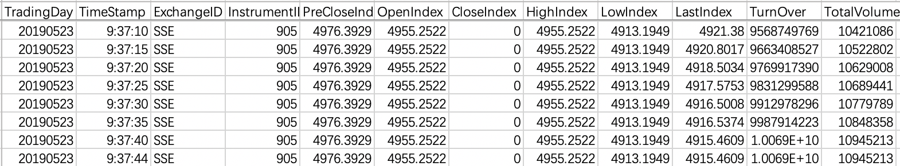
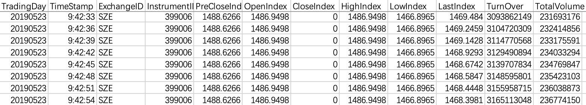
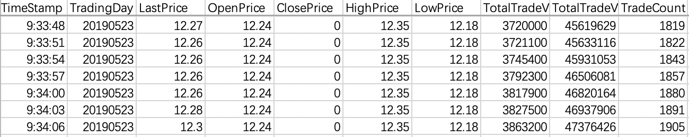
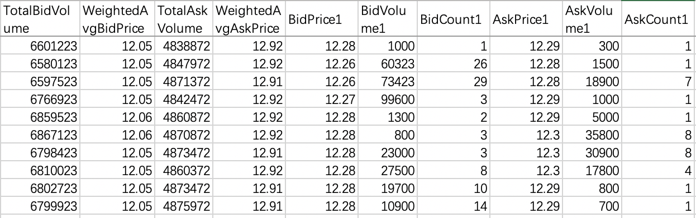
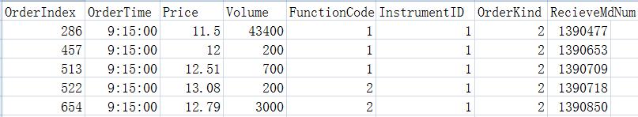
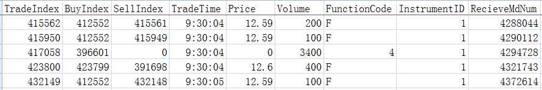

# 因子基础

## 股票数据

### 指数截面数据

股价指数（或称股市指数、股票指数）包含多种股票，是反映市场上组成股票价值的一个数据。它通常被用于展现组成股票的共通特性，例如在同一个证券交易所交易，属于同一个产业，或有相同的市值。

截面数据又称为切片数据。A 股的截面数据是根据指定的时间间隔进行一次检查，如果该时间段内有动作（报撤单），就生成一次快照并推送出来。

000905 中证 500




399006 创业板指



- TimeStamp：交易所时间戳。000 开头的指数由上交所编制，频率为 5s 一个；399 开头为深交所编制，频率为 3s 一个。
- ExchangeID：上海为 SSE，深圳为 SZE。
- PreCloseIndex：index 昨收价。
- OpenIndex：index 开盘价。
- CloseIndex：index 收盘价。直到 15:00 才会推送，其他时候为 0
- HighIndex：到目前为止，最高的 index 价格
- LowIndex：到目前为止，最低的 index 价格
- LastIndex：截取截面数据时，最新的 index 价格
- TurnOver：到目前为止，指数所有成份股的总成交额
- TotalVolume：到目前为止，指数所有成份股的总成交量

不同指数频率不一致，使用时要先**统一格式**。

为了和股票数据的 columns 统一，增加了很多无效的列，如盘口数据等。有效的就是上述 columns，只是列名都换成股票的名字。

### 常用指数

- 沪深 300：大盘股指数。由从上海和深圳两个交易所，选择出来最具市场影响力的 300 个大市值公司股票作为权重计算出的指数，用来反映沪深证券市场的整体状况。具体方法：
  1. 最近一年的 A 股日均成交金额由高到低排名，剔除排名后 50% 的股票；
  2. 对剩余股票按照最近一年 A 股日均总市值由高到低排名，选取前 300 名股票作为指数样本。

- 中证 500：小盘股指数。选取方法：
  1. 在样本空间中剔除沪深 300 指数样本股及最近一年日均总市值排名前 300 名的股票；
  2. 将剩余股票按照最近一年（新股为上市以来）的最近一年日均成交金额由高到低排名，剔除排名后 20% 的股票；
  3. 将剩余股票按照最近一年日均总市值由高到低进行排名，选取排名在前 500 名的股票组成中证 500 指数样本股。
- 上证指数
- 深证成指
- 上证 50
- 中证 1000
- 创业板综
- 创业板指
- 中小板综
- 中小板指

注：

- 指数是按**调整市值**加权；
- 成份股分红时，不修正指数，指数自然回落；
- 同花顺中的白线/黄线，白线：加权价格；黄线：等权价格。

### 个股截面数据

level2 截面数据，有十档 OrderBook。外网上只能拿到 level1 截面数据，有五档 OrderBook，也缺少部分 columns。



- TotalTradeVolume：到目前为止，个股总成交量
- TotalTradeValue：到目前为止，个股总成交额
- TradeCount：到目前为止，总成交笔数

盘口数据



- TotalBid/AskVolume：全档买盘/卖盘总挂单量
- WeightedAvgBid/AskPrice：全档挂单量加权买价/卖价
- Bid/AskPrice1：一档买价/卖价。1 是第一档，总共有十档，1-9，A（第十档）。
- Bid/AskVolume1：一档买量/卖量
- Bid/AskCount1：一档买单个数/卖单个数
- mp, mid price：盘口中间价格。使用 mp 是保证在盘口没有变动时，不会像 last price 在 bp1 和 ap1 之间跳动。
- wp, weighted price：盘口加权价格

```python
df["mp"] = (df["bp1"] + df["ap1"]) / 2
df["wp"] = (df["bp1"] * df["av1"] + df["ap1"] * df["bv1"]) / (df["bv1"] + df["av1"])
```

### Level2 逐笔数据

逐笔数据一般是针对深交所的股票而言（000 和 300 开头）。上交所（600 开头）只有 trade 逐笔数据，且为每 3s 推送一次，使用价值不大。

#### 逐笔委托 order 数据



- OrderIndex：报单编号，从 1 开始，分 group 连续。不同股票 OrderIndex 可能相同。OrderIndex 与 trade 数据中的 BuyIndex 或者 SellIndex 一一对应
- OrderTime：**交易所收到**报单的时间
- Price：报单价格。这个字段只有在报单类型是限价单的时候才有效，对于限价单 price 是最差的成交价格。
- Volume：报单数量，**股数**
- FunctionCode：报单方向，1 是买单，2 是卖单
- InstrumentID：证券代码
- OrderKind：报单类型，1 是市价、2 是限价、U 是本方最优价。
  - 市价指的是，order 到达交易所时，将会以对手价一档申报。如果部分成交时，剩余量会变成挂单。比如 ask1 10.00 20，如果报一个 30 手市价买单，那么 ask1 会上移，bid1 变为 10.00 10。另外，申报时市价单价格是无效的。
  - 本方最优价指的是，order 到达交易所时，将会以本方一档申报。意思是你的报单一定会变成挂单挂在本方一档。

#### 逐笔成交 trade 数据



- TradeIndex：成交编号，从 1 开始，分 group 连续。表征成交的先后顺序，没有其他特殊用途
- BuyIndex：买单编号。对应 Order 中方向为买的报单的 OrderIndex
- SellIndex：卖单编号。对应 Order 中方向为卖的报单的 OrderIndex
- 对于同一支股票：
  - BuyIndex > SellIndex：买单的报单时间在卖单之后，**主动成交的方向为买**
  - BuyIndex < SellIndex：买单的报单时间在卖单之前，**主动成交的方向为卖**
- TradeTime：成交时间
- Price：成交价格
- Volume：成交数量
- FunctionCode：成交类型。F 为成交，4 为撤单。
  - 为撤单时，只有 BuyIndex 或者 SellIndex，且价格为 0。
- InstrumentID：证券代码

### EOD 数据

end-of-day 数据。所有价格相关的数据都是**复权**的，可以直接用来计算 return，但是和同花顺中显示的价格不一样。

### 使用滚动窗口归一化

```python
window_size = 30

# 计算滚动窗口的平均值和标准差
rolling_mean = df['price'].rolling(window=window_size, min_periods=1).mean()
rolling_std = df['price'].rolling(window=window_size, min_periods=1).std()

# 进行归一化
df['normalized_price'] = (df['price'] - rolling_mean) / rolling_std
```

### 在数据划分之前归一化

- 使用整个训练集的数据来计算归一化参数。
- 使用相同的参数对训练集和测试集进行归一化。

## 价格因子

利用过去的价量信息、价格形态对价格进行预测，也就是经常说的价（形态、位置）、量（放量、缩量）、时（时间长度）、空（振幅）。由于价格因子是最被广泛使用的技术指标，所以要挖掘出有效的价格因子有一定难度。另一方面，常见的技术分析指标相关性很高，所以需要一些另辟蹊径的方法。

- **mp**：盘口中间价格
- **wp**：盘口加权价格
- **vol**：成交量

主要研究思路：

- 联动（intermarket 因子）：在股市中，股票的相关性很高，所以个股与个股、个股与板块、个股与指数之前往往存在一些联动的关系，从联动关系中判断涨跌
- 突破 （结合了 CTA 的非方向因子）：各种通道、形态突破，借鉴了传统 CTA 的思想
- 趋势（价格因子）：根据过去的价量信息判断出趋势后进行跟随。
- 反弹（价格因子）：反转类因子，希望买在价格的低位，而不是价格追涨，这类因子在传统的各类技术分析中比较少见，挖掘难度也比较大

### 趋势因子

#### MACD

```python
short_period = 20
long_period = 40
dea_period = 10
ema_short = df['mp'].ewm(span = short_period, adjust=False).mean() # 使用指数移动平均 Exponential Moving Average, EMA 来平滑数据并识别趋势，短期 EMA
ema_long = df['mp'].ewm(span = long_period, adjust=False).mean() # 长期 EMA
ema_diff = ema_short - ema_long
ema_dea = ema_diff.ewm(span=dea_period, adjust=False).mean() # DEA 线
eam_bar = 2*(ema_diff-ema_dea) # MACD 柱状图，MACD 线（ema_diff）与信号线（ema_dea）之间的差值的两倍。MACD 柱状图用于表示动量的强度，其长度表示买方和卖方之间的力量差异
macd = eam_bar
df["x_macd"] =  macd
```

#### RSI

```python
period = 20
ret = np.log(df["wp"]/df["wp"].shift(1)) # 对数收益率 log returns
abs_ret = np.abs(ret)
ret_ema = ret.ewm(span=period).mean()
abs_ret_ema = abs_ret.ewm(span=period).mean()
rsi = ret_ema/abs_ret_ema
rsi = np.where(np.array(range(len(df)))<period, 0, rsi)
```

考虑波动性（当波动小的时候，不可预测性增加）：

```python
mp_std = df["wp"].rolling(20).std().fillna(0)
mp_std = tanh(mp_std, 0.3, 1)  # 缩放到 [1, 1.3]
factor = rsi*mp_std
```

#### KDJ

```python
rolling_max = df["wp"].rolling(period).max()
rolling_min = df["wp"].rolling(period).min()
rsv = (df["wp"] - rolling_min) / (rolling_max - rolling_min)
rsv = pos*2-1 # 将位置值的范围从 [0, 1] 调整为 [-1, 1]
kdj_k = rsv.ewm(com=2, adjust=False).mean()
kdj_k = pd.Series(np.where(np.array(range(len(df)))<period, 0, kdj_k)) # 调整初始周期的值
kdj_d = kdj_k.ewm(com=2, adjust=False).mean()
kdj_j = 3*kdj_k - 2*kdj_d
```

偏度、PMR、R方、RSI、mean/std：大致就是根据价格形态来判断趋势。

### 反转因子

#### 布林带 Bolling

```python
period = 40
mp_mean =  df["mp"].rolling(period).mean() 
bolling_up = mp_mean + 2 * df["mp"].rolling(period).std() 
bolling_down = mp_mean - 2 * df["mp"].rolling(period).std()
bolling = (df["mp"]-mp_mean) / (bolling_up - bolling_down)
```

缺点：无法防范尾部风险，容易一波爆仓。

更好的反转因子：应该是真正出现了底部特征的时候才去买的，或者出现了一点反转入场。

对底部的描述：

1. 从加速度的角度考虑：上涨/下跌速度减慢，波动变小，开始盘整
2. 从位置的角度考虑
3. 背离：价量背离，价格和一些指标的背离（可以利用 Corr 计算）量缩小了可能是一个底部的特征 `np.corr(mp， vol)`

### InterMarket 因子

在股票市场中，涨跌具有比较高的一致性，个股与指数、个股与板块都有比较强的联动效应，所以可以根据他们之间的联动关系来做一些因子。

InterMarket 因子用到的主要还是价格数据

- mp1：交易标的的价格

- mp2：参考标的的价格（指数/板块指数/其他股票）

赚取的利润是跟随大盘的钱

1. 大盘上涨的时候，个股没涨，那么之后有可能需要补涨
2. 个股相对大盘涨了很多，这个时候大盘下跌了，这个时候有补跌的可能

- 直接用 index 的信号来做个股的 T0

```python
index_pmr_period = np.log(df["index"]/df["index"].shift(20))
index_pmr_period = index_pmr_period.fillna(0)
```

- 个股相对于 index 额外的涨跌

```python
stock_pmr = np.log(df["mp"]/df["mp"].shift(50))
index_pmr = np.log(df["index"]/df["index"].shift(50))
pmr_delta = stock_pmr - index_pmr
FACOTR = -pmr_delta
```

- 用 beta 改进，beta 是个股相对于 index 的相对波动大小

```python
stock_pmr = np.log(df["mp"]/df["mp"].shift(50))
index_pmr = np.log(df["index"]/df["index"].shift(50))
pmr_delta = stock_pmr/beta - index_pmr
FACOTR = -pmr_delta
```

#### InterMarket 指标

- Relative Strength：用一个指数和另一个基准指数相除，可以对这个指数计算 MA 消除不稳定因素和噪声使它更加平滑
- Bollinger Band Divergence

```python
SEC1BOL=(C-BollingerBBottom)/(BollingerBTop-BollingerBBottom)
```

为了消除负数（close 超出布林带以下时）

```python
SEC1BOL=1+(C-MA+2SD)/4SD
```

divergence 使用下式计算：

```python
DIVERGENCE=EMA(3)[(SEC2BOL−SEC1BOL)/SEC1BOL∗100]
```

- intermarket disparity

```python
DS1=(SEC1-MA(SEC1))/MA(SEC1)∗100
DS2=(SEC2-MA(SEC2))/MA(SEC2)∗100
IntermarketDisparity(ID)=c∗DS2-DS1 # 相关系数为正c=1，相关系数为负c=-1
```

- intermarket LRS divergence：分别计算两个指数的 LRS（斜率），然后根据波动率（或者 beta）来进行调整，对调整后的值做差。

**思考**：

1. 改变周期
2. 提出的指标进行改进测试
3. 结合之前的反转因子

## Orderbook 因子

主要是根据 Orderbook 的不平衡和流动性缺失等信息来描述方向。

可能用到的信息：

- **Bid/AskPrice1**：一档买价/卖价。1是第一档的意思，总共有十档，1-9，A（第十档）
- **Bid/AskVolume1**：一档买价/卖量
- **Bid/AskCount1**：一档买单个数/卖单个数
- **TotalBid/AskVolume**：全档买盘/卖盘总挂单量
- **WeightedAvgBid/AskPrice**：全档挂单量加权买价/卖价

因子举例：

```python
factor = (df["bv1"]-df["av1"])/df["bv1"]+df["av1"]
```

**思考**：

1. 股票一共有 10 档数据，应该用几档数据比较合适（如示例因子只有 1 档），每一档的权重应该怎么定？
2. 示例的因子只考虑了 bv1 和 av1，没有考虑 bp1，ap1。对于买价稀疏程度，明显低于卖价的稀疏程度，应该如何描述？

```python
bas = (2*df["bv1"]+1*df["bv2"]-2*df["av1"]-1*df["av2"])/(2*df["bv1"]+1*df["bv2"]+2*df["av1"]+1*df["av2"]) # 买卖一、二档的不均衡
```

3. Orderbook 的因子归一化的问题，如果只考虑一个截面的话，可能这个截面 Orderbook 可以给出方向，但是其实是买盘和卖盘都很小，那这个时候的预测能力是否应该得到减弱？（用过去一段时间的值做调整或者 eod 数据调整）。比如说买 1 有 10 手，卖 1 有 1 手，但是平常盘口但是几百几千的单子，这个时候时候怎么处理？
4. 买/卖 1 档、买/卖 2 档之间当流动性缺失的时候可能不是完全对应的。
   1. 解决方法1：百分比/最近的平均波动跳数，重新定义 Orderbook。
   2. 解决方法2：构造 weighted price 描述的是价格的重心，然后重心 wp 距离 mp 越远说明流动性缺失越严重。
5. Orderbook 因子往往只适合比较短的周期，有没有办法用 Orderbook 去预测稍微长一点的时间？加 rolling ewma/count 尝试长周期的 Orderbook 因子。
6. Orderbook 是动态的，示例因子 bas 中完全没有考虑 Orderbook 的上下移动。因为价格刚刚变化的时候 Orderbook 肯定是比较薄的，要给这个时候一定的补偿，也就是考虑价格在这里停留的时间。
7. 如何描述挂单/撤单/追单的现象（价格的变化与 Orderbook 价格重心的变化）
8. Orderbook 因子是不是在低价股上比高价股上面有效？
9. 衡量流动性的因子：衡量现在盘口的流动性的的因子（可以分别有一个买盘的流动性因子、卖盘流动性因子），然后将其看作是一个非方向的因子，把这个非方向因子作为调整值放入到前面的因子中看一下效果是否有什么变化

注意：涨跌停的时候一侧的 Orderbook 价格为 0。

## Trade 成交类因子

根据订单流方向预测接下来的价格变动方向。主动成交多换手率高（活跃）、挂单比较多（流动性好）的股票 Trade 因子应该更有效。

- **TotalTradeVolume**：到目前为止，个股总成交量
- **TotalTradeValue**：到目前为止，个股总成交额
- **TradeCount**：到目前为止，总成交笔数

可以推算出 long_score 主动买数量、short_score 主动卖数量、score 主动买卖量的差值。

```python
score = long_score - short_score
factor = score.ewm(span = period, adjust=False).mean()

# 最近的 score 的平均
factor = df["score"].rolling(20).mean()
```

利润来源

1. 市场交易意图比较一致的时候的趋势。
2. 机构建仓的钱，比如说在一段时间内比较固定频率的建仓。
3. 阻力位被突破的时候，往往伴随着在一个地方有大量成交，但是价格没怎么变化。
4. 突然的知情交易者的钱，比如说有消息来了，主动成交突然变多，这个时候个股的快速拉升。
5. Trade 造成了剧烈的短时间类价格异常后反转的利润。

**思考**：

1. Trade 因子适合不同的周期，所以对于每个因子都可以试试短周期（5-20 个 tick）、中周期（100-500 个 tick）。
2. 主力识别，主动成交一个比较重要的应用就是识别出主力的方向
   1. 方法一：用最近的成交量、成交次数可以计算出平均的单笔成交量，来判定知情交易者。
   2. 方法二：把大的 trade 单定义为知情交易者。只有大的订单才会引起价格的变动，所以可以根据 trade 数据统计方向。
3. 主动成交和价格变化的关系，持续主动成交会引起价格的变化，多少的成交量引起多少的价格变化是一个可以研究的方向
   1. 举例一：如果一个大单被持续的吃掉，那么这个时候主动成交大，价格却又没什么变化
   2. 举例二：在流动性非常差的时候一个单子把价格上抬了非常多，如何确定**价格变化**、**主动买卖量**对**未来涨跌**的影响。
4. Trade 值的一些其他统计，如描述最近的 Trade 一致性 RSI，或者描述最近 Trade 数量的速度/加速度

**注意**：

1. 由于成交量的厚尾效应非常明显，所以做成因子的时候归一化到平稳很重要。解决方法如 tanh、对每个 tick 的最大量做一个限制。
2. 因子值越强越明显吗？

在个股中有 orderbook、trade、price 这三种类别的因子，而在指数中由于不可交易，所以没有 orderbook，只存在 price、trade 两类因子

## 非方向因子

非方向因子指一些描述形态类的因子，与方向因子不同，其值越大并不代表预测接下来上涨/下跌的幅度 ，而是描述某种价格特征。

非方向因子的预测能力往往为 0（不预测涨跌），但是跟方向因子向叠加可以提升其效果。如果成交量大，那么此时的方向行情更具有说服力，就是俗称的放量突破，所以放量之后，原来的因子值应该更大，预测能力更强。

- 波动：STD、ATR
- 趋势性：CORR、abs(MEAN)/STD
- 其他：volume、峰度

### 基于价格

1. 描述当时的波动：std

```python
df["mp"].rolling(20).std()/df["mp"].rolling(60).std()
```

2. 描述波动：ATR

```python
avg(max(df["high"]-df["low"], df["high"]-df["close"].shift(1), df["low"]-df["close"].shift(1)))
```

3. 描述偏离

```python
rolling_mean = df["wp"].rolling(window=window_value).mean().fillna(df["wp"][0])
Amplitude = abs(df["wp"] - rolling_mean)
```

4. 跟指数相关

```python
df_short = (np.log(df['index'] / df['mp'])).rolling(12).mean()
df_long = (np.log(df['index'] / df['mp'])).rolling(24).mean()
factor = df_short / df_long
```

5. mp 跟指数的相关性

```python
factor = df['mp'].rolling(window=tick).corr(df['index'])
```

6. 自身价格的相关性

```python
df['mp'].rolling(window=tick).corr(df['mp'].shift(1))
```

7. 价格的一致性

```python
(abs(df["ret"]).rolling(period).mean())/df["ret"].rolling(period).std() # return 收益率
```

8. 价格的峰度

```python
factor = df["ret"].rolling(window=tick).kurt()
```

### 基于量

9. 成交量

```python
factor = np.tanh(df['vol']) # 归一化
factor = factor.rolling(window=tick).mean()
factor = factor.fillna(0)
```

10. 价量背离

```python
df['mp'].rolling(window=tick).corr(df['vol'])
```

### 基于 Orderbook

11. 衡量流动性

```python
abs((df["ap10"]-df["ap1"])/(df["bp1"]-df["bp10"]))
(abs(df["ap10"]-df["ap1"])/0.01 - 9) + (abs(df["bp10"]-df["bp1"])/0.01 - 9)
```

0.01 是最小跳的价格，0.09 是挂单最密集时，ap1 与 ap10 的价差。和卖盘最密集的情况相比，卖盘的挂单价格多了多少档。

把买盘和卖盘的档位差加起来，就可以衡量挂单的流动性。数值越小，意味着挂单流动性越好，因为买卖挂单更密集，价格变动的档位更少。相反，数值越大，意味着流动性越差，因为买卖价格的分散度更高，导致挂单深度低。

### 应用举例

```python
index_pmr_period = np.log(df["mp"]/df["mp"].shift(20))
index_pmr_period = index_pmr_period.fillna(0)

# 波动因子
std_factor = df["mp"].rolling(20).std()/df["mp"].rolling(60).std()

# 归一化
std_factor = tanh(std_factor, alpha=2, bound=0.2)+1

# 最后的因子值在范围内波动，比如这里是 [1,1.2]，避免出现突然一个非常大的值
index_pmr_period = index_pmr_period*std_factor
```

## K 线因子

之前用到的都是 Tick 数据，但是如果是做一些长周期的预测的话，可以不需要这么精确的数据，采用 K 线数据即可。

resample 成 K 线因子之后，信息包括 open、high、low、close、volume、buy_score、sell_score。

## 因子增强

单因子增强

1. 尽量简单，思路清晰（知道这个因子描述的是什么行情）
2. 参数尽量少（方便优化、避免过拟合）
3. 相关性低（思路另辟蹊径，跟传统指标相关性低）
4. 表现好（单笔利润与交易次数）

因子增强是在单个因子的基础上进行改进，提高表现，结合其他因子改进的时候用到因子也较少（避免过拟合），具有较好的可解释性。而因子组合是利用各种机器学习的模型对现有的因子进行结合，因子组合用到的因子会比较多。

### 对单因子的操作

#### 1. 去极值

- MAD 中位数绝对偏离修正法

up_percentile、low_percentile 取数据百分位数区间，将数据进行升序排序，只取该区间内数值进行样本计算。高于 Upper（包括 up_percentile 部分）的值将以 Upper 替换，低于 Lower（包括低于 low_percentile 部分）的值将以 Lower 替换，合法输入为 0%-100%，默认区间为 100%-0%

```python
Upper = MD+3 * 1.4826 * MAD  
Lower = MD-3 * 1.4826 * MAD
```

其中 `MD=median({xi,i=1,2,…,N}), MAD=median({|x_i-MD|,i=1,2,…,N})`，median 为求样本中位数

- Norm_distr 正态分布法

multiple 倍数，当 `win_type='Norm_distr'`，更改该参数有意义，合法输入为正整数，默认值为 3。

iterations 去极值的迭代次数，只有当 `win_type='Norm_distr'` 且数据百分位区间缺省时，更改该参数才有意义，合法输入为正整数，默认值为5。

```python
Upper = Mu + multiple * Sigma  
Lower = Mu - multiple * Sigma
```

其中 `Mu=mean({xi,i=1,2,…,N})，Sigma=std({xi,i=1,2,…,N})`

- Box_plot 分位数修正法

quantile 取分位数，合法输入为正整数，默认值为4。

quantileA 取分位数的档位，合法输入为正整数，默认值 3。

quantileB 取分位数的档位，合法输入为正整数，默认值为 1。

```python
Upper = QA + multiple*(QA-QB)
Lower = QB - multiple*(QA-QB)
```

其中 QA、QB 分别为样本点的分位数，一般取四分位数的第三分位数和第一分位数。

#### 2. 归一化方法

- Z_SCORE_NORM Z 值标准化

$$
x_i = \frac{x_i - \mu}{\sigma}
$$

标准化后的数据可以解释为偏离均值多少倍标准差。另外，均值和方差也可以采用加权平均方式计算，如在多因子分析过程中采用市值加权，其标准化后，基准组合对各个因子的因子暴露为 0，非零的因子暴露度就是投资组合偏离了基准组合多少倍标准差。

- LIN_NORM 线性标准化

$$
x_i^s = \frac{x_i - x_{min}}{x_{max} - x_{min}} \times 2 - 1
$$

- tanh 非线性标准化

```python
y = bound * (1.0 - np.exp(-alpha * x)) / (1.0 + np.exp(-alpha * x))
```

bound：上下限。一般取 1，缩放到 [-1, 1]

alpha：调节变化速度，越大变化得越快。一般取 2/std，这样到达 2 倍标准差的时候就比较接近 1 。

#### 3. 滤波方法、其他增强方法

- EMA、MA

```python
ema = df["mp"].ewm(span=20,adjust=False).mean()
ma = df["mp"].rolling(20).mean()
```

- median

```python
df["mp"].rolling(20).median()
```

- np.sign：防止时间序列中一些非常大的值，这样即使求了 MA 也依然噪声很大

```python
np.sign(score)
```

- np.clip：防止极端异常值，且相比符 np.sign 又体现出了强度

```python
np.clip(score, -thr, thr)
```

- e 底数（调整系数），将 0 附近的数缩放到 1 附近，方便后面使用
- In函数：将 0 附近的数缩放到 1 附近，方便后面使用
- 平方：金融数据在因子值比较小的时候预测性比较弱，表现出来的很可能是噪声，所以让小的更小
- Sigmoid 函数
- 门函数

这些增强方法本质是从一个序列映射到另一个序列，有的方法用了之后结果可能会有提升，但是有的方法用了之后单个因子可能没有提升（分位顺序没有改变），但是会使因子的分布更加接近正态化，对之后因子的结合会有帮助

### 多因子增强方法

1. 直接相加：如两个方向因子相结合，相关关系为正，可以不用回归，自己定一下系数，可能效果就不错。
2. 相乘：对于一些成交量、波动这类非方向因子，调整到 1 附近。原来的方向因子可以通过 e 底数，也调整到 1 附近，然后可以将非方向因子和方向因子相乘。
3. 仅在某些时候增强：如因子 A 只在某些情况下对原因子起到了增强的结果，那么可以用门函数或者是 Sigmoid 函数，把某些情况过滤掉，然后再相加或者相乘。

这些规则虽然看起来比较简单，但是大部分好的因子其实都不复杂，添加的条件不会特别多。同时在组合的因子不是特别多的情况下，也具有比较好的解释性，方便理解市场。

### 警惕未来函数

1. rolling、shift 中带了负号，e.g. shift(-10)
2. 用一天的数据去 ZScore 或者归一化：`df = df.apply(lambda x: (x-np.min(x))/(np.max(x)-np.min(x)), axis=0)`
3. 填补 NA 值的时候用均值，应该用 0 或者前值去填充

### 参考书籍

1. Statistically Sound Machine Learning for Algorithmic Trading of Financial Instruments
2. The Encyclopedia Of Technical Market Indicators

### 课程设计实例：

- High/Low：最高价除以最低价，波动率因子
- -1 * AdjVolume：后复权交易量
- -1 * Resvol：Barra 因子模型
- ts_Mean(NetProfitMRQ/AMktCap, 30)：季度净利润的均值
- -ts_Mean(Volume./(AMktCap./Close) , 300) * 300：换手率除以收盘流通市值的均值

使用的是简单多样化，即等权重。
