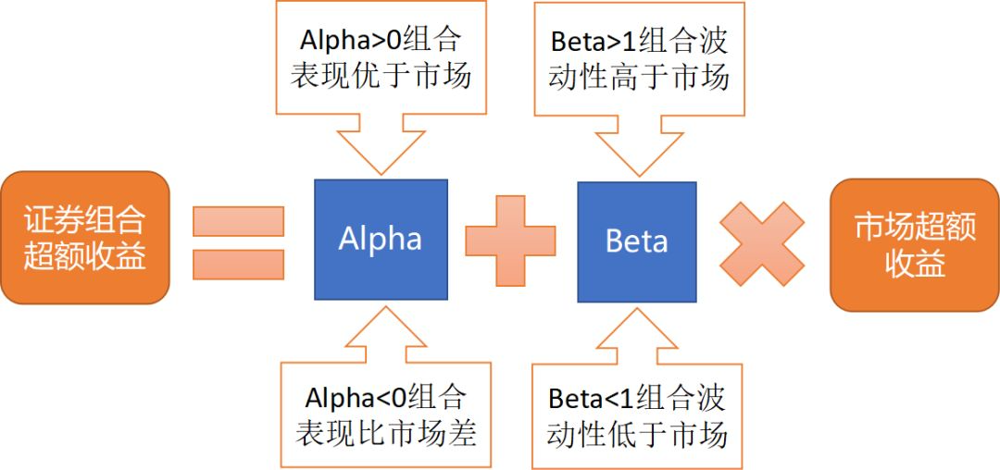

# 多因子量化选股模型

多因子模型是建立在**投资组合、资本资产定价（CAPM）、套利定价理论（APT）**等现代金融投资理论基础上，在量化投资领域应用最广泛也最成熟的量化选股模型之一。

多因子模型假设市场是**无效或弱有效**的，通过主动投资组合管理来获取超额收益。多因子选股的核心思想在于，市场影响因素是多重的并且是动态的，但是总会有一些因子在一定的时期内能发挥稳定的作用。

## 理论背景

现代金融投资理论主要由**投资组合理论、资本资产定价模型（CAPM）、套利定价理论（APT）、有效市场假说、期权定价理论以及行为金融理论**等组成。

- 1952 年 Markowitz 证券组合选择，引入了**均值和方差**来定量刻画股票投资的收益和风险，建立了确定最佳资产组合的基本模型。

- William Sharpe、John Lintne、Jack Treynor、Jan Mossin **资本资产定价模型**（Capital Asset Pricing Model, CAPM），不仅提供了评价收益-风险相互转换特征的可运作框架，也为投资组合分析、基金绩效评价提供了重要的理论基础。CAPM 模型认为所有证券的收益率都与唯一的公共因子市场证券组合的收益率存在着线性关系。

- 1976 年，针对 CAPM 模型存在不可检验性的缺陷，Stephen Ross 提出了**套利定价理论**（Arbitrage Pricing Theory，APT），以收益率形成过程的多因子模型为基础，认为证券收益率与一组因子线性相关，这组因子代表证券收益率的一些基本因素。事实上，当收益率通过单一因子（市场组合）形成时，会发现套利定价理论与资本资产定价模型相同。因此，套利定价理论其实是一种广义的资本资产定价模型，该理论成了多因子量化选股模型的重要理论基础。

但是套利定价理论并没有指出影响证券收益的具体因素，在应用中需要预先判断哪些因素可能影响证券收益，并使用统计分析方法进行验证。研究者从不同角度出发，发现了各类影响证券收益的因子，比较经典的有 **Fama-French 三因子模型**。

市场中的小市值、价值股表现明显超过市场，而这一效应不能用 CAPM 模型解释。1981 年，大卫·布斯和雷克斯·桑奎菲尔德成立了维度投资顾问公司，买入小市值、低估值的股票，获得了高额回报。1992 年，Fama 和 French 对美国股票市场决定不同股票回报率差异的因素的研究发现，股票的市场的 beta 值不能解释不同股票回报率的差异，而**上市公司的市值、账面市值比、市盈率**可以解释股票回报率的差异，因此提出了著名的**三因子模型**。

随着市场交易实践和研究的不断深入，研究者又发现市场中的动量现象无法用三因子模型解释。1997 年，卡哈特（Carhart）认为研究股票收益应在 Fama 和 French 的三因子模型基础上加入**动量效应**，构建**四因子模型**。动量投资策略依据的就是动量效应，又称为“惯性效应”，即某个时段跌得最深或长得最猛的股票往往会沿着原来的方向继续运动。

虽然四因子模型将股票收益与价格本身联系起来了，但与公司价值关系不大。从直觉上理解，在其他条件一定的情况下，财务质量高的上市公司应该带来更高的投资回报，因此有必要引入刻画**公司资产质量的因子**。2013 年，Fama 的学生阿斯内斯（Asness）对公司“质量”进行量化，并提出了**五因子模型**。

后来，研究者们又发现**低波动率（低 beta）股票组合的实际收益比高波动率（高 beta）股票组合的要高**，这一现象无法用五因子模型解释，于是法拉瑞利等于 2013 年又将波动率因子引入，建立了**六因子模型**。

五类风险因子，围绕它们构建的具备可投资性的纯多头投资组合在回测中可以获得相对于基准指数的超额收益。**这五类因子是：流动性因子、规模因子、成长因子、估值因子以及反转因子。**

## 多因子模型的构建

多因子量化选股的原理不难理解，即认为股票收益率是由一系列因素（因子）决定的，根据经济金融理论或市场经验寻找这些因子，然后通过对历史数据的拟合和统计分析进行验证和筛选，最后以这些因子的组合作为选股标准，买入满足这些因子的股票。在实践中，多因子量化选股已经是一个相对成熟且大致框架较为固定的策略，具体可分为五个步骤，分别为**因子选取、因子有效性检验、因子筛选、综合评分模型以及模型的评价和改进**。

### 因子的选择

多因子选股模型的第一步是发掘各类与股票收益率相关的因子，因子的选择主要基于经济逻辑和市场经验，在经典的规模、估值、动量、波动率等全市场通用因子基础上，根据宏观、行业、公司基本面、市场特征，结合各类特异因子来构造投资组合。影响股价收益的因子多种多样，见仁见智，参考券商研报总结，有以下几类（还可以继续细分和挖掘）：

1. **市场整体**：市场因子、系统性风险等;
2. **估值因子**：市盈率、市净率、市销率、 市现率、 企业价值倍数、 PEG 等；
3. **成长因子**：营业收入增长率、营业利润增长率、净利润增长率、每股收益增长率、净资产增长率、股东权益增长率、经营活动产生的现金流量金额增长率等；
4. **盈利能力因子**：销售净利率、毛利率、净资产收益率、资产收益率、营业费用比例、财务费用比例、息税前利润与营业总收入比等； 
5. **动量反转因子**：前期涨跌幅等； 
6. **交投因子**：前期换手率、量比等； 
7. **规模因子**：流通市值、总市值、自由流通市值、流通股本、总股本等； 
8. **股价波动因子**：前期股价振幅、日收益率标准差等；
9. **分析师预测因子**：预测净利润增长率、预测主营业务增长率、盈利预测调整等。 

### 附：基本面因子

- **公司财务数据**：最核心的数据源，比如资产负债表（资产负债率、流动比率）、利润表（营收增速、毛利率、净利润率）、现金流量表（经营现金流净额、自由现金流）；
- **行业与产业链数据**：比如行业集中度、产能利用率、上下游价格（如大宗商品价格、原材料成本）、政策导向（如新能源补贴、医药集采政策）；
- **宏观经济数据**：影响全市场或行业的宏观指标，如 GDP 增速、利率、通胀率、汇率、M2（货币供应量）；
- **另类基本面数据**：非传统财报数据，比如上市公司调研记录、管理层言论、供应链数据（如订单量、发货量）、ESG（环境、社会、治理）数据。

因子是能解释资产收益差异的可量化指标，本质是把"好公司"的标准拆成一个个可计算的数据维度：

|因子类型|核心逻辑|代表因子|
|---|---|---|
|价值因子|股价低于内在价值（"便宜股"）|市盈率（P/E）、市净率（P/B）、市销率（P/S）、股息率|
|成长因子|公司未来盈利持续增长（"成长股"）|营收同比增速、净利润同比增速、ROE 增速、资本开支增速|
|质量因子|公司经营稳健、盈利质量高（"好公司"）|ROE（净资产收益率）、毛利率稳定性、经营现金流 / 净利润、资产负债率|
|盈利因子|公司当前盈利能力强|净利润率、EBITDA（息税折旧摊销前利润）、ROIC（投入资本回报率）|
|动量 / 反转因子|基本面趋势的延续性|盈利上调幅度、营收环比改善幅度、分析师评级上调次数|

### 因子有效性的检验

一般检验方法主要采用排序的方法检验候选因子的选股有效性。例如：可以每月检验，具体而言，对于任意一个候选因子，在模型形成期的第一个月初开始计算市场中每只正常交易股票的该因子的大小，按从小到大的顺序对样本股票进行排序，并平均分为 N 个组合，一直持有到月末，在下月初再按同样的方法重新构建 N 个组合并持有到月末，一直重复到模型形成期末。还有一个参数是候选组合的数量，具体参数的最优选择，需要用历史数据进行检验。

### 剔除冗余因子

不同的选股因子可能由于内在的驱动因素大致相同等原因，所选出的组合在个股构成和收益等方面具有较高的一致性，因此其中的一些因子需要作为冗余因子剔除， 而只保留同类因子中收益最好，区分度最高的一个因子。例如成交量指标和流通量指标之间具有比较明显的相关性。流通盘越大的，成交量一般也会比较大，因此在选股模型中，这两个因子只选择其中一个。

冗余因子剔除的方法：假设需要选出 K 个有效因子，样本期共 M 月，那么具体的冗余因子剔除步骤为：

1. 先对不同因子下的 N 个组合进行打分，分值与该组合在整个模型形成期的收益相关，收益越大，分值越高；
2. 按月计算个股的不同因子得分间的相关性矩阵； 
3. 在计算完每月因子得分相关性矩阵后，计算整个样本期内相关性矩阵的平均值；
4. 设定一个得分相关性阀值，将得分相关性平均值矩阵中大于该阀值的元素所对应的因子只保留与其他因子相关性较小、有效性更强的因子，而其它因子则作为冗余因子剔除。

### 多因子选股的判断方法

多因子选股的判断方法分为**回归法（OLS）**和**打分法**。回归方法是利用股票历史收益率对筛选出的多因子进行回归，估计出回归方程系数，然后将最新的因子带入回归方程估计股票未来收益，以此为依据进行选股。回归方法的问题是很难找到一个精确拟合的回归方程，模型误差比较大。

打分法是根据各个因子的大小对股票进行打分，然后根据一定的权重加权得到一个总分，根据总分对股票进行筛选。例如每个月初，对市场中正常交易的个股计算每个因子的最新得分并按照一定的权重求得所有因子的平均分。最后，根据模型所得出的综合平均分对股票进行排序，然后根据需要选择排名靠前的股票。例如，选取得分最高的前 20% 股票，或者选取得分最高的 50 到 100 只股票等等。打分法操作简单，但是权重的确定比较困难，对结果的影响较大。

### 模型的评价及持续改进

多因子量化选股模型是建立在市场无效或弱有效的前提之下，随着使用多因子选股模型的交易者数量的不断增加，有的因子会逐渐失效，而另一些新的因素可能被验证有效而加入到模型当中。此外，一些因子可能在过去的市场环境下比较有效，而随着市场风格的改变，这些因子可能短期内失效，而另外一些以前无效的因子会在当前市场环境下表现较好。

在计算综合评分的过程中，各因子得分的权重设计、交易成本考虑和风险控制等都存在进一步改进的空间。因此在综合评分选股模型的使用过程中会对选用的因子、模型本身做持续的再评价和不断的改进以适应变化的市场环境。因子和参数的获取只能通过历史数据回测来获得，但是在回测过程中，防止出现过度优化也很重要的。

## 总结

多因子量化选股本质是基于历史数据的统计分析，通过寻找那些与股票收益率最相关的因子，并基于套利定价理论，将多个影响因子进行组合，构建综合选股指标来筛选股票。**任何一个多因子选股模型具有一定的时效性、风险性，需要使用者根据市场情况进行调整和更新，这是多因子选股策略存在的不足**。多因子选股模型作为一种量化投资选股策略，最大的优势在于其结果是根据客观的数据和完整的模型得出的，可以避免交易者个人主观意念的干扰，具有一定客观性。多因子选股研究的对象主要是因子，因此单因子的回测和有效性检验是整个多因子模型的重要组成部分。

## 常见因子

| 大类因子                 | 因子变量                                     | 含义                       |
| ------------------------ | -------------------------------------------- | -------------------------- |
| 价值（Value）            | BM、EP、GP等                                 | 估值越低预期收益率越高     |
| 盈利（Profitability）    | ROA、ROE、ROTC等                             | 盈利越高预期收益率越高     |
| 成长（Growth）           | ROA同比变化、ROE同比变化、净利润同比增长率等 | 成长指标越大预期收益率越高 |
| 红利（DP-Yield）         | DP                                           | 股息率越高预期收益率越高   |
| 低波动（Low-Volatility） | IVOL                                         | 特质风险越小预期收益率越高 |
| 规模（Size）             | Size                                         | 市值越小预期收益率越高     |
| 动量（Momentum）         | MOM                                          | 动量越强预期收益率越高     |
| 流动性 （Liquidity）     | ILLIQ、TURN等                                | 流动性越小预期收益率越高   |
