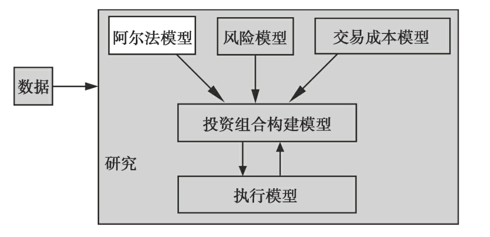
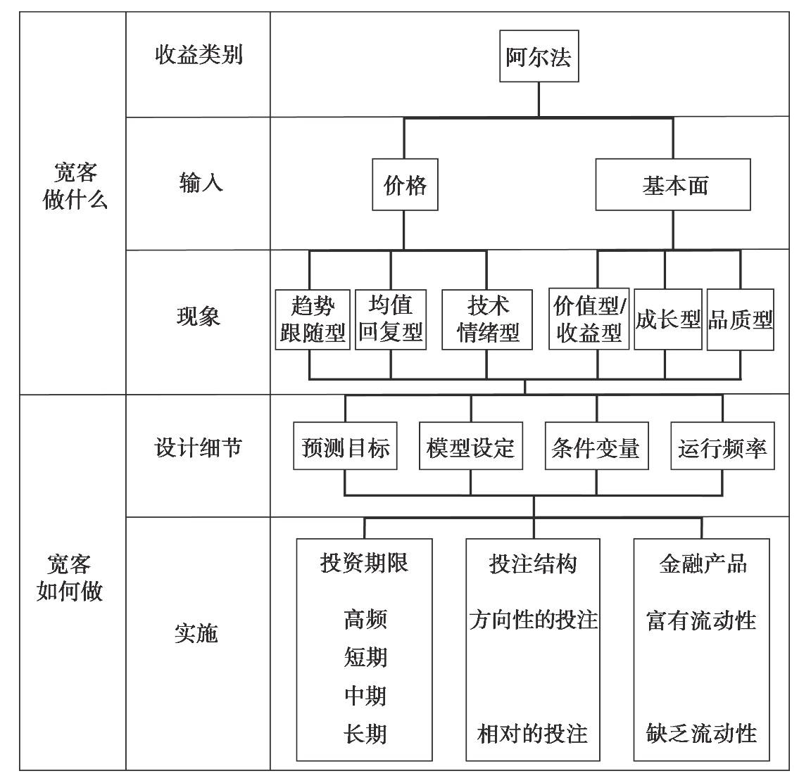

# 阿尔法模型

打开量化投资的黑箱

如果**建仓的点位选择**及**头寸的规模大小**都是系统自动生成的，则是量化交易；如果两者中有一个是需要人工干预的，就不是量化交易。

统计套利（statistical arbitrage）通过改善市场无效性而获利。对于那些市值较小，流动性低且容易被忽视的股票，统计套利者是市场流动性的提供者，帮助市场参与者发现有效的市场价格。

> 亏损时要止损，盈利时要让利润奔跑。

但是主观判断型投资者通常很难及时意识到发生了亏损，相反却会很快意识到盈利，这就是处置效应（disposition effect）。

真正的无效市场代表着存在很少的、转瞬即逝的无风险套利机会。但是，无风险套利并不是 quant 改进效率的唯一方法，甚至不是最主要的方法。quant 并不是能够绝对地消除市场无效性并从中获利，而是概率性地获利，并且需要承担风险。

1. 阿尔法模型：预测交易的金融产品未来趋势（核心部分）
2. 风险模型：控制不太可能带来收益但是会造成损失的敞口规模。
3. 交易成本模型

## 1. 阿尔法模型

阿尔法：在交易中关于**买卖时机把握**和**持有头寸选择**的技巧。

理论驱动型：通过观察市场行为，寻找可能用来解释这些行为的普适性理论，再依据市场数据来检验该理论是否可以有效解释市场行为。

数据驱动型（经验型）：通过对世界的充分观察，也可以对未来的行为模型进行预测。换句话说，知识源于经验。通过合理使用正确的技术手段，识别出隐藏在数据中的模式或规律。

### 理论驱动型

趋势型和均值回复型都依赖于价格数据，技术情绪型比较少见，可以看作基于价格的第三类型策略。而价值型/收益型、成长型和品质型都基于基本面数据。

#### 基于价格数据的交易策略

- 趋势跟随策略（trend following）/动量策略（momentum）：预测已有趋势是否会延续。
- 反趋势策略（counter-trend）/均值回复策略（mean reversion）：预测目前的趋势是否会反转。

##### 1. 趋势跟随策略/动量策略

趋势跟随策略是基于以下基本假定：在一定时间内市场通常是朝着同一方向变化，据此对市场趋势作出判断。趋势法的经济学基本原理是市场均衡理论。

博傻理论（greater fools theory）：人们因为相信趋势才会追涨杀跌，这种行为反过来又促进了趋势的形成。关键在于将持有的产品卖给更傻的下家而避免自身成为最后的持有者。

对于何种变化是显著的，有很多种定义方式，最常见的是滤波（filtering）和调理（conditioning）。

趋势跟随策略的最典型例子出现在期货交易行业，称为期货管理或者商品交易顾问（Commodity Trading Advisor, CTA）。

定义趋势的一种方法是移动平均线交叉指标（moving average crossing indicator），通过对比较短期间和较长期间的某个指标来判断趋势。当短期均线位于长期均线之下时，认为市场处于下跌趋势；反之则认为市场处于上涨趋势。

趋势跟随策略的收益极其不稳定，与丰厚回报相伴而来的是极高的风险。

##### 2. 反趋势策略/均值回复策略

价格终究会沿着已有的趋势反方向运动，而不可能一直延续已有趋势。事实上，价格围绕其价值中枢而上下波动，判断出这个中枢以及波动的方向就足以捕捉到交易机会。

解释均值回复现象存在的原因：

1. 流动性导致的买卖之间的短期不平均，出现超买或超卖现象。
2. 市场参与者并不了解其他人的观点和行为，当他们下单进行买入卖出并促使价格向新的均衡状态移动时，在某个时点可能由于超买或超卖，价格剧烈波动。

组合使用趋势跟随策略和均值回复策略，趋势通常是长期的，而短期内围绕着趋势的小范围波动也是常见的。

采用均值回复策略的主观判断型交易者，通常被称为反转交易者（contrarians）。

基于均值回复概念的最为著名的策略：统计套利策略，价格出现背离的类似股票的价差终究会缩小到合理区间范围。

在某些情况下，均值回复策略可作为长期指标，而动量可以作为速度指标。

##### 3. 技术情绪型策略

主要追踪投资者情绪相关指标来判断预期回报，常见指标有：

- 交易价格
- 交易量
- 波动性指标等。

警惕：没有明确的经济理论来支持这一策略。技术情绪型策略的一些实例也被认为是预测未来价格变动方向的独立方法。

1. 观察期权市场判断市场基本情绪
   - 观察认购量和认沽量，将此作为市场情绪的指标。
   - 利用认购和认沽的隐含波动性：认购和认沽期权的隐含波动率具有一定差别，对于虚值期权或平值期权，**慢涨快跌会造成认沽期权的波动率高于认购期权的波动率**，反过来会造成认沽期权的卖方要价高于认购期权卖方的要价，同样对应的隐含波动率也要高一些。对历史上的认沽和认购波动率的比率进行分析可以发现，该比率维持在一个固定水平（由上面所描述的上行和下行波动率的特点可知该比率大于1），通过观察比率偏离该水平就可以了解市场情绪的迹象。一个类似的想法就是利用隐含波动率或其他指标（如信用违约互换等）作为市场情绪的风向标。
2. 把交易量、公开市场利率或其他相关指标等作为未来价格的风向标：
   - 在很短的时间窗内，一些高频交易者通过观察限价指令簿的形态来判断近期市场情绪。限价指令簿的形态包含很多信息，如相对于最优买入/卖出价的买卖单的量而言买方和卖方出价的规模，以及买入卖出报价单的总量等。
   - 对于较长期的策略而言，对量的分析包括成交量、交易量、公开市场利率以及对交易活动的其他度量指标等。可以将量的信息作为反向指标（或正向指标）使用，例如，成交量大或换手率很高的股票预计会表现不佳，而低成交量或低换手率的股票将会表现出色。

#### 基于基本面数据的策略

基于基本面数据的策略：Fama 和 French 认为，股票的 Beta 系数不足以有效解释股票收益的千差万别；根据**股票的账面净值与股价的比率以及股票市值的历史记录**，再结合股票的 Beta 系数，可以对预期收益作出更精准的预测。

Eugene Fama 的理论奠定了量化阿尔法交易策略的基础，而 Fama 最为著名的工作是市场有效性理论，该理论认为在有效市场上不可能获得阿尔法收益。

##### 1. 价值型/收益型

用于度量资产价值的指标，绝大部分是一些基本面数据与资产价格的比率，如市盈率（P/E）、市净率（P/B ratio）等。有时更倾向于使用这些比率的倒数，通常将资产价格放在分母上，如市盈率的倒数，盈利收益率（earnings yield）。另外还有股息收益率（dividend yield）。

价值型策略的基本理念是，收益率越高，价格越低。**市场倾向于高估高风险资产的风险，而低估低风险资产的风险**。因此，在适当时间买入高风险资产和（或）卖出低风险资产，可以获得收益。这一理论的依据是，有时候市场需要某类资产具有较高的收益，这些资产可以获得的收益就会比单纯由其基本面数据算出的收益要高。购买具有高收益的金融产品的投资者，在产品价格向更有效率、更加适中的价位变动时可以获利。因为在这一变动过程中，产品价格并非仅仅是下降，因为在其基本面大大改善时价格并不变动。相反，相对于基本面的变化， 价格才是价值的重要决定因素。对于低价格的金融产品，这意味着产品的价格已经发生了大幅下降。所以，在某种意义上，价值型投资者是因为承担了价格趋势会延续的风险而获利。投资者期望获得高风险和高收益的股票，通常更可能具有高收益率。

在统一相对水平上，买入估值过低的证券并卖出估值过高的证券，称为利差交易（carry trade）。通过卖出收益低的资产获取资金，用以买入高收益的资产，两种收益之间的差别称为利差所得（carry）。价值型交易带给投资者安全边际。

在股票交易中，使用股票价值型策略是在寻找相对价值较低的股票，而不是评估某只股票的便宜还是贵。这个策略称为**量化多空策略**（quant long/short strategy，QLS）。基于价值等多种因素判断股票的吸引力，进而对股票进行评级，买入高评级的股票而卖出低评级的股票。

- 税息折旧及摊销前利润（EBITDA）对企业价值（EV）的比率或市净率
- 每股账面净值对股价的比率（账面收益率）

在期货市场，称为展期收益（roll yield），在未来某天到期的期货合约价格和现货价格（或在相对较短时间内到期的期货合约）之间的价差。在现货溢价（backwardated）市场上，现货价格高于期货价格，由于期货价格会向现货价格靠拢，所以期货的展期收益大于零；在期货溢价（contango）市场上，现货价格低于期货价格，从而展期收益为负。

##### 2. 成长型

成长型策略试图通过对所考虑资产以往的增长水平进行分析而对未来的走势进行预测，GDP 或收益预测都属于这类预测的范畴。在其他条件都相同的情况下，应该买入价格正在快速上涨的产品而卖出价格涨幅较慢甚者负增长的产品。

主要关注的指标包括年度营收增长率（Revenue Growth）、年度利润增长率（Profit Growth）、每股盈利增长率（EPS Growth）等。

一些成长型的度量指标，比如**市盈率与增长比率**（PEG，PE 比率与 ESP 增长率的比值），基本上都是度量价值的前瞻性指标。换句话说，通过比较预期增长与预期价值，在对金融产品可能会经历的正增长或负增长做出预测的基础上来判断金融产品的价格是否合理。

**假如你预计某项资产会快速升值，但由于这种升值的可能，市场上该资产的价格已经上涨，那么成长型交易的机会便不再存在。**事实上，如果市场上该资产的价格已经上涨得远远超出你的预期，卖空该资产才是个合理的选择。当然很多种成长型策略仅仅关注买入价格快速上涨的产品而不考虑价格本身的高低，或者卖出价格停滞不前甚至下降的资产，即便是在价格非常便宜或者具有高收益的情况下也要卖出。

价格的上涨通常都是存在趋势的，价格上涨最快的产品通常会比同类产品更具有优势。对于公司而言，快速扩张的公司比其增长缓慢的竞争对手更容易占有更多的市场份额。成长型投资者应设法尽早判断出公司的股价处于增长期，从而捕捉到公司股价未来更大的上涨幅度。

宏观层面：外汇交易，持有经济迅速增长的国家的外汇。至少这些国家的利率比经济增长缓慢或处于复苏期的经济体要高。

基于市场情绪的策略（sentiment-based strategy）：指标是关于公司预期收益（或关于市场情绪的预测，如价格目标、推荐等级等）的估计。买入增长期的公司股票，这一点和其他成长型策略是相同的，略有不同的是在股票交易中**希望通过分析师们预测而不是等待公司官方公布其收益信息，从而尽早对公司的增长情况做出预判**。

根据经验，情绪型策略和成长型策略在实务中是高度相关的，以至于它们经常被认为没什么差别。

##### 3. 品质型

持有高品质金融资产的投资策略有利于保护投资者，尤其是在高风险的市场环境中。因此被称为安全投资转移策略（flight-to-quality）。

衡量资产质量的指标分为五大类：

1. 杠杆比率（leverage）：低杠杆更可靠。
2. 收入来源的多样性（diversity of revenue source）：对公司而言，收入的波动性（volatility of revenue）就属于这类指标，波动率低的更好。
3. 管理水平 management quality
4. 欺诈风险 fraud risk：股票多空策略中的收益质量（earnings quality）就是欺诈风险的一个实例。欺诈风险用于度量公司的真实收益（自由现金流等）与财报所公布的每股净收益之间的接近程度。
5. 情绪型策略

近年来，信用违约互换市场的逐步发展成为关于投资信心信息的来源渠道。也有一些投资者使用隐含波动率来衡量投资信心，但是隐含波动率的上升可能有很多原因，例如市场走弱，对公司未来增长的预期降低，公司收益低于预期以及其他与公司资产质量无关的原因等。品质型策略的收益随时间波动很大，并且极度依赖于宏观市场环境。

**价值型策略注重寻找低估的股票，相信股票价格会回归到其内在价值；而成长型策略注重寻找增长性强的公司，相信这些公司有望实现持续的业绩增长。**

### 数据驱动型

在股票，期货或外汇市场，很多高频交易者喜欢使用纯粹经验主义的数据挖掘的方法去设计其短期交易策略。由于目前缺乏人工和电脑程序化高频交易的理论基础，基于经验的方法要比理论型方法大有优势。此外，在高频交易的时间尺度上数据资源非常丰富，经验主义者可以通过各种数据进行验证，最终找到具有统计学意义上的显著性结果。

缺点：

1. 用什么数据建模
2. 算法使用的计算量大到无法实现
3. 使用历史数据得到的策略，相当于假设了未来和历史的表现会很类似，但实际上很多时候未来的走势会和历史数据差别很大，即使差别不大也只是在较短时间内，为了解决这个问题，策略需要经常调整，以便于市场保持一致，但这种调整本身又有很大的风险。
4. 如果输入变量中的噪声信息过大，包含着很多错误的信号，会误导数据分析人员，干扰其判断。

在进行交易流程中，要搞清楚以下几个问题：

1. 如何定义“目前”的市场环境？
2. 寻找“相似”模式使用什么搜索算法？如何定义“相似”？
3. 算法采用什么方法来给出未来各种可能情况的概率？
4. 如何确定历史数据的回溯时间段？越近期的数据越相关，越多的数据结论越准确。

### 实施策略

1. 预测目标：方向、振幅、运动的持续时间，进一步包括预测目标的概率或置信度。信号强度（signal strength），以期望收益或置信度进行定义。如果保持置信水平不变，预期收益越高，信号强度越强。通常情况下，信号强度水平越高，收益或损失就会越大。注意：极强的信号是不正常的，因此基于极强信号的预测和实际情况间的关系的置信度往往要低于弱信号情形。
2. 投资期限：高频、短线（一天到两周）、中线（几周到几个月）、长线（几个月到更长时间）。较短投资期限上收益的差别通常要大于较长投资期限情形。
3. 投注结构：配对法；分大类投注。评估阿尔法模型时，需要注意不同投注结构之间的差别，特别是方向性投注/绝对投注（单个产品）和相对投注（多产品）。
4. 投资范围：地理范围（geography），资产种类（asset class），产品类别（instrument class）。选择上，流动性好的，优质数据（高流动性比较成熟的），易于使用体系化的模型进行预测的金融产品。
5. 模型设定：机器学习方法可以用于判断量化交易模型中参数的最优设定。涉及模型调整的频率，为了使用更近期的数据，需要对模型进行调整，这一过程称为重拟合。但同时要小心过拟合。
6. 条件变量：

   - 修正型条件变量（modifying conditioner）：基于某种给定的信号，根据该信号的特征或相应结果而发生变化。假设一个量化策略基于某个主要技术指标（比如移动平均线交叉）生成交易信号。然而，这个策略可能会发现，在特定市场条件下，这个主要指标的准确性可能会受到影响。为了应对这种情况，可以引入一个修正型条件变量，如市场波动率或交易量，以调整主要指标的阈值。例如，当市场波动率较高时，可能需要调整交叉点的距离，以反映更大的价格波动性。
   - 辅助条件变量（secondary conditioner）：要求多种信号达成一致从而触发条件，继续上述例子，假设量化策略基于移动平均线交叉生成交易信号。除了市场波动率之外，还可以引入其他辅助条件变量，如成交量或市场情绪指标。这些辅助变量可以用来过滤交易信号，例如，只有当交叉点出现在高成交量的情况下，才会执行交易。有助于排除在低交易量下产生的虚假信号，提高策略的可靠性。
   - 修正型条件变量用于根据市场情况调整主要条件变量，以提高策略的适应性；而辅助条件变量用于过滤信号并提高交易决策的精确性。
7. 运行频率：频率高，交易机会更多，但是付的佣金也更多，同时投资组合是基于并不包含有用信息的噪声数据进行决策的可能性会更大；频率低，会导致数量小但规模较大的交易发生。
8. 策略的多样性

关于修正型条件变量和辅助条件变量：

- 修正型条件变量通常是基于某种给定的信号，根据该信号的特征或相应结果而发生变化。例如，单纯使用一个趋势指标不足以正确地捕捉到趋势信号。毕竟，趋势跟随策略中有很多趋势显现的错误信号，因此要引入“资金管理”或“风险管理”规则，使得策略具有可投资性。这些规则，以及下文所要讨论的其他规则，在一定程度上可以看作趋势跟随策略的条件变量。

  例如，止损是伴随着趋势跟随策略的常用条件变量，基本思路是跟随趋势，直到趋势开始反转并导致足够多的损失而触发止损规则。停止规则有很多种：止损、止盈和时间停止等。止损，通常是在策略中使用了大量“错误”信号时使用，而不是在“好的”信号带来很多收益时使用。即便如此，很多方向型趋势跟随策略只在很少数交易中能够盈利（通常少于40%），但是它们在盈利的交易中所获得的收益要远远高于在亏损时付出的损失（由于止损规则的存在）。

  当我们认为尽管当前价位还处于盈利中但风险已经越来越大时，就会使用止盈策略。这很合理：市场几乎不可能沿着同一个方向无限期走下去，所以在同一方向上交易策略已经获得足够多的盈利时应该见好就收。此外，时间停止规则可用于避免持仓过久触发某些信号而被认为交易失效的情况出现，这是一种对投资组合进行更新的途径。

- 辅助条件变量要求多种信号达成一致从而触发交易，如股票基本面中的 GARP（Growth at a Reasonable Price）策略，信奉“在较低价位买入成长性高的股票”。如果一家公司处于成长期并且股价不高，该公司的股票就可以列入买入的候选股票。但绝对价格的便宜并不能说明值得购买。在价格驱动型策略中，不同投资期限上的趋势，或趋势法和均值回复法，会被组合使用。例如，均值回复策略可以作为买入价格已经下跌的金融产品的条件，但是交易的方向应该和长期趋势的方向保持一致（在上行市场上买入价格下跌的产品，在下行市场时卖出价格上涨的产品）。

- 大部分基于规则的模式识别策略在设计时都会使用条件变量。像数据驱动型策略一样，这类模式识别策略也是寻找市场行为中重复的模式（通常会比“买涨卖跌”或“买跌卖涨”模式要复杂），但是理论驱动型模式识别模型都是从预先设定的规则开始。而数据驱动型交易者更依赖于算法来判断哪种“模式”最重要。

### 混合型阿尔法策略

#### 1. 线性模型

多元回归分析（multiple regression）

- 等权重模型
- 等风险模型

#### 2. 非线性模型

- 条件模型（conditional models）：赋予某一阿尔法模型的权重，取决于该模型对其他模型的解释能力。如只有当价格趋势法和收益型模型的结果一致时才有效，被“激活”。
- 旋转模型（rotation approach）：根据阿尔法模型的表现追随相应的趋势，而不是跟随市场本身的趋势。模型的权重基于各种信号的权重进行更新计算，且随时间波动。随时间变化的趋势跟随阿尔法策略。

#### 3. 机器学习模型

混合信号（mixing signal），对多个阿尔法信号进行加权汇总得到一个组合预测，进而用于投资组合构建；投资组合构建模型使用多种信号作为输入，包括阿尔法信号、风险模型和交易成本模型，试图决定投资组合的头寸规模。

### 统计学总结

- 贝叶斯统计学和理论驱动型方法之间密切相关。贝叶斯预测方法的基本理念就是允许新的信息去对先验信息进行修正。新的信息越是令人吃惊（和先验信息相冲突），我们就会越多地摆脱先验信息。
- 频率统计学认为，数据只能告诉我们概率以及围绕着概率的置信区间。例如，从数据分析中得出股票目前的 E/P 比率为 0.03 或者更低（P/E 比率为 33.33 或者更高），已经下降了 10%，并且知道在观察到这一比率后的一年时间里对应的 6% 的置信区间，这样可以进行进一步的预测。频率统计学和数据驱动型方法之间存在着密切关系。很多理论型科学家也坚信应该从数据出发，从数据中得到结论，例如模型中的参数估计。但这样的话，会发现很多自称贝叶斯统计学派的人所使用的都是频率工具。

## 2. 风险模型

风险管理不仅仅是规避风险和减少损失，更是通过对敞口实施有目的的选择和规模控制来提高收益的质量和稳定性。风险模型会降低量化策略的盈利，但同时也可以降低策略收益波动性，降低重大损失发生的可能性。

阿尔法可以被定义为一种敞口。还有另外一些敞口，通常与追求阿尔法收益有关，不能期望这些敞口带来任何收益，但是他们经常和追求收益的敞口同时出现，这些敞口称为风险。长期来看，风险敞口不会带来利润，但是随时会对策略的收益造成影响。

风险模型存在的主要目的就是控制敞口规模并处理不希望出现的敞口，破坏可能带来的损失或不确定的事情，尤其是那些无目的的投注或阿尔法模型带来的附加产品。风险模型试图清楚投资组合中不希望出现的敞口。

### 控制风险规模

1. 控制规模的方式
2. 度量风险的方式
3. 怎么才算控制了规模

#### 通过约束或惩罚加以限制

- 硬性约束：设定风险线，如强行规定头寸规模不能超过投资组合的 3%
- 惩罚函数：只有当阿尔法模型带来的收益显著增大的情况下才允许仓位超过临界水平，仓位超出临界水平越多，仓位增加越困难。

理论驱动型方法通常是先设定一个任意值，再加以验证。如果有必要，就继续调整至一个满意的结果。

数据驱动型方法更加多变，可以使用机器学习方法验证各种临界水平的组合，或者只是验证各种水平，根据历史数据来选出最终结果。无论哪种方式，不管是通过研究还是依靠直觉，都必须设定风险模型中的惩罚函数和临界水平等参数。

#### 度量风险

- 纵向：即波动率，计算不同时期各个产品收益的标准差来度量风险
- 横向：计算给定时间所有相关金融产品的横截面标准差（cross-sectional standard deviation），在给定产品范围内对各种金融产品表现的相似水平进行测量。标准差越大，说明所包含在内的金融产品的表现种类越多样化。标准差又称为离散（dispersion），离散也可以使用给定范围内金融产品的相关系数或协方差来度量。
- 度量信用价差、信用风险互换、隐含波动率。

#### 限制值的适用范围

1. 控制风险敞口的规模（一个产品的仓位/一类产品的仓位）加以限制。例如，在股票交易中，可以通过对市场因素或市值投注来控制敞口。一般地，倾向于使用临界值或惩罚的风险都是那些不能明确地通过阿尔法模型预测的风险。如果阿尔法模型只是对单只股票进行预测而不是预测整个股票市场，那么一般限制投资组合在股市上的头寸规模。
2. 杠杆率：衡量整个市场风险情况，从而针对性的调整杠杆，以保持风险水平相对稳定。常用工具是 VaR（value at risk）模型。

绝大部分 VaR 模型基于当前波动率水平计算投资组合收益的单日标准差。当波动率上升时，这些模型通过降低杠杆来控制风险，因此，在 VaR 模型中解读的风险水平越高，杠杆水平应该设置的越低。（但其实更应该是在策略赢的概率大时提高杠杆，在获胜概率小的时候降低杠杆）

然而，这些风险模型的核心目标是有缺陷的，其他类型的投资，如股票、债券、共同基金、私募基金，并不需要波动率保持在固定水平。如果能准确地预测波动率或离散，将会有更加有效的途径（如期权市场）去利用这些预测，而不是在风险模型中控制杠杆率。

### 限制风险种类

消除所有无意的敞口：理论途径和经验途径。

阿尔法模型也可以（经常）含有风险管理的概念。一个阿尔法策略，很大的部分在匹配计算承担或对冲的敞口的“相对”量上。

例如，如果无法准确的预测一只股票所处板块的收益情况，那么可以设计策略的投注结构，预测这只股票相对其所在板块的收益。这样就不需要在板块的方向性波动上投注，而只关心哪些股票的表现优于所处板块。

- 理论驱动型风险模型
  - 专注于已知的或系统性风险因素
  - 合理的经济学解读风险因素
  - 使用大量预先设定的系统性风险因素，可以度量和校准所给定投资组合的敞口

- 经验型风险模型：基于同样的假设：系统风险可以被度量并加以缓解。经验主义的方法根据历史数据来判断这些风险是什么以及投资组合如何暴露其中。如使用主成分分析 PAC 识别系统风险。
  - 对不同到期日的国债数据进行主成分分析，结果表明统计学意义上的第一风险因素对应于利率水平，或者理论驱动型风险模型中的利率风险（interest rate risk）。
  - 对于给定的某只股票而言，市场本身就是股票收益最为重要的驱动力，第二重要的推动力来自于板块。
  - 统计风险模型在统计套利交易中非常流行，对股票收益中无法由系统风险解释的部分进行投注。
  - 统计风险模型也有可能找到虚假的敞口，只是数据上的巧合而不代表市场上的任何风险。

使用经验注意风险模型主要利用自适应性，而理论风险模型比较僵化（风险因素不怎么变动）。

经验型风险模型除了在环境变化时表现出的缺陷外，对统计学的基本理解会揭示出经验型风险模型的另一个问题。为了达到统计学意义上的显著性，减少计算各种产品相关关系时可能存在的测量误差， 经验型风险模型需要使用大量的样本数据。但这会抵消经验型风险模型自适应性带来的绝大部分优势。使用的数据越多，意味着需要回溯的时间越长，模型的自适应性就越差，因为新产生的数据只是许多样本中的一个。**统计显著性和自适应性之间的矛盾关系可以通过使用日间数据（每分钟频次）来加以缓和**

理论风险模型以其正确性取胜，而经验模型可以捕捉到一些风险因素而不必事先知道其名称。

无论使用理论型还是经验型或是二者的混合，目标都是一样的：识别出要面临哪些系统性敞口，度量投资组合的各种敞口的大小，然后对哪些风险是可承受的做出判断。

## 3. 交易成本模型

交易成本模型并非为了最小化交易成本，而是告知构建投资组合过程中进行交易的成本。正如阿尔法模型并不是创造收益而是进行预测并将这些预测传递给投资组合构建模型。

进行交易只有两个原因：

1. 可以增加盈利的概率或量（阿尔法模型）
2. 可以降低亏损的概率或量（风险模型）

trade-off：使用可以更准确描述交易成本的复杂模型，还是使用计算负荷较小速度较快的不太复杂的模型。

### 定义交易成本

三部分：佣金（commissions）和费用（fees）、滑点（slippage）、市场冲击成本（market impact）

1. 佣金和费用包括，清算（clearing）结算（settlement）。

2. 滑点是指从交易者决定开始交易到订单进入交易所系统实际被执行这两个时间段所发生的价格变动。滑点是时间间隔的一个函数，同时还是所预测产品波动性的函数。

3. 市场冲击成本通常被定义为订单进入市场时的价格和订单被执行价格之间的差价，当交易者想买入大量产品，会推高价格。小规模订单价格波动幅度通常介于最优买卖价之间，但大规模订单会造成巨大的波动幅度，极端情况下会高达几个百分点。因此，市场冲击是给定订单通过流动性需求对市场造成的价格变动的度量。

交易成本建模中的市场冲击，通常只关注相对于当时市场流动性的订单规模。流动性有很多种定义方法，无论是根据买卖单的数量规模还是依据订单簿深度，都跟偏离最优买价或卖价的买卖单信息有关。

滑点和市场冲击之间可能会有些重合。

如果交易者需要流动性，提供流动性的人就会要求交易者支付一定费用。流动性的供给方因此而获得收益，流动性的供给方通常是做市商或者专业人士。

关于暗池：

暗池是经纪商或独立公司设立的允许交易者以匿名方式直接进行交易的场所。暗池交易产生的部分原因就是出于对大单交易产生的市场冲击的担忧。在暗池中，不提供限价交易簿的信息，从而看不到做市商或其他市场参与者所提供的流动性。交易者只是将他们的单挂出来，如果恰好有人愿意做该单的反向操作，这笔订单就成交。由于这种订单匹配过程是匿名的，所以与公开市场相比波动较小，因为在公开市场上交易的主动方会补偿接单的一方。暗池交易是在场外交易场内的金融产品，如果没有公开市场，暗池交易就无法存在，因为暗池中交易的证券都是交易所的交易品种。此外，公开市场提供价格发现的公开透明性，否则暗池交易的参与者便很难决定买入卖出价。

### 交易成本模型的种类

成本中的佣金和费用是固定的，在成本模型中作为基准线。而滑点和市场冲击成本是变化的，交易发生前不可能准确知道。滑点受到很多因素影响，如交易产品的波动率 （如波动率越高，可能发生的滑点越多）、流行趋势（如趋势越明显，顺势进行交易发生的滑点可能越多）。市场冲击有很多驱动因素，包括被执行订单的规模，可以用来吸收订单的流动性规模以及当时该产品供需间的不平衡等。使用交易成本模型，交易者试图为所进行交易的各种规模的订单的成本进行合理的估计。

很多交易成本模型高度依赖历史经验，在观察到的、记录下来的交易数据的基础上允许模型随着时间进行变化。

交易成本和交易规模一般呈二次型关系：随着交易规模增大，交易成本上升的速度会更快。

1. 常值型：交易成本保持不变，绝大部分情况不成立
2. 线性：固定比率随着交易规模的增大而增大。
3. 分段线性：在一定范围内线性估计是正确的，但在某些点上，二次估计的曲率会造成真实交易成本曲率会造成真实交易成本曲线斜率有较大上升。简洁性和准确性的折中方案，
4. 二次型。

对于只交易给定金融产品并且交易规模基本不变的交易者，或者交易规模很小以至于可以假设一个很低的交易成本并且在绝大部分时间都是正确的这类交易者，简单些的模型比较有用。对于在短期内对给定金融产品进行大笔交易或交易量变化很大的量化交易员而言，比较复杂的模型更加有用。

不管使用什么类型的模型，必须对投资范围内每种产品的交易成本进行描述，毕竟，流动性差的小市值股票的交易成本要比流动性良好的高市值股票的交易成本要高。此外，必须更新对交易成本的估计，以保证模型与当前市场形势保持一致，同时指明什么时候需要进行更多的研究进而改进模型。

## 4. 投资组合构建模型

乐观主义者（阿尔法模型）+悲观主义者（风险模型）+成本核算的会计（交易成本模型）->（裁决者）投资组合构建模型

量化投资组合构建模型主要分为两大类：

1. 基于规则的投资组合构建模型
2. 基于优化的投资组合构建模型

### 基于规则的投资组合构建模型

1. 相等头寸加权：通过在尽可能多的头寸上进行多样化投注来减缓风险。有时会受到流动性的约束。
   - 非等权重的方法存在的一个潜在问题是，总是默认模型具有统计学意义上的能力和功效，对头寸方向、波动幅度和（或）向相对于投资组合中其他预测值变动的概率进行准确的预测。相反，等权重方法认为，只有在方向性预测上才可以充分信任阿尔法模型，并且只要在方向性预测上有足够的置信度可以确保值得进行交易，就值得进行和其他头寸相同规模的交易。
   - 非等权重方法的第二个潜在问题是，它一般倾向于在“最好”的几个预测头寸上进行大的投注，而在其他预测上投注很少。但是，这种权重的差异都会使策略在看似很有吸引力的头寸上承担一些例外事件的风险，而不管进行预测时使用的是何种阿尔法模型。例如，在动量型策略中，最强的信号中很多是那些价格已经发生了最大幅度移动（例如已经具有明显的趋势）的金融产品。换句话说，交易者已经错过了时机，在趋势的峰值处得到最强信号所承担正是趋势可能会反转的风险。类似地，对于均值回复型策略，很多很强的信号也是产品的价格已经发生了很大程度的波动而预计会发生大幅反转之时。但是通常来说，发生大幅波动，都是因为市场上有确切的信息导致波动延续下去。统计学家称这种现象逆向选择偏误 （adverse selection bias）。这种情形下的均值回复策略被形象地称为“空手套白狼”，相当于是赌一个很强的趋势会发生反转，经常会发生趋势继续而没有反转导致策略损失的情况。
   - 不良数据的影响：等权重头寸策略可以保证因显然有误的数据导致的预测所带来的损失风险在可控范围内。阿尔法模型一包都会经过实际数据集的检验，模型的统计显著性和预测能力基本上都是依据于分布的均值或平均水平，而不是分布分尾部。如果观测到一个尾概率事件（不仅仅是个不良数据点）包含有很高的阿尔法预测收益，它可能会是个好的交易机会， 但是与通常的阿尔法模型相比又具有极高的风险。这种情形下，相等头寸加权方法也可以控制这种尾概率事件所带来的风险。
2. 相等风险加权：风险一般为头寸的波动性，反向调整头寸规模。波动性越大的头寸，分配的权重就越小。
   - 无论使用何种方法对风险度量，通常都是一种回顾型度量，例如波动率。但是没有考虑到波动率剧烈变化的情况。
3. 阿尔法驱动型加权：预测收益越高，头寸规模越大。这种方法严重依赖于所使用的阿尔法模型所能作出的正确的预测，不仅仅是对产品方向性的预测，还包括对产品波动规模的预测。
4. 决策树加权：以某种顺序使用一系列规则来决定头寸规模。

### 投资组合最优化

Harry Markowitz 投资组合选择（Portfolio Selection）：均值方差优化技术（mean variance optimization）

现代投资组合理论（modern portfolio theory MPT）核心原理：投资者一贯是风险厌恶型的，这意味着如果两种产品收益相同但风险水品不同，投资者会偏好低风险产品。由此引入**风险调整收益**（risk-adjusted return）概念。

均值优化技术是基于 MPT 构建投资组合的一种常用方法。

优化器的三个输入：均值、方差和资产的期望相关系数矩阵（expected correlation matrix）。**均值是指进行评估的各种资产的平均期望收益，方差是对各种资产期望风险的度量**，通过计划持有的各种资产收益的标准差来计算。优化器输出变量是在各个风险水平上具有最高收益的一系列投资组合，称为有效边界（efficient frontier）。

优化工具输入变量：

1. 期望收益（均值），可以是阿尔法模型的输出
2. 期望波动率（方差）：随机波动模型（stochastic volatility models），最常用的广义自回归条件异方差模型（Generalized Autoregressive Conditional Heteroskedasticity，GARCH），波动率在一个集中时段相对平稳，接下来就会比较动荡，再接着恢复平静，如此周而复始。
3. 期望相关性：期望相关系数矩阵。相关系数是衡量两个产品变化的相似程度的核心度量。

其他输入变量：

1. 以货币表示的投资组合规模
2. 期望的风险水平（通常以波动率或预期下跌来度量）
3. 其他会缩小优化工具可行域的约束条件，如股票交易中主要经纪商提供的卖空限制列表（hard-to-borrow list）

#### 优化技术

1. 无约束条件的优化方法：所有资金投入单一金融产品
2. 带约束条件的优化方法：约束包括头寸规模限制或对产品组的头寸加以限制。
   - 约束：可以是惩罚项或者硬性约束条件；如果只是想消除板块风险，一个简单的途径是修正相关系数矩阵，使同一板块的所有股票间具有很好的正相关系数，之后优化方法便在修正后的相关系数矩阵基础上寻找最优解。
3. Black-Litterman 优化方法：解决了优化工具的输入变量带有测量误差的一些相关问题，利用投资者对不同金融产品收益的预测来调整真实观测到的产品间的相关系数。
4. Grinold-Kahn 方法：优化要素投资组合，建立因素投资组合群，其中每个投资组合都是基于规则（实际上通常都是等权重或等风险权重）考虑单一种类的阿尔法预测而构建的。所以可以考虑动量型投资组合、价值型投资组合和成长型投资组合。投资组合的数量更加易于管理，通常不会超过 20 个。
5. 重新取样效率：(Resampled Efficiency, Richard Michaud)，解决针对估计误差的过度敏感性问题。蒙特卡洛模拟，对数据重新取样，以减少优化工具输入变量的估计误差。
6. 基于数据挖掘的最优化方法：监督学习或遗传算法。

### 投资组合构建模型的输出

输出是目标投资组合：理想的头寸和各个头寸的规模。 

### 如何选择投资组合构建模型

- 绝对型阿尔法方法：对单个产品加以预测，而不是对金融产品之间的相关关系进行预测。多用于基于规则的权重分配系统，多数是期货交易
- 相对阿尔法方法：绝大部分应用于股票市场中性策略中，相信产品间的相关关系具有稳定性。

在相对阿尔法策略的范式中，对给定产品的预测就像是一个函数，一个该产品行为相对于与之进行比较的其他金融产品行为的函数。

对于绝对型阿尔法方法，相当于隐式地声明投资组合主要是由一系列独立的投注构成，所以依赖相关系数矩阵可能就没什么用。因此将根据交易成本把经历更直接地花在风险限制和阿尔法收益预测上。

## 5. 执行模型

电子化交易，通过直接市场准入（direct market access，DMA）

### 订单执行算法

目标：以尽可能低的价格，尽可能完整地完成想要交易的订单。

降低成本：市场冲击和滑点的一个驱动力被称为印迹（footprint），是指可探测到的市场参与者的行为模式。如果一个订单执行算法有明显的印迹，其他市场参与者就可以预测其行为，这些参与者有可能会进行同样的操作，从而加重了该算法所导致的市场冲击和滑点。

- 中间市场价格（mid-market），最佳买入价和最佳卖出价的均值，判断建议价格是否公平最为标准的方法。
- 交易量加权平均价格（volume-weighted average price, VWAP）：反映出如何对一天中的交易量定价，衡量进行多笔交易时执行算法的质量。

#### 进取订单和被动订单

- 进取订单：无附加条件，市价订单。
- 被动订单：控制进行交易的最坏价格。所有限定价格的买卖申报指令（均为被动订单）的集合称为限价指令簿（limit order book）
- 限价订单也可以看作不同程度的进取型订单，以当前最佳卖出价进行交易的限价买单是进取订单，低于当前最佳卖出价的限价买单就属于被动订单。

很多交易所向提供流动性的发出被动订单的交易者支付费用，而要求流动性的使用者支付费用。以对手价成交的订单（市价订单）使用或“消耗”了流动性，因为以该种方式成交的每一份合约都消耗了其他交易者所发出的被动订单，从而减少了别的市场参与者可以获得的流动性。

支付费用给流动性的提供者的做法促进了被动订单交易，但只是在订单撮合成功时。被动型交易者不仅得到了一个更好的交易价格，而且会收到交易所的佣金返利（通常是每股 0.2 美分）。但同时，付出的代价是撮合成功概率的下降以及可能会遭受逆向选择问题。

注意！一些交易所的做法是相反的：向流动性的提供者收费而付费给流动性的消耗者。因此，提供（消耗）流动性的返利取决于如何判断被动或进取订单。这也取决于怎么回答在何处提交订单的问题。

#### 如何选择订单类型

一般来说，动量型的阿尔法策略会和进取型的执行策略配对使用，不然市场形势可能很快就会发生变化。而均值回复策略倾向于使用被动执行策略，因为均值回复策略的风险在于当前的市场趋势仍将继续，采用被动策略至少可以得到更好的执行价格，从而减缓逆势而为的下行风险。

另一个考虑因素是信号强度和模型关于信号的置信水平。相对于较弱的不太确定的信号，比较强烈的、更具有确定性的信号将会以更加进取的策略加以执行。

一个常见的折中做法是将限价订单的价格设定在介于最佳买入价和最佳卖出价之间的某个价位，这样订单可以跳到等待执行的订单序列的最前面。以最佳买入价或卖出价下单称为跟单（joining），生成新的最优买入价或卖出价的下单称为推单（improving）。

总的来说，订单执行算法的第一个特征是订单的进取程度，可以通过频谱（spectrum）的概念加以理解。市价订单处于频谱最为进取的一端，最为被动的一端是设定价格远离当前市价的限价订单。订单的进取程度通常取决于所选用交易策略的类型，也依赖于信号强度以及系统关于信号的置信水平，有时也会考虑到订单簿信息，如合理价格等。

#### 其他订单类型

- 暗订单（hidden orders）：以牺牲与相同价位的明订单的优先权为代价，让市场其他参与者看不到自身订单信息的交易方式。降低市场对不均衡性的感知。
  - 冰山算法（iceberging）：使用暗订单的算法类交易策略。通过将一个大单拆分成很多小订单，绝大部分小订单以暗订单的形式出现在指令簿上。
- 收盘市价订单（market-on-close orders）：通知经纪商在交易日的收盘竞价阶段发布的市价订单
- 停止限价订单（stop-limit orders）：要求经纪人必须严格按照订单价格成交或在更好价格水平上成交，否则就要等到订单价格或更好价格重新出现时再执行。
- 立即全部执行或者撤销订单（fill-or-kill order）：所下达的订单立即全部成交否则自动撤销。
- 全部成交或不交易订单（all-or-none order）和立即全部执行或者撤销订单类似，但没有撤销机制，所以如果一个订单无法马上全部成交，仍存在于指令簿上而不撤销。
- 取消前有效订单（good-till-canceled）在交易日结束时不自动取消，在几天甚至几周内持续有效，直到交易者明确取消为止。

### 交易基础设施

- 提供给交易者用来连接到交易所的服务，最为常见的类型是直接市场入口（DMA）
- 高频策略使用主机托管（colocation）
- 金融信息交换协议（Financial Information eXchange，FIX），FIX 协议免费开源；实施 FIX 协议的软件被称为 FIX 引擎（FIX engine）

## 6. 数据

### 数据类型

#### 价格数据（price data）

1. 价格相关的数据
2. 从交易行为中得到或提取的其他信息，如股票的交易量、每笔交易的时间及规模等。

实际上，整个指令簿都可以认为是价格数据，因为指令簿上包含有一个交易日中给定金融产品所有买入价和卖出价（以及量）的连续记录。

此外，还可以将各种指标水平相关的数据（如标准普尔 500 指数每日记录的波动百分比）归为价格数据的范畴，即使计算的数值并不是关于可交易的金融产品的。

#### 基本面数据（fundamental data）

1. 财务健康状况（financial health）如资产负债表、财务表现（financial performance）、财务价值（financial worth）和情绪（sentiment）等；
2. 反映宏观经济状况的有价证券（政府债券或货币）、财政预算、贸易赤字和个人存款等；
3. 金融产品的价值：如股票市场上的账面价值或净现金流；
4. 情绪相关数据：股票评级，公司内部人员对公司股票的买卖行为，股票期权的隐含波动率相关信息等。宏观情绪数据：经济学家对下一季度GDP增长情况的预测。

另类数据：新闻报道；卫星定位（GPS）数据判断各种经济活动的水平。本质还是基本面数据。

大部分价格数据倾向于关注短期效应，讨论的都是每日数据甚至日间连续数据。而基本面数据通常是周度、月度或季度数据。这是因为价格数据比基本面数据更新的频率更高。但也不是绝对，因为有些基本面策略，尤其是关注基本面或情绪变化的策略，可能是很短期的。

### 数据源

- 最直接：从源头直接获得原始数据，纽交所（NYSE）
- 交易所：价格、交易量、时间戳、持仓量、空头持仓量、订单簿数据。
- 监管机构：各个公司的财务报表、个股的大股东持股情况以及内部买卖活动。
- 政府：宏观经济数据，如失业率、通货膨胀及GDP数据。
- 公司：财务报告及其他公告（如红利的变化等）。
- 新闻机构：新闻报道。
- 数据专营供应商（或数据加工者）：可能有用的一些生产数据。如经纪公司经常发布关于上市公司的报告，一些公司追踪并发布基金的现金流数据。

### 数据清洗

- 缺失值处理：填充最近两个价格平均值，补零等
- 错误观测值：异常值过滤（spike filter），平滑或直接删除
- 数据中含有错误的时间戳
- 数据不同步，前视偏差问题（look-ahead bias）：未来信息。可以记录下更新后的数据发布的日期，并且在模型验证时只在合理的时间段才使用这些数据；也可以在数据上加人工滞后项。

## 模型评价标准

1. 累积盈利图
2. 平均收益率
3. 收益率随时间的变异性：描述的是平均收益率的不确定性。一种测量收益一致性的方法：块度（lumpiness），指的是显著高于平均收益的时间段内的收益占策略总收益的比例。
4. 波峰波谷间的最大降幅：最大回测。可能存在样本偏差（sample bias），通过重采样能更稳健地估计策略的潜在下行风险
5. 预测力：统计量 R^2^（R-squared）表示预测模型解释被预测量的变异程度，也就是被预测量被信号解释的变异程度。R^2^ 为 1 意味着模型解释了被预测量变异 100% 的信息，事实上 0.05 就是极好的。实际检验中，按照十分位数对金融产品的潜在预测收益率进行分组。
6. 胜率或盈利时间占比：另一种度量一致性的方法。
7. 回报相对于风险的不同比率：调整风险收益（risk-adjusted return），用来度量获得收益的成本（风险的角度）。包括夏普比率、信息比率、斯特林比率（Sterling ratio，平均收益率与低于平均收益率的波动率），Calmar 比率（Calmar ratio，平均收益率与波峰波谷间最大回测的比值），Omega 比率（Omega ratio，正收益率之和与负收益之和的比值）
8. 与其他策略的关系：计算新策略与现存的投资组合策略之间的相关系数，度量新策略的新增价值。
9. 时间延迟：策略对接收信息及时性的敏感程度和策略拥挤程度
10. 特定参数的敏感性：防止过度拟合

## 量化策略的风险内生性

两种类型的敞口：

1. 可以带来长期回报（阿尔法和贝塔）的敞口
2. 不能带来长期回报（风险）的敞口，易伴随着策略偶尔发生

对于积极主动投资的量化交易者，通常可以避免贝塔敞口（因为它们极易通过复制一般的低成本的指数金融工具而获得），因此主要聚焦于阿尔法风险敞口。

任何一种策略都存在这样的问题，即在某个时间点，应该用于产生回报的敞口却没有从市场中得到相应的补偿。

### 模型风险

策略不能精确表述、匹配或者预测它所能探索的现实世界现象的风险。

模型风险并不会立即呈现，在技术参数或者软件工程上的一些小错误会随着时间的积累导致许多问题，这些问题在某一个繁忙的交易日突然爆发出来。

模型风险来自许多方面，最常见的是模型的不适宜性、模型的错误设定以及执行错误。值得一提的是，所有类型的模型风险不仅会出现在阿尔法模型中，而且可能来自策略的其他部分的任何一个错误。回测软件、数据处理器、阿尔法模型、风险模型、交易成本模型、组合构建模型以及执行算法都存在着模型风险。

#### 建模不适宜

量化交易中的典型模型风险：对已知问题的模型的错误应用。传统的 VaR 用相关矩阵和历史波动率来判断一个组合在特定时间的风险，然而，使用 VaR 中许多固有假设是无效的，例如，使用相关系数矩阵和历史波动率（定义为回报率标准差）时，假设投资组合中的数据都是呈正态分布。但事实上，市场数据经常呈现厚尾特征（fat tails）。换句话说，数据中经常有极端值存在。

此外，只有当两者成线性相关关系时，相关系数（VaR计算过程中的重要组成部分）才有意义。然而，许多金融产品彼此并不是线性相关关系。

#### 模型误设

错误设定（misspecification）导致建立了不能很好描述真实世界的模型。

#### 执行错误

errors in implementation，或者是编程错误或者是网络架构中的错误。

### 结构关系变化风险

如果既定的趋势发生反转，趋势跟随者几乎肯定会受到损失。然而均值回复型策略在大的趋势反转时可能也会遭受损失，尤其是相对均值回复策略（relative mean reversion strategy）。

市场结构的转变引起一个金融工具的历史行为或者金融工具之间的关系剧烈变动。更为糟糕的是，一些频繁的剧烈反转会引起许多其他类型的相关关系的动摇不定。

### 外生冲击风险

exogenous shocks

主要不是由市场内部信息所驱动（如战争、恐怖袭击及政治或者监管干涉）。因为量化模型使用市场数据进行预测，当非市场信息对价格产生影响，股价运动趋势大于平常的幅度，量化策略会受到影响。

在外生冲击的情况下，大幅度的运动不能通过使用市场数据的合理的模型进行解释，而完全要通过市场外部信息进行解释

### 蔓延风险和同质投资风险

蔓延风险（contagion）

同质投资者风险（common investor）

同质投资者风险风险不是因为策略本身，而是因为其他投资者持有相同的策略。

这个风险因素和策略使用的人数相关，与其他投资者持有的别的因素有关，这些因素使得他们退出量化交易策略。

### 监控风险

利用不同的软件监控风险敞口、监控它们的系统和各种各样的量化特有风险。

- 敞口监控工具（exposure monitoring tools）：从当前持有头寸开始，根据经理所关心的敞口进行分组和分析头寸
- 损益监控（profit and loss monitors）：关心投资组合前一天的收盘价，并对同一产品的收盘价与当前市场价格进行比较
- 执行监控工具（execution monitoring tools）：显示量化交易者的执行进度。显示目前正在运行的订单以及哪种订单被完成，包含交易规模和价格信息。
- 系统性能监控工具（systems performance monitors）：检测软件和基础设施错误。

### 交易是一门艺术、不是科学

由于低估风险，量化交易员引发很多的市场波动性：这个批评即包含真实成分，也包含虚假成分。

- 量化不能应对市场行情中的不寻常时间或者快速变化：对量化交易最合理的批评。量化策略必须依赖于历史数据才能对未来进行预测，这种依赖性的结果是，当市场发生重大或者突然改变时，很可能会遭受损失。

长远来看，只有少数几个大型量化公司才能蓬勃发展（错误结论）

- 在困难时期，管理大量资金并不总是好事
- 较小的对冲基金实际上表现优于大型对冲基金
- 较小规模基金的基金经理倾向于将注意力集中在他们熟悉的事情上，而大型经理为了扩大资金规模，需要多样化的投资领域，大型经理会涉及越来越多远离自己专业的领域
- 绝大多数量化策略的成功与否是由负责人良好的判断力和有效的研究过程决定。
- 精通数学、计算机科学和金融的人在一起工作会更好

数据挖掘与过度拟合

- 在量化金融领域，过度拟合的必然结果就是损失金钱
- 在数据挖掘策略中，较短周期更能经得起数据挖掘的考验。
- 持有周期少于 1 天的策略，数据挖掘策略可能更有用
- 持有周期近似为一个星期的策略，将数据挖掘技巧与健全的市场理论向结合的混合策略更好用
- 对于期望持续周期为数月或者数年的策略，过度依赖数据挖掘技巧可能不奏效

## 评估量化交易策略

- 研究和发展策略

  - 对于交易策略，如何提出新的想法？
  - 对这些想法如何进行测试？
  - 拟合这些模型的方法是什么，样本内测试和样本外测试的方法是什么？
  - 策略是否有效的判断依据是什么？

- 数据搜寻、收集、清洗以及管理

  - 使用的数据是什么？

  - 如何存储数据？为什么要采用这种存储方法？

  - 如何清洗数据？

- 投资选择和构造

  - 能描述阿尔法背后的理论吗？
  - 使用的阿尔法策略是哪一种类型（例如，趋势型、反转型、情绪指标、价值型/收益型、成长型或品质型）？
  - 做的是相对赌注还是方向型赌注？
  - 如果是相对的，确切的相对均值是多少？
  - 阿尔法策略适用的投资期限是多长，投资领域有哪些？
  - 如何组合不同的阿尔法模型？

- 投资组合构建
  - 如何构建你的投资组合？也就是说，如何确定头寸大小？
  - 有限额吗？为什么这样设置？
  - 投资组合构建模型的输入参数有哪些？
  - 在投资组合构建模型中获得什么？（即“目标函数”是什么？）

- 执行
  - 所用的交易成本模型是哪一种？为什么选择这一种？
  - 如何执行交易？人工操作还是自动化？
  - 用哪种方法构建订单执行算法？（即明单还是暗单，主动的还是被动的？）

- 风险管理和监测
  - 风险模型考虑因素有哪些？为什么选择这些？
  - 不同的风险限额是多少？为什么这样设置？
  - 什么情况下你会干预自己的模型？
  - 如果策略在持续运行过程中，你将检测哪些方面？
