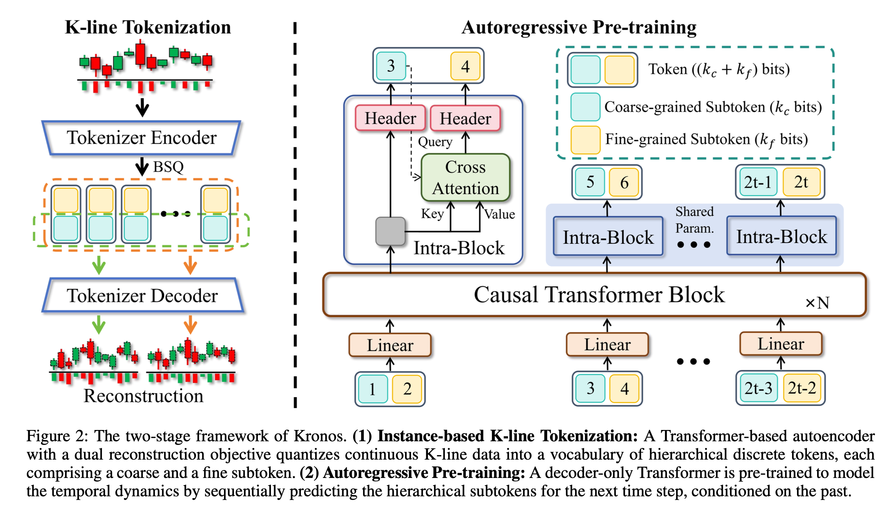
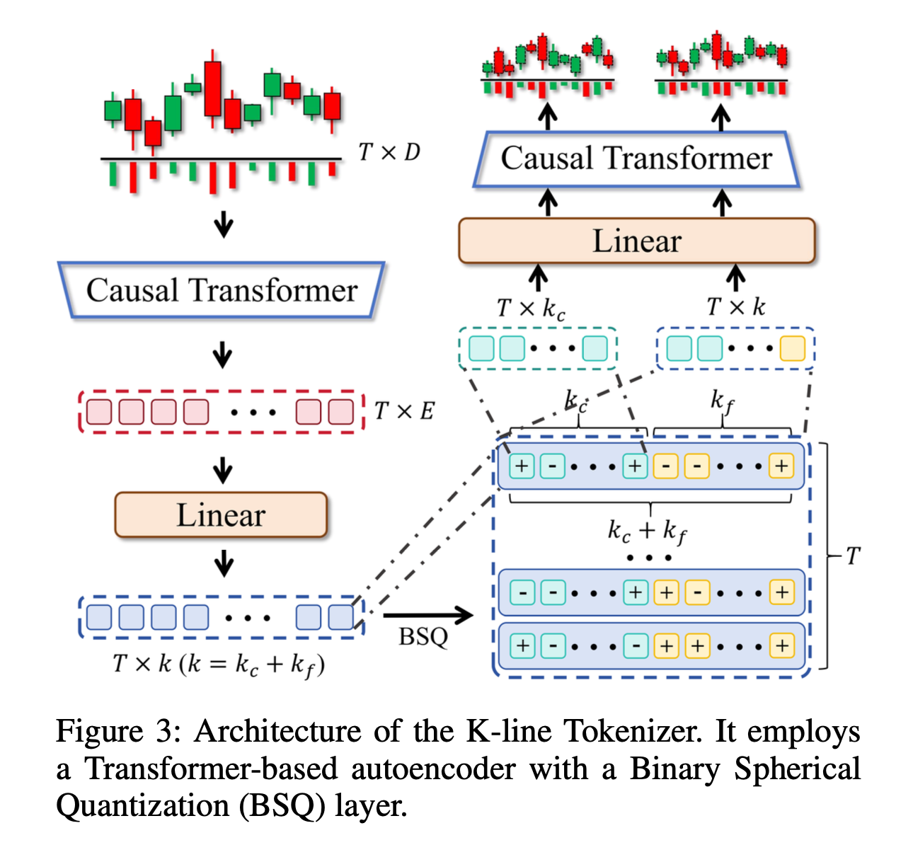

# Kronos

1. K 线数据的独特统计特性：低信噪比、强非平稳性，以及开盘价、最高价、最低价、收盘价、成交量和成交额（OHLCVA）属性之间复杂的高阶相关性，这些特性往往与通用时间序列基础模型（TSFM）的归纳偏置不匹配。
2. 主流的时间序列基础模型研究在很大程度上未能充分覆盖金融领域；金融序列在大多数现有时间序列基础模型的预训练语料中仅占很小一部分，而对量化金融至关重要的一系列下游任务——包括波动率估计、合成序列生成和风险管理——在很大程度上仍未得到解决。

通用时间序列基础模型在金融任务上的表现往往不如专门的、非预训练的模型，并且无法在更广泛的量化金融领域中实现泛化。

训练了 Kronos，使用了来自 45 个市场，7 种时间粒度，超过 120 亿条 K 线数据。

主要贡献：

1. 新的 K 线数据建模框架，用于学习 hierarchical representation，用一个专门的 tokenizer 将 K 线量化为结构化的、粗粒度和细粒度的 tokens，并配合定制的自回归目标，依次预测 subtokens。这种从粗到细的预测方案允许 Kronos 明确地模拟多尺度市场动态。
2. 对一系列不同容量的 Kronos 模型进行大规模预训练，对于学习稳健的、可泛化的市场表征非常重要，这些表征就是模型有效性的基础

## Preliminary

令 D 维向量 $\mathbf{x}_t \in \mathbb{R}^D$ 表示离散时间 $t$ 的 K 线观测值，这里 $D=6$ 固定为 OHLCVA 属性（开盘价、最高价、最低价、收盘价、成交量和成交额）。给定一个历史序列 $\mathbf{x}_{1: T}=(\mathbf{x}_{1}, \mathbf{x}_{2}, ..., \mathbf{x}_{T})$，目标是预测接下来的 H 个观测值 $\hat{\mathbf{x}}_{T+1: T+H}=(\hat{\mathbf{x}}_{T+1}, \hat{\mathbf{x}}_{T+2}, ..., \hat{\mathbf{x}}_{T+H})$。

Kronos 不直接对原始的连续输入进行处理，而是首先通过一个可学习的码本 $\mathcal{C}$，将每个多变量观测值 $\mathbf{x}_{t}$ 量化为一个离散标记 $b_{t}$。因此，原始序列 $\mathbf{x}_{1: T}=(\mathbf{x}_{1}, ..., \mathbf{x}_{T})$ 被映射为 $\mathbf{b}_{1: T}=(b_{1}, ..., b_{T})$。这样，预测任务就简化为一个自回归标记序列建模问题：

$$
p\left(\mathbf{b}_{T+1: T+H} | \mathbf{b}_{1: T}\right)=\prod_{h=1}^{H} p\left(b_{T+h} | \mathbf{b}_{1: T+h-1}\right)
$$

这种离散化的表示本质上具有可扩展性，并且自然适用于其他可通过生成方式构建的任务，例如合成数据生成和波动率预测。

## Methodology

### K 线 Tokenization

基于 Transformer 的自编码器实现 Tokenizer，该自编码器由编码器 $E_{enc}$、量化器 Q 和解码器 $E_{dec}$ 组成。受生成建模中视频量化方法的启发，采用二进制球面量化（BSQ），一种无查找量化（LFQ）。BSQ 通过将连续潜向量 $\xi_{t}$ 投影到一组可学习的超平面上，将其量化为 k 位二进制代码 $b_{t} \in\{-1,1\}^{k}$。

虽然比特 $k$ 值越大（例如 $k=20$），越有利于捕捉丰富的金融模式，但会导致 $2^k$ 的指数级大容量词汇表，给后续的自回归模型在计算成本和参数规模方面带来了重大挑战。为了缓解这一问题，遵循视频量化和生成领域的最新研究，将 k 位代码分解到 n 个子空间中。基于附录 H（Q3）中详细说明的参数节省与延迟成本之间的权衡，设置 $n=2$。将编码划分为粗粒度 subtoken $b_{t}^{c}$ 和细粒度 subtoken $b_{t}^{f}$ ，两者具有相等的比特长度 $k_{c}=k_{f}=k / 2$ ，其中 $k=k_{c}+k_{f}$ 。生成的编码 $b_{t}$ 是这两个 subtoken 的拼接： $b_{t}=[b_{t}^{c}, b_{t}^{f}]$ ，其中 $b_{t}^{c}$ ， $b_{t}^{f} \in \{-1,1\}^{k / 2}$ 。这种分解将对大小为 $2^{k}$ 的大词汇表的单次预测转换为对 $2^{k / 2}$ 的两次连续预测，显著降低了计算复杂度和参数复杂度。

使用一个复合损失目标来训练分词器，该目标结合了用于 BSQ 的分层重建损失和 commitment 损失： 

$$
\mathcal{L}_{tokenizer}=\mathcal{L}_{coarse}+\mathcal{L}_{fine}+\lambda \mathcal{L}_{quant}
$$

其中 $\lambda$ 是一个平衡超参数。各组成部分定义如下：

- $\mathcal{L}_{coarse}=\mathbb{E}[\left\|x-E_{dec}(\mathbf{b}^{c})\right\|^{2}]$，训练粗粒度 subtoken $\mathbf{b}^{c}$ 以形成低保真度重建。
- $\mathcal{L}_{fine}=\mathbb{E}[\left\|x-E_{dec}(\mathbf{b})\right\|^{2}]$，使用完整的 token $\mathbf{b}$ 来评估高保真重建。
- $\mathcal{L}_{quant}$ 是来自 BSQ 的量化损失，用于规范学习过程。惩罚连续的潜向量 $\xi$ 与其二进制编码 $\mathbf{b}$ 之间的 L2 距离，使编码器的输出与学习到的码本对齐，以确保训练的稳定性。

通过优化 $\mathcal{L}_{coarse}$，粗粒度 subtoken $b^{c}$ 学会捕捉输入的主要结构。因此，在优化 $\mathcal{L}_{fine}$ 的过程中，细粒度 subtoken $b^{f}$ 被引导去精细化编码粗略近似所需的残差信息。先前的研究表明，从粗到细的解码顺序能提高生成质量。

希望在量化过程中明确地将这种层次结构赋予 token，而不是识别并优先解码本身包含粗粒度信息的 token。这确保了第一个 subtoken 始终代表粗粒度信息，为后续的自回归建模阶段建立所需的条件依赖关系。

### 详细解释 BSQ Binary Spherical Quantization

BSQ（二进制球形量化）是一种**基于球面投影的二进制量化方法**，核心思想是将高维连续向量投影到低维超球体表面，通过二进制编码实现离散化，同时保证量化误差有严格数学上界，核心是利用超球面的 “等距性” 约束量化误差（保证量化后特征的尺度一致性），同时低维超球面的二值点（如 L 维超球面的二值顶点）能构成 “隐式码本”，无需额外学习参数，兼顾效率与表示能力。以下从数学原理、操作步骤、误差分析和金融场景适配四个维度展开推导：

#### 一、核心数学原理：球面投影与二进制编码

假设输入为高维连续向量 $\xi_t \in \mathbb{R}^D$（如 K 线数据的 6 维 OHLCVA 特征），BSQ 的量化过程分为三步：

1. **线性降维投影**：首先将 $\xi_t$ 投影到低维空间 $k$（通常 $k \ll D$）：
   $$
   \mathbf{z} = W \xi_t \quad (W \in \mathbb{R}^{k \times D} \text{为投影矩阵})
   $$
   
   降维目的是减少计算量，同时保留关键特征（如 K 线中价格与成交量的相关性）。
   
2. **单位球面归一化**：将降维后的向量归一化到单位球面，消除尺度影响：
   $$
   \mathbf{u} = \frac{\mathbf{z}}{\|\mathbf{z}\|_2} \quad (\|\mathbf{u}\|_2 = 1)
   $$
   
   这一步是 BSQ 的核心：**球面约束使量化误差有界**（见第四部分误差分析）。
   
3. **逐维度二进制量化**：对单位向量 $\mathbf{u}$ 的每个维度独立二值化：
   $$
   b_i = \text{sign}(u_i) \quad \text{其中} \quad \text{sign}(0) = 1 \quad (i=1,2,...,k)
   $$
   
   最终量化后的二进制码为 $\mathbf{b} = [b_1, b_2, ..., b_L] \in \{-1, 1\}^k$。

#### 二、前向传播与反向传播：STE 直通估计器 Straight-through estimator
BSQ 的量化过程在训练中需处理**不可导的 Round 操作**，通过**直通估计器（STE）**解决梯度回传问题：

- **前向传播**：使用量化后的二进制码 $\mathbf{b}$ 计算损失（如 Kronos 的重构损失）。  
- **反向传播**：梯度直接通过未量化的 $\mathbf{u}$ 回传，忽略量化操作的梯度（STE 近似）：  

  $$
  \frac{\partial \mathcal{L}}{\partial \xi_t} = \frac{\partial \mathcal{L}}{\partial \mathbf{b}} \cdot \frac{\partial \mathbf{b}}{\partial \mathbf{u}} \cdot \frac{\partial \mathbf{u}}{\partial \mathbf{z}} \cdot \frac{\partial \mathbf{z}}{\partial \xi_t} \approx \frac{\partial \mathcal{L}}{\partial \mathbf{u}} \cdot \frac{\partial \mathbf{u}}{\partial \xi_t}
  $$

  （注：$\text{sign}$ 函数的导数在 STE 中视为 1，忽略量化误差的梯度）

#### 三、分层量化：粗粒度+细粒度的维度分解（Kronos 专用）
Kronos 针对金融数据的高维特性，将 BSQ 的 $k$ 维进一步分解为**粗粒度（$k_c$）和细粒度（$k_f$）**两层（$k = k_c + k_f$）：

1. **粗粒度量化（第一层）**：对 $\mathbf{u}$ 的前 $k_c$ 维二值化，得到粗码 $\mathbf{b}^c \in \{-1, 1\}^{k_c}$，仅保留趋势信息（如价格涨跌方向）。
   
2. **细粒度量化（第二层）**：基于粗码的残差，对后 $k_f$ 维二值化，得到细码 $\mathbf{b}^f \in \{-1, 1\}^{k_f}$，补充细节（如涨跌幅度）。
   
3. **维度分解的数学意义**：原始词汇量为 $2^k$，分解后为 $2^{k_c} +2^{k_f}$。例如 $k=20$ 分解为 $k_c=k_f=10$，词汇量从 100 万降至 1024+1024，**参数量减少 99.8%**，同时保持信息分层。

#### 四、量化误差分析：有界性与金融场景适配
BSQ 的核心优势是**量化误差有严格上界**，推导如下：

1. **球面投影的误差边界**：设原始向量为 $\mathbf{u}$，量化后为 $\mathbf{\hat{u}}$（二进制码对应的单位向量），则：
   $$
   \|\mathbf{u} - \mathbf{\hat{u}}\|_2^2 = \sum_{i=1}^k (u_i - \hat{u}_i)^2
   $$
   
   由于 $u_i \in [-1, 1]$，$\hat{u}_i = \pm 1$，单个维度最大误差为 $|u_i - \hat{u}_i| \leq 2$，总误差： 
   
   $$
   \|\mathbf{u} - \mathbf{\hat{u}}\|_2 \leq \sqrt{2k}
   $$
   
   当 $k=20$ 时，误差上限为 $\sqrt{40} \approx 6.3$，但实际中通过球面约束，误差集中在低维（如 Kronos 的 $k=10$ 分层），有效抑制极端值影响。
   
2. **金融数据的噪声抑制**：对 K 线数据中的异常值（如闪崩），BSQ 通过球面投影将其归一化，避免连续值的无界误差。例如：  
   
   - 原始价格波动：100 → 10（极端下跌），归一化后为 $\mathbf{u}$，量化误差仅反映方向（-1），不放大绝对波动。  
   - 成交量激增：1000 → 10000 手，归一化后仅保留“活跃”方向（+1），忽略具体数值噪声。

#### 五、与其他量化方法的对比
| 方法       | 核心思想                     | 优势                     | 劣势                     | 金融适配性               |
|------------|------------------------------|--------------------------|--------------------------|--------------------------|
| **BSQ**    | 球面投影+二进制编码          | 误差有界、参数高效       | 需球面归一化             | ✅ 抑制金融极端值        |
| **LFQ**    | 直接二值化（无球面约束）     | 无需归一化               | 误差无界，易受噪声影响   | ❌ 不适配金融噪声        |
| **均匀量化** | 线性区间划分（如 8bit 定点）   | 简单易实现               | 长尾数据误差大           | ❌ 无法处理金融厚尾分布  |
| **VQ-VAE**| 显式码本学习                | 高保真重建               | 码本坍塌风险             | ❌ 参数量大，难适配时序  |

#### 六、BSQ 在 Kronos 中的具体实现（以 20-bit 为例）
1. **输入预处理**：K 线数据 $x_t \in \mathbb{R}^6$ 经标准化（Z-score）和裁剪（[-5,5]），输入 Tokenizer 的 Transformer 编码器。
   
2. **量化流程**  
   - 编码器输出 $\xi_t$，投影降维至 $k=20$，归一化到单位球。  
   - 分层量化：前 10 位为粗码（趋势），后 10 位为细码（幅度），总词汇量 $2^{10} \times 2^{10} = 1,048,576$，但通过分层预测（先粗后细），实际词汇量降为 1024+1024=2048。

3. **损失函数**：结合重构损失（粗码+细码）和量化损失（BSQ 的 L2 正则）：  
   $$
   \mathcal{L} = \underbrace{\|x - E_{\text{dec}}(\mathbf{b}^c)\|_2^2}_{\text{粗粒度重构}} + \underbrace{\|x - E_{\text{dec}}(\mathbf{b})\|_2^2}_{\text{细粒度重构}} + \lambda \underbrace{\|\xi - \mathbf{b}\|_2^2}_{\text{量化约束}}
   $$
   粗码先学趋势，细码再补细节，符合金融数据的“趋势→细节”层级结构。

#### 总结
1. **噪声免疫**：球面投影将极端值归一化，量化误差有界，避免金融异常值干扰。  
2. **分层建模**：粗粒度（趋势）+细粒度（幅度）匹配 K 线“先方向后幅度”的分析逻辑。  
3. **高效训练**：分层量化大幅减少词汇量，使自回归模型可处理 120 亿级 K 线数据。  
4. **理论保证**：量化误差的数学边界（$\sqrt{2k}$）为金融预测的稳定性提供依据，符合风控需求。

BSQ 通过几何约束（球面）和分层设计，将连续的金融 K 线数据转化为结构化的离散 Token，既保留市场规律，又适配大模型的序列建模优势。

### Hierarchical Autoregressive Modeling

在分词阶段之后，生成的离散序列使用 Decoder-only Transformer 进行建模，记为 $E_{ar}$，主要目标是估计 token 序列 $\mathbf{b}=\{b_{1}, ..., b_{T}\}$ 的联合分布。式 1 的简化形式可推导为：

$$
p(\mathbf{b})=\prod_{t=1}^{T} p(b_{t} | \mathbf{b}_{<t})
$$

其中，$\mathbf{b}_{<t}$ 表示截至时间 $t-1$ 的所有先前 token。

基于层级化的 token 设计（其中每个 token 的结构为 $b_{t}=[b_{t}^{c}, b_{t}^{f}]$），利用链式法则进一步分解条件概率，以明确捕捉固有的从粗到细的依赖关系： 

$$
p\left(b_{t} | \mathbf{b}_{<t}\right)=p\left(b_{t}^{c} | \mathbf{b}_{<t}\right) \cdot p\left(b_{t}^{f} | \mathbf{b}_{<t}, b_{t}^{c}\right)
$$

这使模型能够首先预测粗粒度 subtoken，以此作为后续生成细粒度残差 subtoken 的框架。因此，预训练目标简化为在这种层次分解下最大化观测序列的对数似然。

如图 2 所示，自回归过程首先为每个时间步构建一个统一的输入向量，在时间 $i$，subtoken $b_{i}^{c}$ 和 $b_{i}^{f}$ 使用两个不同的嵌入层独立投影到向量表示中，分别产生 $e_{c}(b_{i}^{c})$ 和 $e_{f}(b_{i}^{f})$ 表示。然后 concatenate 这些嵌入并线性投影以产生融合的输入向量： 

$$
\mathbf{v}_{i}=W_{fuse}\left(\left[e_{c}\left(b_{i}^{c}\right) ; e_{f}\left(b_{i}^{f}\right)\right]\right),
$$

其中 $W_{fuse}$ 是一个可学习的权重矩阵，负责将组合表示投影到模型的潜空间中。

融合输入序列 $\{\mathbf{v}_{1}, ..., \mathbf{v}_{t-1}\}$ 随后由 Transformer $E_{ar}$ 进行处理，后者输出 contextualized hidden state。处理 $\mathbf{b}_{<t}$ 得到的最终隐藏状态（记为 $\mathbf{h}_{t}$）随后用于预测 token $b_{t}$ 。该隐藏状态随后为下一步中粗粒度和细粒度 subtoken 的自回归预测提供信息，从而使模型能够有效捕捉数据中固有的多尺度时间依赖性。

#### 粗粒度 subtoken 预测

历史向量 $\mathbf{h}_{t}$ 通过线性头 $W_{c}$ 进行投影，以生成第一个 subtoken 分布的对数概率： 
$$
p(b_{t}^{c}|\mathbf{b}_{<t})=\text{softmax}(W_{c}\mathbf{h}_{t})
$$

#### 细粒度 subtoken 预测

为了对式 11 中的条件依赖性进行建模，需要用预测的粗粒度 subtoken $\hat{b}_{t}^{c}$ 来更新上下文。在训练过程中，使用模型从先前步骤做出的预测 $\hat{b}_{t}^{c}$（该预测是从预测分布 $p(b_{t}^{c} | \mathbf{b}_{<t})$ 中采样得到的，而非使用真实 subtoken（即 teacher-forcing）。

这种采样策略通过减轻暴露偏差，使训练分布与多步推理的自回归特性更好地对齐（在多步推理中真实 token 不可用），从而增强了模型的稳健性。采用交叉注意力机制，其中 $\hat{b}_{t}^{c}$ 的 embedding 作为查询，历史 $\mathbf{h}_{t}$ 提供键和值。结果由第二个头 $W_{f}$ 进行投影：
$$
\mathbf{h}_{t}^{\text{update}}=\text{CrossAttn}\left(q=e_{c}\left(\hat{b}_{t}^{c}\right), k=v=\mathbf{h}_{t}\right) \\
p\left(b_{t}^{f} | \mathbf{b}_{<t}, b_{t}^{c}\right)=\text{softmax}\left(W_{f} \mathbf{h}_{t}^{\text{update}}\right)
$$

整体训练目标 $\mathcal{L}_{ar}$ 是负对数似然，在两个预测步骤上求和： 

$$
\mathcal{L}_{ar}=-\mathbb{E}_{b \sim \mathcal{D}} \sum_{t=1}^{T}\left[\log p\left(b_{t}^{c} | \mathbf{b}_{<t}\right)+\log p\left(b_{t}^{f} | \mathbf{b}_{<t}, b_{t}^{c}\right)\right]
$$

其中 $D$  表示数据分布。

### 模型预训练

数据集：为确保预训练质量，我们从头开始精心构建了一个大规模、高质量的金融 K 线数据集。与针对通用时间序列的基础模型研究不同，我们的数据集涵盖 7 种采样频率下的超过 120 亿条观测数据，包含来自 45 个全球交易所的各种资产类别。为保证数据质量，我们开发了一个简化的数据清洗流程，专门针对金融 K 线数据的独特特征，该流程能够识别并过滤掉低质量的数据段，例如那些存在异常价格飙升或长期无交易活动的数据段。关于清洗流程的更多细节详见附录 B。

基于在大型语言模型（LLMs）中观察到的缩放定律，训练了 Kronos 的三个变体，其参数数量不断增加，最多接近 5 亿，以在性能和推理预算之间取得平衡。考虑到资源限制和实际部署场景，将最大上下文长度限制为 512 个 token。尽管如此，通过利用不同频率的 K 线数据，这种设计仍然完全兼容任意的预测范围；例如，使用 1 分钟数据进行短期预测，使用每日数据进行每周或每月预测。完整的训练细节见附录 C。

|  | Layers | d_model | d_ff | Heads | Vocab. ( 2^k ) | Params |
| --- | --- | --- | --- | --- | --- | --- |
| Kronos small | 8 | 512 | 1024 | 8 | 20 | 24.7M |
| Kronos base | 12 | 832 | 2048 | 16 | 20 | 102.3M |
| Kronos large | 18 | 1664 | 3072 | 32 | 20 | 499.2M |

## 实验

设计了一系列涵盖 5 个代表性任务的实验：预测应用（价格序列、回报率及实际波动率预测）、生成能力（合成 K 线生成）以及一项用于评估实际适用性的投资模拟。

Baseline：

- 非预训练全样本模型：iTransformer
- 零样本时间序列基础模型：TimeMOE
- 计量经济学波动率模型：GARCH（计量经济学中用于波动率预测的经典方法）
- 生成式时间序列模型：DiffusionTS

任务细节和基线模型详见附录 D。主要实验结果概述如图 4 所示，完整的结果细分详见附录 F。

预测任务：Kronos 在三个预测任务中均实现了一致的最先进性，。特别是在价格序列预测方面，与最强的 TSFM 基线相比，Kronos 的 RankIC 提升了 93%，与最佳非预训练模型相比提升了 87%。此外，随着模型规模的扩大，这些任务的性能持续提升，从经验上验证了时间序列基础模型的缩放定律。

在实验比较中，**non-pre-trained full-shot models** 和 **zero-shot time series foundation models** 是两类关键 baseline，分别代表了传统监督学习范式和新兴的基础模型范式。

- non-pre-trained full-shot models：从头训练的“全量监督模型”，**不依赖任何预训练知识**，直接在目标任务的完整训练集上从头训练，其核心假设是：通过充分利用标注数据，模型可以直接学习到任务的特定模式。

  1. **数据依赖性强**：需大量标注数据，在小样本场景下性能急剧下降。
  2. **泛化能力弱**：对未见过的领域（如跨市场、跨资产类型）适应性差。
  3. **计算成本高**：从头训练深度模型需消耗大量算力，尤其在序列长度较长时（如金融分钟级数据）。

- zero-shot time series foundation models：预训练驱动的“通用预测引擎”：**在大规模时间序列语料库上预训练**，学习通用时序模式（如趋势、季节性、异常检测），然后在新任务中**无需微调**直接应用。其核心优势是：
  1. **泛化性**：通过跨领域预训练（如混合金融、医疗、工业数据），模型能捕捉通用规律。
  1. **零样本推理**：仅需输入历史观测，即可生成预测，无需目标任务标注数据。

典型模型与技术细节

1. **TimesFM**（Google, 2023）：
   - **架构**：基于 Transformer 解码器，通过分块（chunking）处理不同长度的时序输入。
   - **预训练**：在包含小时、日、周等多粒度的 1000 亿时间点上训练，支持动态调整预测长度和时间粒度。
   - **零样本表现**：在 M5 竞赛数据集上，其零样本预测误差比传统 ARIMA 低 40%。

2. **Chronos**（Amazon, 2024）：
   - **量化策略**：将连续时间序列离散化为固定词汇（如通过缩放和分层量化），适配语言模型架构。
   - **泛化能力**：在 42 个跨领域数据集（如零售销售、能源消耗）上的零样本 MASE 指标比传统模型低 25%。

| **维度**         | **non-pre-trained full-shot models**                     | **zero-shot time series foundation models**               |
|------------------|----------------------------------------------------------|----------------------------------------------------------|
| **知识来源**     | 仅依赖目标任务数据                                       | 依赖大规模跨领域预训练知识                               |
| **训练范式**     | 监督学习（全量标注数据）                                 | 自监督/弱监督预训练 + 零样本推理                         |
| **泛化能力**     | 局限于训练数据分布                                       | 跨领域泛化，但领域适配性不足                             |
| **数据需求**     | 需大量标注数据                                           | 仅需少量或无需目标任务数据                               |
| **典型应用场景** | 数据充足、任务固定的场景（如单资产预测）                 | 数据稀缺、任务多样的场景（如跨市场预测）                 |

1. **验证预训练价值**：通过对比 non-pre-trained 基线，证明领域专属预训练（如 Kronos 的 120 亿 K 线数据）能显著提升模型对金融噪声的鲁棒性。
2. **评估基础模型潜力**：通过对比 zero-shot 基线，揭示基础模型在泛化能力上的优势与局限。例如，TimesFM 在能源消耗预测任务中的零样本误差比 ARIMA 低 30%，但在金融波动率预测中仍逊于 Kronos。
3. **成本权衡分析**：全量监督模型的训练成本（如 GPU 集群训练 72 小时）与基础模型的推理成本（如 TimesFM 单次预测耗时 0.2 秒）形成对比，为实际部署提供参考。
