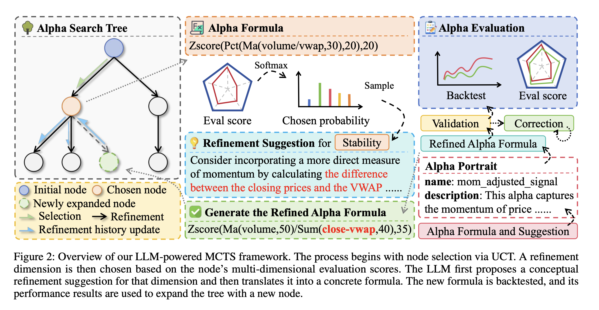
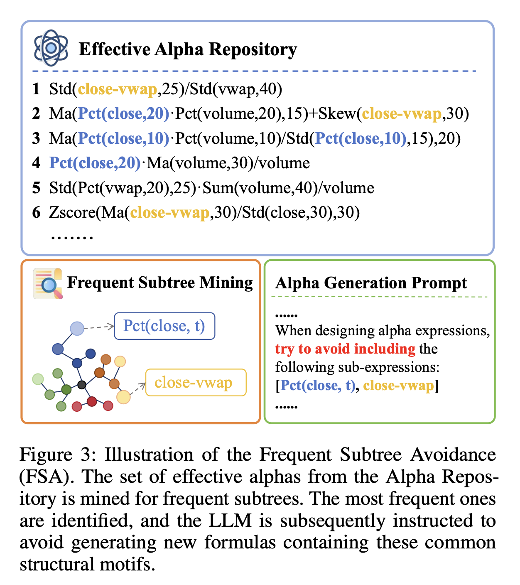

# Navigating the Alpha Jungle: An LLM-Powered MCTS Framework for Formulaic Factor Mining

传统的 Alpha 因子挖掘方法，无论是依赖人类专家的手动构建，还是使用遗传规划（GP）、强化学习（RL）等自动化技术，都存在显著的痛点：

1. **搜索效率低下**：需要在巨大的因子空间中进行探索，容易发现伪因子（过拟合）。
2. **可解释性差**：自动生成的因子公式通常过于复杂和晦涩，缺乏清晰的经济学逻辑，难以在实际投资中被信任和应用。

本文提出了一种将 LLMs 与蒙特卡罗树搜索（MCTS）相结合的新颖框架，以克服这些局限性。该方法利用 LLM 的指令遵循和推理能力，在 MCTS 驱动的探索中迭代生成和优化符号化 alpha 公式。

关键创新在于通过对每个候选因子进行金融回测获得丰富的定量反馈，指导 MCTS 探索，从而高效遍历庞大的搜索空间。此外，引入了频繁子树避免机制（frequent subtree avoidance mechanism），以提高搜索效率和 alpha 因子性能。在真实股票市场数据上的实验结果表明，基于 LLM 的框架在挖掘 alpha 因子方面优于现有方法，挖掘出的因子具有更高的预测准确性、交易性能和更好的可解释性，为公式化 alpha 挖掘提供了更高效的解决方案。

1. **LLM 与 MCTS 的结合**：框架的核心是一个迭代循环。LLM 负责生成和优化 Alpha 公式的“想法”，而 MCTS 则负责系统性地探索这些想法，并根据量化反馈进行决策。树中的每个节点都代表一个候选的 Alpha 因子。
2. **量化回测指导搜索**：与传统 MCTS 在游戏等领域的应用不同，该框架的独特之处在于，MCTS 的每一步探索都由对候选 Alpha 因子进行金融回测后得到的**多维度、量化的性能指标**直接指导。这使得搜索过程非常高效且目标明确。
3. **频繁子树规避 (FSA) 机制**：为了防止生成的 Alpha 因子变得同质化（即反复利用几种相似的结构），论文引入了 FSA 机制。该机制会从已发现的有效 Alpha 池中挖掘出最常见的公式子结构，并显式地指导 LLM 在后续生成中避免使用它们，从而提升了搜索的多样性和有效性。
4. **优越的性能与可解释性**：实验证明，该框架挖掘出的 Alpha 因子在预测准确性和模拟交易性能上均优于现有方法。同时，由于 LLM 的参与和生成过程的设计，产出的因子公式具有更好的可解释性，更容易被人类理解。

## 背景

预测金融市场价格走势是量化投资的核心挑战，由于市场信噪比低，从股票数据中提取预测信号（alpha 因子）是增强模型预测能力的常用策略。当前 alpha 因子挖掘方法主要分为基于神经网络和基于公式两类。

- 基于神经网络的方法（如 FactorVAE、HIST、REST）通过深度学习隐式构建复杂的 alpha 因子，能捕捉复杂模式，但缺乏可解释性；
- 基于公式的方法旨在发现由显式数学表达式表示的 alpha 因子，传统上这些因子由人工设计，反映市场见解（如 Fama-French 因子、金融异常现象）

近年来，出现了采用遗传编程或强化学习等自动化技术来发现公式化 alpha 因子的方法。然而，现有的自动化公式化 alpha 挖掘方法存在显著局限性：一是挖掘出的因子可解释性差，这些方法在庞大的空间中进行无约束的数据驱动探索，缺乏金融理论或领域专业知识的充分指导，导致公式过于复杂和不透明，给实际投资带来挑战；二是搜索效率低，为识别足够数量的有效因子，通常需要生成和评估大量候选公式，这种详尽的搜索过程可能会导致发现虚假关系和过拟合，导致许多挖掘出的因子泛化能力差，样本外表现不佳。鉴于大模型具有丰富的先验知识和强大的推理能力，适合生成可解释的 alpha 因子，本文受 LLM 推理进展（如思维链、思维树）和蒙特卡罗树搜索（MCTS）在增强 LLM 处理复杂问题能力方面的启发，将 alpha 挖掘建模为 MCTS 驱动的树搜索问题。

## 方法



#### 1. 选择

使用 Upper Confidence Bound for Trees, UCT 准则选择有潜力的节点（alpha 公式）。每个节点维护一个 $Q(s,a)$ 值，表示从节点 s 采取行动 a 获得的最大累积奖励（如回测性能）。UCT 准则公式为：

$$
\text{UCT} (s,a) = Q(s,a) + c \sqrt\frac{\ln(N_s)}{N_{s'}}
$$

其中 $N_{s}$ 是父状态 $s$ 的访问次数，$N_{s'}$ 是采取行动 $a$ 后子状态 $s'$ 的访问次数，c 是探索权重。

The optimal action $a^*$:

$$
a^* = \arg \max_{a\in A(s)} \left(Q(s,a) + c \sqrt\frac{\ln(N_s)}{N_{s'}} \right)
$$

与标准 MCTS 只扩展叶子节点不同，该方法允许选择任何节点进行扩展，因为每个 alpha 优化都可以通过回测立即评估，无需单独的模拟阶段。为了实现这一点，通过添加一个 “virtual" expansion action $a_e$，总行动集就是 $A(s) \cup a_e$，定义 $N_{s^′_e}= 1 + |C(s)|$ 为 virtual visit count for the prospective new node $s^′e$，其中 $C(s)$ 是 s 现有子节点的集合，如果选择 $a_e$，则选择节点 s 进行扩展。这种机制确保了有潜力的非叶节点可以进一步被优化。

#### 2. 扩展

维度目标优化建议：每个节点 s 关联一个多维评估得分向量 $E_{s}=[e_{1}, ..., e_{q}]$，通过随机选择一个维度进行改进，选择维度 $i$ 的概率为：

$$
P(i^*=i \mid s) = \text{Softmax}\left( \left( e_{max} \cdot \mathbf{1}_q - E_s \right) / T \right)_i
$$

其中 T 是控制随机性的温度参数。选择维度后，LLM 根据有效 alpha 仓库中的 alpha 作为示例，生成针对性的优化建议。

alpha 公式生成和验证：LLM 根据选定维度和优化建议，先制定 alpha 的概念描述，再生成相应的 alpha 公式。公式经过自动有效性检查（如语法正确性），无效时提供反馈给 LLM 进行迭代修正，有效公式进行回测，评估结果构成 MCTS 树的新节点。

#### 3. 多维 alpha 评估

采用相对排名方法评估候选 alpha 公式对现有有效 alpha 仓库的潜在贡献。对于 IC 等指标，alpha f 的相对排名 $R(f)$ 为：

$$
R(f,m,\mathcal{F}_{zoo}) = \frac{1}{\vert\mathcal{F}_{zoo}\vert}\sum_{f'\in \mathcal{F}_{zoo}} \mathbb{I}(m(f) < m(f'))
$$

从有效性、稳定性、换手率、多样性和过拟合风险五个关键维度评估 alpha 公式，其中过拟合风险得分由 LLM 根据 alpha 公式和详细历史生成。整体 alpha 得分是各维度得分的平均值，作为更新 MCTS 节点 Q 值的奖励信号。

#### 4. 反向传播

更新从评估节点到根节点路径上节点的 Q 值，节点的 Q 值表示其所在子树中找到的最大评估得分。LLM 生成每个节点优化过程的简洁摘要，包括维度得分的变化，并将其集成到搜索树的整体优化历史中。同时，为提高优化建议的质量和过拟合评估的准确性，LLM 会获得当前节点的父节点、子节点和兄弟节点的优化历史上下文信息。

#### 5. 避免频繁子树

为减轻 alpha 公式同质化问题，引入避免频繁子树（FSA）方法。定义根基因是 alpha 公式表达式树中从叶节点（原始特征）开始的子树，抽象掉运算符的具体参数值，仅关注树结构。该方法从先前发现的有效 alpha 仓库中挖掘频繁闭合根基因，选择前 k 个最频繁的闭合子树，指导 LLM 在生成新 alpha 公式时避免包含这些子表达式，从而提高 MCTS 搜索效率和 alpha 性能。



## 实验

### 数据

实验在中国 A 股市场进行，分别针对沪深 300 指数和中证 1000 指数两个股票池。定义两个预测目标：股票的 10 天回报和 30 天回报，买卖在收盘价执行。数据集按时间顺序划分为训练期（2011/01/01-2020/12/31）和测试期（2021/01/01-2024/11/30）。

### 对比基线

将提出的框架与多种公式化 alpha 挖掘方法进行比较，包括深度符号优化（DSO）、遗传编程（GP）、基于强化学习的 AlphaGen、具有生成-预测架构的 AlphaForge，以及基于 LLM 的思维链（CoT）、思维树（ToT）和 FAMA。使用 OpenAI 的 GPT4.1 模型作为 LLM，同时评估不同 LLM 对框架性能的影响。为保证公平比较，基于控制搜索次数（即 alpha 生成次数）进行基准测试，LLM 方法报告搜索次数为 1000、2000 或 3000 时的最佳性能，其他方法的搜索次数逐渐增加直至性能收敛，上限为 600000。单个实验运行的最长时间限制为 24 小时。

### 实验结果

使用 LightGBM 和 3 层多层感知器（MLP）两个代表性机器学习模型评估生成的 alpha 因子。为每个 alpha 挖掘方法生成大小为 10、50 和 100 的 alpha 集作为模型输入特征，输入 alpha 和目标回报在训练前进行截面排名归一化。使用信息系数（IC）、排名信息系数（RankIC）、年化回报率（AR）和信息比率（IR）四个指标评估预测性能。实验结果表明，提出的框架在所有指标上均持续优于基线方法，挖掘出的 alpha 因子对未来股票回报具有更强的预测能力，并能有效转化为交易盈利能力。

- 消融研究

对框架的三个关键组件（MCTS、多维反馈和 FSA）进行消融研究。结果显示，当纳入有效性和多样性作为反馈时，MCTS 的预测性能优于 CoT 和 ToT，随着更多反馈维度的集成，性能逐步提高。换手率反馈虽略微降低 IC 和 RankIC，但通过降低交易成本提高了实际交易指标（AR、IR）。FSA 的集成进一步提高了所有指标的性能，表明 MCTS、多维反馈和 FSA 对框架的有效性有个体和集体贡献。此外，FSA 提高了搜索效率，随着生成 alpha 数量的增加，CoT 和 ToT 的效率因多样性降低而下降，而采用 FSA 的方法能保持较高的搜索效率。

- Alpha 公式的可解释性

通过随机选择每个方法的一个 alpha 公式，使用 LLM 对其可解释性进行排名，并重复 50 次计算平均排名，同时综合三个不同 LLM 的排名结果。结果表明，提出的框架挖掘的公式可解释性仅次于 CoT 方法，显著优于非 LLM 方法，说明该方法在实现强预测性能的同时，保持了较高的可解释性。

### 其他相关实验验证

将提出的框架与量化金融中广泛采用的两个基准 alpha 集（Alpha158 和 Alpha360）进行比较，使用线性回归（LR）、LightGBM 和 3 层 MLP 三个模型进行评估。结果显示，提出的方法在不同实验设置和模型架构下均实现了更好的预测性能，表明其在识别更有效的 alpha 信号方面更具优势。

### LLM 潜在数据泄漏测试

设计实验探究预训练 LLM 是否存在潜在的数据泄漏问题，即是否在训练数据中包含历史上表现良好的 alpha 公式信息。结果表明，明确提示 LLM 生成高性能 alpha 公式的平均性能与随机生成的基线无显著差异，且远低于提出的框架，说明测试的 LLM 在该任务中未利用泄漏的知识，缓解了数据泄漏担忧。

### 不同 MCTS 搜索深度下 alpha 的特征分析

分析 MCTS 搜索树中不同深度节点导出的 alpha 特征。随着搜索深度增加，平均公式深度和长度先上升后趋于稳定，这主要是由于过拟合风险得分对过于复杂的公式进行惩罚。同时，平均样本内（IS）和样本外（OOS）RankIC 总体呈上升趋势，反映了优化过程的有效性，但 alpha 的泛化能力（IS 和 OOS RankIC 之差）趋于下降，说明在提高性能的同时需要谨慎管理过拟合风险。

1. **选择 (Selection)**
   - **目标**：平衡“探索”（Exploration）和“利用”（Exploitation），找到最有潜力的节点进行扩展。
   - **方法**：使用 UCT（Upper Confidence Bound for Trees）公式选择最佳动作。
   - **创新点**：与标准 MCTS 只扩展叶节点不同，该框架允许**在树的任意节点上进行扩展**。它通过为内部节点增加一个“虚拟扩展动作”来实现，确保有潜力的中间节点也能被进一步优化。
2. **扩展 (Expansion)**
   - **目标**：在选定的节点（父 Alpha）基础上，生成一个更优的新节点（子 Alpha）。	
   - **维度定位**：首先，根据父 Alpha 的多维度评估分数（如有效性、稳定性、多样性等），随机选择一个表现较差的维度作为优化方向。
   - **LLM 生成**：LLM 执行两步生成：1. **生成优化建议**：针对选定的维度，LLM 首先产出一段自然的、概念性的优化建议文本。2. **生成新公式**：基于这个建议，LLM 再生成一个具体、可执行的新 Alpha 公式。
   - **验证与修正**：新公式会经过语法验证，如果无效，LLM 会根据错误信息进行迭代修正。
3. **评估 (Evaluation)**
   - **目标**：量化新生成 Alpha 的优劣，作为 MCTS 的奖励信号。
   - **方法**：直接通过金融回测进行评估，而非传统 MCTS 的模拟。
   - **多维度评估**：从多个维度（如有效性、稳定性、换手率、多样性、过拟合风险）对 Alpha 进行打分。
   - **相对排名**：大多数维度的分数是通过将新 Alpha 与“有效 Alpha 池”（Fzoo）中已有的 Alpha 进行比较得出的**百分位排名**，避免使用固定的阈值，使评估标准动态自适应。
   - **过拟合评估**：过拟合风险维度由 LLM 进行定性评估，分析其公式复杂度和优化历史。
   - **总分 (Reward)**：将所有维度的分数聚合，得到该 Alpha 的最终总分，用于更新 MCTS。
4. **反向传播 (Backpropagation)**
   - **目标**：将新节点的评估结果更新回其所有祖先节点。
   - **方法**：从新节点开始，沿路径向上返回至根节点，更新路径上所有节点的访问次数 `N` 和质量价值 `Q`。`Q` 值被更新为该路径下发现的**历史最佳分数**。
5. **频繁子树规避 (Frequent Subtree Avoidance, FSA)**
   - **目标**：增加生成 Alpha 的结构多样性，避免算法陷入局部最优。
   - **方法**：从“有效 Alpha 池” `Fzoo` 中所有公式的表达树里，挖掘出最常出现的子结构（论文中称为“根基因”）。将这些最频繁的子结构加入“禁用列表”。在“扩展”阶段，明确指示 LLM 避免生成包含这些禁用结构的新公式。

```python
import numpy as np
import math
import random
import re
from collections import defaultdict, Counter

# --- 1. 模拟核心组件 (Mocks) ---

class MockLLMAgent:
    """
    模拟大型语言模型代理。
    在真实场景中，这将调用 GPT-4, Gemini 等模型的 API。
    """
    def generate_initial_alpha(self):
        print("[LLM] Generating initial alpha formula...")
        return "Ma(close, 20)"

    def generate_refinement(self, formula, dimension, forbidden_subtrees=None):
        print(f"[LLM] Refining formula '{formula}' on dimension '{dimension}'.")
        if forbidden_subtrees:
            print(f"[LLM] Avoiding subtrees: {forbidden_subtrees}")
        
        # 模拟基于维度的优化
        if dimension == "Effectiveness":
            new_formula = f"Zscore({formula}, 30)"
        elif dimension == "Stability":
            new_formula = f"Std({formula}, 10)"
        elif dimension == "Diversity":
            new_flist = list(formula)
            random.shuffle(flist)
            new_formula = f"Corr({''.join(flist)}, vwap, 10)"
        else:
            # 随机添加一个操作
            ops = ["Std", "Corr", "Pct", "Diff"]
            new_formula = f"{random.choice(ops)}({formula}, {random.randint(10, 50)})"
        
        # 确保不生成完全相同的公式
        if new_formula == formula:
            new_formula += " + 0.01" # 简单扰动
            
        print(f"[LLM] Generated new formula: '{new_formula}'")
        return new_formula

    def evaluate_overfitting_risk(self, formula, history):
        print(f"[LLM] Evaluating overfitting risk for '{formula}'...")
        # 简单的启发式：公式越长，历史越长，风险越高
        risk = (len(formula) / 50.0 + len(history) / 10.0)
        return min(1.0, risk) # 返回 0-1 的风险值 (0 是最好）

class MockBacktester:
    """
    模拟金融回测引擎。
    在真实场景中，这将运行复杂的历史数据回测。
    """
    def __init__(self, dimensions):
        self.dimensions = dimensions

    def evaluate(self, formula, fzoo):
        print(f"[Backtester] Evaluating '{formula}'...")
        # 模拟生成一个多维度的分数向量，分数越高越好
        # 简单的启发式：公式越复杂，某些指标可能越高
        base_score = np.clip(len(formula) / 40.0, 0.1, 0.9)
        
        scores = {}
        for dim in self.dimensions:
            if dim != "Overfitting Risk":
                # 模拟相对排名：与 fzoo 中的因子比较
                # 这里简单地用随机性模拟
                if not fzoo:
                    rank_score = base_score
                else:
                    num_better = sum(1 for f_other in fzoo if len(f_other) > len(formula))
                    rank_score = 1.0 - (num_better / len(fzoo))
                
                scores[dim] = np.clip(rank_score + np.random.randn() * 0.1, 0.0, 1.0)
        return scores

# --- 2. MCTS 和 FSA 的数据结构与算法实现 ---

class Node:
    """MCTS 树中的节点"""
    def __init__(self, formula, parent=None, evaluation_scores=None, overall_score=0.0):
        self.formula = formula
        self.parent = parent
        self.children = []
        self.evaluation_scores = evaluation_scores if evaluation_scores is not None else {}
        self.overall_score = overall_score
        self.visit_count = 1
        self.q_values = defaultdict(float) # Q(s,a): key 是子节点的 formula
        self.action_visits = defaultdict(int) # N(s,a)

    def select_child_uct(self, exploration_weight):
        """使用 UCT 公式选择子节点"""
        best_score = -1
        best_child = None
        for child in self.children:
            q_value = self.q_values[child.formula]
            n_sa = self.action_visits[child.formula]
            uct_score = q_value + exploration_weight * math.sqrt(math.log(self.visit_count) / n_sa)
            if uct_score > best_score:
                best_score = uct_score
                best_child = child
        return best_child

class MCTSAlphaMiner:
    """LLM 驱动的 MCTS Alpha 挖掘器主类"""
    def __init__(self, llm_agent, backtester, dimensions):
        self.llm = llm_agent
        self.backtester = backtester
        self.dimensions = dimensions
        self.fzoo = [] # 有效 Alpha 池
        self.forbidden_subtrees = set()
        self.root = None
        self.exploration_weight = 1.5

    def _get_overall_score(self, scores, overfit_risk):
        """聚合多维度分数为一个总分 (Reward)"""
        # score 越高的维度越好，overfit_risk 越低越好
        dim_scores = sum(scores.values()) / len(scores) if scores else 0
        return dim_scores * (1 - overfit_risk)

    def _update_fsa(self):
        """频繁子树规避 (FSA) 机制的模拟实现"""
        if len(self.fzoo) < 5: return # 池太小时不启动
        
        print("[FSA] Updating forbidden subtrees...")
        # 简单实现：找到最常见的操作符
        op_counts = Counter()
        for formula in self.fzoo:
            found_ops = re.findall(r"(\w+)\(", formula)
            op_counts.update(found_ops)
        
        if op_counts:
            # 禁止最常见的操作符
            most_common_op = op_counts.most_common(1)[0][0]
            self.forbidden_subtrees.add(most_common_op)
            print(f"[FSA] New forbidden pattern: '{most_common_op}'")
    
    def run_search(self, num_iterations=50):
        # 1. 初始化
        initial_formula = self.llm.generate_initial_alpha()
        initial_scores = self.backtester.evaluate(initial_formula, self.fzoo)
        overfit_risk = self.llm.evaluate_overfitting_risk(initial_formula, [])
        initial_overall_score = self._get_overall_score(initial_scores, overfit_risk)
        
        self.root = Node(initial_formula, evaluation_scores=initial_scores, overall_score=initial_overall_score)
        
        for i in range(num_iterations):
            print(f"\n--- Iteration {i+1}/{num_iterations} ---")
            
            # 2. 选择 (Selection)
            current_node = self._select()
            
            # 3. 扩展 (Expansion)
            new_node = self._expand(current_node)
            
            # 4. 反向传播 (Backpropagation)
            self._backpropagate(new_node)
            
            # 5. 更新 Fzoo 和 FSA
            if new_node.overall_score > 0.6: # 假设一个有效性阈值
                if new_node.formula not in self.fzoo:
                    print(f"[Fzoo] Added new effective alpha: '{new_node.formula}' (Score: {new_node.overall_score:.3f})")
                    self.fzoo.append(new_node.formula)
                    self._update_fsa()

        best_alpha = max(self.fzoo, key=lambda f: self.backtester.evaluate(f, [])['Effectiveness'], default="None")
        print(f"\n--- Search Finished ---\nBest alpha found: {best_alpha}")

    def _select(self):
        """选择一个节点进行扩展，允许非叶节点"""
        node = self.root
        while True:
            # 论文创新：允许在任何节点上扩展，这里简化为：如果节点有未探索的潜力，就选它
            # 一个简单的实现是如果子节点数小于某个阈值，就直接选择当前节点扩展
            if len(node.children) < 5: # 假设每个节点最多探索 5 个方向
                return node
            
            if not node.children: # 是叶节点
                return node

            # 否则，继续向下选择
            node = node.select_child_uct(self.exploration_weight)

    def _expand(self, node):
        """扩展一个新节点"""
        print(f"Expanding node: '{node.formula}'")
        
        # 1. 维度定位：选择一个分数较低的维度进行优化
        target_dim = min(node.evaluation_scores, key=node.evaluation_scores.get)
        
        # 2. LLM 生成新公式
        refinement_history = [node.formula] # 简化的历史
        new_formula = self.llm.generate_refinement(
            node.formula, target_dim, self.forbidden_subtrees
        )
        
        # 3. 评估新公式
        new_scores = self.backtester.evaluate(new_formula, self.fzoo)
        overfit_risk = self.llm.evaluate_overfitting_risk(new_formula, refinement_history)
        overall_score = self._get_overall_score(new_scores, overfit_risk)
        
        # 4. 创建新节点并加入树中
        new_node = Node(new_formula, parent=node, evaluation_scores=new_scores, overall_score=overall_score)
        node.children.append(new_node)
        print(f"Created new node '{new_formula}' with score {overall_score:.3f}")
        return new_node
        
    def _backpropagate(self, node):
        """反向传播更新节点统计信息"""
        print(f"Backpropagating score {node.overall_score:.3f} from '{node.formula}'")
        current = node
        while current is not None:
            current.visit_count += 1
            if current.parent:
                parent = current.parent
                # 论文提到 Q 值是子树中发现的最大奖励
                parent.q_values[current.formula] = max(parent.q_values[current.formula], node.overall_score)
                parent.action_visits[current.formula] += 1
            current = current.parent

# --- 3. 运行主程序 ---

if __name__ == "__main__":
    # 定义评估维度
    EVALUATION_DIMENSIONS = ["Effectiveness", "Stability", "Turnover", "Diversity", "Overfitting Risk"]
    
    # 实例化组件
    mock_llm = MockLLMAgent()
    mock_backtester = MockBacktester(EVALUATION_DIMENSIONS)
    
    # 创建并运行挖掘器
    miner = MCTSAlphaMiner(llm_agent=mock_llm, backtester=mock_backtester, dimensions=EVALUATION_DIMENSIONS)
    miner.run_search(num_iterations=20)
```
