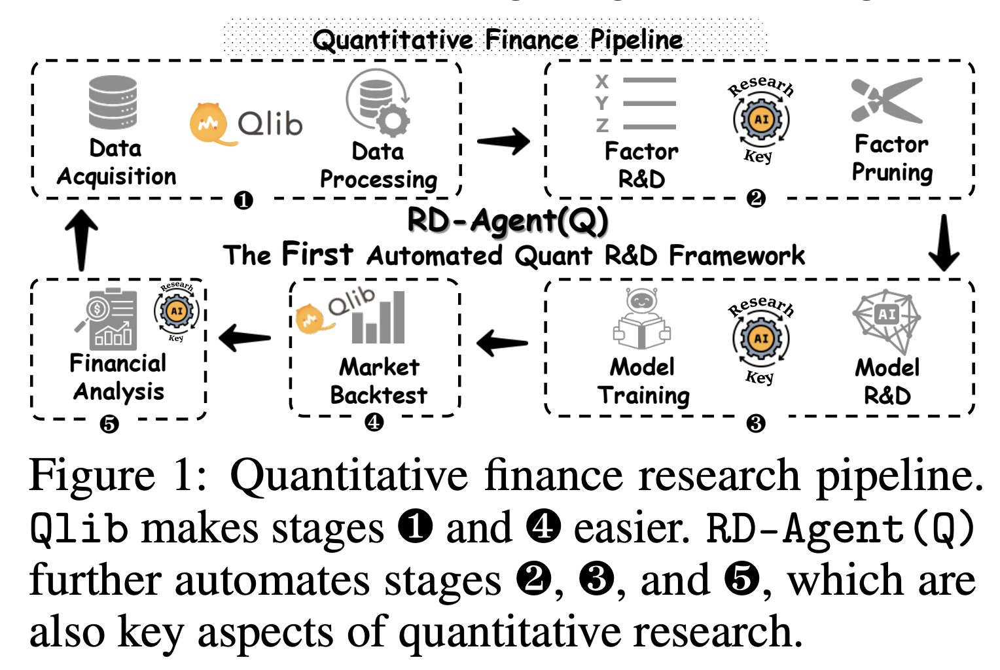
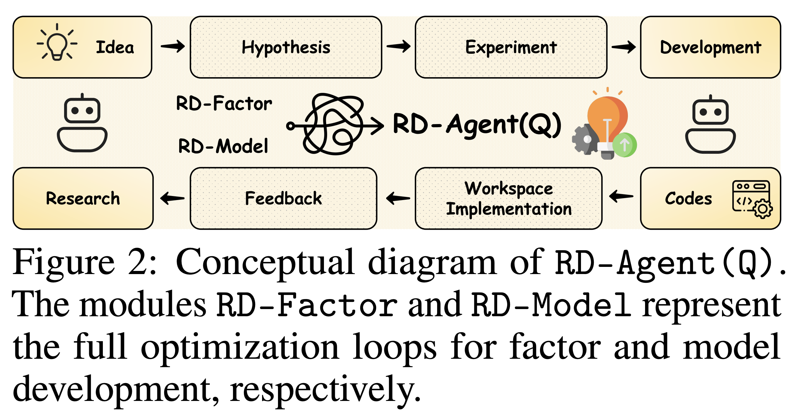
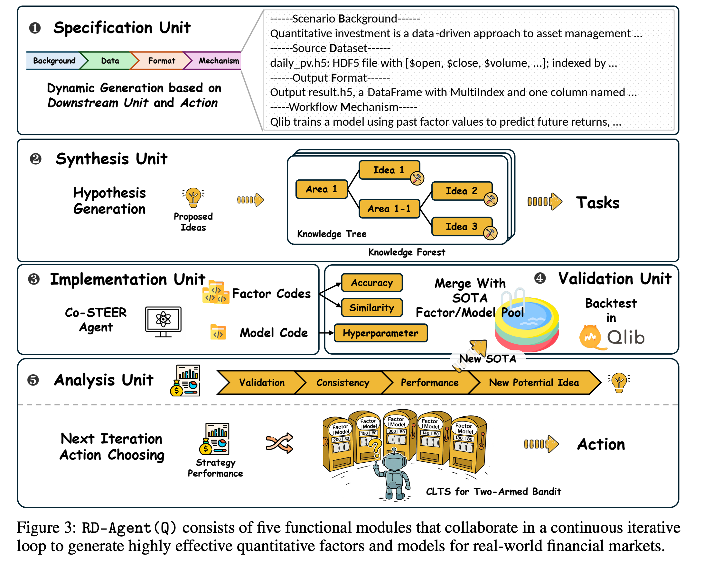
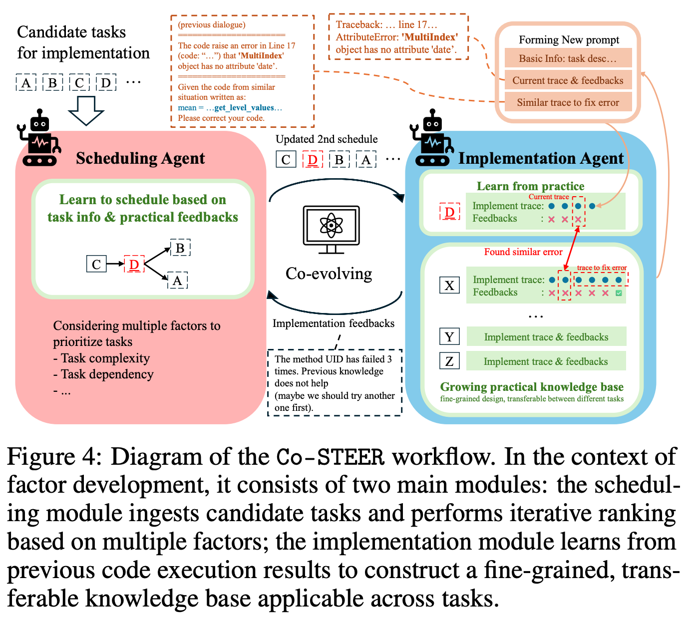
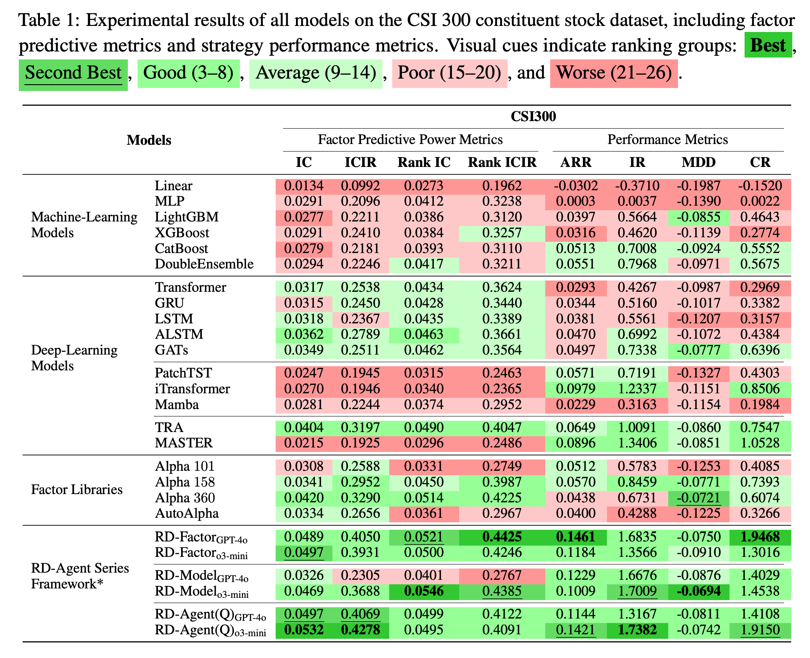
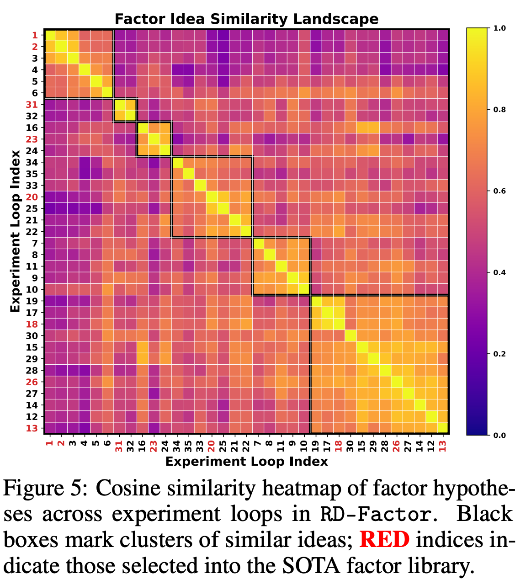
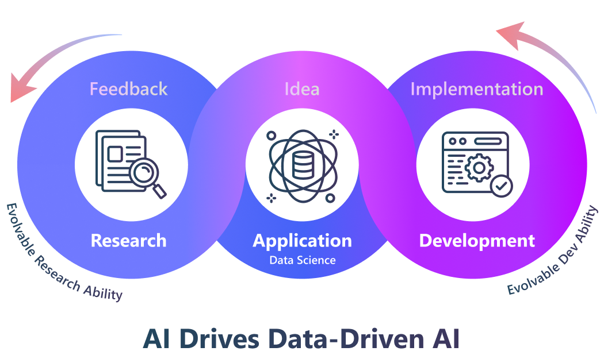
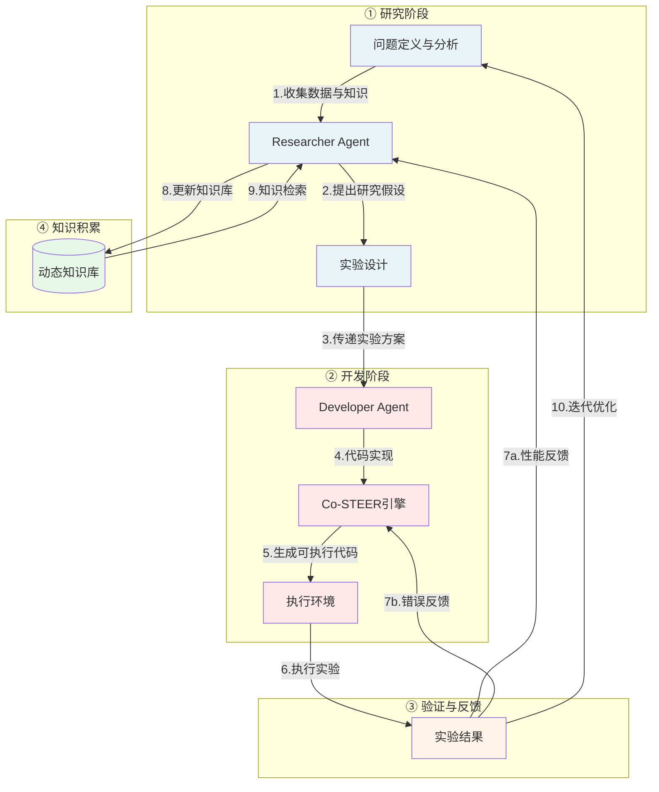
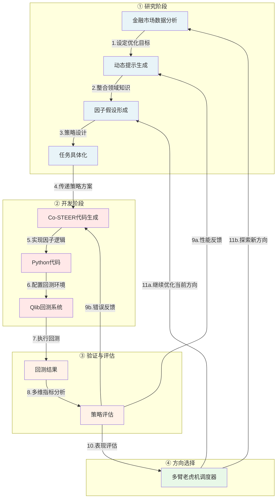

# R&D-Agent-Quant

## 量化金融研究的挑战与机遇

金融市场的复杂性和动态性给资产收益预测带来了巨大挑战。金融市场表现出高维度、非平稳性和持续波动性，其收益序列呈现出厚尾特征、时间变化的波动性以及复杂的横截面依赖性。这些特性使得资产价格同时受到宏观因子、微观结构信号和行为反馈的驱动，预测难度远超传统时间序列分析。

近年来，大语言模型（LLM）和多智能体系统的突破为量化金融研究带来了新的机遇。然而，当前的量化研究流程仍存在以下关键局限性：

1. 自动化程度有限：
    - 现有工作流程需要大量人工干预，包括假设生成、编码和调优，导致迭代缓慢且容易产生偏差。
    - 半自动化系统无法满足快速变化的市场对响应性和可扩展性的需求。
2. 可解释性差：
    - 基于 LLM 的智能体通常直接从语言交互中生成交易信号，缺乏基于因子构建的逻辑基础和透明的模型逻辑，容易产生幻觉。
    - 这种缺乏可解释性的特性阻碍了其在实际交易中的应用，因为在实际交易中，可解释性和风险控制至关重要。
3. 优化碎片化：
    - 量化流程涵盖数据处理、因子挖掘、模型训练和评估，但现有方法缺乏系统化的任务分解或智能体级别的协调。
    - 这种孤立的结构限制了跨阶段的反馈和整体性能提升。

为了应对这些挑战，本文提出了一种名为 R&D-Agent for Quantitative Finance，简称 RD-Agent(Q) 的全新数据驱动多智能体框架，旨在通过协调因子-模型协同优化，实现量化策略全栈研发流程的自动化。

两个阶段：

1. 研究阶段：dynamically sets goal-aligned prompts，根据领域先验提出假设，并将这些假设映射到具体的任务上，
2. 开发阶段，使用代码生成 agent Co-STEER 来实现特定任务的代码，然后在实际市场回测中执行。

两个阶段通过一个反馈阶段相连，该反馈阶段彻底评估实验结果，并为后续迭代提供信息，同时使用多臂 bandit 调度器进行适应性方向选择。

## RD-Agent(Q) 自动化、可解释性和效率的融合

RD-Agent(Q) 框架基于图示的现代量化研究流程构建，并进一步自动化了其中关键阶段 2、3 和 5。该框架将量化研究分解为五个紧密耦合的单元：规范单元（Specification）、综合单元（Synthesis）、实施单元（Implementation）、验证单元（Validation）和分析单元（Analysis）。这些单元在统一的输入-输出约束下，以闭环循环的方式运行，模拟了人类量化研究人员的试错过程。

与人工工作流程不同，RD-Agent(Q) 可以持续自主运行，支持因子和模型组件的动态协同优化。此外，每轮假设、实施和结果都持久存储，支持知识的持续积累和日益明智的决策。

### 规范单元：任务定义与约束

规范单元作为 RD-Agent 的顶层组件，负责为下游模块动态配置任务上下文和约束，确保设计、实施和评估的一致性。它沿着两个轴线运行：

- **理论轴 (Theoretical)：** 将先验假设、数据模式和输出协议编码为结构化规范。
- **经验轴 (Empirical)：** 建立可验证的执行环境和标准化的回测接口，使智能体免受低级预处理和基础设施问题的困扰。

通过将形式化定义与统一接口相结合，该模块减少了模糊性，提高了组件之间的协调效率。

### 综合单元：假设生成与任务分解

综合单元通过模拟人类推理，基于历史实验生成新的假设。每个优化动作被定义为 $a_t \in \{\text{factor}, \text{model}\}$。对于当前动作 $a_t$，该单元通过选择相关历史实验的子集来构建实验轨迹。基于此，历史假设和反馈集分别定义为 $h^t$ 和 $f^t$。然后提取出以动作为条件的子集，并将其传递给生成映射函数 $G$，以生成下一个假设 $h^{(t+1)} = G(\mathcal{H}^{(a)}_t , \mathcal{F}^{(a)}_t)$。

在实践中，该模块依赖于结构化模板和标准化格式来确保假设既可执行又具有科学依据。例如，在因子生成任务中，$h^{(t+1)}$ 不仅包含最新的反馈，还包含当前市场状况和特定领域的经济理论，确保因子的有效性和可观察性。为了促进多样性和渐进式改进，生成机制根据性能反馈调整其策略。如果 $\mathcal{F}^{(a)}$ 表明成功，下一个假设在复杂程度或范围上会增加；否则，它会进行结构性调整或引入新的变量，从而构成一个想法森林。这种自适应机制使智能体能够在保持对经验结果敏感的同时探索新方向，支持迭代有效的策略开发。

最后，将假设 $h^t$ 实例化为具体任务 ，供下游实施模块进行代码级实现。因子假设 $h^{\text{factor}}_t$ 由于其异质性和潜在的相互作用，可以分解为多个子任务 。相比之下，模型假设由于其结构一致性，被映射到负责执行整个建模和推理管道的单个任务 。

### 实施单元：代码生成与优化

实施单元负责将综合单元生成的可行任务转换为功能性代码。它构成了 RD-Agent(Q) 中复杂开发的核心。为了支持这一过程，我们设计了一个专门的智能体 Co-STEER，专为量化研究中的因子和模型开发而量身定制。

Co-STEER 通过集成系统调度和代码生成策略来确保实现的正确性、效率和适应性。在因子开发中，任务通常表现出结构依赖性。为了解决这个问题，我们引入了引导式链式思维机制，鼓励推理的可追溯性。具体来说，智能体构建了一个有向无环图 (DAG) $\mathcal{G}=(\mathcal{V},\mathcal{E})$ 来表示任务依赖性，其中从任务 A 到任务 B 的边意味着由于知识流或复杂性，A 应该先于 B。然后导出拓扑排序 $\mathcal{\pi}_S=(t_{(1)},\dots,t_{(n)})$ 以指导任务执行。调度是自适应的。前几次执行的反馈不断整合以改进规划：对任务的重复失败表明复杂性增加，从而优先考虑更简单的任务以增强知识积累和执行成功。

对于每个任务 $t_j$，实施智能体 $I$ 根据任务描述和当前知识库生成相应的代码 $c_j$，因此 $c_j=I(t_j, \mathcal{K})$。该过程包括任务解析、代码合成和完善、执行和验证。智能体的目标是最大化累积实施质量：$\pi_I=\arg \max_{\pi} \mathbb{E}[\sum^n_{j=1}R_I(c_j)]$，其中 $R_I(c_j)$ 评估代码 $c_j$ 的正确性和性能。知识库 $\mathcal{K}$ 起着核心作用，它记录了成功和失败的任务-代码-反馈三元组：$\mathcal{K}^{(t+1)}=\mathcal{K}^{(t)} \cup\left\{\left(t_j, c_j, f_j\right)\right\}$，其中 $f_j$ 表示执行任务 $t_j$ 后收到的反馈。通过知识转移机制，实施智能体还可以根据当前反馈 $f^{(t)}$ 从知识库中检索类似任务的解决方案，从而提高新任务代码生成的效率和成功率：$c_{\text {new }}=\arg \max _{c_k \in \mathcal{K}} \text{similarity}\left(t_{\text {new }}, t_k\right) \cdot c_k$。

这种反馈驱动的优化循环使实施单元能够不断提高代码质量和效率，促进量化研究组件的快速稳健开发。

### 验证单元：因子与模型评估

验证单元评估实施单元生成的因子或模型的实际有效性。

对于因子，首先应用去重过程，通过计算其与现有 SOTA 因子库的相关系数来过滤掉冗余信号。给定连接后的因子矩阵 $\mathbf{F}=\left[F_{\text {SOTA }}, F_{\text {new }}\right] \in \mathbb{R}^{T \times(M+N)}$，在所有 $M \times N$ 对 SOTA 和新因子之间计算每个时间片的 IC：

$$
\mathrm{IC}_{m, n}^{(t)}=\text{corr}\left(F_{\text {SOTA }, m}^{(t)}, F_{\text {new }, n}^{(t)}\right)
$$

其中 $(m, n)$ 是 SOTA-新因子对的索引，$t$ 是时间片的索引。然后将这些 IC 值在时间上取平均，对于每个新因子 $n$，其所有 SOTA 因子的最大 IC 获得为 $\mathrm{IC}_{\max }^{(n)}=\max _m \mathbb{E}_t\left[\mathrm{IC}_{m, n}^{(t)}\right]$。$\mathrm{IC}_{\text {max }}^{(n)} \geq 0.99$ 的新因子被视为冗余并被排除。在因子过滤之后，剩余的候选因子与当前的 SOTA 模型（或如果没有可用的基线模型）相结合，并通过 Qlib 回测平台进行评估。这允许在现实市场条件下评估性能。

对于模型，过程是对称的：每个候选模型都与当前的 SOTA 因子集配对，并通过相同的回测管道进行评估。

因此，验证单元提供了一个集成的自动化管道，支持在生产级市场模拟环境中对新组件进行标准化评估。

### 分析单元：实验评估与反馈生成

分析单元在 RD-Agent(Q) 框架内既充当研究评估员又充当策略分析师。在每一轮实验之后，它对当前假设 $h^t$、特定任务 $t^t$ 和实验结果 $r^t$ 进行多维度评估。如果实验被判定为在动作类型 $a_t$ 下优于 SOTA，则其结果被添加到相应的 SOTA 集 $\text{SOTA}(a_t)$ 中。然后，该单元诊断失败策略并生成针对特定弱点的改进建议。反馈 $f^t$ 被传递给综合单元，以指导未来假设的制定。

值得注意的是，分析单元对当前实验具有局部视角，而综合单元在整个实验历史上保持全局视角。它们的相互作用形成了一个闭环系统，在短期响应和长期探索之间取得平衡，支持研究设计、策略实施、验证和深度分析的自动化迭代。

在每次分析轮之后，分析单元进一步确定是优先考虑因子细化还是模型优化以进行下一次迭代。为了最大限度地提高性能提升，这个决策被制定为一个上下文两臂强盗问题，并通过线性汤普森采样来解决（详见附录 A.2 中的详细算法）。具体来说，在每一轮 $t$ 中，系统观察一个 8 维性能状态向量 $\mathbf{x}_t\in\mathbb{R}^8$，它编码了当前策略的关键评估指标。动作空间是 $\mathcal{A}=\{\text{factor},\text{model}\}$，对应于两个可能的优化路径。为了评估在上下文 $\mathbf{x}_t$ 下每个动作的预期收益，我们采用线性奖励函数 $r=\mathbf{w}^{\top} \mathbf{x}_t$，其中 $\mathbf{w}$ 反映了每个指标的相对重要性。每个动作都维护一个单独的贝叶斯线性模型，高斯后验编码了奖励系数的分布。在每个步骤中，系统从每个后验中采样一个奖励向量，并计算相应的预期奖励。执行具有最高采样奖励的动作。在观察到实际改进后，更新所选臂的后验。通过这种上下文汤普森采样机制，RD-Agent(Q) 自适应地平衡探索和利用，在迭代中实现稳健的性能提升。

## 实验设置与结果分析

### 数据集与基线模型

实验使用 CSI 300 数据集，该数据集涵盖了中国市场 300 只大盘 A 股股票，时间跨度分为训练期（2008 年 1 月 1 日至 2014 年 12 月 31 日）、验证期（2015 年 1 月 1 日至 2016 年 12 月 31 日）和测试期（2017 年 1 月 1 日至 2020 年 8 月 1 日）。RD-Agent(Q) 在三种配置下进行评估：

- RD-Factor：固定预测模型为 LightGBM，优化因子集，从 Alpha 20 开始。
- RD-Model：固定输入因子集为 Alpha 20，搜索更好的模型。
- RD-Agent(Q)：联合优化因子和模型组件。

基线模型包括机器学习模型（线性模型、MLP、LightGBM、XGBoost、CatBoost、DoubleEnsemble）、深度学习模型（GRU、LSTM、ALSTM、Transformer、PatchTST、iTransformer、Mamba、TRA、MASTER、GATs）和因子库（Alpha 101、Alpha 158、Alpha 360、AutoAlpha）。

### 评估指标

RD-Agent(Q) 的评估采用两类指标：

- 因子预测指标： 信息系数 (IC)、IC 信息比率 (ICIR)、排名 IC 和排名 ICIR。
- 策略性能指标：年化收益率 (ARR)、信息比率 (IR)、最大回撤 (MDD) 和 Calmar 比率 (CR)。

评估遵循基于预测收益排名的每日多空交易策略，并考虑了头寸更新、持仓保留规则和现实交易成本。

### 主要结果分析

实验结果表明，RD-Agent(Q) 在预测和策略指标上始终优于所有基线模型：

- **RD-Factor（因子优化）：** 当仅对因子空间进行自适应优化时，RD-FactorGPT-4o 和 RD-Factor o3-mini 超过了静态因子库（例如 Alpha 158/360），具有更高的 IC（高达 0.0497）和显著提高的 ARR（高达 14.61%），使用的手工因子更少。这表明 RD-Agent(Q) 中的动态假设细化和因子筛选产生了比固定的高维因子集更有信息的信号。
- **RD-Model（模型优化）：** 对于固定因子的模型优化，RD-Model o3-mini 超过了所有基线，并在排名 IC（0.0546）和 MDD（-6.94%）方面表现最佳。机器学习模型明显落后，这突出了它们在捕捉金融噪声和非线性模式方面的局限性。虽然通用深度学习架构（GRU、LSTM、Transformer）提供了适度的预测指标，但它们的策略性能仍然很弱，这表明特征提取与可操作的收益之间存在差距。令人惊讶的是，时间序列预测模型（例如 PatchTST、Mamba）在两个方面都表现不佳，这表明标准序列预测与股市动态之间存在根本上的不匹配。相比之下，专门的股票预测模型（TRA、MASTER）在策略指标上表现出色，但在预测能力上落后，这突出了稳健性（低 MDD，高 IR）和精确性（高 IC）之间的权衡。这些结果表明，自适应模型配置（由自动化假设评估指导）比 ML 和手工 DL 架构产生了更稳健和风险敏感的的预测结构。
- **RD-Agent(Q)（联合优化）：** 通过协同优化因子和模型，RD-Agent(Q)o3-mini 实现了最高的整体性能：IC 为 0.0532，ARR 为 14.21%，IR 为 1.74。这些改进远远超过了最强基线方法（例如 Alpha 158、TRA）。这表明因子的协同改进和架构能够释放互补的改进，从而实现可扩展且一致的 alpha 建模。

图 5 展示了三种探索模式：

1. 局部细化后方向转变：对角线块（如实验 1-6，7-11）表明 RD-Factor 在转变方向之前，在概念线程内进行多步细化，平衡深度与新颖性。 
2. 战略性重访：实验 26 与较早的实验 12-14 聚类，展示了智能体具有可以重访和逐步细化有希望的早期假设的能力。
3. 多种路径产生协同效应：36 个实验中有 8 个被选入最终的 SOTA 集，涵盖了 6 个集群中的 5 个。这表明探索多个方向会产生互补的信号，这些信号共同加强了最终因子库。

这种 refine-shift-reuse 模式支撑高效的深度搜索和广泛的概念覆盖，使构建紧凑、多样和高性能的因子库成为可能。

### 因子与模型效果分析

- **因子效果分析：** RD-Factor 生成的因子库与基线因子库进行比较，结果表明，即使从 Alpha 20 开始，RD-Factor 也很快实现了与 Alpha 158 和 Alpha 360 可比的 IC 水平，同时仅使用 22% 的因子。2017 年后，它始终优于 Alpha 20，并在 2019-2020 年基线性能下降时保持了稳定的 IC。当从 Alpha 158 开始时，RD-Factor 进一步改进，特别是使用 o3-mini，在 2020 年达到 IC > 0.07，超过了所有基线。这表明迭代因子细化有助于消除对环境敏感的或冗余的信号，提高了整体预测稳定性。
- **模型效果分析：** RD-Model 与基线深度学习模型在 ARR、MDD 和资源使用三个维度上进行了比较。两种 RD-Model 变体都明显向理想的上左区域移动。RD-ModelGPT-4o 实现了 ARR (12%) 和 |MDD| (8%)，达到了最高的收益-风险斜率。RD-Model -mini 在更严格的 risk 约束下提供了更低的回撤，ARR (11%)，在更严格的 risk 约束下表现出色。

# R&D-Agent

通过自主进化的 Agent 框架，实现从研究假设提出到代码实现的全流程自动化。

- 自主学习能力
- 闭环反馈机制：将实验结果反馈到研究假设，形成持续优化循环
- 多路径探索：并行尝试多种解决方案，大幅提高创新可能性
- 领域知识积累：随之使用不断积累专业知识，持续提升能力

## 双智能体协同架构

RD-Agent 框架

- 基于 LLM 的研究与开发自动化
- 双智能体协同工作机制（Researcher&Developer）
- 迭代探索与反馈学习
- 多迹探索与融合技术

Researcher Agent：提出创新思路、分析实验结果

- 处理性能反馈：从实验结果中提取关键洞察
- 提出研究假设：基于数据和历史经验生成创新想法
- 设计实验方案：规划验证假设的最佳路径
- 维护动态知识库：积累经验，不断优化决策能力

Developer Agent：实现研究假设、优化代码性能

- 代码生成与优化：将抽象想法转化为可执行代码
- 处理错误反馈：基于执行反馈优化实现修复错误方案
- 实验执行与验证：运行代码并收集关键指标
- 工程细节处理：确保解决方案在实际环境中可靠运行

Co-STEER 组件（Developer Agent 核心引擎）

- 协同知识学习
- 检索增强进化
- 任务调度与优化
- 领域知识积累

## 闭环协作机制

- Researcher 提出想法，Developer 负责实现
- 实验结果产生两种反馈：性能反馈（给 Researcher）和错误反馈（给 Developer）
- Researcher 基于性能反馈优化假设，Developer 基于错误反馈优化代码
- 新获取的知识不断被添加到知识库，用于指导未来决策

## 多迹探索

在复杂的研发任务中，单一的探索路径往往难以找到最优解。RD-Agent 创新性地引入了**多迹探索机制**（Multi-Trace Exploration），显著提升了发现突破性解决方案的可能性。

1. **并行启动多个探索迹**：每个迹配置不同的参数组合
2. **异构参数配置**：不同 Trace 可使用不同的：
    - LLM 模型（如 GPT-4、Claude、Llama 等）
    - 提示策略和模板
    - 工具集和 API 接口
    - 领域知识范围和先验信息
3. **Trace 之间信息共享**：探索 Trace 之间可共享：
    - 代码片段和实现思路
    - 错误日志和解决方案
    - 性能指标和评估结果
4. **解决方案融合**：最终将多个探索 Trace 的优势部分整合为更优的综合方案

### 用户可控的探索策略

RD-Agent 不仅提供强大的自动化能力，还赋予用户高度的控制权：

- **提前终止条件**：设定性能阈值、时间限制或步骤数量
- **信息共享范围**：控制 Trace 之间可共享的信息类型和频率
- **融合规则定制**：自定义组件兼容性规则和聚合函数

> 多迹探索就像同时派出多支研发队伍，各自采用不同方法攻克同一问题，然后汇总最佳成果。这大大提高了发现创新解决方案的概率，同时降低了陷入局部最优的风险。

## Co-STEER

RD-Agent 的另一个技术亮点是 **Co-STEER**（Collaborative Knowledge-STudying-Enhanced Evolution by Retrieval）组件，它是开发员智能体的核心引擎，专注于提升以数据为中心的开发效率。

Co-STEER 的四大核心机制

1. **协同知识学习**：
    - 持续积累领域知识和编程模式
    - 从实践经验中提炼最佳实践
    - 构建领域特定的代码知识库
2. **渐进式学习策略**：
    - 从简单任务入手，建立基础能力
    - 逐步提升任务复杂度，扩展技能范围
    - 在熟悉的基础上尝试创新
3. **反馈驱动优化**：
    - 分析执行错误，识别改进点
    - 持续优化代码质量和执行效率
    - 形成错误-修复-验证的快速迭代循环
4. **智能任务调度**：
    - 根据任务特性和历史经验，优化执行顺序
    - 合理分配资源，避免瓶颈
    - 预测潜在问题，提前规划解决方案

### 链式思维与图知识存储

在 RD-Agent(Q) 这一特定应用中，Co-STEER 采用了**链式思维推理**（Chain-of-Thought Reasoning）和**基于图的知识存储**（Graph-based Knowledge Store）技术，进一步提升了代码生成的质量和效率。

使得开发员智能体能够：

- 更系统地分解复杂问题
- 更清晰地表达推理过程
- 更高效地复用历史经验
- 更准确地处理错误和异常

## RD-Agent(Q)，实现了量化策略研发的全栈自动化

RD-Agent(Q) 在真实股票市场测试中取得的惊人成果：

- **成本效益极高**：不到 10 美元的成本，实现约 2 倍于基准因子库的年化回报率
- **极致简化**：使用的因子数量减少 70% 以上，大幅降低策略复杂度
- **超越 SOTA**：性能超越最先进的深度时间序列模型
- **双重优化**：通过因子-模型联合优化，平衡预测准确性和策略鲁棒性

这一应用展示了 RD-Agent 如何彻底改变金融研究范式，使普通投资者也能以极低成本获得专业级的量化交易策略。