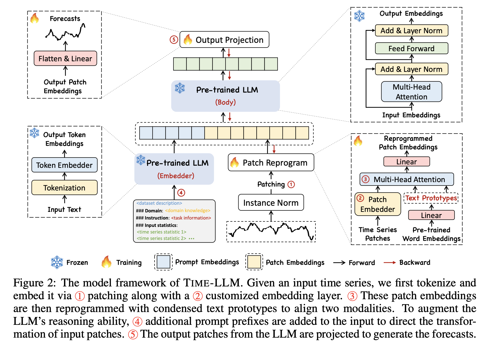
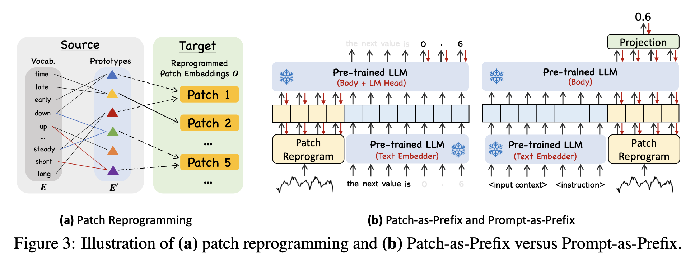
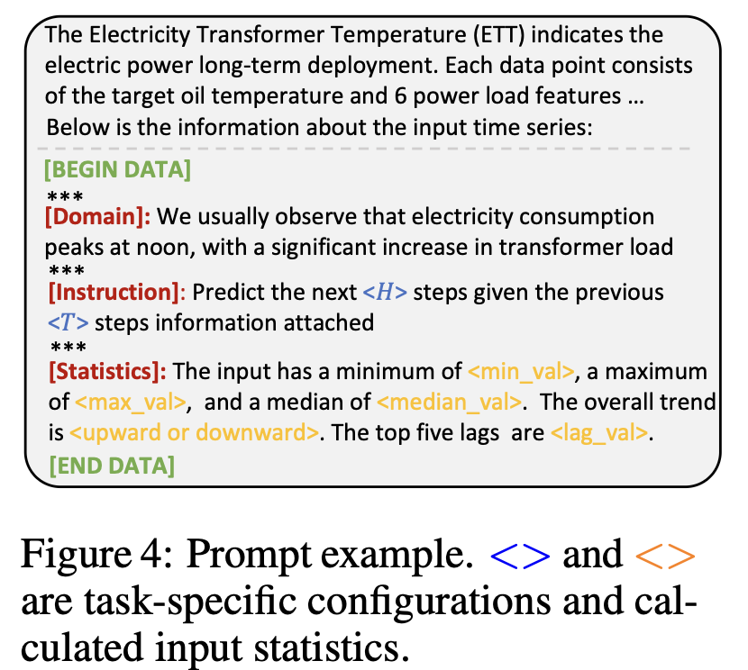
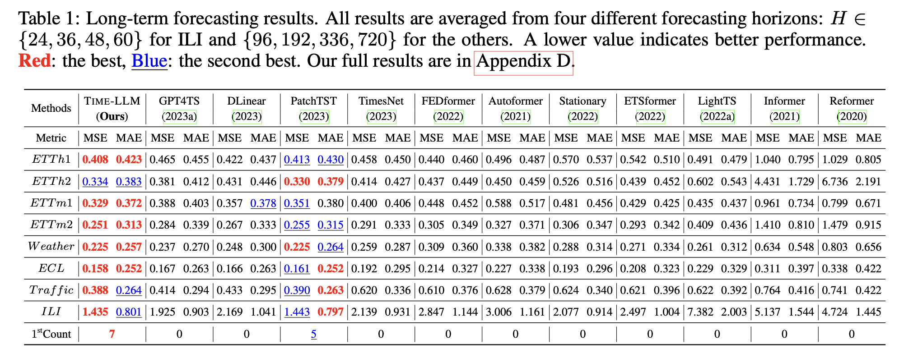
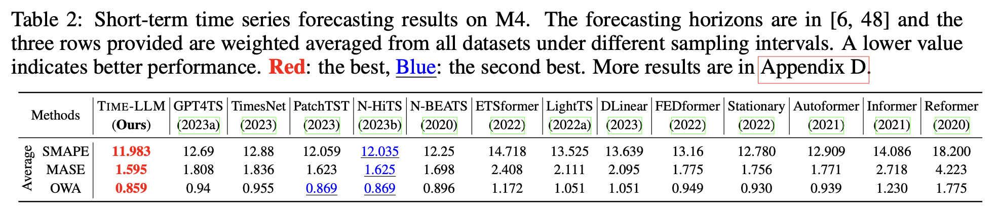
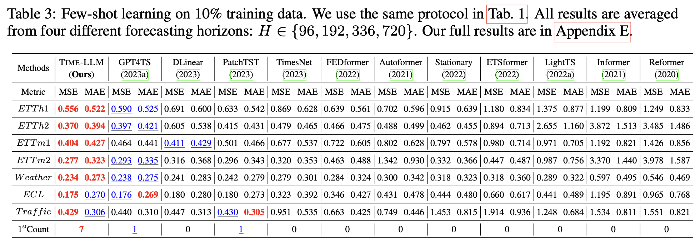

# Time-LLM

[2024 ICLR] Time Series Forecasting by Reprogramming Large Language Models

本文提出了一个 Time-LLM 的模型，它无需微调 LLM 中的任何层，只需要冻结 LLM，然后在其基础上用两个可学习的模块 Patch Reprogramming 和 Output Projection 对输入和输出分别进行特殊处理即可。这两个可学习的模块参数比较少，因此只需要在很少的样本上微调就行。

本文也是采用了通道独立的策略，即把多变量预测分解为多个独立的单变量预测。

## Framework

模型框架如图，主要分为如下几个部分：

### Input Embedding

如图序号 1 和序号 2 所示，时间序列先通过 RevIN 的归一化操作，然后分 patch 进行 embedding，得到 shape 为 $\mathbb R^{P\times d_m}$ 的时序输入特征 $\hat X_P$。

### Patch Reprogramming

由于时间序列和文本是有区别的，两者属于不同模态，表达语义的方式存在差异，LLM 肯定无法直接处理时序输入特征 $\hat X_P$，因此，需要将时序输入特征对齐到自然语言文本域上。

- **对齐不同模态的一个常用招数就是 cross-attention，只需要把所有词的 embedding 和时序输入特征做一个 cross-attention 就行了（其中时序输入特征为 Query，所有词的 embedding 为 Key 和 Value）**。
- 但是，词汇表很大，肯定无法直接将时序特征对齐到所有词上，而且也并不是所有词都和时间序列有对齐的语义关系，比如 apple 这个词完全就不需要。
- 为了应对这个问题，用一个简单的 Linear 层来抽取 text prototypes（语义原型），也就是直接把 $\mathbb R^{V\times D}$ 投影到 $\mathbb R^{V' \times D} （V' \ll V)$，相当于把 $V$ 个词降低到了 $V'$ 个 prototypes。然后时序输入特征只需要和这些 prototypes 对齐即可，具体的 cross-attention 的操作如上图序号 3 所示。

Patch Reprogramming 整体的概念如下图，比如时间序列的第 5 个 patch（Patch 5），它和绿色和紫色的原型的相关性比较大，而紫色的原型主要包含 up 和 short 这两个词的信息，绿色的原型主要包含 down 和 steady 这两个词的信息，所以第 5 个 patch 的时间序列可能包含短期上升趋势和稳定下降趋势。

  

### Prompt-as-Prefix

得到了与自然语言文本对齐后的时序特征（也就是 patch reprogramming 模块的输出）之后，接下来需要预测结果。

把时序特征作为前缀 prompt，和一句文本（比如 ”The next value is“）的特征拼接，送入到 LLM 中，即可预测得到下一个 value，但未来的 value 是数值而不是离散的文本，LLM 输出解码起来很麻烦（详情见 Large Language Models Are Zero-Shot Time Series Forecasters）。

因此，一个方法是，**如果把这个时间序列数据集的一些先验信息，以自然语言的方式，作为前缀 prompt，和对齐后的时序特征拼接喂给 LLM，就可以提升预测效果。**

具体实现方式如图所示，自然语言 prompt 的 embedding 向量（蓝色）和对齐后的时序特征（黄色）拼接后，送入到预训练好的 LLM 中，然后时序特征位置对应的那些输出特征展平之后用 output projection 模块（展平和投影的操作就是一个预测头）来预测得到未来的时间序列。  

其中，前缀 prompt 的例子可以是下面的样子：

这个 prompt 提供了时间序列的一些先验信息，比如它是关于什么的，有什么模式，这些都是人为可以提前给定的，而这些先验信息对时序预测是至关重要的。

## 实验

虽然 LLM 本身冻结，但额外加的模块（Patch Reprogramming 和 Output Projection）需要训练，如果使用全部的时序数据进行训练的话，效果对比如下，其实和专用时序模型 PatchTST 的效果差不多：

  

由于 Patch Reprogramming 和 Output Projection 参数较少，微调它们可以只用少量的时间序列样本，所以相当于是一个 few-shot 的解决方案。如果只用 10% 的时序数据进行训练的话，效果对比如下：

可见，Time-LLM 的优势在于更强的 few-shot 能力。

## 总结

时序特征 Reprogramming 具有一点可解释性，给出了时序和文本之间的对应关系。

自然语言文本作为 Prompt，这种引入先验的方式应该能适应到很多不同的场景中去，只需要把场景对应的时间序列特点给说明白，比如用电量预测场景下时间序列一般是以天为周期且晚上是高峰。

