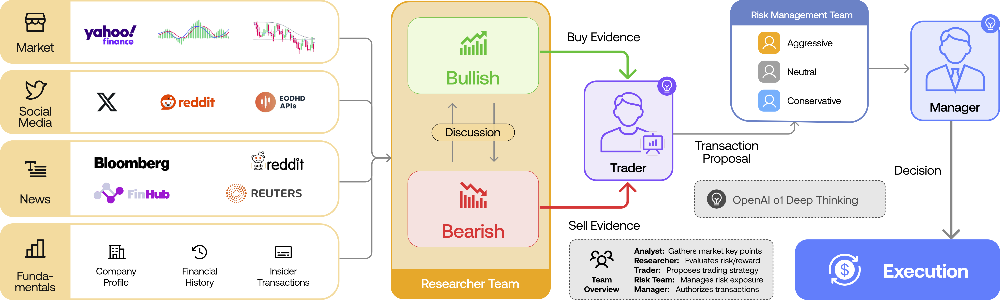
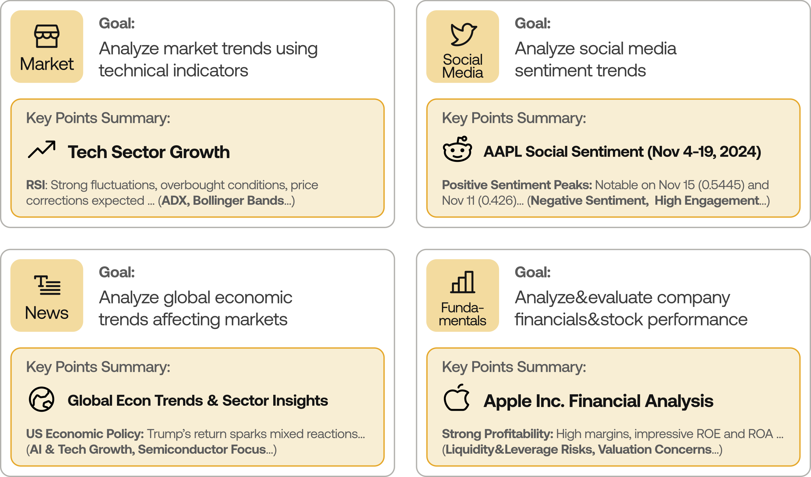
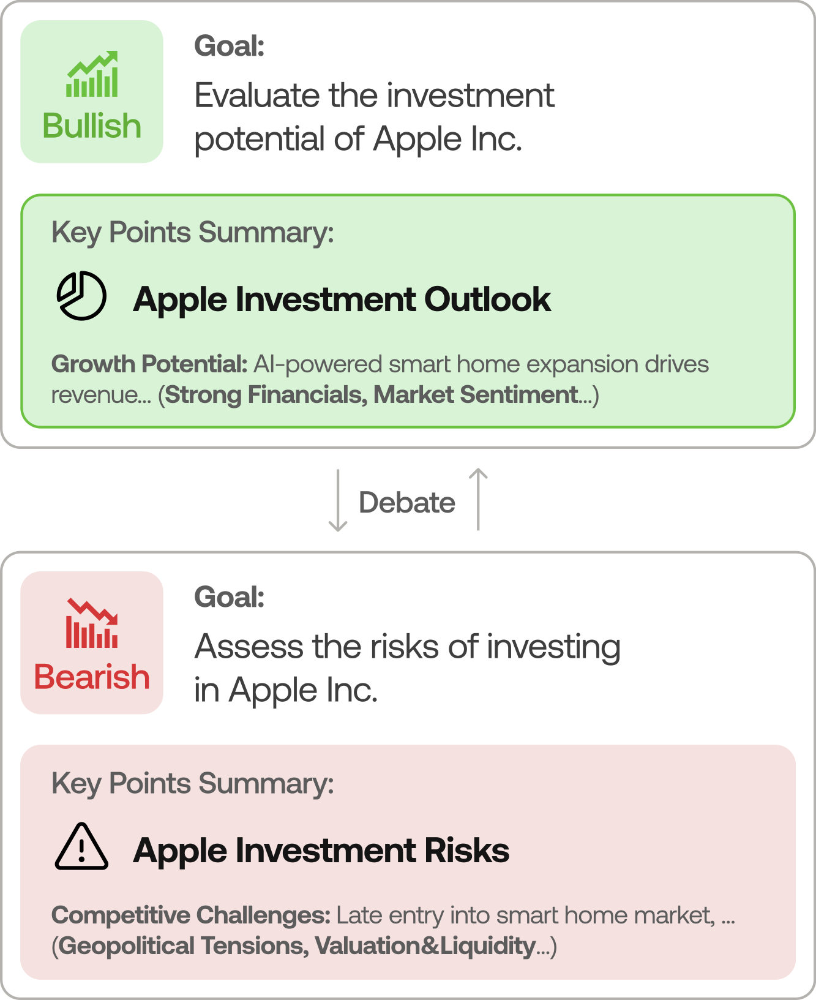
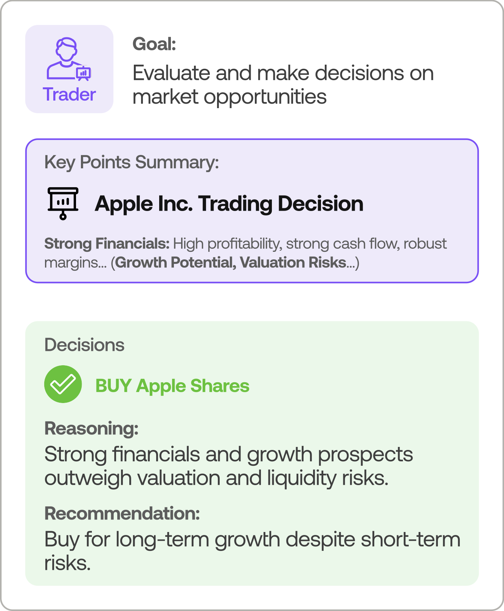
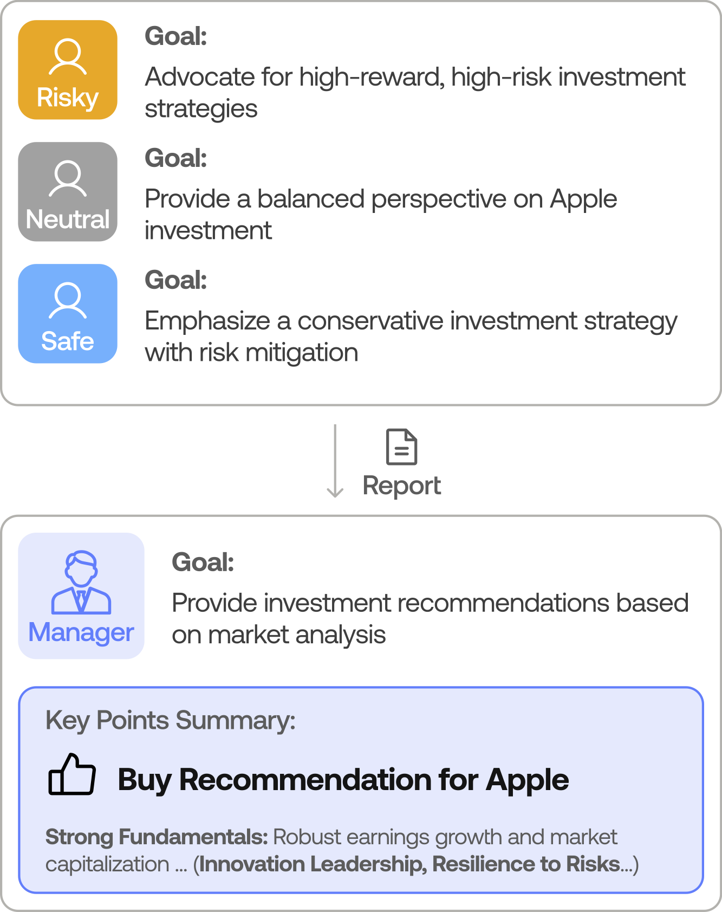
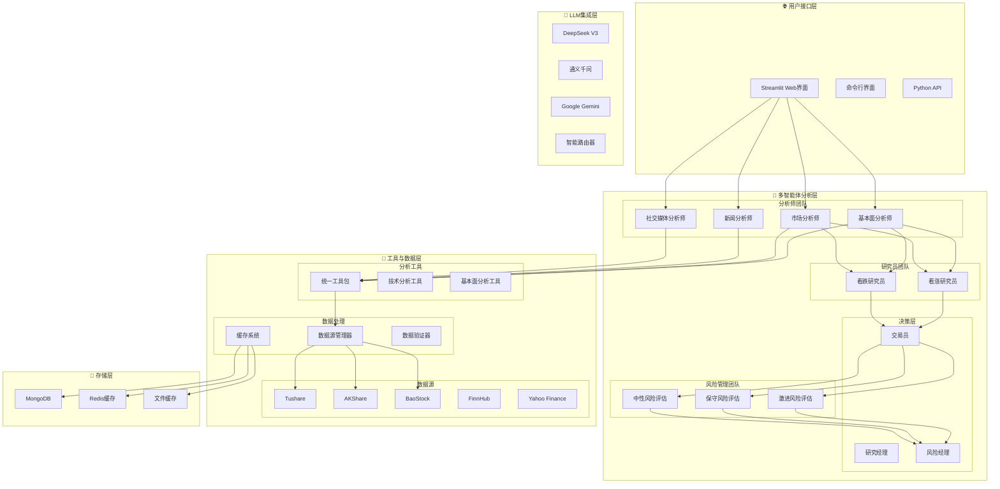
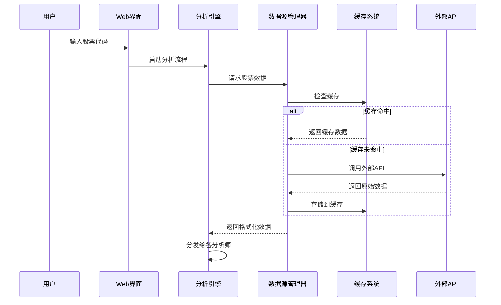
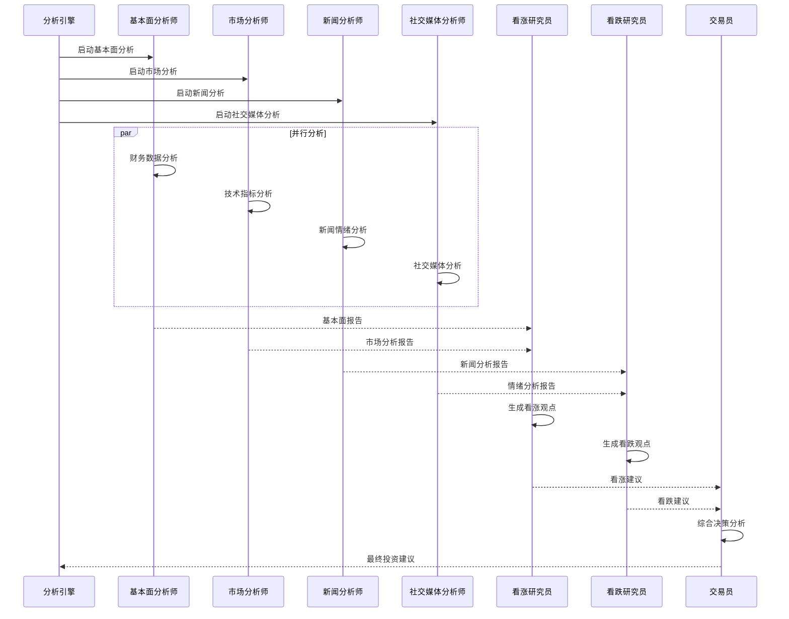
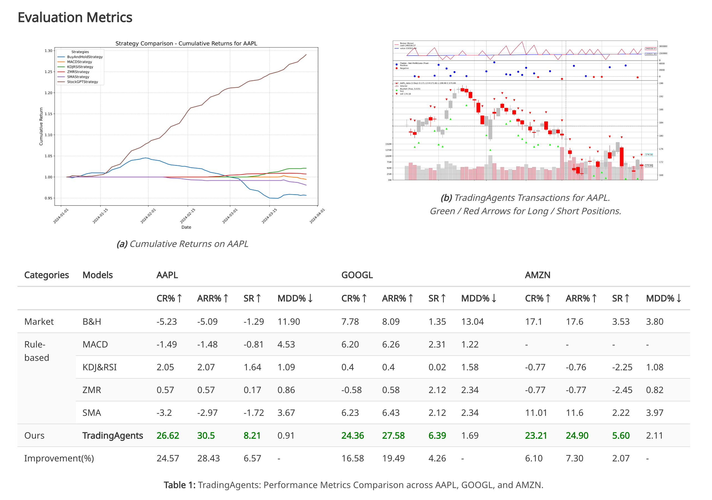

# TradingAgents

论文链接： [https:// arxiv.org/pdf/2412.2013 8 ](https://arxiv.org/pdf/2412.20138)

代码链接： https://TradingAgents

> 利用大语言模型（LLM）的智能体社区在自动化问题解决方面取得了显著进展。在金融领域，多智能体系统复制现实世界交易公司协作动态的潜力尚未得到充分挖掘。TradingAgents 提出了一种新颖的股票交易框架，包含不同角色的 LLM 智能体，如基本面分析师、情绪分析师、技术分析师和不同风险偏好的交易者等。还有评估市场状况的多空研究员智能体、风险管理团队等。该框架通过模拟动态协作的交易环境来提高交易绩效，实验表明其在累积回报、夏普比率和最大回撤等方面优于基线模型，显示了多智能体 LLM 框架在金融交易中的潜力。

## 背景

自主智能体借助 LLM 通过复制人类流程和工作流为决策提供了变革性方法。这些系统通过为语言智能体配备工具和实现与其他智能体的协作来增强问题解决能力。金融市场是一个受多种因素影响的复杂系统，传统算法交易系统难以完全捕捉各种因素的复杂相互作用，而 LLM 在处理和理解自然语言数据方面表现出色。尽管多智能体 LLM 框架在金融领域有进展，但当前语言智能体在金融和交易领域的应用存在局限，包括缺乏现实的组织建模和低效的通信接口。

- 缺乏现实组织建模：许多框架未能捕捉到模仿现实世界交易公司结构的这些代理之间复杂的相互作用，相反，它们往往专注于特定任务的性能，这些任务与组织工作流程和在交易中被证明有效的既定人类操作程序脱节。这限制了它们完全复制和从现实世界交易实践中受益的能力。
- 低效的通信接口：大多数现有系统主要使用自然语言作为通信媒介，通常依赖于消息历史或未结构化的信息池进行决策。这种方法往往会导致“电话效应”，即随着对话的延长，细节丢失，状态被篡改。代理在维护上下文和跟踪长时间的历史记录时，难以过滤掉之前决策步骤中的无关信息，从而降低了它们处理复杂、动态任务的有效性。此外，未结构化的信息池缺乏明确的指令，迫使逻辑通信和信息交换仅依赖于检索，但会破坏数据的关联完整性。

## 智能体角色定义

### 分析师团队（Analyst Team）

- **基本面分析师（Fundamental Analyst Agents）：** 通过分析财务报表、收益报告、内幕交易等数据评估公司基本面，判断股票是否被低估或高估，提供长期投资潜力的见解。
- **情绪分析师（Sentiment Analyst Agents）：** 处理大量社交媒体帖子、情绪分数和内幕情绪等信息，衡量市场情绪以预测短期股价受投资者集体行为的影响。
- **新闻分析师（News Analyst Agents）：** 分析新闻文章、政府公告和宏观经济指标，评估市场宏观经济状态、重大事件和公司变化，识别可能影响市场走势的新闻事件。
- **技术分析师（Technical Analyst Agents）：** 计算和选择相关技术指标（如 MACD、RSI 等），分析价格模式和交易量以预测未来价格走势，协助确定买卖时机。

### 研究员团队（Researcher Team）

- **多头研究员（Bullish Researchers）：** 强调积极指标、增长潜力和有利的市场条件，构建支持投资的论点。
- **空头研究员（Bearish Researchers）：** 关注潜在的风险、不利因素和市场信号，提供谨慎的见解并质疑投资策略的可行性。

### 交易员（Trader Agents）

根据分析师和研究员提供的综合分析评估建议和见解，决定交易的时机和规模以最大化交易回报，在市场上下达买卖订单，根据市场变化和新信息调整投资组合配置。

### 风险管理团队（Risk Management Team）

持续评估投资组合的风险状况，确保交易活动在预定风险参数内并符合监管要求，实施风险缓解策略并向交易者提供风险反馈和交易策略调整建议。

### 基金经理（Fund Manager）

审查风险管理团队的讨论结果，确定适当的风险调整并更新交易者的决策和报告状态。

### 智能体工作流通信协议（Agent Workflow Communication Protocol）

纯自然语言交流可能类似于传话游戏——经过多次迭代，初始信息可能会因为语境长度限制和大量文本的干扰而被遗忘或扭曲。与以往多智能体交易框架不同，TradingAgents 主要通过结构化文档和图表进行通信。

- 分析师将研究结果整理成特定领域的分析报告；
- 交易员审查分析师报告后生成决策信号并附带详细报告；
- 研究员查询全局状态形成观点并进行多轮自然语言对话辩论，辩论主持人选择主导观点并记录；
- 风险管理团队查询交易者决策报告后从不同风险视角进行多轮自然语言讨论调整交易计划；
- 基金经理审查风险管理团队讨论结果并更新交易者决策和报告状态。

### Backbone LLMs

根据任务的不同复杂度和速度要求选择 LLM。快速思考模型（如 gpt-4o-mini 和 gpt-4o）用于处理快速、低深度任务（如总结、数据检索等）；深度思考模型（如 o1-preview）用于推理密集型任务（如决策、撰写报告、数据分析等），同时还使用辅助专家模型进行特定任务（如情绪分析）。

所有分析师使用深度思考模型以确保稳健的分析，而快速思考模型则负责从 API 和工具中高效地检索数据。研究人员和交易员使用深度思考模型生成有价值的见解，并支持基于充分信息的决策。通过将所选 LLM 与每个任务的具体要求对齐，在效率和推理深度之间实现了平衡，这对于有效的交易策略至关重要。

### 1. 数据获取流程

### 2. 分析师协作流程

## 实验

### 数据集

- **历史股票价格：** 2024 年 1 月 1 日至 3 月 29 日期间多只股票（如苹果、英伟达、微软等）的开盘价、最高价、最低价、收盘价、成交量和调整后收盘价。
- **新闻文章：** 来自彭博、雅虎等不同来源的每日新闻更新，涵盖公司发展、全球事件、宏观经济趋势和政府动态。
- **社交媒体帖子和情绪：** 来自 Reddit、X/Twitter 等平台的帖子以及由辅助语言模型计算的帖子情绪分数。
- **内幕情绪和交易：** 来自公共信息（如 SEDI 交易和相关公司文件）的情绪。
- **财务报表和收益报告：** 公司提交的季度和年度报告。
- **公司概况和财务历史：** 第三方报告的公司概况、目标行业和财务历史。
- **技术指标：** 为每个资产计算的 60 个标准技术分析指标（如 MACD、RSI、布林带等）。

### 模拟设置

模拟 2024 年 6 月 19 日至 11 月 19 日的交易环境，TradingAgents 根据每日可用数据生成交易信号（买入、卖出或持有）并执行，之后计算分析指标再进行下一日数据处理。

### Baseline Models

- **买入并持有（Buy and Hold）：** 在所有选定股票中均等投资并在整个模拟期持有。
- **MACD（Moving Average Convergence Divergence）：** 基于 MACD 线和信号线交叉点生成买卖信号的趋势跟踪动量策略。
- **KDJ 和 RSI（Relative Strength Index）：** 结合 KDJ 和 RSI 指标识别超买和超卖条件以生成交易信号的动量策略。
- **ZMR（Zero Mean Reversion）：** 基于价格偏离和回归零参考线生成信号的均值回归交易策略。
- **SMA（Simple Moving Average）：** 基于短期和长期移动平均线交叉生成交易信号的趋势跟踪策略。

### 评估指标（Evaluation Metrics）

- **累积回报（Cumulative Return，CR）：**

$$
CR = \left( \frac{V_{end}-V_{start}}{V_{start}} \right) \times 100\%
$$

其中 $V_{end}$ 是模拟期末的投资组合价值， $V_{start}$ 是初始投资组合价值。

- **年化回报（Annualized Return，AR）：**

$$
AR = \left( \left( \frac{V_{end}}{V_{start}}\right)^{\frac{1}{N}} -1  \right) \times 100\%
$$

其中 $N$ 是模拟的年数。

- **夏普比率（Sharpe Ratio，SR）：**

$$
SR = \frac{\bar{R} - R_f}{\sigma}
$$

其中 $R$ 是平均投资组合回报， $R_f$ 是无风险利率（如 3 个月国债收益率），$\sigma$ 是投资组合回报的标准差。

- **最大回撤（Maximum Drawdown，MDD）：**

$$
MDD = \max\limits_{t\in [0, T]}\left(\frac{\text{Peak}_t - \text{Trough}_t}{\text{Peak}_t} \right) \times 100\%
$$

### 结果和分析

- **累积和年化回报：** TradingAgents 在三只抽样股票上的累积回报至少为 23.21%，年化回报至少为 24.90%，明显优于表现最佳的基线模型至少 6.1%。在 AAPL 股票测试中，传统方法表现不佳，而 TradingAgents 在不到三个月内回报超过 26%。
- **夏普比率：** TradingAgents 在 AAPL、GOOGL 和 AMZN 上的夏普比率至少为 5.60，显著优于所有基线模型至少 2.07，显示出其在平衡回报与风险方面的卓越能力。
- **最大回撤：** 尽管基于规则的基线模型在控制风险方面表现较好，但 TradingAgents 在保持相对较低最大回撤（不超过 2）的同时实现了较高回报，这得益于风险控制智能体之间的辩论机制。
- **可解释性：** 与当前深度学习交易方法相比，基于 LLM 的智能体框架以自然语言传达操作和决策，具有高度可解释性。例如，论文提供了 TradingAgents 一天的完整交易日志，展示了每个决策背后的详细推理、工具使用和思维过程。

## 结论

TradingAgents 是一个由 LLM Agent 驱动的股票交易框架，模拟了现实的交易公司环境，多个专门的智能体进行辩论和对话，利用 LLM 处理和分析多种数据源的能力，通过多智能体交互在行动前进行全面推理和辩论来提高交易决策的质量。与基线模型相比，TradingAgents 通过整合具有不同角色和风险概况的智能体、反思智能体和专门的风险管理团队，显著改善了交易结果和风险管理。实验表明其在累积回报、夏普比率等关键指标上优于传统交易策略和基线。未来工作将聚焦于在实时交易环境中部署该框架、扩展智能体角色以及纳入实时数据处理以进一步提高性能。

工具调用

- Market Analyst
    - get_YFin_data (Args: symbol: AAPL, curr_date: 2024-11-19)
    - get_stockstats_indicators_report (Args: symbol: AAPL, indicator: rsi/adx/macd/vwma/atr/supertrend/cci, curr_date: 2024-11-19)
- Social Media Analysts Team
    - get_reddit_stock_info (Args: query: Apple Inc, start_date: 2024-11-12, end_date: 2024-11-19)
    - get_EODHD_sentiment (Args: symbol: AAPL, curr_date: 2024-11-19)
- News Analyst Team
    - get_EODHD_news
    - get_finnhub_news
- Fundamentals Analyst Team
    - get_finnhub_company_profile
    - get_finnhub_company_financials_history
    - get_finnhub_basic_company_financials
    - get_finnhub_company_insider_sentiment
    - get_finnhub_company_insider_transactions